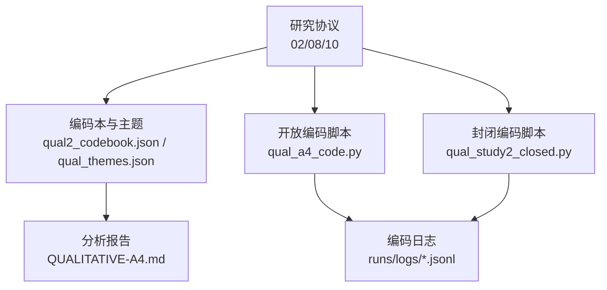
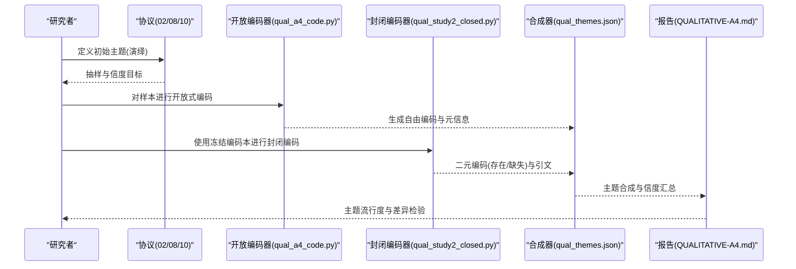
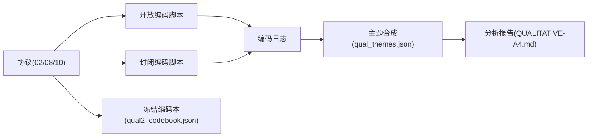

# 编码本开发

<cite>
**本文引用的文件**
- [DeeWaanAI-Next/protocols/02-QUALITATIVE-ANALYSIS-PROTOCOL.md](file://DeeWaanAI-Next/protocols/02-QUALITATIVE-ANALYSIS-PROTOCOL.md)
- [DeeWaanAI-Next/protocols/08-AMENDMENT-A4-INDUCTIVE-QUALITATIVE.md](file://DeeWaanAI-Next/protocols/08-AMENDMENT-A4-INDUCTIVE-QUALITATIVE.md)
- [DeeWaanAI-Next/protocols/10-PROTOCOL-STUDY2-QUAL.md](file://DeeWaanAI-Next/protocols/10-PROTOCOL-STUDY2-QUAL.md)
- [research/orchestration-economics/results/qual2_codebook.json](file://research/orchestration-economics/results/qual2_codebook.json)
- [research/orchestration-economics/results/QUALITATIVE-A4.md](file://research/orchestration-economics/results/QUALITATIVE-A4.md)
- [research/orchestration-economics/results/qual_themes.json](file://research/orchestration-economics/results/qual_themes.json)
- [research/orchestration-economics/code/qual_a4_code.py](file://research/orchestration-economics/code/qual_a4_code.py)
- [research/orchestration-economics/code/qual_study2_closed.py](file://research/orchestration-economics/code/qual_study2_closed.py)
</cite>

## 目录
1. [引言](#引言)
2. [项目结构](#项目结构)
3. [核心组件](#核心组件)
4. [架构总览](#架构总览)
5. [详细组件分析](#详细组件分析)
6. [依赖关系分析](#依赖关系分析)
7. [性能与可靠性考量](#性能与可靠性考量)
8. [故障排查指南](#故障排查指南)
9. [结论](#结论)
10. [附录：编码本模板与示例](#附录编码本模板与示例)

## 引言
本文件面向DeeWaanAI的编码本（Codebook）开发，目标是系统化地说明从“初始主题定义”到“迭代完善”，再到“编码指令设计”与“模板示例”的全过程。文档基于仓库中的研究协议、结果与代码实现，确保每一步都可追溯、可复现，并满足LLM编码器准确理解与应用编码规则的要求。

## 项目结构
围绕编码本开发与质性分析，仓库中关键位置如下：
- 研究协议层：规定编码本构建流程、抽样策略、信度目标与分析计划
- 结果层：冻结的编码本、主题合成与信度指标
- 代码层：开放编码与封闭编码的自动化执行脚本
- 数据层：样本抽取、原始转录文本与编码输出

**图表来源**
- [DeeWaanAI-Next/protocols/02-QUALITATIVE-ANALYSIS-PROTOCOL.md:1-133](file://DeeWaanAI-Next/protocols/02-QUALITATIVE-ANALYSIS-PROTOCOL.md#L1-L133)
- [DeeWaanAI-Next/protocols/08-AMENDMENT-A4-INDUCTIVE-QUALITATIVE.md:1-68](file://DeeWaanAI-Next/protocols/08-AMENDMENT-A4-INDUCTIVE-QUALITATIVE.md#L1-L68)
- [DeeWaanAI-Next/protocols/10-PROTOCOL-STUDY2-QUAL.md:1-74](file://DeeWaanAI-Next/protocols/10-PROTOCOL-STUDY2-QUAL.md#L1-L74)
- [research/orchestration-economics/results/qual2_codebook.json:1-85](file://research/orchestration-economics/results/qual2_codebook.json#L1-L85)
- [research/orchestration-economics/results/qual_themes.json:1-596](file://research/orchestration-economics/results/qual_themes.json#L1-L596)
- [research/orchestration-economics/code/qual_a4_code.py:1-195](file://research/orchestration-economics/code/qual_a4_code.py#L1-L195)
- [research/orchestration-economics/code/qual_study2_closed.py:100-116](file://research/orchestration-economics/code/qual_study2_closed.py#L100-L116)

**章节来源**
- [DeeWaanAI-Next/protocols/02-QUALITATIVE-ANALYSIS-PROTOCOL.md:1-133](file://DeeWaanAI-Next/protocols/02-QUALITATIVE-ANALYSIS-PROTOCOL.md#L1-L133)
- [DeeWaanAI-Next/protocols/08-AMENDMENT-A4-INDUCTIVE-QUALITATIVE.md:1-68](file://DeeWaanAI-Next/protocols/08-AMENDMENT-A4-INDUCTIVE-QUALITATIVE.md#L1-L68)
- [DeeWaanAI-Next/protocols/10-PROTOCOL-STUDY2-QUAL.md:1-74](file://DeeWaanAI-Next/protocols/10-PROTOCOL-STUDY2-QUAL.md#L1-L74)

## 核心组件
- 初始主题（演绎法）：基于研究问题预先设定4–6个主题，包括文化适应性、结构严谨性、角色一致性、分析深度、可操作性、创造性。
- 归纳式迭代：从10个样本输出中进行开放式编码，发现新主题并合并/删减，最终形成稳定编码本。
- 编码指令：为LLM编码器提供清晰、可重复的提示词，要求逐主题判断存在与否，并提供引文证据与置信度。
- 信度评估：采用双编码器（LLM vs LLM或LLM vs 人工），计算Cohen's κ，目标≥0.70；低于阈值则修订定义并重码。
- 分析与报告：按单元计算主题流行度，进行统计检验，选取代表性引文用于论文呈现。

**章节来源**
- [DeeWaanAI-Next/protocols/02-QUALITATIVE-ANALYSIS-PROTOCOL.md:11-39](file://DeeWaanAI-Next/protocols/02-QUALITATIVE-ANALYSIS-PROTOCOL.md#L11-L39)
- [DeeWaanAI-Next/protocols/02-QUALITATIVE-ANALYSIS-PROTOCOL.md:42-65](file://DeeWaanAI-Next/protocols/02-QUALITATIVE-ANALYSIS-PROTOCOL.md#L42-L65)
- [DeeWaanAI-Next/protocols/02-QUALITATIVE-ANALYSIS-PROTOCOL.md:67-98](file://DeeWaanAI-Next/protocols/02-QUALITATIVE-ANALYSIS-PROTOCOL.md#L67-L98)

## 架构总览
编码本开发遵循“演绎→归纳→验证”的闭环流程，结合协议约束与代码实现，确保可审计与可复现。

**图表来源**
- [DeeWaanAI-Next/protocols/02-QUALITATIVE-ANALYSIS-PROTOCOL.md:11-65](file://DeeWaanAI-Next/protocols/02-QUALITATIVE-ANALYSIS-PROTOCOL.md#L11-L65)
- [research/orchestration-economics/code/qual_a4_code.py:32-60](file://research/orchestration-economics/code/qual_a4_code.py#L32-L60)
- [research/orchestration-economics/code/qual_study2_closed.py:100-116](file://research/orchestration-economics/code/qual_study2_closed.py#L100-L116)
- [research/orchestration-economics/results/qual_themes.json:1-596](file://research/orchestration-economics/results/qual_themes.json#L1-L596)
- [research/orchestration-economics/results/QUALITATIVE-A4.md:1-102](file://research/orchestration-economics/results/QUALITATIVE-A4.md#L1-L102)

## 详细组件分析

### 初始主题定义（演绎法）
- 主题范围：文化适应性、结构严谨性、角色一致性、分析深度、可操作性、创造性。
- 指标说明：每个主题需明确“存在/缺失”的判断标准与示例指标，便于LLM一致应用。
- 目的：为后续归纳式迭代提供基线，并在A4.5作为二次验证通道。

**章节来源**
- [DeeWaanAI-Next/protocols/02-QUALITATIVE-ANALYSIS-PROTOCOL.md:11-23](file://DeeWaanAI-Next/protocols/02-QUALITATIVE-ANALYSIS-PROTOCOL.md#L11-L23)

### 归纳式主题发现与迭代（10样本）
- 采样：从5个实验单元各取2个输出，外加探索性样本，共10个。
- 过程：让LLM编码器先应用初始主题，再提出新主题；团队审查后增删合并，最终固化4–6个主题。
- 产出：稳定的编码本与清晰的示例指标，支撑后续大规模编码。

**章节来源**
- [DeeWaanAI-Next/protocols/02-QUALITATIVE-ANALYSIS-PROTOCOL.md:24-29](file://DeeWaanAI-Next/protocols/02-QUALITATIVE-ANALYSIS-PROTOCOL.md#L24-L29)

### 编码指令开发原则
- 角色设定：将LLM定位为“定性编码员”。
- 任务描述：逐项主题判断“存在/缺失”，若存在需提供原文引证。
- 不确定性处理：不确定时编码为“缺失”，避免主观臆断。
- 可重复性：固定提示词结构与字段，便于批量执行与解析。

**章节来源**
- [DeeWaanAI-Next/protocols/02-QUALITATIVE-ANALYSIS-PROTOCOL.md:31-39](file://DeeWaanAI-Next/protocols/02-QUALITATIVE-ANALYSIS-PROTOCOL.md#L31-L39)

### 编码流程与质量控制
- 抽样：分层抽样覆盖所有单元与问题，保证代表性。
- 主编码：使用前沿模型作为主编码器，输出主题存在性、引文与可选置信度。
- 信度检查：双编码器（LLM vs LLM或LLM vs 人工）计算Cohen's κ，目标≥0.70。
- 分歧解决：κ不达标则修订定义并重码；持续分歧引入第三方裁决。

**章节来源**
- [DeeWaanAI-Next/protocols/02-QUALITATIVE-ANALYSIS-PROTOCOL.md:42-65](file://DeeWaanAI-Next/protocols/02-QUALITATIVE-ANALYSIS-PROTOCOL.md#L42-L65)

### Study 2 质量分析（冻结样本与波次设计）
- 冻结样本：在编码前锁定样本与选择规则，避免事后挑选。
- 波次设计：Wave 1开放编码（盲态、无预设主题），Wave 2封闭编码（二元判断）。
- 信度门槛：沿用Protocol 02的κ≥0.70标准，未达标项降级为中等可靠性证据。

**章节来源**
- [DeeWaanAI-Next/protocols/10-PROTOCOL-STUDY2-QUAL.md:24-44](file://DeeWaanAI-Next/protocols/10-PROTOCOL-STUDY2-QUAL.md#L24-L44)

### 主题合成与结果（A4）
- 开放编码：两个独立编码器分别生成自由编码，语义收敛通过合成阶段评估。
- 合成：第三方模型将两份编码表合并为主题与子主题，记录分歧与理由。
- 信度：总体κ=0.774，部分主观风格类代码κ较低，相应结论降级为中等可靠性证据。

**章节来源**
- [research/orchestration-economics/results/QUALITATIVE-A4.md:15-43](file://research/orchestration-economics/results/QUALITATIVE-A4.md#L15-L43)
- [research/orchestration-economics/results/qual_themes.json:1-596](file://research/orchestration-economics/results/qual_themes.json#L1-L596)

### 代码级实现要点
- 开放编码提示词：禁止预设主题，要求从文本中涌现编码，附带定义与引文。
- 并发与重试：多线程并发调用，失败指数退避重试，保障完成度。
- 封闭编码：将冻结编码本注入提示词，逐文本执行二元编码。

**章节来源**
- [research/orchestration-economics/code/qual_a4_code.py:32-60](file://research/orchestration-economics/code/qual_a4_code.py#L32-L60)
- [research/orchestration-economics/code/qual_a4_code.py:117-159](file://research/orchestration-economics/code/qual_a4_code.py#L117-L159)
- [research/orchestration-economics/code/qual_study2_closed.py:100-116](file://research/orchestration-economics/code/qual_study2_closed.py#L100-L116)

## 依赖关系分析
编码本开发涉及协议、脚本与结果的强耦合关系：
- 协议驱动：决定抽样、信度目标与分析计划
- 脚本实现：将协议转化为可执行的编码流水线
- 结果沉淀：编码本、主题合成与信度指标作为可审计产物

**图表来源**
- [DeeWaanAI-Next/protocols/02-QUALITATIVE-ANALYSIS-PROTOCOL.md:1-133](file://DeeWaanAI-Next/protocols/02-QUALITATIVE-ANALYSIS-PROTOCOL.md#L1-L133)
- [DeeWaanAI-Next/protocols/08-AMENDMENT-A4-INDUCTIVE-QUALITATIVE.md:1-68](file://DeeWaanAI-Next/protocols/08-AMENDMENT-A4-INDUCTIVE-QUALITATIVE.md#L1-L68)
- [DeeWaanAI-Next/protocols/10-PROTOCOL-STUDY2-QUAL.md:1-74](file://DeeWaanAI-Next/protocols/10-PROTOCOL-STUDY2-QUAL.md#L1-L74)
- [research/orchestration-economics/results/qual2_codebook.json:1-85](file://research/orchestration-economics/results/qual2_codebook.json#L1-L85)
- [research/orchestration-economics/results/qual_themes.json:1-596](file://research/orchestration-economics/results/qual_themes.json#L1-L596)
- [research/orchestration-economics/results/QUALITATIVE-A4.md:1-102](file://research/orchestration-economics/results/QUALITATIVE-A4.md#L1-L102)

**章节来源**
- [DeeWaanAI-Next/protocols/02-QUALITATIVE-ANALYSIS-PROTOCOL.md:1-133](file://DeeWaanAI-Next/protocols/02-QUALITATIVE-ANALYSIS-PROTOCOL.md#L1-L133)
- [research/orchestration-economics/code/qual_a4_code.py:1-195](file://research/orchestration-economics/code/qual_a4_code.py#L1-L195)
- [research/orchestration-economics/code/qual_study2_closed.py:100-116](file://research/orchestration-economics/code/qual_study2_closed.py#L100-L116)

## 性能与可靠性考量
- 并发与吞吐：开放编码脚本按编码器家族设置并发信号量，提升整体吞吐。
- 容错与重试：网络异常与解析失败触发指数退避重试，提高完成度。
- 信度门槛：以κ≥0.70为合格线；低于阈值的主题需修订定义或降级结论可靠性。
- 预算控制：Study 2预注册限制API调用规模，避免过度消耗。

**章节来源**
- [research/orchestration-economics/code/qual_a4_code.py:117-159](file://research/orchestration-economics/code/qual_a4_code.py#L117-L159)
- [DeeWaanAI-Next/protocols/02-QUALITATIVE-ANALYSIS-PROTOCOL.md:56-65](file://DeeWaanAI-Next/protocols/02-QUALITATIVE-ANALYSIS-PROTOCOL.md#L56-L65)
- [DeeWaanAI-Next/protocols/10-PROTOCOL-STUDY2-QUAL.md:63-68](file://DeeWaanAI-Next/protocols/10-PROTOCOL-STUDY2-QUAL.md#L63-L68)

## 故障排查指南
- 解析失败：当LLM返回非JSON或截断时，脚本会尝试提取JSON片段；多次失败记录错误并继续。
- 低信度主题：若某主题κ<0.70，需回溯定义清晰度与示例指标，必要时重码或降级结论。
- 完成度不足：达到重试上限仍未完成的条目将被审计排除并披露，不得事后修补编码本。

**章节来源**
- [research/orchestration-economics/code/qual_a4_code.py:63-79](file://research/orchestration-economics/code/qual_a4_code.py#L63-L79)
- [research/orchestration-economics/code/qual_a4_code.py:117-159](file://research/orchestration-economics/code/qual_a4_code.py#L117-L159)
- [DeeWaanAI-Next/protocols/02-QUALITATIVE-ANALYSIS-PROTOCOL.md:62-65](file://DeeWaanAI-Next/protocols/02-QUALITATIVE-ANALYSIS-PROTOCOL.md#L62-L65)
- [DeeWaanAI-Next/protocols/10-PROTOCOL-STUDY2-QUAL.md:63-68](file://DeeWaanAI-Next/protocols/10-PROTOCOL-STUDY2-QUAL.md#L63-L68)

## 结论
本编码本开发流程以协议为先导，结合开放与封闭编码的双阶段设计，确保主题既源于数据又受控于研究问题。通过严格的信度门槛与透明的分歧处理，保证了结论的可信度与可复现性。冻结编码本与完整日志为后续扩展与审计提供了坚实基础。

## 附录：编码本模板与示例
以下为可直接使用的编码本模板与示例，涵盖主题定义、指标说明与编码标准。

- 主题定义模板
  - 主题名称：简明扼要
  - 定义：一句话说明该主题的核心含义与边界
  - 指标说明：列出可观察的文本特征（如引用、结构、语气等）
  - 编码标准：存在/缺失的判断依据与示例引文位置

- 示例主题（来自冻结编码本）
  - 诊断重构：将给定问题分解为子问题或挑战问题假设
  - 命名化概念：引入新的概念、分类或分析区分
  - 假设检验：质疑默认假设并提出替代解释或测试
  - 简洁格言：短小精悍、易记的规范性句子
  - 具体操作参数：决策SLA、预算上限、止损条件等
  - 文化本地化：针对目标区域的文化概念、术语或规范适配
  - 结构化报告：正式报告/备忘录框架（摘要、抬头、编号章节）
  - 外部权威引用：引用知名框架、作者或最佳实践
  - 分阶段时间线：带里程碑、闸门或go/no-go决策点的实施计划
  - 表格与矩阵：比较表、矩阵、审计清单或风险表
  - 量化目标：明确的数值目标或KPI阈值
  - 细粒度操作细节：周/日级实施颗粒度、角色与规模
  - 冗余/套话：可见重复或超出论证需要的填充内容

- 编码指令模板（供LLM编码器使用）
  - 角色：你是定性编码员
  - 任务：对以下输出逐项编码，判断主题是否存在（1/0）
  - 要求：若存在，提供简短原文引文；不确定时编码为缺失
  - 输出：结构化JSON，包含主题存在性、引文与可选置信度

- 信度与质量控制
  - 双编码器：LLM vs LLM或LLM vs 人工
  - 目标：Cohen's κ ≥ 0.70
  - 处理：低于阈值则修订定义并重码；持续分歧引入第三方裁决

**章节来源**
- [research/orchestration-economics/results/qual2_codebook.json:1-85](file://research/orchestration-economics/results/qual2_codebook.json#L1-L85)
- [DeeWaanAI-Next/protocols/02-QUALITATIVE-ANALYSIS-PROTOCOL.md:31-39](file://DeeWaanAI-Next/protocols/02-QUALITATIVE-ANALYSIS-PROTOCOL.md#L31-L39)
- [DeeWaanAI-Next/protocols/02-QUALITATIVE-ANALYSIS-PROTOCOL.md:56-65](file://DeeWaanAI-Next/protocols/02-QUALITATIVE-ANALYSIS-PROTOCOL.md#L56-L65)