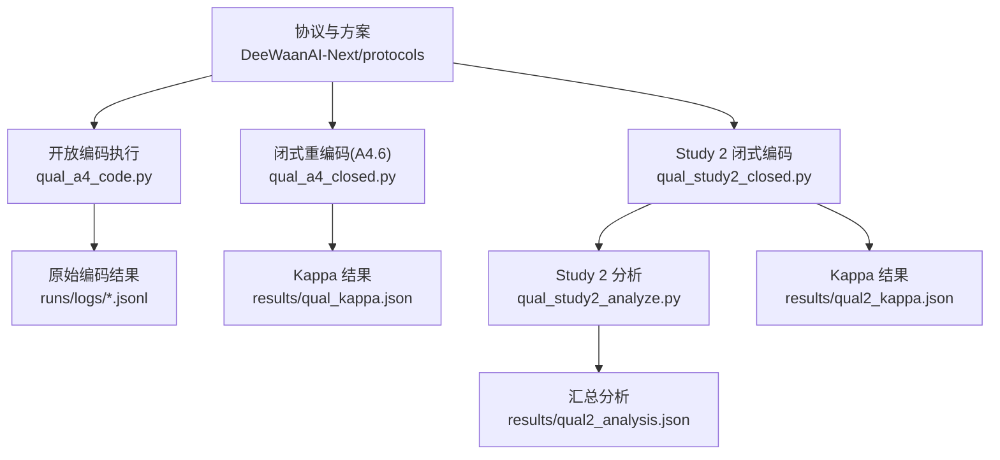
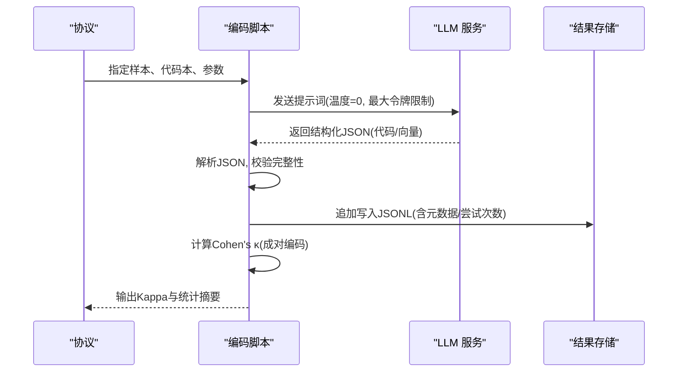
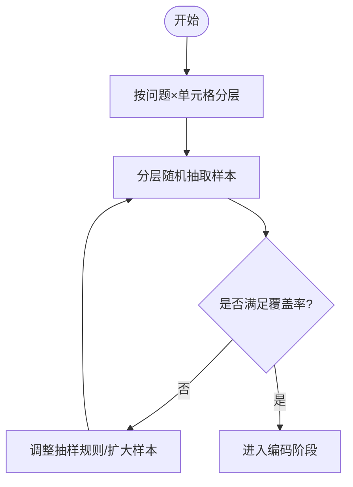
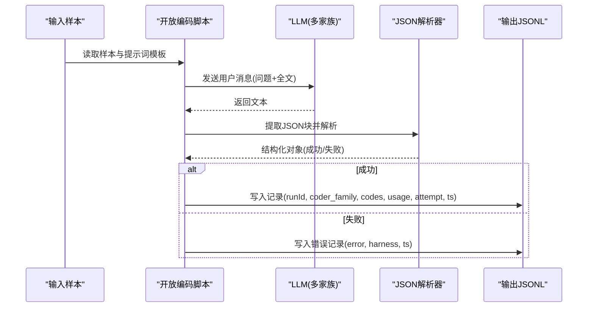
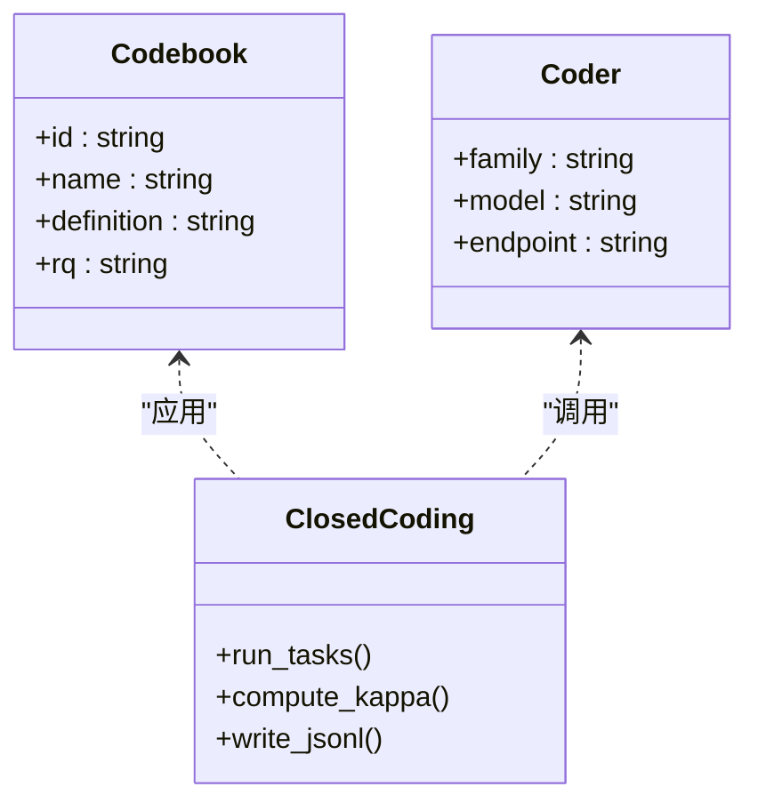
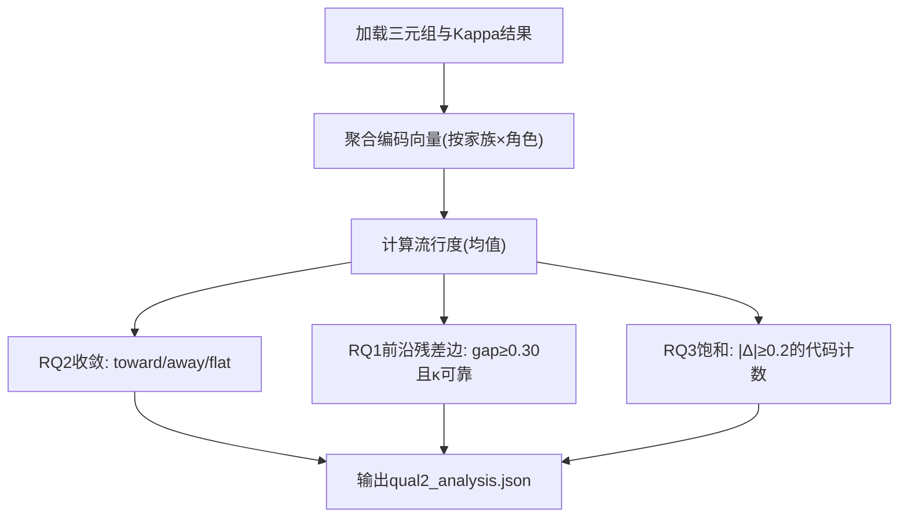
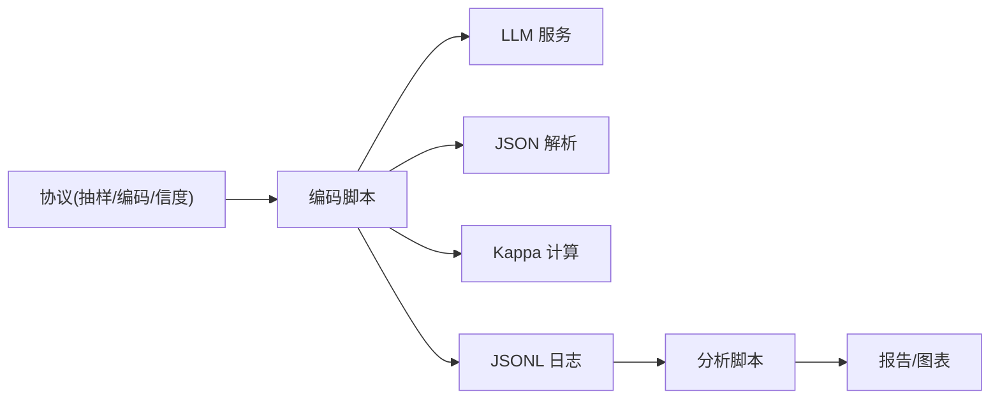

# 编码程序

<cite>
**本文引用的文件**
- [DeeWaanAI-Next/protocols/02-QUALITATIVE-ANALYSIS-PROTOCOL.md](file://DeeWaanAI-Next/protocols/02-QUALITATIVE-ANALYSIS-PROTOCOL.md)
- [research/orchestration-economics/code/qual_a4_code.py](file://research/orchestration-economics/code/qual_a4_code.py)
- [research/orchestration-economics/code/qual_a4_closed.py](file://research/orchestration-economics/code/qual_a4_closed.py)
- [research/orchestration-economics/code/qual_study2_closed.py](file://research/orchestration-economics/code/qual_study2_closed.py)
- [research/orchestration-economics/code/qual_study2_analyze.py](file://research/orchestration-economics/code/qual_study2_analyze.py)
- [DeeWaanAI-Next/protocols/10-PROTOCOL-STUDY2-QUAL.md](file://DeeWaanAI-Next/protocols/10-PROTOCOL-STUDY2-QUAL.md)
- [DeeWaanAI-Next/protocols/09-PROTOCOL-STUDY2-REFINER.md](file://DeeWaanAI-Next/protocols/09-PROTOCOL-STUDY2-REFINER.md)
- [research/orchestration-economics/results/QUALITATIVE-A4.md](file://research/orchestration-economics/results/QUALITATIVE-A4.md)
- [research/orchestration-economics/MANIFEST.md](file://research/orchestration-economics/MANIFEST.md)
</cite>

## 目录
1. [引言](#引言)
2. [项目结构](#项目结构)
3. [核心组件](#核心组件)
4. [架构总览](#架构总览)
5. [详细组件分析](#详细组件分析)
6. [依赖关系分析](#依赖关系分析)
7. [性能与可扩展性](#性能与可扩展性)
8. [故障排查指南](#故障排查指南)
9. [结论](#结论)
10. [附录](#附录)

## 引言
本文件为 DeeWaanAI 的“编码程序”提供系统化技术文档，聚焦以下目标：
- 输出样本选择策略：分层抽样方法与代表性保证。
- 主编码器执行流程：LLM 模型选择、提示词设计与输出格式规范。
- 信度检验实施方案：LLM vs LLM、LLM vs 人类两种可靠性检查。
- 分歧解决机制：重新编码、第三方仲裁等处理策略。
- 质量控制与最佳实践：盲评、冻结代码本、重试与审计排除、可复现记录。

## 项目结构
围绕编码程序的实现，仓库中关键位置如下：
- 协议与方案：DeeWaanAI-Next/protocols（研究方案、质量要求、Study 2 定性分析方案）。
- 编码执行脚本：research/orchestration-economics/code（A4 开放编码、A4.6 闭式重编码、Study 2 闭式编码与分析）。
- 结果与报告：research/orchestration-economics/results（Kappa 结果、分析报告）、MANIFEST（运行日志与决策记录）。

图表来源
- [DeeWaanAI-Next/protocols/02-QUALITATIVE-ANALYSIS-PROTOCOL.md:1-133](file://DeeWaanAI-Next/protocols/02-QUALITATIVE-ANALYSIS-PROTOCOL.md#L1-L133)
- [research/orchestration-economics/code/qual_a4_code.py:1-195](file://research/orchestration-economics/code/qual_a4_code.py#L1-L195)
- [research/orchestration-economics/code/qual_a4_closed.py:1-230](file://research/orchestration-economics/code/qual_a4_closed.py#L1-L230)
- [research/orchestration-economics/code/qual_study2_closed.py:1-193](file://research/orchestration-economics/code/qual_study2_closed.py#L1-L193)
- [research/orchestration-economics/code/qual_study2_analyze.py:1-113](file://research/orchestration-economics/code/qual_study2_analyze.py#L1-L113)

章节来源
- [DeeWaanAI-Next/protocols/02-QUALITATIVE-ANALYSIS-PROTOCOL.md:1-133](file://DeeWaanAI-Next/protocols/02-QUALITATIVE-ANALYSIS-PROTOCOL.md#L1-L133)
- [research/orchestration-economics/code/qual_a4_code.py:1-195](file://research/orchestration-economics/code/qual_a4_code.py#L1-L195)
- [research/orchestration-economics/code/qual_a4_closed.py:1-230](file://research/orchestration-economics/code/qual_a4_closed.py#L1-L230)
- [research/orchestration-economics/code/qual_study2_closed.py:1-193](file://research/orchestration-economics/code/qual_study2_closed.py#L1-L193)
- [research/orchestration-economics/code/qual_study2_analyze.py:1-113](file://research/orchestration-economics/code/qual_study2_analyze.py#L1-L113)

## 核心组件
- 样本选择与分层抽样：基于问题与单元格的分层，确保跨域与跨单元的代表性。
- 主编码器（开放编码）：无预设主题，从文本中涌现代码，双盲独立编码。
- 闭式重编码（信度检验）：冻结代码本，两位编码者独立判定存在/缺失，计算 Cohen's κ。
- Study 2 闭式编码与分析：三角色三元组（原始/精炼/前沿），收敛与饱和度量。
- 质量控制：温度=0、最大令牌限制、重试指数退避、审计排除、完整日志。

章节来源
- [DeeWaanAI-Next/protocols/02-QUALITATIVE-ANALYSIS-PROTOCOL.md:42-65](file://DeeWaanAI-Next/protocols/02-QUALITATIVE-ANALYSIS-PROTOCOL.md#L42-L65)
- [research/orchestration-economics/code/qual_a4_code.py:1-195](file://research/orchestration-economics/code/qual_a4_code.py#L1-L195)
- [research/orchestration-economics/code/qual_a4_closed.py:1-230](file://research/orchestration-economics/code/qual_a4_closed.py#L1-L230)
- [research/orchestration-economics/code/qual_study2_closed.py:1-193](file://research/orchestration-economics/code/qual_study2_closed.py#L1-L193)
- [research/orchestration-economics/code/qual_study2_analyze.py:1-113](file://research/orchestration-economics/code/qual_study2_analyze.py#L1-L113)

## 架构总览
编码程序由“协议驱动 + 脚本执行 + 结果归档”构成闭环。协议定义抽样、编码、信度与分歧处理；脚本负责并发调用 LLM、解析 JSON、写入日志并计算 Kappa；结果以 JSON/JSONL 形式归档，便于审计与复现。

图表来源
- [research/orchestration-economics/code/qual_a4_code.py:82-160](file://research/orchestration-economics/code/qual_a4_code.py#L82-L160)
- [research/orchestration-economics/code/qual_a4_closed.py:112-181](file://research/orchestration-economics/code/qual_a4_closed.py#L112-L181)
- [research/orchestration-economics/code/qual_study2_closed.py:83-184](file://research/orchestration-economics/code/qual_study2_closed.py#L83-L184)

## 详细组件分析

### 样本选择策略（分层抽样与代表性保证）
- 分层维度：按“问题 × 单元格”进行分层，确保每个组合均有覆盖。
- 样本规模：协议提出 110 或 176 输出的分层样本；Study 2 采用固定种子随机抽取 30 个三元组（每家族 10 个）。
- 代表性保障：通过分层与固定种子随机，避免结果导向的选择偏差，保证跨域与跨单元均衡。

章节来源
- [DeeWaanAI-Next/protocols/02-QUALITATIVE-ANALYSIS-PROTOCOL.md:42-45](file://DeeWaanAI-Next/protocols/02-QUALITATIVE-ANALYSIS-PROTOCOL.md#L42-L45)
- [DeeWaanAI-Next/protocols/10-PROTOCOL-STUDY2-QUAL.md:24-30](file://DeeWaanAI-Next/protocols/10-PROTOCOL-STUDY2-QUAL.md#L24-L30)
- [research/orchestration-economics/code/select_pilot_problems.py:41-70](file://research/orchestration-economics/code/select_pilot_problems.py#L41-L70)

### 主编码器执行流程（开放编码）
- 模型选择：使用两个不同家族的廉价模型作为独立编码者（如 deepseek、zhipu），温度=0，最大令牌限制。
- 提示词设计：无预设主题，要求从文本中涌现代码，包含名称、定义、引文、推理风格、结构与显著特征。
- 输出格式：严格 JSON，包含 codes、reasoning_style、structure_notes、notable。
- 执行细节：线程池并发、逐条写入 JSONL、失败重试（指数退避）、解析失败记录错误。

图表来源
- [research/orchestration-economics/code/qual_a4_code.py:32-60](file://research/orchestration-economics/code/qual_a4_code.py#L32-L60)
- [research/orchestration-economics/code/qual_a4_code.py:63-79](file://research/orchestration-economics/code/qual_a4_code.py#L63-L79)
- [research/orchestration-economics/code/qual_a4_code.py:117-160](file://research/orchestration-economics/code/qual_a4_code.py#L117-L160)

章节来源
- [research/orchestration-economics/code/qual_a4_code.py:1-195](file://research/orchestration-economics/code/qual_a4_code.py#L1-L195)

### 闭式重编码与信度检验（A4.6 与 Study 2）
- 代码本冻结：在 Wave 1 观察基础上冻结 12/13 项代码，明确定义与归属研究问题。
- 编码方式：两位编码者独立对全部文本进行存在/缺失判定，温度=0，盲评（不含标签/分数/家族信息）。
- 信度指标：逐项与总体 Cohen's κ，同时记录百分比一致率；阈值 0.70，低于阈值的项披露并降级证据等级。
- 结果输出：JSONL 记录每条编码与使用量，JSON 汇总 Kappa 与低阈值项。

图表来源
- [research/orchestration-economics/code/qual_a4_closed.py:27-70](file://research/orchestration-economics/code/qual_a4_closed.py#L27-L70)
- [research/orchestration-economics/code/qual_study2_closed.py:35-80](file://research/orchestration-economics/code/qual_study2_closed.py#L35-L80)

章节来源
- [research/orchestration-economics/code/qual_a4_closed.py:1-230](file://research/orchestration-economics/code/qual_a4_closed.py#L1-L230)
- [research/orchestration-economics/code/qual_study2_closed.py:1-193](file://research/orchestration-economics/code/qual_study2_closed.py#L1-L193)
- [research/orchestration-economics/results/QUALITATIVE-A4.md:25-43](file://research/orchestration-economics/results/QUALITATIVE-A4.md#L25-L43)
- [research/orchestration-economics/MANIFEST.md:365-374](file://research/orchestration-economics/MANIFEST.md#L365-L374)

### Study 2 闭式编码与分析
- 样本：30 个三元组（原始/精炼/前沿），每家族 10 个，固定种子随机。
- 编码：两位编码者对 90 段文本独立判定 13 项代码的存在/缺失。
- 分析：计算各家族的角色流行度、收敛（精炼向前沿靠近的比例）、前沿残差边（可靠代码中前沿-精炼≥0.30）、饱和（精炼相较原始变化≥0.2 的代码数）。

图表来源
- [research/orchestration-economics/code/qual_study2_analyze.py:19-112](file://research/orchestration-economics/code/qual_study2_analyze.py#L19-L112)

章节来源
- [research/orchestration-economics/code/qual_study2_analyze.py:1-113](file://research/orchestration-economics/code/qual_study2_analyze.py#L1-L113)
- [DeeWaanAI-Next/protocols/10-PROTOCOL-STUDY2-QUAL.md:24-61](file://DeeWaanAI-Next/protocols/10-PROTOCOL-STUDY2-QUAL.md#L24-L61)

### 分歧解决机制
- 若 κ < 0.70：回顾并澄清代码本定义，必要时重新编码。
- 若分歧持续：引入第三方编码者（LLM 或人类）进行裁决。
- 证据降级：依赖低 κ 项的结论降为中等可靠性证据，并在报告中披露。

章节来源
- [DeeWaanAI-Next/protocols/02-QUALITATIVE-ANALYSIS-PROTOCOL.md:56-65](file://DeeWaanAI-Next/protocols/02-QUALITATIVE-ANALYSIS-PROTOCOL.md#L56-L65)
- [research/orchestration-economics/results/QUALITATIVE-A4.md:32-41](file://research/orchestration-economics/results/QUALITATIVE-A4.md#L32-L41)

### 质量控制与最佳实践
- 盲评：提示词不包含单元格、家族或评分信息，避免偏见。
- 参数控制：温度=0，设置最大令牌限制，减少发散与截断风险。
- 重试与鲁棒性：指数退避重试，解析失败记录错误，未解析条目审计排除。
- 可复现性：固定种子、冻结代码本、完整 JSONL 日志与 MANIFEST 记录。
- 报告纪律：所有发现（包括低 κ 项）透明披露，不事后删除。

章节来源
- [research/orchestration-economics/code/qual_a4_code.py:117-160](file://research/orchestration-economics/code/qual_a4_code.py#L117-L160)
- [research/orchestration-economics/code/qual_a4_closed.py:144-181](file://research/orchestration-economics/code/qual_a4_closed.py#L144-L181)
- [research/orchestration-economics/code/qual_study2_closed.py:118-184](file://research/orchestration-economics/code/qual_study2_closed.py#L118-L184)
- [DeeWaanAI-Next/protocols/10-PROTOCOL-STUDY2-QUAL.md:63-73](file://DeeWaanAI-Next/protocols/10-PROTOCOL-STUDY2-QUAL.md#L63-L73)

## 依赖关系分析
- 协议到脚本：协议定义抽样、编码与信度要求；脚本实现具体执行。
- 脚本到外部服务：通过统一接口调用 LLM（带鉴权与限流），返回结构化响应。
- 脚本内部依赖：JSON 解析、并发控制、重试逻辑、Kappa 计算。
- 结果到报告：JSONL 与 JSON 结果被分析与可视化脚本消费，形成最终报告。

图表来源
- [research/orchestration-economics/code/qual_a4_code.py:82-160](file://research/orchestration-economics/code/qual_a4_code.py#L82-L160)
- [research/orchestration-economics/code/qual_study2_analyze.py:19-112](file://research/orchestration-economics/code/qual_study2_analyze.py#L19-L112)

章节来源
- [research/orchestration-economics/code/qual_a4_code.py:1-195](file://research/orchestration-economics/code/qual_a4_code.py#L1-L195)
- [research/orchestration-economics/code/qual_study2_analyze.py:1-113](file://research/orchestration-economics/code/qual_study2_analyze.py#L1-L113)

## 性能与可扩展性
- 并发模型：按编码者家族配置信号量与线程池，提升吞吐。
- 资源控制：最大令牌限制与温度=0 降低延迟与成本。
- 容错策略：指数退避重试，异常捕获与错误记录，避免单点失败阻塞整体。
- 扩展建议：增加编码者家族、并行度与重试上限需结合 API 配额与稳定性评估。

章节来源
- [research/orchestration-economics/code/qual_a4_code.py:113-160](file://research/orchestration-economics/code/qual_a4_code.py#L113-L160)
- [research/orchestration-economics/code/qual_a4_closed.py:140-181](file://research/orchestration-economics/code/qual_a4_closed.py#L140-L181)
- [research/orchestration-economics/code/qual_study2_closed.py:114-184](file://research/orchestration-economics/code/qual_study2_closed.py#L114-L184)

## 故障排查指南
- JSON 解析失败：检查提示词输出是否为纯 JSON，确认解析函数正确提取首尾括号并处理嵌套。
- 网络超时/错误：启用指数退避重试，记录错误信息与尝试次数，必要时调整超时与并发度。
- 编码不完整：确保返回向量长度等于代码本项数，否则视为失败并重试或审计排除。
- 低信度项：识别低于阈值的代码项，回溯定义清晰度与示例，必要时重新编码或引入第三方裁决。

章节来源
- [research/orchestration-economics/code/qual_a4_code.py:63-79](file://research/orchestration-economics/code/qual_a4_code.py#L63-L79)
- [research/orchestration-economics/code/qual_a4_code.py:117-160](file://research/orchestration-economics/code/qual_a4_code.py#L117-L160)
- [research/orchestration-economics/code/qual_a4_closed.py:144-181](file://research/orchestration-economics/code/qual_a4_closed.py#L144-L181)
- [research/orchestration-economics/code/qual_study2_closed.py:118-184](file://research/orchestration-economics/code/qual_study2_closed.py#L118-L184)

## 结论
本编码程序以协议驱动、脚本实现、结果归档的方式，构建了可复现、可审计的 LLM 编码流水线。通过分层抽样、冻结代码本、双盲编码与 Cohen's κ 信度检验，确保了编码质量与结论稳健性。Study 2 进一步将精炼答案与前沿答案进行对比分析，揭示收敛与饱和机制。建议在后续迭代中继续强化提示词工程、重试策略与并发优化，并保持严格的披露与降级原则。

## 附录
- 相关协议参考：
  - 自动定性分析协议（编码流程、信度与报告要求）
  - Study 2 定性分析协议（样本、方法、分析计划与预算）
  - Study 2 精炼阶段协议（约束与边界）
- 结果与记录：
  - A4.6 闭式重编码 Kappa 结果与说明
  - MANIFEST 中的运行与决策记录

章节来源
- [DeeWaanAI-Next/protocols/02-QUALITATIVE-ANALYSIS-PROTOCOL.md:1-133](file://DeeWaanAI-Next/protocols/02-QUALITATIVE-ANALYSIS-PROTOCOL.md#L1-L133)
- [DeeWaanAI-Next/protocols/10-PROTOCOL-STUDY2-QUAL.md:1-74](file://DeeWaanAI-Next/protocols/10-PROTOCOL-STUDY2-QUAL.md#L1-L74)
- [DeeWaanAI-Next/protocols/09-PROTOCOL-STUDY2-REFINER.md:1-135](file://DeeWaanAI-Next/protocols/09-PROTOCOL-STUDY2-REFINER.md#L1-L135)
- [research/orchestration-economics/results/QUALITATIVE-A4.md:25-43](file://research/orchestration-economics/results/QUALITATIVE-A4.md#L25-L43)
- [research/orchestration-economics/MANIFEST.md:365-374](file://research/orchestration-economics/MANIFEST.md#L365-L374)