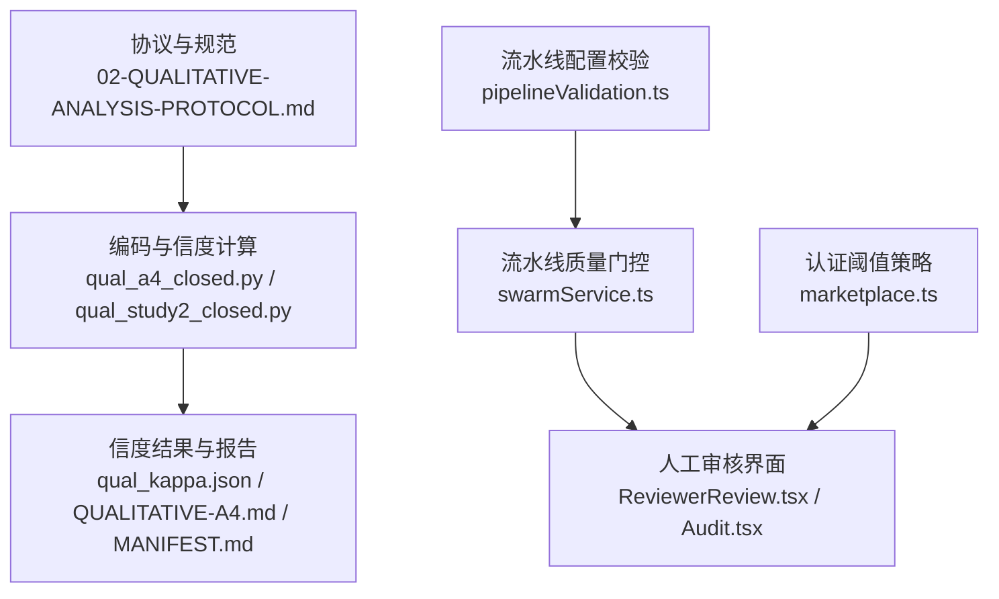
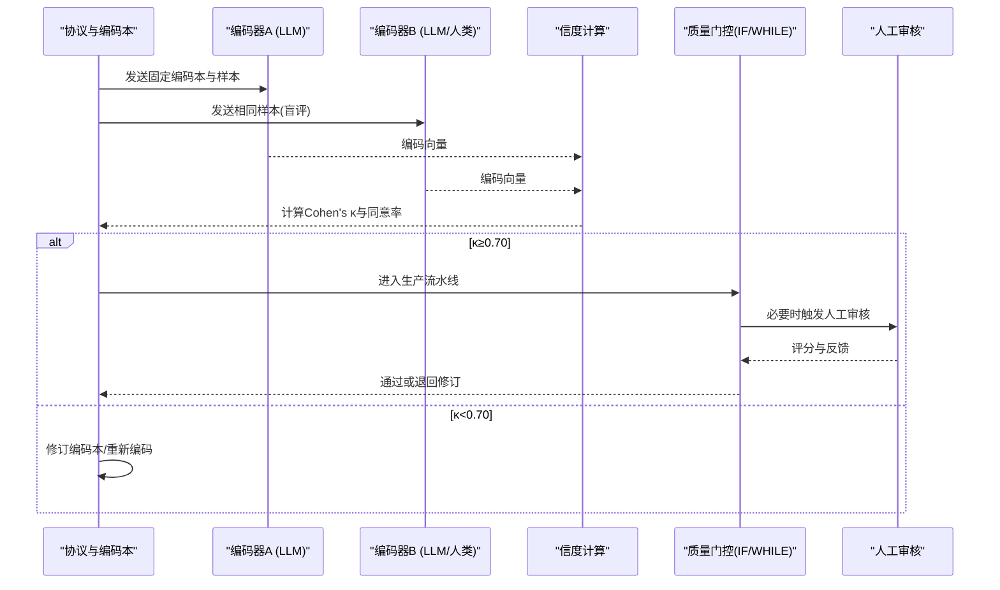
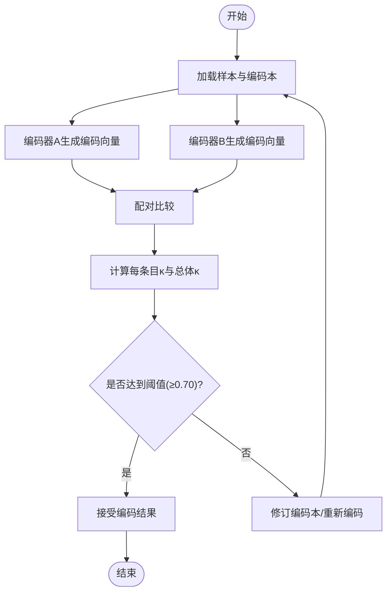
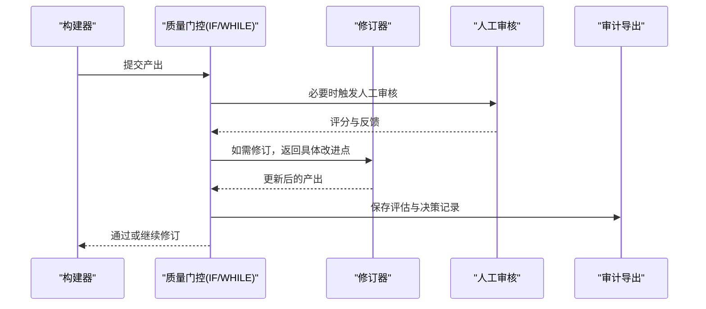
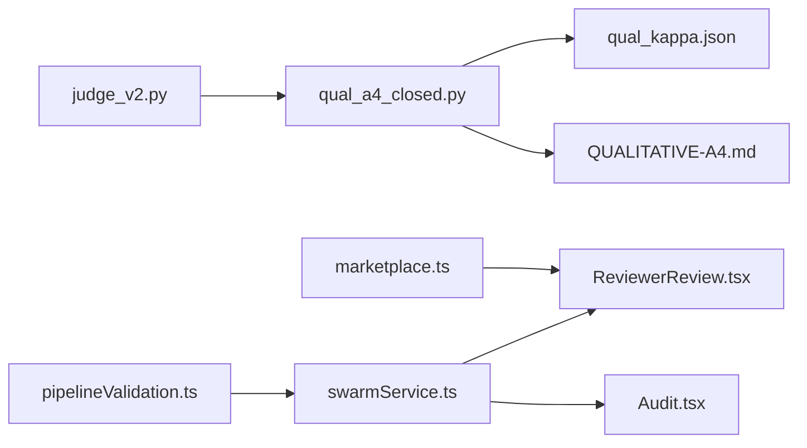

# 质量控制

<cite>
**本文引用的文件**
- [DeeWaanAI-Next/protocols/02-QUALITATIVE-ANALYSIS-PROTOCOL.md](file://DeeWaanAI-Next/protocols/02-QUALITATIVE-ANALYSIS-PROTOCOL.md)
- [research/orchestration-economics/code/qual_a4_closed.py](file://research/orchestration-economics/code/qual_a4_closed.py)
- [research/orchestration-economics/results/qual_kappa.json](file://research/orchestration-economics/results/qual_kappa.json)
- [research/orchestration-economics/MANIFEST.md](file://research/orchestration-economics/MANIFEST.md)
- [research/orchestration-economics/results/QUALITATIVE-A4.md](file://research/orchestration-economics/results/QUALITATIVE-A4.md)
- [research/orchestration-economics/code/qual_study2_closed.py](file://research/orchestration-economics/code/qual_study2_closed.py)
- [api/services/swarmService.ts](file://api/services/swarmService.ts)
- [src/pages/ReviewerReview.tsx](file://src/pages/ReviewerReview.tsx)
- [src/pages/Audit.tsx](file://src/pages/Audit.tsx)
- [api/mcp/tools/pipelineValidation.ts](file://api/mcp/tools/pipelineValidation.ts)
- [api/routers/marketplace.ts](file://api/routers/marketplace.ts)
</cite>

## 目录
1. [简介](#简介)
2. [项目结构](#项目结构)
3. [核心组件](#核心组件)
4. [架构总览](#架构总览)
5. [详细组件分析](#详细组件分析)
6. [依赖关系分析](#依赖关系分析)
7. [性能考量](#性能考量)
8. [故障排查指南](#故障排查指南)
9. [结论](#结论)
10. [附录](#附录)

## 简介
本文件面向DeeWaanAI的定性分析质量控制，聚焦信度检验标准、编码者间一致性评估方法、质量保障措施与工具技术。目标包括：
- 明确信度检验标准与可接受阈值（Cohen's κ ≥ 0.70）。
- 记录编码者间一致性的评估方法，覆盖LLM与LLM、LLM与人类编码者的对比分析。
- 说明质量保障流程：编码本验证、编码培训、定期检查与反馈机制。
- 提供质量控制工具与技术：自动化检查脚本、人工审核流程与争议解决程序。

## 项目结构
围绕“定性分析质量控制”的相关代码与文档分布在以下位置：
- 协议与规范：DeeWaanAI-Next/protocols/02-QUALITATIVE-ANALYSIS-PROTOCOL.md
- 编码与信度计算：research/orchestration-economics/code/qual_a4_closed.py、qual_study2_closed.py
- 结果与报告：research/orchestration-economics/results/qual_kappa.json、QUALITATIVE-A4.md、MANIFEST.md
- 流水线质量门控与人工审核：api/services/swarmService.ts、src/pages/ReviewerReview.tsx、src/pages/Audit.tsx
- 流水线配置校验：api/mcp/tools/pipelineValidation.ts
- 认证与阈值策略：api/routers/marketplace.ts

图表来源
- [DeeWaanAI-Next/protocols/02-QUALITATIVE-ANALYSIS-PROTOCOL.md:1-133](file://DeeWaanAI-Next/protocols/02-QUALITATIVE-ANALYSIS-PROTOCOL.md#L1-L133)
- [research/orchestration-economics/code/qual_a4_closed.py:1-230](file://research/orchestration-economics/code/qual_a4_closed.py#L1-L230)
- [research/orchestration-economics/results/qual_kappa.json:1-89](file://research/orchestration-economics/results/qual_kappa.json#L1-L89)
- [api/services/swarmService.ts:657-739](file://api/services/swarmService.ts#L657-L739)
- [src/pages/ReviewerReview.tsx:1-366](file://src/pages/ReviewerReview.tsx#L1-L366)
- [src/pages/Audit.tsx:1-563](file://src/pages/Audit.tsx#L1-L563)
- [api/mcp/tools/pipelineValidation.ts:54-83](file://api/mcp/tools/pipelineValidation.ts#L54-L83)
- [api/routers/marketplace.ts:517-543](file://api/routers/marketplace.ts#L517-L543)

章节来源
- [DeeWaanAI-Next/protocols/02-QUALITATIVE-ANALYSIS-PROTOCOL.md:1-133](file://DeeWaanAI-Next/protocols/02-QUALITATIVE-ANALYSIS-PROTOCOL.md#L1-L133)

## 核心组件
- 编码本与编码流程：在协议中定义主题、指标与编码指令；在脚本中冻结编码本并执行双盲编码。
- 信度计算：使用Cohen's κ对每条目及整体进行一致性评估，输出汇总与明细。
- 质量门控与人工审核：通过IF/WHILE步骤实现自动质量门控，结合人类评审界面进行复核与打分。
- 配置校验：对流水线步骤进行合法性校验，防止错误配置导致的质量风险。
- 认证阈值：以平均评分与通过率作为认证决策依据，同时保留κ作为诊断指标。

章节来源
- [DeeWaanAI-Next/protocols/02-QUALITATIVE-ANALYSIS-PROTOCOL.md:40-66](file://DeeWaanAI-Next/protocols/02-QUALITATIVE-ANALYSIS-PROTOCOL.md#L40-L66)
- [research/orchestration-economics/code/qual_a4_closed.py:112-220](file://research/orchestration-economics/code/qual_a4_closed.py#L112-L220)
- [api/services/swarmService.ts:657-739](file://api/services/swarmService.ts#L657-L739)
- [api/mcp/tools/pipelineValidation.ts:54-83](file://api/mcp/tools/pipelineValidation.ts#L54-L83)
- [api/routers/marketplace.ts:517-543](file://api/routers/marketplace.ts#L517-L543)

## 架构总览
下图展示从编码到信度评估再到质量门控与人工审核的整体流程。

图表来源
- [DeeWaanAI-Next/protocols/02-QUALITATIVE-ANALYSIS-PROTOCOL.md:40-66](file://DeeWaanAI-Next/protocols/02-QUALITATIVE-ANALYSIS-PROTOCOL.md#L40-L66)
- [research/orchestration-economics/code/qual_a4_closed.py:183-220](file://research/orchestration-economics/code/qual_a4_closed.py#L183-L220)
- [api/services/swarmService.ts:657-739](file://api/services/swarmService.ts#L657-L739)
- [src/pages/ReviewerReview.tsx:65-93](file://src/pages/ReviewerReview.tsx#L65-L93)

## 详细组件分析

### 编码者与信度计算（LLM vs LLM）
- 编码本冻结：在脚本中定义12项编码条目，包含名称、定义与研究问题映射，确保编码一致性。
- 并行编码：为不同编码器家族设置并发工作线程，提升效率。
- 结果输出：将每条编码结果写入日志文件，便于后续审计与复现。
- Cohen's κ计算：按条目与整体计算κ与百分比同意率，识别低于阈值的条目。

图表来源
- [research/orchestration-economics/code/qual_a4_closed.py:27-70](file://research/orchestration-economics/code/qual_a4_closed.py#L27-L70)
- [research/orchestration-economics/code/qual_a4_closed.py:112-220](file://research/orchestration-economics/code/qual_a4_closed.py#L112-L220)

章节来源
- [research/orchestration-economics/code/qual_a4_closed.py:27-70](file://research/orchestration-economics/code/qual_a4_closed.py#L27-L70)
- [research/orchestration-economics/code/qual_a4_closed.py:112-220](file://research/orchestration-economics/code/qual_a4_closed.py#L112-L220)
- [research/orchestration-economics/results/qual_kappa.json:1-89](file://research/orchestration-economics/results/qual_kappa.json#L1-L89)

### 编码者与信度计算（LLM vs 人类）
- 协议支持LLM与人类编码者对比：可选择人类编码者对子集进行编码，计算Cohen's κ。
- 盲评设计：编码提示不包含分组信息，保证评价客观性。
- 结果降级策略：对于主观风格类编码（如隐喻、协作框架），若κ低于阈值，则证据等级降级并在报告中披露。

章节来源
- [DeeWaanAI-Next/protocols/02-QUALITATIVE-ANALYSIS-PROTOCOL.md:56-66](file://DeeWaanAI-Next/protocols/02-QUALITATIVE-ANALYSIS-PROTOCOL.md#L56-L66)
- [research/orchestration-economics/results/QUALITATIVE-A4.md:25-43](file://research/orchestration-economics/results/QUALITATIVE-A4.md#L25-L43)
- [research/orchestration-economics/MANIFEST.md:365-374](file://research/orchestration-economics/MANIFEST.md#L365-L374)

### 质量门控与人工审核
- IF/WHILE步骤：在流水线中插入质量门控，根据评估结果决定继续或退回修订。
- 反馈循环：记录前次评估内容，指导改进；限制最大迭代次数，避免无限循环。
- 人工审核界面：提供多维度评分（准确性、完整性、清晰度等），支持查看中间步骤轨迹。
- 审计导出：管理员可导出JSON/CSV格式的审计账本，用于合规与追溯。

图表来源
- [api/services/swarmService.ts:657-739](file://api/services/swarmService.ts#L657-L739)
- [src/pages/ReviewerReview.tsx:65-93](file://src/pages/ReviewerReview.tsx#L65-L93)
- [src/pages/Audit.tsx:322-423](file://src/pages/Audit.tsx#L322-L423)

章节来源
- [api/services/swarmService.ts:657-739](file://api/services/swarmService.ts#L657-L739)
- [src/pages/ReviewerReview.tsx:1-366](file://src/pages/ReviewerReview.tsx#L1-L366)
- [src/pages/Audit.tsx:1-563](file://src/pages/Audit.tsx#L1-L563)

### 流水线配置校验
- 输入模式校验：限制步骤数量、控制流类型（IF/WHILE）的配置合法性。
- 安全约束：while循环的目标步骤必须指向自身或更早步骤，防止逻辑错误。
- 能力门控：某些高级步骤需要特定层级权限，防止越权使用。

章节来源
- [api/mcp/tools/pipelineValidation.ts:54-83](file://api/mcp/tools/pipelineValidation.ts#L54-L83)

### 认证阈值与策略
- 决策规则：以加权平均分与通过率作为认证门槛，保留κ作为诊断指标。
- 历史调整：由于高通过率下κ可能因流行度悖论而偏低，采用通过率作为更稳健的指标。

章节来源
- [api/routers/marketplace.ts:517-543](file://api/routers/marketplace.ts#L517-L543)

## 依赖关系分析
- 编码脚本依赖统一评测接口（judge_v2），用于调用不同模型家族进行编码。
- 信度结果与报告由脚本生成，供论文与内部审查使用。
- 质量门控与人工审核依赖于流水线执行上下文与数据库存储。
- 配置校验模块被流水线创建与更新流程调用，确保配置正确性。

图表来源
- [research/orchestration-economics/code/judge_v2.py:168-188](file://research/orchestration-economics/code/judge_v2.py#L168-L188)
- [research/orchestration-economics/code/qual_a4_closed.py:112-220](file://research/orchestration-economics/code/qual_a4_closed.py#L112-L220)
- [api/services/swarmService.ts:657-739](file://api/services/swarmService.ts#L657-L739)
- [src/pages/ReviewerReview.tsx:65-93](file://src/pages/ReviewerReview.tsx#L65-L93)
- [src/pages/Audit.tsx:322-423](file://src/pages/Audit.tsx#L322-L423)
- [api/mcp/tools/pipelineValidation.ts:54-83](file://api/mcp/tools/pipelineValidation.ts#L54-L83)
- [api/routers/marketplace.ts:517-543](file://api/routers/marketplace.ts#L517-L543)

章节来源
- [research/orchestration-economics/code/judge_v2.py:168-188](file://research/orchestration-economics/code/judge_v2.py#L168-L188)
- [api/services/swarmService.ts:657-739](file://api/services/swarmService.ts#L657-L739)

## 性能考量
- 并发编码：通过线程池与信号量控制每个编码器的并发度，平衡速度与稳定性。
- 重试机制：网络请求失败时指数退避重试，提高鲁棒性。
- 资源限制：限制while循环的最大迭代次数，避免长时间运行。
- 审计开销：导出功能需考虑数据量与签名计算成本。

[本节提供一般性指导，无需特定文件分析]

## 故障排查指南
- 编码解析失败：检查输出是否为有效JSON，必要时增加容错解析逻辑。
- 信度不达标：针对低κ条目，回顾编码定义与示例，必要时引入第三方仲裁。
- 流水线卡住：检查IF/WHILE配置是否正确，确认目标步骤与迭代上限。
- 人工审核延迟：确认评分维度是否完整，最小时间限制是否合理。
- 审计导出失败：验证权限与数据完整性，检查签名算法兼容性。

章节来源
- [research/orchestration-economics/code/qual_a4_closed.py:73-87](file://research/orchestration-economics/code/qual_a4_closed.py#L73-L87)
- [api/mcp/tools/pipelineValidation.ts:72-83](file://api/mcp/tools/pipelineValidation.ts#L72-L83)
- [src/pages/ReviewerReview.tsx:65-93](file://src/pages/ReviewerReview.tsx#L65-L93)
- [src/pages/Audit.tsx:322-423](file://src/pages/Audit.tsx#L322-L423)

## 结论
DeeWaanAI的定性分析质量控制体系以协议为基础，结合自动化编码与信度计算，辅以质量门控与人工审核，形成闭环管理。Cohen's κ作为核心指标，确保编码一致性达到可接受水平（≥0.70）。通过编码本冻结、并行编码、重试机制与配置校验，系统在效率与可靠性之间取得平衡。未来可进一步扩展人类编码者参与规模，增强跨文化场景下的信度稳健性。

[本节总结性内容，无需特定文件分析]

## 附录
- 关键术语：
  - Cohen's κ：衡量编码者间一致性的统计指标，取值范围[-1,1]，≥0.70通常视为可接受。
  - 编码本：定义编码条目及其判断标准的文档，确保编码一致性。
  - 质量门控：基于规则或评估结果的流程控制节点，决定继续或退回。
- 参考结果：
  - 总体κ=0.774，同意率89.8%，部分条目低于阈值，已披露并降级证据等级。

[本节提供补充信息，无需特定文件分析]