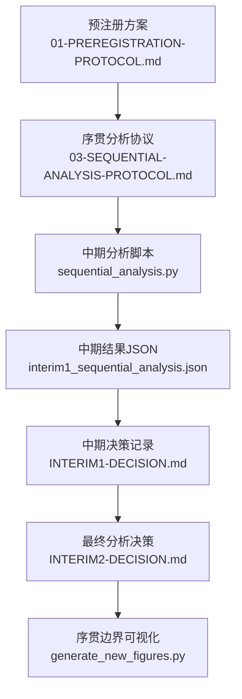
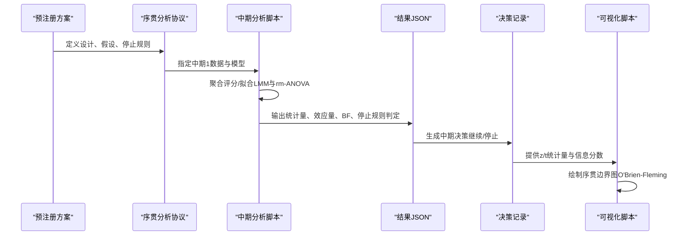
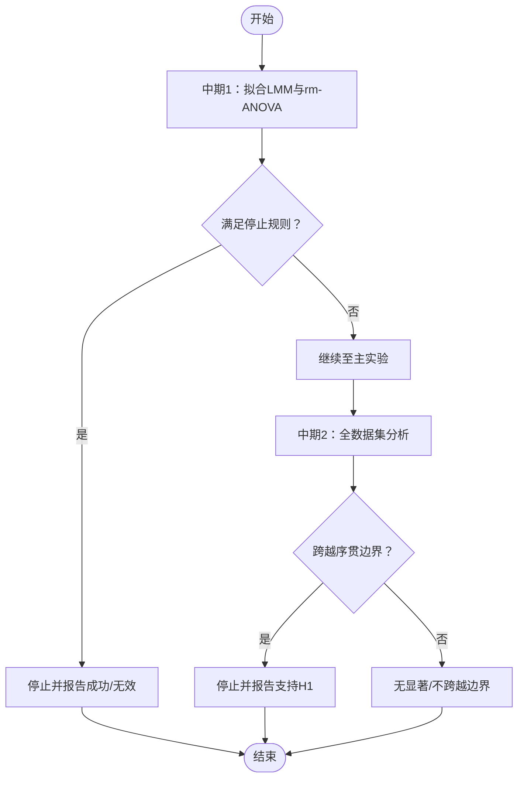
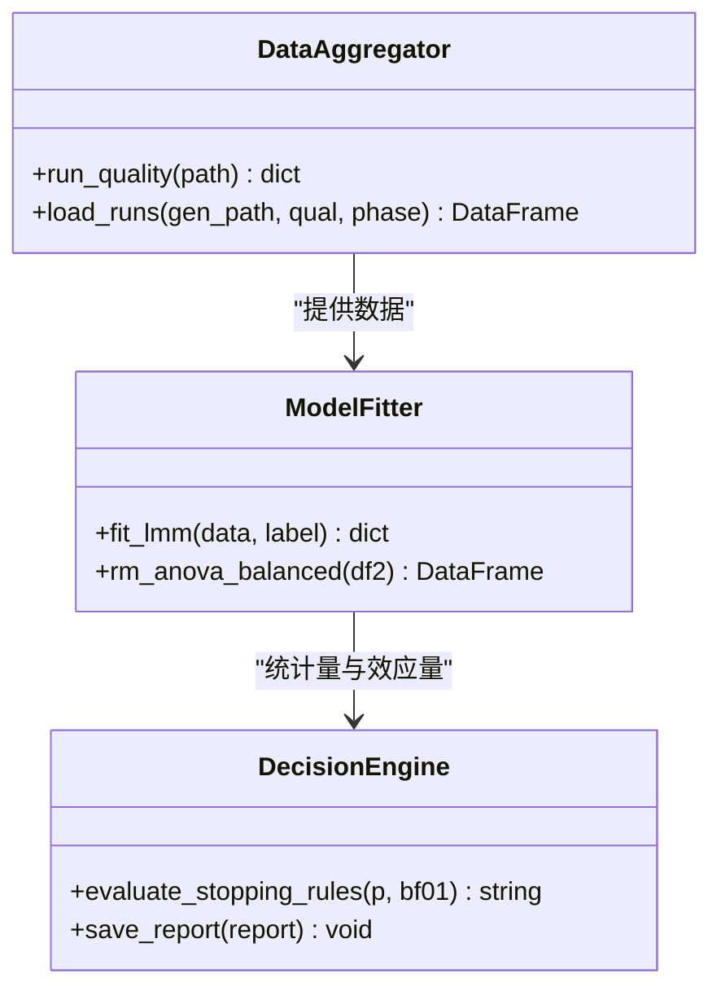

# 序贯分析协议

<cite>
**本文引用的文件**
- [03-SEQUENTIAL-ANALYSIS-PROTOCOL.md](file://DeeWaanAI-Next/protocols/03-SEQUENTIAL-ANALYSIS-PROTOCOL.md)
- [sequential_analysis.py](file://research/orchestration-economics/code/sequential_analysis.py)
- [interim1_sequential_analysis.json](file://research/orchestration-economics/results/interim1_sequential_analysis.json)
- [INTERIM1-DECISION.md](file://research/orchestration-economics/results/INTERIM1-DECISION.md)
- [INTERIM2-DECISION.md](file://research/orchestration-economics/results/INTERIM2-DECISION.md)
- [01-PREREGISTRATION-PROTOCOL.md](file://DeeWaanAI-Next/protocols/01-PREREGISTRATION-PROTOCOL.md)
- [PILOT-POWER-ANALYSIS-PROTOCOL.md](file://DeeWaanAI-Next/PILOT-POWER-ANALYSIS-PROTOCOL.md)
- [generate_new_figures.py](file://research/orchestration-economics/paper/generate_new_figures.py)
</cite>

## 目录
1. [引言](#引言)
2. [项目结构](#项目结构)
3. [核心组件](#核心组件)
4. [架构总览](#架构总览)
5. [详细组件分析](#详细组件分析)
6. [依赖关系分析](#依赖关系分析)
7. [性能与功效考量](#性能与功效考量)
8. [故障排查指南](#故障排查指南)
9. [结论](#结论)
10. [附录：可视化与实现指南](#附录可视化与实现指南)

## 引言
本文件为DeeWaanAI“序贯分析协议”的完整技术文档，围绕序贯统计分析的理论基础、适用场景（组间设计与重复测量设计）、中间分析时间点与决策规则（含p值阈值与统计功效监控）、多重比较校正与错误率控制、样本量重新估计与试验优化、可视化展示方法（序贯图与置信区间图），以及R/Python实现要点进行系统化说明。内容严格基于仓库中的预注册方案、序贯分析协议、实际运行脚本与结果记录，确保可追溯与可复现。

## 项目结构
与序贯分析直接相关的材料分布在以下位置：
- 协议与预注册：DeeWaanAI-Next/protocols 下的序贯分析协议与预注册方案
- 代码实现：research/orchestration-economics/code/sequential_analysis.py
- 结果与决策：research/orchestration-economics/results 下的JSON报告与Markdown决策记录
- 可视化：research/orchestration-economics/paper/generate_new_figures.py 中的序贯边界图生成逻辑
- 功效与样本量：DeeWaanAI-Next/PILOT-POWER-ANALYSIS-PROTOCOL.md

**图示来源**
- [03-SEQUENTIAL-ANALYSIS-PROTOCOL.md:1-44](file://DeeWaanAI-Next/protocols/03-SEQUENTIAL-ANALYSIS-PROTOCOL.md#L1-L44)
- [sequential_analysis.py:1-30](file://research/orchestration-economics/code/sequential_analysis.py#L1-L30)
- [interim1_sequential_analysis.json:1-16](file://research/orchestration-economics/results/interim1_sequential_analysis.json#L1-L16)
- [INTERIM1-DECISION.md:13-35](file://research/orchestration-economics/results/INTERIM1-DECISION.md#L13-L35)
- [INTERIM2-DECISION.md:27-46](file://research/orchestration-economics/results/INTERIM2-DECISION.md#L27-L46)
- [generate_new_figures.py:185-243](file://research/orchestration-economics/paper/generate_new_figures.py#L185-L243)

**章节来源**
- [03-SEQUENTIAL-ANALYSIS-PROTOCOL.md:1-44](file://DeeWaanAI-Next/protocols/03-SEQUENTIAL-ANALYSIS-PROTOCOL.md#L1-L44)
- [01-PREREGISTRATION-PROTOCOL.md:9-18](file://DeeWaanAI-Next/protocols/01-PREREGISTRATION-PROTOCOL.md#L9-L18)

## 核心组件
- 序贯设计概览与决策点：以“试点=中期1”、“主实验=中期2”的两阶段序贯设计，明确在中期1后对“层级×结构”交互作用进行评估并依据预设规则停止或继续。
- 停止规则：早期成功（强证据）、早期无效（强支持零假设）、继续至主实验；最终分析在中期2后进行全数据集汇总。
- 统计检验：频率学派采用重复测量ANOVA或线性混合模型（LMM）；贝叶斯方法提供BF作为辅助证据；中期使用O'Brien-Fleming边界控制整体I类错误。
- 中期分析流程：数据聚合→拟合模型→提取交互项→应用停止规则→输出报告与决策。
- 结果与决策：中期1因分析方法分歧与方向不一致而选择继续；中期2达到序贯边界，支持主要假设并终止数据收集。

**章节来源**
- [03-SEQUENTIAL-ANALYSIS-PROTOCOL.md:8-44](file://DeeWaanAI-Next/protocols/03-SEQUENTIAL-ANALYSIS-PROTOCOL.md#L8-L44)
- [sequential_analysis.py:53-118](file://research/orchestration-economics/code/sequential_analysis.py#L53-L118)
- [interim1_sequential_analysis.json:16-29](file://research/orchestration-economics/results/interim1_sequential_analysis.json#L16-L29)
- [INTERIM1-DECISION.md:21-59](file://research/orchestration-economics/results/INTERIM1-DECISION.md#L21-L59)
- [INTERIM2-DECISION.md:27-46](file://research/orchestration-economics/results/INTERIM2-DECISION.md#L27-L46)

## 架构总览
下图展示了从预注册到最终分析的端到端流程，包括数据输入、模型拟合、停止规则评估与可视化输出。

**图示来源**
- [01-PREREGISTRATION-PROTOCOL.md:20-76](file://DeeWaanAI-Next/protocols/01-PREREGISTRATION-PROTOCOL.md#L20-L76)
- [03-SEQUENTIAL-ANALYSIS-PROTOCOL.md:45-90](file://DeeWaanAI-Next/protocols/03-SEQUENTIAL-ANALYSIS-PROTOCOL.md#L45-L90)
- [sequential_analysis.py:99-118](file://research/orchestration-economics/code/sequential_analysis.py#L99-L118)
- [interim1_sequential_analysis.json:16-29](file://research/orchestration-economics/results/interim1_sequential_analysis.json#L16-L29)
- [INTERIM1-DECISION.md:43-59](file://research/orchestration-economics/results/INTERIM1-DECISION.md#L43-L59)
- [generate_new_figures.py:185-243](file://research/orchestration-economics/paper/generate_new_figures.py#L185-L243)

## 详细组件分析

### 组件A：序贯分析与停止规则
- 理论背景：序贯分析允许多次查看数据并在信息分数累积时评估统计量，通过边界函数控制整体I类错误。本方案采用两阶段设计（中期1=试点，中期2=主实验）。
- 适用场景：
  - 组间设计：当不同层级（廉价vs前沿）与结构（个人vs团队）存在交叉时，序贯分析可在早期识别强效应或无效性，避免过度采样。
  - 重复测量设计：问题内重复测量（同一问题在不同条件下评估）提升统计效率；脚本中同时使用LMM（随机截距）与问题层面的rm-ANOVA。
- 时间点与决策规则：
  - 中期1：若p<0.01（早期成功）或p>0.10且BF01>10（早期无效）则停止；否则继续。
  - 中期2：最终分析，α=0.05，结合序贯边界（O'Brien-Fleming）判断是否跨越边界。
- 多重比较校正与错误率控制：
  - 主要假设聚焦单一交互项（tier×structure），降低多重比较压力。
  - 次要假设与探索性分析采用BH-FDR等校正策略（见中期2决策记录）。
  - 序贯边界保证整体I类错误控制在目标水平。

**图示来源**
- [03-SEQUENTIAL-ANALYSIS-PROTOCOL.md:20-44](file://DeeWaanAI-Next/protocols/03-SEQUENTIAL-ANALYSIS-PROTOCOL.md#L20-L44)
- [sequential_analysis.py:190-203](file://research/orchestration-economics/code/sequential_analysis.py#L190-L203)
- [INTERIM2-DECISION.md:27-46](file://research/orchestration-economics/results/INTERIM2-DECISION.md#L27-L46)

**章节来源**
- [03-SEQUENTIAL-ANALYSIS-PROTOCOL.md:20-44](file://DeeWaanAI-Next/protocols/03-SEQUENTIAL-ANALYSIS-PROTOCOL.md#L20-L44)
- [sequential_analysis.py:99-118](file://research/orchestration-economics/code/sequential_analysis.py#L99-L118)
- [INTERIM1-DECISION.md:21-59](file://research/orchestration-economics/results/INTERIM1-DECISION.md#L21-L59)
- [INTERIM2-DECISION.md:27-46](file://research/orchestration-economics/results/INTERIM2-DECISION.md#L27-L46)

### 组件B：统计模型与数据流
- 数据聚合：每运行取3名裁判分数的均值作为DV；过滤失败运行与缺失值。
- 模型拟合：
  - LMM：quality ~ tier*structure*persona + (1|problem) + (1|family)，提取交互项系数、标准误、t统计量与p值；使用BIC近似计算BF（标注可靠性限制）。
  - rm-ANOVA：在平衡子集（claude+kimi）上按问题层面聚合，计算tier×structure交互。
- 数据流：读取生成日志与评判日志→构建DataFrame→分组聚合→拟合模型→输出统计量与决策。

**图示来源**
- [sequential_analysis.py:53-87](file://research/orchestration-economics/code/sequential_analysis.py#L53-L87)
- [sequential_analysis.py:99-118](file://research/orchestration-economics/code/sequential_analysis.py#L99-L118)
- [sequential_analysis.py:142-158](file://research/orchestration-economics/code/sequential_analysis.py#L142-L158)
- [sequential_analysis.py:190-203](file://research/orchestration-economics/code/sequential_analysis.py#L190-L203)

**章节来源**
- [sequential_analysis.py:53-118](file://research/orchestration-economics/code/sequential_analysis.py#L53-L118)
- [sequential_analysis.py:142-158](file://research/orchestration-economics/code/sequential_analysis.py#L142-L158)
- [sequential_analysis.py:190-203](file://research/orchestration-economics/code/sequential_analysis.py#L190-L203)

### 组件C：中期决策与报告
- 中期1：由于LMM与rm-ANOVA结果分歧且方向不一致，分析师建议继续至主实验以恢复完全平衡设计。
- 中期2：达到序贯边界（|z|≥1.977），支持主要假设（H1），终止数据收集并报告效应量、CI与p值。

**章节来源**
- [INTERIM1-DECISION.md:43-59](file://research/orchestration-economics/results/INTERIM1-DECISION.md#L43-L59)
- [INTERIM2-DECISION.md:27-46](file://research/orchestration-economics/results/INTERIM2-DECISION.md#L27-L46)

## 依赖关系分析
- 协议依赖：预注册方案定义了设计、假设与停止规则；序贯分析协议细化了中期时间点与决策流程。
- 代码依赖：脚本依赖pandas、statsmodels、pingouin、scipy；读取运行日志与评判日志，输出JSON报告。
- 结果依赖：JSON报告包含数据指纹、统计量、停止规则判定；决策记录解释机械决策与分析师建议。
- 可视化依赖：生成脚本读取统计量并绘制序贯边界图，标注信息分数与边界穿越。

**图示来源**
- [01-PREREGISTRATION-PROTOCOL.md:20-76](file://DeeWaanAI-Next/protocols/01-PREREGISTRATION-PROTOCOL.md#L20-L76)
- [03-SEQUENTIAL-ANALYSIS-PROTOCOL.md:45-90](file://DeeWaanAI-Next/protocols/03-SEQUENTIAL-ANALYSIS-PROTOCOL.md#L45-L90)
- [sequential_analysis.py:31-48](file://research/orchestration-economics/code/sequential_analysis.py#L31-L48)
- [interim1_sequential_analysis.json:1-16](file://research/orchestration-economics/results/interim1_sequential_analysis.json#L1-L16)
- [INTERIM1-DECISION.md:1-12](file://research/orchestration-economics/results/INTERIM1-DECISION.md#L1-L12)
- [generate_new_figures.py:185-243](file://research/orchestration-economics/paper/generate_new_figures.py#L185-L243)

**章节来源**
- [sequential_analysis.py:31-48](file://research/orchestration-economics/code/sequential_analysis.py#L31-L48)
- [interim1_sequential_analysis.json:1-16](file://research/orchestration-economics/results/interim1_sequential_analysis.json#L1-L16)
- [INTERIM1-DECISION.md:1-12](file://research/orchestration-economics/results/INTERIM1-DECISION.md#L1-L12)

## 性能与功效考量
- 功效与样本量：预注册方案与功效分析协议明确了试点与主实验的样本规模；中期2的最小可检测效应与每单元样本量在决策记录中报告。
- 序贯功效监控：通过O'Brien-Fleming边界在信息分数累积时评估统计量，确保整体I类错误受控；中期2边界值为1.977，观测z=-2.447跨越边界。
- 敏感性分析：中期2决策记录包含leave-one-family-out与leave-one-problem-out稳健性检查，确认效应不受单一家族或问题驱动。

**章节来源**
- [PILOT-POWER-ANALYSIS-PROTOCOL.md:61-90](file://DeeWaanAI-Next/PILOT-POWER-ANALYSIS-PROTOCOL.md#L61-L90)
- [INTERIM2-DECISION.md:61-76](file://research/orchestration-economics/results/INTERIM2-DECISION.md#L61-L76)
- [INTERIM2-DECISION.md:27-46](file://research/orchestration-economics/results/INTERIM2-DECISION.md#L27-L46)

## 故障排查指南
- 数据完整性：中期2决策记录列出排除的单元格与原因（系统性不完整），确保DV计算的稳健性。
- 模型可靠性：中期1脚本标注BIC近似的BF在含方差成分的混合模型中不可靠，需结合其他证据（如rm-ANOVA）综合判断。
- 分析方法分歧：当LMM与rm-ANOVA结果不一致时，优先恢复完全平衡设计（主实验）以消除混淆。

**章节来源**
- [INTERIM2-DECISION.md:10-25](file://research/orchestration-economics/results/INTERIM2-DECISION.md#L10-L25)
- [sequential_analysis.py:188-189](file://research/orchestration-economics/code/sequential_analysis.py#L188-L189)
- [INTERIM1-DECISION.md:43-59](file://research/orchestration-economics/results/INTERIM1-DECISION.md#L43-L59)

## 结论
本序贯分析协议通过预注册设计、明确的停止规则与序贯边界控制，实现了在试点阶段快速识别强效应或无效性，并在主实验阶段完成最终验证。中期1因分析方法分歧与方向不一致选择继续；中期2跨越序贯边界，支持主要假设并终止数据收集。该流程兼顾统计严谨性与资源效率，为后续研究提供了可复现的范式。

## 附录：可视化与实现指南

### 可视化展示方法
- 序贯图：以信息分数为横轴、检验统计量为纵轴，绘制O'Brien-Fleming上下边界，标注中期1与中期2的点及边界穿越情况。
- 置信区间图：报告Bootstrap 95% CI，用于评估效应量的稳定性与不确定性。

**章节来源**
- [generate_new_figures.py:185-243](file://research/orchestration-economics/paper/generate_new_figures.py#L185-L243)
- [INTERIM2-DECISION.md:27-46](file://research/orchestration-economics/results/INTERIM2-DECISION.md#L27-L46)

### 软件实现指南（R与Python）
- Python实现要点：
  - 数据聚合：读取运行日志与评判日志，计算每运行平均质量得分。
  - 模型拟合：使用statsmodels的mixedlm拟合LMM，pingouin的rm_anova进行重复测量ANOVA。
  - 停止规则：根据p值与BF01评估早期成功/无效/继续；最终分析结合序贯边界。
  - 输出：保存JSON报告与Markdown决策记录，便于审计与复现。
- R实现要点（概念性说明）：
  - 可使用lme4或nlme进行LMM拟合，afex或ezANOVA进行rm-ANOVA。
  - 使用gsDesign或rbounds包计算序贯边界与alpha花费函数。
  - 使用BayesFactor包计算BF，并结合频域结果进行决策。

[本节为概念性指导，不直接分析具体文件]

### 与传统固定样本设计的优势与局限性
- 优势：
  - 资源效率：早期发现强效应或无效性可提前终止，节省成本。
  - 统计严谨：序贯边界控制整体I类错误，避免多次查看数据的膨胀风险。
  - 灵活性：可根据中期结果调整后续计划（如样本量重新估计）。
- 局限性：
  - 复杂性：需要预先注册停止规则与分析计划，增加设计与执行难度。
  - 解释挑战：中期结果可能受随机波动影响，需谨慎解读。
  - 工具依赖：需要专门的序贯分析工具与专业知识。

[本节为概念性总结，不直接分析具体文件]