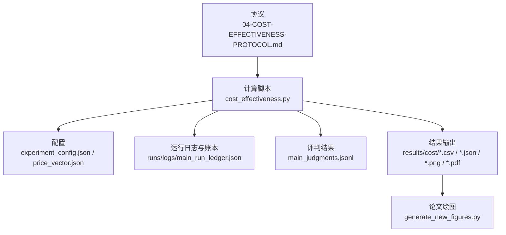
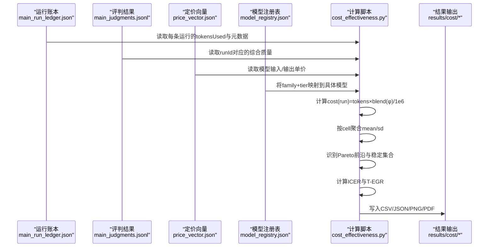
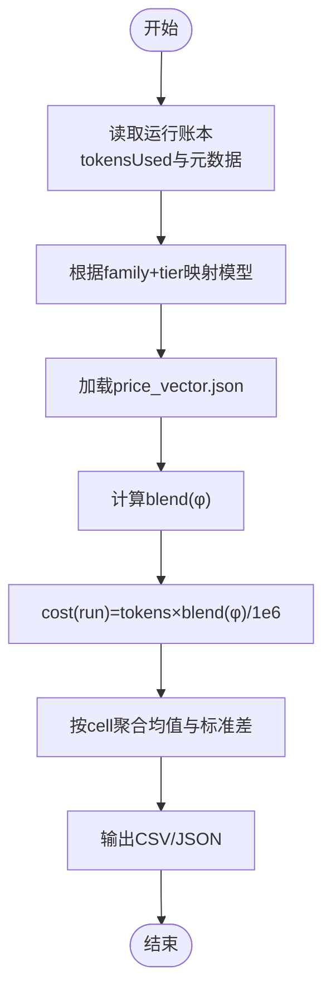
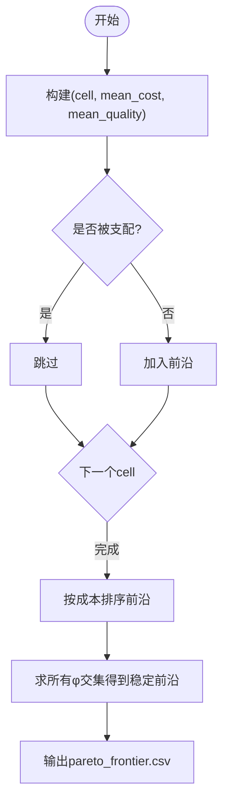
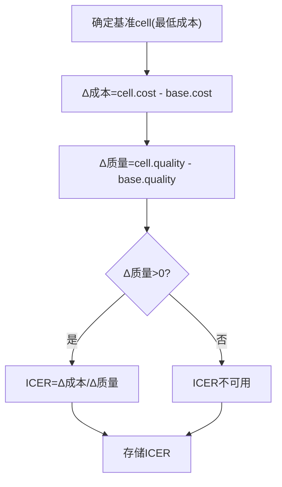
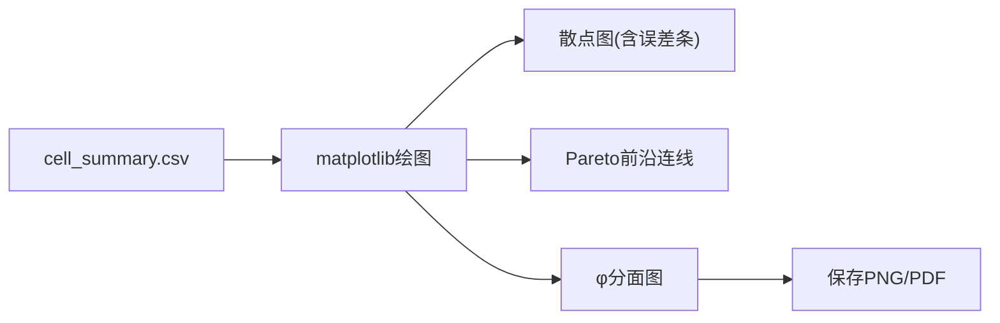
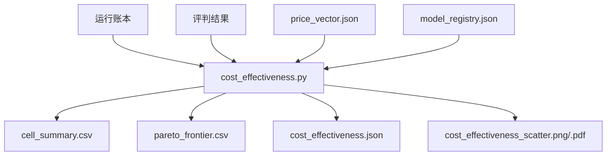

# 成本效益分析协议

<cite>
**本文引用的文件**
- [04-COST-EFFECTIVENESS-PROTOCOL.md](file://DeeWaanAI-Next/protocols/04-COST-EFFECTIVENESS-PROTOCOL.md)
- [cost_effectiveness.py](file://research/orchestration-economics/code/cost_effectiveness.py)
- [COST-EFFECTIVENESS.md](file://research/orchestration-economics/results/COST-EFFECTIVENESS.md)
- [experiment_config.json](file://research/orchestration-economics/config/experiment_config.json)
- [price_vector.json](file://research/orchestration-economics/config/price_vector.json)
- [cell_summary.csv](file://research/orchestration-economics/results/cost/cell_summary.csv)
- [pareto_frontier.csv](file://research/orchestration-economics/results/cost/pareto_frontier.csv)
- [cost_per_run.csv](file://research/orchestration-economics/results/cost/cost_per_run.csv)
- [cost_effectiveness.json](file://research/orchestration-economics/results/cost/cost_effectiveness.json)
- [generate_new_figures.py](file://research/orchestration-economics/paper/generate_new_figures.py)
</cite>

## 目录
1. [引言](#引言)
2. [项目结构](#项目结构)
3. [核心组件](#核心组件)
4. [架构总览](#架构总览)
5. [详细组件分析](#详细组件分析)
6. [依赖关系分析](#依赖关系分析)
7. [性能与计算特性](#性能与计算特性)
8. [故障排查指南](#故障排查指南)
9. [结论](#结论)
10. [附录](#附录)

## 引言
本文件为DeeWaanAI的成本效益分析协议提供系统化、可复现的技术文档。内容覆盖：
- 成本效益评估的理论框架与指标体系（直接成本、间接成本、机会成本的定义与在本项目中的映射）
- 质量效用指标的标准化过程（本项目采用“综合评分”作为效用代理，并说明与QALY的关系与差异）
- 成本效果比（CER）与增量成本效果比（ICER）的计算与应用
- 成本效益前沿分析与Pareto最优解识别、多目标优化思路
- 敏感性分析与不确定性分析方法（价格权重φ敏感性面板；蒙特卡洛模拟与情景分析的扩展建议）
- 可视化输出与使用指南（散点图、ROC曲线、接受域图的实现与解读）
- 在AI系统评估中的应用价值与局限性

## 项目结构
围绕成本效益分析的核心代码与产出集中在研究子模块中，关键路径如下：
- 协议与规范：DeeWaanAI-Next/protocols/04-COST-EFFECTIVENESS-PROTOCOL.md
- 计算脚本：research/orchestration-economics/code/cost_effectiveness.py
- 配置与定价：research/orchestration-economics/config/{experiment_config.json, price_vector.json}
- 结果与图表：research/orchestration-economics/results/cost/* 与 paper 绘图脚本 generate_new_figures.py

**图示来源**
- [04-COST-EFFECTIVENESS-PROTOCOL.md:1-164](file://DeeWaanAI-Next/protocols/04-COST-EFFECTIVENESS-PROTOCOL.md#L1-L164)
- [cost_effectiveness.py:40-196](file://research/orchestration-economics/code/cost_effectiveness.py#L40-L196)
- [experiment_config.json:1-272](file://research/orchestration-economics/config/experiment_config.json#L1-L272)
- [price_vector.json:1-26](file://research/orchestration-economics/config/price_vector.json#L1-L26)

**章节来源**
- [04-COST-EFFECTIVENESS-PROTOCOL.md:1-164](file://DeeWaanAI-Next/protocols/04-COST-EFFECTIVENESS-PROTOCOL.md#L1-L164)
- [cost_effectiveness.py:40-196](file://research/orchestration-economics/code/cost_effectiveness.py#L40-L196)
- [experiment_config.json:1-272](file://research/orchestration-economics/config/experiment_config.json#L1-L272)
- [price_vector.json:1-26](file://research/orchestration-economics/config/price_vector.json#L1-L26)

## 核心组件
- 成本计算与聚合：按运行粒度计算成本，再按实验单元（cell）聚合均值与标准差，支持多价格权重φ的敏感性面板。
- Pareto前沿识别：基于“更低成本且更高或相等质量”的支配规则识别Pareto最优单元，并在不同φ下检验稳定性。
- ICER计算：以最低成本单元为基准，计算各单元相对于基准的增量成本与增量质量之比。
- T-EGR（分层效率增益比率）：在家族内比较，衡量单位成本带来的相对质量提升。
- Study-2扩展：对C-T-P追加一次精炼调用，叠加精炼成本与质量，形成扩展前沿点。
- 可视化：生成带误差条的散点图与Pareto前沿线，支持按φ分面展示。

**章节来源**
- [cost_effectiveness.py:40-196](file://research/orchestration-economics/code/cost_effectiveness.py#L40-L196)
- [COST-EFFECTIVENESS.md:1-73](file://research/orchestration-economics/results/COST-EFFECTIVENESS.md#L1-L73)
- [cell_summary.csv:1-26](file://research/orchestration-economics/results/cost/cell_summary.csv#L1-L26)
- [pareto_frontier.csv:1-6](file://research/orchestration-economics/results/cost/pareto_frontier.csv#L1-L6)

## 架构总览
成本效益分析的数据流从“运行账本+评判结果”出发，经“定价向量+模型映射”转换为美元成本，再与质量指标聚合，最终输出统计摘要、前沿识别、ICER/T-EGR以及可视化图表。

**图示来源**
- [cost_effectiveness.py:40-196](file://research/orchestration-economics/code/cost_effectiveness.py#L40-L196)
- [price_vector.json:1-26](file://research/orchestration-economics/config/price_vector.json#L1-L26)
- [experiment_config.json:1-272](file://research/orchestration-economics/config/experiment_config.json#L1-L272)

## 详细组件分析

### 成本计算与聚合
- 单行成本：cost(run) = tokensUsed × blend(φ) / 1,000,000，其中 blend(φ) = φ·p_out + (1−φ)·p_in。
- 敏感性面板：φ ∈ {0.25, 0.50, 0.75}，主分析取φ=0.50。
- 聚合指标：每个cell的n、mean_cost、sd_cost、mean_quality、sd_quality、mean_tokens。
- 输出：cost_per_run.csv、cell_summary.csv（含三组φ）、cost_effectiveness.json。

**图示来源**
- [cost_effectiveness.py:54-105](file://research/orchestration-economics/code/cost_effectiveness.py#L54-L105)
- [price_vector.json:1-26](file://research/orchestration-economics/config/price_vector.json#L1-L26)

**章节来源**
- [cost_effectiveness.py:54-105](file://research/orchestration-economics/code/cost_effectiveness.py#L54-L105)
- [cell_summary.csv:1-26](file://research/orchestration-economics/results/cost/cell_summary.csv#L1-L26)
- [cost_effectiveness.json:1-182](file://research/orchestration-economics/results/cost/cost_effectiveness.json#L1-L182)

### Pareto前沿与多目标优化
- 支配规则：若存在另一cell同时满足“更低成本且更高或相等质量”，则当前cell被支配。
- 前沿识别：对每个φ分别识别Pareto最优cell集合并排序。
- 稳定性：在所有φ下均保持Pareto最优的cell集合视为稳健前沿成员。
- 多目标视角：成本最小化与质量最大化构成双目标优化；前沿即为非支配解集。

**图示来源**
- [cost_effectiveness.py:107-126](file://research/orchestration-economics/code/cost_effectiveness.py#L107-L126)
- [pareto_frontier.csv:1-6](file://research/orchestration-economics/results/cost/pareto_frontier.csv#L1-L6)

**章节来源**
- [cost_effectiveness.py:107-126](file://research/orchestration-economics/code/cost_effectiveness.py#L107-L126)
- [pareto_frontier.csv:1-6](file://research/orchestration-economics/results/cost/pareto_frontier.csv#L1-L6)

### ICER与T-EGR
- ICER：以最低成本cell为基准，计算Δ成本/Δ质量，用于比较“每提升一单位质量的额外成本”。
- T-EGR：在家族内以F-S-N为基线，计算(Novelty_cell/Novelty_F-S-N)/(Cost_cell/Cost_F-S-N)，衡量单位成本带来的相对新颖性收益。
- 应用：辅助决策选择性价比更高的cell或策略组合。

**图示来源**
- [cost_effectiveness.py:128-135](file://research/orchestration-economics/code/cost_effectiveness.py#L128-L135)
- [cost_effectiveness.json:105-145](file://research/orchestration-economics/results/cost/cost_effectiveness.json#L105-L145)

**章节来源**
- [cost_effectiveness.py:128-135](file://research/orchestration-economics/code/cost_effectiveness.py#L128-L135)
- [cost_effectiveness.json:105-145](file://research/orchestration-economics/results/cost/cost_effectiveness.json#L105-L145)

### 质量效用指标与标准化
- 本项目采用“综合评分”作为效用代理，来源于评判器对解决方案的多维度评分汇总。
- 与QALY的关系：QALY用于健康经济学，将生存年数乘以健康效用（0–1）。本项目未直接使用QALY；若需迁移至健康领域，可将“综合评分”映射为效用值（例如归一化到0–1），并结合预期寿命或干预周期计算QALY。
- 标准化建议：
  - 将综合评分归一化到[0,1]区间（min-max或z-score后转换）
  - 明确评价尺度与权重，确保跨模型/跨问题可比
  - 报告信度与效度指标（如Kappa、ICC）以支撑效用可靠性

**章节来源**
- [experiment_config.json:177-193](file://research/orchestration-economics/config/experiment_config.json#L177-L193)
- [COST-EFFECTIVENESS.md:1-73](file://research/orchestration-economics/results/COST-EFFECTIVENESS.md#L1-L73)

### 成本效益前沿可视化
- 散点图：横轴为平均成本（USD），纵轴为平均质量，标注误差条（±SD），连接Pareto前沿。
- 分面图：按φ=0.25/0.50/0.75展示前沿稳定性。
- 扩展点：Study-2精炼后的C-T-P点以菱形标记，便于对比。

**图示来源**
- [cost_effectiveness.py:198-224](file://research/orchestration-economics/code/cost_effectiveness.py#L198-L224)
- [generate_new_figures.py:42-98](file://research/orchestration-economics/paper/generate_new_figures.py#L42-L98)

**章节来源**
- [cost_effectiveness.py:198-224](file://research/orchestration-economics/code/cost_effectiveness.py#L198-L224)
- [generate_new_figures.py:42-98](file://research/orchestration-economics/paper/generate_new_figures.py#L42-L98)

### 敏感性分析与不确定性分析
- 已实现：价格权重φ敏感性面板（0.25/0.50/0.75），用于检验前沿稳定性与结论鲁棒性。
- 可扩展方法：
  - 蒙特卡洛模拟：对tokens、质量、价格等参数引入分布假设，抽样生成成本-质量联合分布，估计置信区间与概率优势。
  - 情景分析：设定极端价格或质量场景（如批量折扣、峰值定价、质量偏差），评估决策稳健性。
  - 预算约束下的多目标优化：在给定预算上限下寻找最大期望质量或最大化QALY的策略组合。

**章节来源**
- [cost_effectiveness.py:29-33](file://research/orchestration-economics/code/cost_effectiveness.py#L29-L33)
- [cost_effectiveness.py:107-126](file://research/orchestration-economics/code/cost_effectiveness.py#L107-L126)

### 成本效果比（CER）与增量成本效果比（ICER）的应用
- CER：适用于单一方案评估，CER = 成本/效果。本项目更关注相对改进，故以ICER为主。
- ICER：比较新策略与基准策略的增量成本与增量效果，常用于阈值决策（如 willingness-to-pay）。
- 在本项目中：
  - 以最低成本cell为基准计算ICER，帮助识别“最具性价比”的改进方向。
  - 结合T-EGR进行家族内相对效率评估，避免跨家族绝对成本误导。

**章节来源**
- [cost_effectiveness.py:128-153](file://research/orchestration-economics/code/cost_effectiveness.py#L128-L153)
- [COST-EFFECTIVENESS.md:29-34](file://research/orchestration-economics/results/COST-EFFECTIVENESS.md#L29-L34)

### 在AI系统评估中的应用价值与局限性
- 价值：
  - 将“质量”与“成本”统一量化，支持资源受限下的策略选择。
  - 通过前沿与ICER揭示不同编排结构（solo/team）与模型层级（cheap/frontier）的经济权衡。
  - 支持可扩展的敏感性分析与不确定性评估，增强结论稳健性。
- 局限：
  - 未包含评判成本于单元T-EGR（仅计入生成成本），需在报告中披露。
  - 团队中间输出token未被完全记录，导致团队成本可能略低估（已在协议中披露）。
  - 质量效用并非QALY，迁移到健康领域需重新校准与验证。

**章节来源**
- [COST-EFFECTIVENESS.md:1-73](file://research/orchestration-economics/results/COST-EFFECTIVENESS.md#L1-L73)
- [cost_effectiveness.json:179-181](file://research/orchestration-economics/results/cost/cost_effectiveness.json#L179-L181)

## 依赖关系分析
- 输入依赖：
  - 运行账本：记录tokensUsed与运行元数据
  - 评判结果：提供runId对应的综合质量
  - 定价向量：冻结的价格矩阵，决定成本换算
  - 模型注册表：family→模型映射，区分cheap与frontier
- 内部依赖：
  - cost_effectiveness.py 依赖 analyze_main 与 refine_study2_analyze 以加载评判与精炼数据
- 输出依赖：
  - CSV/JSON用于后续统计与可视化
  - PNG/PDF用于论文插图

**图示来源**
- [cost_effectiveness.py:40-196](file://research/orchestration-economics/code/cost_effectiveness.py#L40-L196)
- [experiment_config.json:1-272](file://research/orchestration-economics/config/experiment_config.json#L1-L272)
- [price_vector.json:1-26](file://research/orchestration-economics/config/price_vector.json#L1-L26)

**章节来源**
- [cost_effectiveness.py:40-196](file://research/orchestration-economics/code/cost_effectiveness.py#L40-L196)
- [experiment_config.json:1-272](file://research/orchestration-economics/config/experiment_config.json#L1-L272)

## 性能与计算特性
- 时间复杂度：Pareto识别为O(n^2)（n为cell数量，实际n=8，计算开销极低）。
- 数据规模：约1,900条运行记录，逐行处理成本与质量聚合，内存占用低。
- I/O瓶颈：读取JSON/JSONL与写入CSV/JSON/PNG/PDF为主要I/O操作。
- 可重复性：冻结价格向量与模型注册表，保证结果可复现。

**章节来源**
- [cost_effectiveness.py:40-196](file://research/orchestration-economics/code/cost_effectiveness.py#L40-L196)
- [COST-EFFECTIVENESS.md:1-73](file://research/orchestration-economics/results/COST-EFFECTIVENESS.md#L1-L73)

## 故障排查指南
- 常见问题：
  - 缺失评判结果：若某runId无对应质量，该行将被过滤（仅保留有composite的行）。
  - 价格向量不匹配：确保price_vector.json包含所用模型的输入/输出单价。
  - 模型映射错误：检查model_registry.json中family→模型映射是否正确。
  - 输出目录不存在：脚本会自动创建results/cost目录。
- 诊断步骤：
  - 检查cost_per_run.csv行数与预期运行数是否一致
  - 核对pareto_frontier.csv在不同φ下的稳定性
  - 查看console输出中的cheapest cell与ICER是否合理

**章节来源**
- [cost_effectiveness.py:54-71](file://research/orchestration-economics/code/cost_effectiveness.py#L54-L71)
- [cost_effectiveness.py:198-238](file://research/orchestration-economics/code/cost_effectiveness.py#L198-L238)

## 结论
本成本效益分析协议提供了从成本计算、质量聚合、前沿识别到ICER/T-EGR评估的完整流程，并通过φ敏感性面板保障结论稳健性。对于AI系统评估而言，该协议能够：
- 在资源约束下识别最优策略组合
- 通过前沿与ICER指导资源配置与策略迭代
- 支持扩展至健康领域的QALY框架（需重新校准效用与生命周期）

未来工作可包括：
- 引入蒙特卡洛模拟与预算约束优化
- 扩展多目标效用（如新颖性、稳定性、公平性）的综合评估
- 完善健康领域迁移的效用测量与验证

## 附录
- 可视化使用指南：
  - 散点图：读取cell_summary.csv，绘制mean_cost vs mean_quality，添加误差条与标签
  - ROC曲线：如需评估分类型效用（如是否达到阈值质量），可基于二元判定绘制ROC
  - 接受域图：在成本-质量平面上绘制预算线与阈值区域，辅助决策
- 参考输出：
  - results/cost/cost_per_run.csv：逐行成本与质量
  - results/cost/cell_summary.csv：按cell聚合的统计量
  - results/cost/pareto_frontier.csv：Pareto前沿与稳定集合
  - results/cost/cost_effectiveness.json：完整结果对象（含ICER、T-EGR、精炼点等）

**章节来源**
- [generate_new_figures.py:42-98](file://research/orchestration-economics/paper/generate_new_figures.py#L42-L98)
- [cost_effectiveness.json:1-182](file://research/orchestration-economics/results/cost/cost_effectiveness.json#L1-L182)