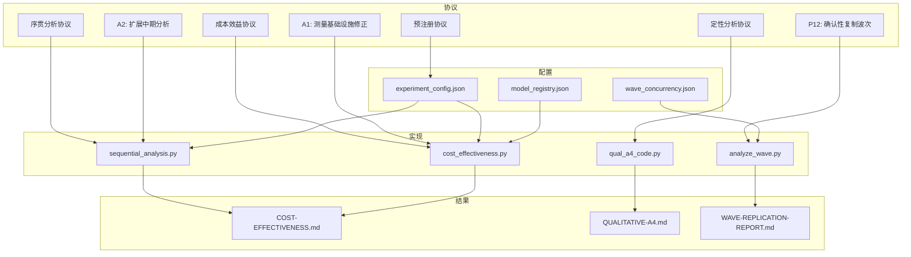
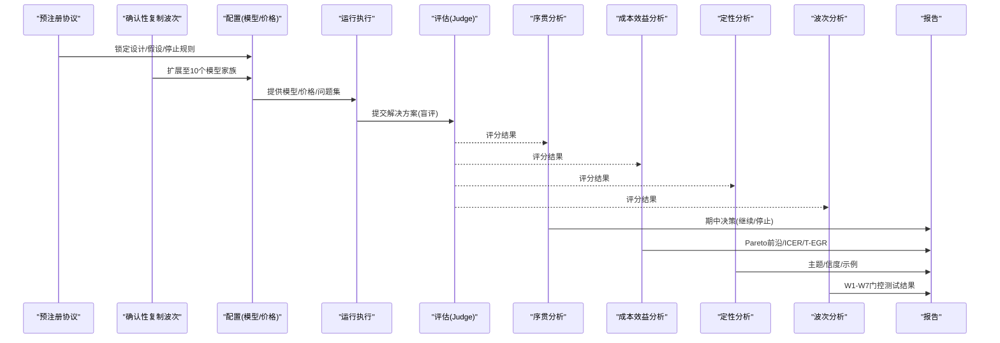
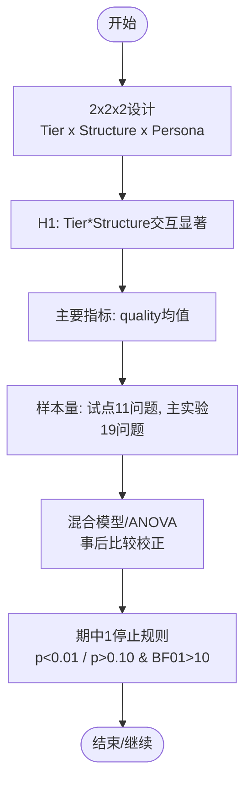
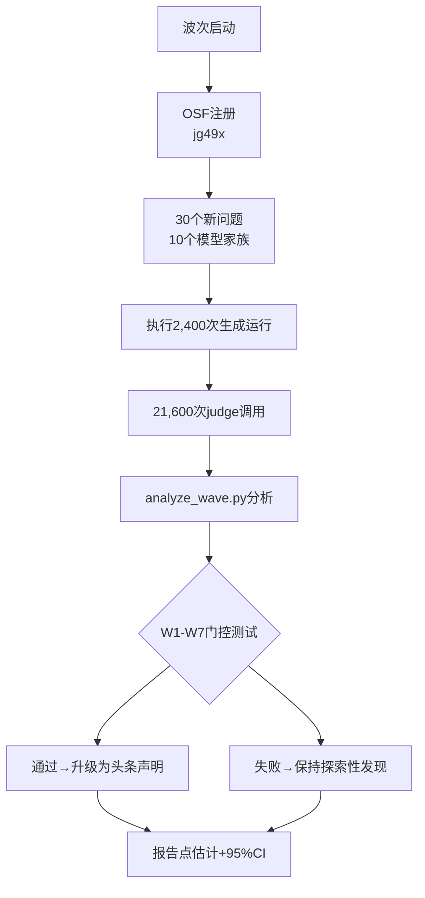
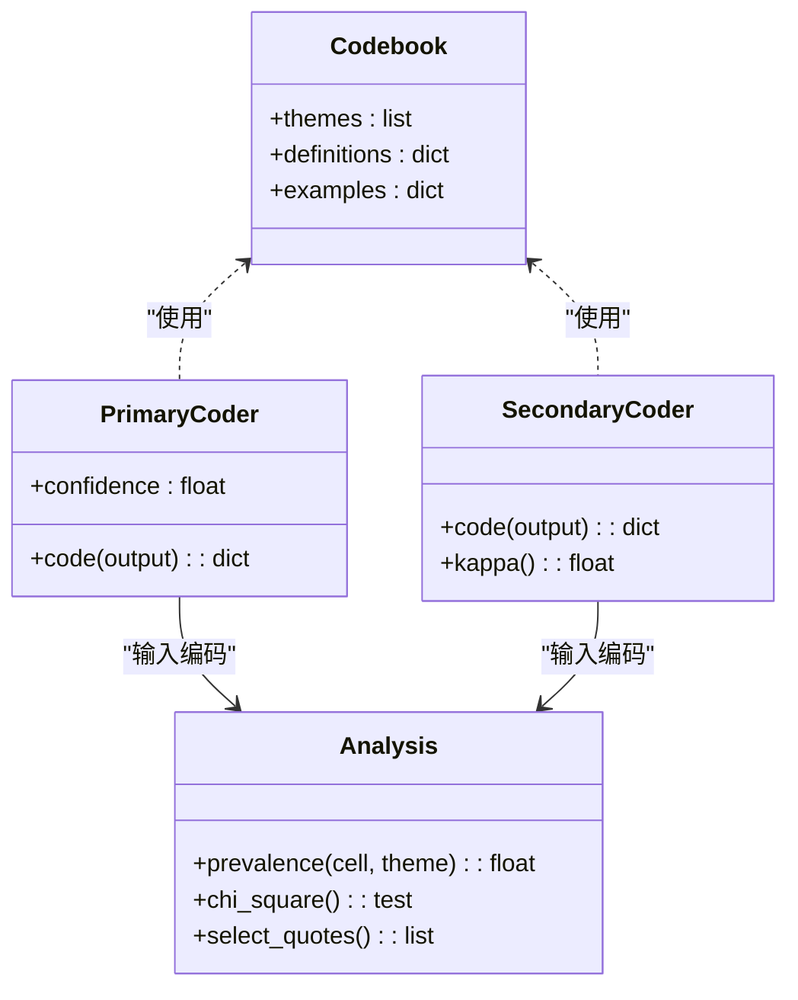
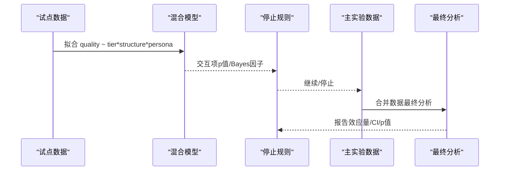
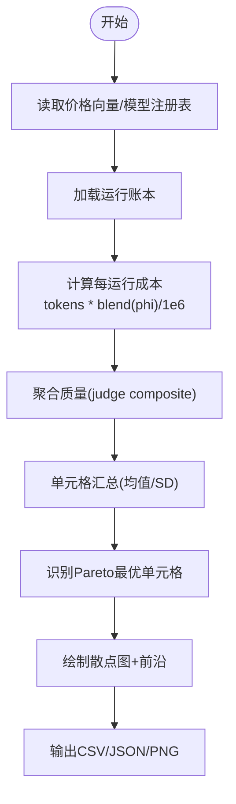
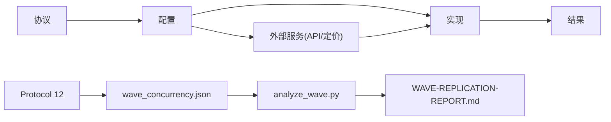

# 研究方法论

<cite>
**本文引用的文件**
- [01-PREREGISTRATION-PROTOCOL.md](file://DeeWaanAI-Next/protocols/01-PREREGISTRATION-PROTOCOL.md)
- [02-QUALITATIVE-ANALYSIS-PROTOCOL.md](file://DeeWaanAI-Next/protocols/02-QUALITATIVE-ANALYSIS-PROTOCOL.md)
- [03-SEQUENTIAL-ANALYSIS-PROTOCOL.md](file://DeeWaanAI-Next/protocols/03-SEQUENTIAL-ANALYSIS-PROTOCOL.md)
- [04-COST-EFFECTIVENESS-PROTOCOL.md](file://DeeWaanAI-Next/protocols/04-COST-EFFECTIVENESS-PROTOCOL.md)
- [05-AMENDMENT-A1-PILOT-ARTIFACT-CORRECTIONS.md](file://DeeWaanAI-Next/protocols/05-AMENDMENT-A1-PILOT-ARTIFACT-CORRECTIONS.md)
- [06-AMENDMENT-A2-EXTENDED-INTERIM2-ANALYSIS.md](file://DeeWaanAI-Next/protocols/06-AMENDMENT-A2-EXTENDED-INTERIM2-ANALYSIS.md)
- [12-PROTOCOL-WAVE-CONFIRMATORY-REPLICATION.md](file://DeeWaanAI-Next/protocols/12-PROTOCOL-WAVE-CONFIRMATORY-REPLICATION.md)
- [README.md](file://research/orchestration-economics/README.md)
- [experiment_config.json](file://research/orchestration-economics/config/experiment_config.json)
- [model_registry.json](file://research/orchestration-economics/config/model_registry.json)
- [wave_concurrency.json](file://research/orchestration-economics/config/wave_concurrency.json)
- [sequential_analysis.py](file://research/orchestration-economics/code/sequential_analysis.py)
- [cost_effectiveness.py](file://research/orchestration-economics/code/cost_effectiveness.py)
- [qual_a4_code.py](file://research/orchestration-economics/code/qual_a4_code.py)
- [analyze_wave.py](file://research/orchestration-economics/code/analyze_wave.py)
- [fresh_business_cases_20_wave.json](file://research/orchestration-economics/data/problems/fresh_business_cases_20_wave.json)
- [fresh_domain_map_wave.json](file://research/orchestration-economics/data/problems/fresh_domain_map_wave.json)
- [wave_pipelines_registry.json](file://research/orchestration-economics/pipelines/fixed/wave_pipelines_registry.json)
- [.osf_state_wave.json](file://research/orchestration-economics/preregistration/osf_submission/.osf_state_wave.json)
- [COST-EFFECTIVENESS.md](file://research/orchestration-economics/results/COST-EFFECTIVENESS.md)
- [QUALITATIVE-A4.md](file://research/orchestration-economics/results/QUALITATIVE-A4.md)
</cite>

## 更新摘要
**变更内容**
- 新增Protocol 12确认性复制波次章节，扩展预注册协议体系
- 增加跨10个模型家族的验证研究设计说明
- 更新架构总览图以包含Wave确认性复制流程
- 增强版本管理与变更控制机制，包含OSF注册状态
- 补充Wave相关的执行纪律、数据制品和分析脚本

## 目录
1. [引言](#引言)
2. [项目结构](#项目结构)
3. [核心组件](#核心组件)
4. [架构总览](#架构总览)
5. [详细组件分析](#详细组件分析)
6. [依赖关系分析](#依赖关系分析)
7. [性能与成本考量](#性能与成本考量)
8. [故障排查指南](#故障排查指南)
9. [结论](#结论)
10. [附录](#附录)

## 引言
本文件系统化梳理 DeeWaanAI 的"编排经济学"研究方法论，覆盖预注册协议、定性分析协议、序贯分析协议、成本效益分析框架、质量控制与伦理、以及版本管理与变更控制机制。文档以可复现的数据与代码为依据，确保读者在不深入源码的情况下也能理解实验设计、统计决策规则与分析流程。**最新更新**：Protocol 12作为新的确认性复制波次被添加到研究方法论框架中，扩展了原有的预注册协议体系，增加了跨10个模型家族的验证研究设计。

## 项目结构
研究仓库围绕"协议—配置—实现—结果"四层组织：
- 协议层：定义假设、设计、分析计划、停止规则与变更（Protocol 01–04 及 A1/A2，新增Protocol 12）。
- 配置层：模型注册表、价格向量、问题集与执行参数（experiment_config.json、model_registry.json、wave_concurrency.json）。
- 实现层：序贯分析脚本、成本效益计算、定性编码流水线、Wave确认性分析（sequential_analysis.py、cost_effectiveness.py、qual_a4_code.py、analyze_wave.py）。
- 结果层：分析报告、图表与中间产物（results/*.md、*.json、*.csv、*.png）。

**图示来源**
- [01-PREREGISTRATION-PROTOCOL.md:1-131](file://DeeWaanAI-Next/protocols/01-PREREGISTRATION-PROTOCOL.md#L1-L131)
- [02-QUALITATIVE-ANALYSIS-PROTOCOL.md:1-133](file://DeeWaanAI-Next/protocols/02-QUALITATIVE-ANALYSIS-PROTOCOL.md#L1-L133)
- [03-SEQUENTIAL-ANALYSIS-PROTOCOL.md:1-142](file://DeeWaanAI-Next/protocols/03-SEQUENTIAL-ANALYSIS-PROTOCOL.md#L1-L142)
- [04-COST-EFFECTIVENESS-PROTOCOL.md:1-164](file://DeeWaanAI-Next/protocols/04-COST-EFFECTIVENESS-PROTOCOL.md#L1-L164)
- [12-PROTOCOL-WAVE-CONFIRMATORY-REPLICATION.md:1-169](file://DeeWaanAI-Next/protocols/12-PROTOCOL-WAVE-CONFIRMATORY-REPLICATION.md#L1-L169)
- [experiment_config.json:1-272](file://research/orchestration-economics/config/experiment_config.json#L1-L272)
- [model_registry.json:1-226](file://research/orchestration-economics/config/model_registry.json#L1-L226)
- [wave_concurrency.json:1-15](file://research/orchestration-economics/config/wave_concurrency.json#L1-L15)

**章节来源**
- [README.md:1-91](file://research/orchestration-economics/README.md#L1-L91)

## 核心组件
- 预注册协议：明确2×2×2因子设计、主要假设、样本量、统计分析计划、停止规则与数据共享策略。
- 定性分析协议：基于LLM自动编码的主题分析，包含编码方案、信度检验（Cohen's κ）与主题 prevalence 分析。
- 序贯分析协议：以试点为期中1、主实验为期中2，采用O'Brien-Fleming边界与贝叶斯因子辅助决策。
- 成本效益分析：按单元格聚合质量与成本，绘制Pareto前沿并识别最优条件；支持敏感性分析（φ面板）。
- **确认性复制波次**：Protocol 12定义了跨10个模型家族的验证研究，使用30个全新问题，实施严格的门控测试（W1-W7）。
- 质量控制与伦理：盲评、截断修复、长度协变量、审计字段、重复运行与幂分析。
- 版本管理与变更控制：OSF注册、修订A1/A2登记、冻结配置与价格向量、可追溯的代码与数据快照。

**章节来源**
- [01-PREREGISTRATION-PROTOCOL.md:1-131](file://DeeWaanAI-Next/protocols/01-PREREGISTRATION-PROTOCOL.md#L1-L131)
- [02-QUALITATIVE-ANALYSIS-PROTOCOL.md:1-133](file://DeeWaanAI-Next/protocols/02-QUALITATIVE-ANALYSIS-PROTOCOL.md#L1-L133)
- [03-SEQUENTIAL-ANALYSIS-PROTOCOL.md:1-142](file://DeeWaanAI-Next/protocols/03-SEQUENTIAL-ANALYSIS-PROTOCOL.md#L1-L142)
- [04-COST-EFFECTIVENESS-PROTOCOL.md:1-164](file://DeeWaanAI-Next/protocols/04-COST-EFFECTIVENESS-PROTOCOL.md#L1-L164)
- [12-PROTOCOL-WAVE-CONFIRMATORY-REPLICATION.md:1-169](file://DeeWaanAI-Next/protocols/12-PROTOCOL-WAVE-CONFIRMATORY-REPLICATION.md#L1-L169)

## 架构总览
研究从"协议→配置→执行→评估→分析→报告"形成闭环。关键路径如下：
- 设计与假设由预注册协议锁定；模型与价格由配置层冻结。
- 执行阶段通过平台生成运行日志与完整文本（fulltext），避免传输层截断。
- 评估阶段使用独立judge家族进行评分，保证盲评与无重叠。
- 分析阶段包括序贯分析（期中1/2）、成本效益前沿、定性主题分析、**确认性复制波次分析**。
- 报告阶段输出结构化结果与可视化，供论文与补充材料使用。

**图示来源**
- [01-PREREGISTRATION-PROTOCOL.md:1-131](file://DeeWaanAI-Next/protocols/01-PREREGISTRATION-PROTOCOL.md#L1-L131)
- [12-PROTOCOL-WAVE-CONFIRMATORY-REPLICATION.md:1-169](file://DeeWaanAI-Next/protocols/12-PROTOCOL-WAVE-CONFIRMATORY-REPLICATION.md#L1-L169)
- [experiment_config.json:1-272](file://research/orchestration-economics/config/experiment_config.json#L1-L272)
- [sequential_analysis.py:1-248](file://research/orchestration-economics/code/sequential_analysis.py#L1-L248)
- [cost_effectiveness.py:1-243](file://research/orchestration-economics/code/cost_effectiveness.py#L1-L243)
- [qual_a4_code.py:1-195](file://research/orchestration-economics/code/qual_a4_code.py#L1-L195)
- [analyze_wave.py:1-200](file://research/orchestration-economics/code/analyze_wave.py#L1-L200)

## 详细组件分析

### 预注册协议（设计与假设）
- 设计：2×2×2 within-family factorial（Tier × Structure × Persona），跨5个模型家族，30个问题（11试点+19主实验）。
- 主要假设：Tier×Structure交互显著，团队结构对廉价模型的质量提升大于前沿模型。
- 主要指标：冻结judge面板的quality分数均值；次要指标包括成本、延迟、token效率。
- 样本量与统计：混合效应模型或重复测量ANOVA；事后比较Holm-Bonferroni校正。
- 停止规则：期中1（试点）若p<0.01则提前成功；若p>0.10且BF01>10则早期无效；否则继续主实验。
- 盲评与数据共享：judge不知条件；原始数据、代码与材料公开。

**图示来源**
- [01-PREREGISTRATION-PROTOCOL.md:1-131](file://DeeWaanAI-Next/protocols/01-PREREGISTRATION-PROTOCOL.md#L1-L131)

**章节来源**
- [01-PREREGISTRATION-PROTOCOL.md:1-131](file://DeeWaanAI-Next/protocols/01-PREREGISTRATION-PROTOCOL.md#L1-L131)

### 确认性复制波次（Protocol 12）
**新增** Protocol 12作为确认性复制波次，扩展了原有的预注册协议体系：

- **动机与锁定原理**：Study 1的发现（团队效应、能力差距机制、营销方差优势）需要在新数据上验证，遵循开放科学合作组织的复制逻辑。
- **设计规格**：30个全新问题（Fresh_Case_1-32，排除24/28），10个模型家族（原有5个+新增thinkingmachines、gpt-oss、gemma、mistral、minimax），3个单元格（C-S-N、C-T-N、F-S-N）。
- **统计功效**：每域每单元格n=15观察值，≥5个问题每域，满足稳定域级混合模型估计要求。
- **门控测试**：W1-W7七个预注册假设，包括团队效应复制、升级阈值复制、域依赖性、能力差距机制、方差/下行风险复制、经济复制、judge可靠性。
- **执行纪律**：注册先于生成、调度窗口、并发控制、信用耗尽政策、完整性检查、分析锁定。

**图示来源**
- [12-PROTOCOL-WAVE-CONFIRMATORY-REPLICATION.md:1-169](file://DeeWaanAI-Next/protocols/12-PROTOCOL-WAVE-CONFIRMATORY-REPLICATION.md#L1-L169)
- [analyze_wave.py:1-200](file://research/orchestration-economics/code/analyze_wave.py#L1-L200)

**章节来源**
- [12-PROTOCOL-WAVE-CONFIRMATORY-REPLICATION.md:1-169](file://DeeWaanAI-Next/protocols/12-PROTOCOL-WAVE-CONFIRMATORY-REPLICATION.md#L1-L169)
- [analyze_wave.py:1-200](file://research/orchestration-economics/code/analyze_wave.py#L1-L200)

### 定性分析协议（编码、信度与主题）
- 编码方案：初始主题（文化适应、结构严谨性、角色一致性、深度、可操作性、创造力），经LLM迭代精炼。
- 编码流程：分层抽样（覆盖所有单元格与问题），主编码器（前沿模型），次编码器（另一LLM或人工）计算Cohen's κ。
- 目标信度：κ≥0.70；不一致时修订编码手册或引入第三方仲裁。
- 分析：按单元格计算主题出现比例，卡方检验差异，选取代表性引文。
- 实施：A4波次开放编码（双编码器盲评），闭式重编码计算κ，综合主题与RQ回答。

**图示来源**
- [02-QUALITATIVE-ANALYSIS-PROTOCOL.md:1-133](file://DeeWaanAI-Next/protocols/02-QUALITATIVE-ANALYSIS-PROTOCOL.md#L1-L133)
- [QUALITATIVE-A4.md:1-102](file://research/orchestration-economics/results/QUALITATIVE-A4.md#L1-L102)

**章节来源**
- [02-QUALITATIVE-ANALYSIS-PROTOCOL.md:1-133](file://DeeWaanAI-Next/protocols/02-QUALITATIVE-ANALYSIS-PROTOCOL.md#L1-L133)
- [QUALITATIVE-A4.md:1-102](file://research/orchestration-economics/results/QUALITATIVE-A4.md#L1-L102)

### 序贯分析协议（统计方法与决策规则）
- 期中1（试点）：拟合混合模型提取Tier×Structure交互，应用停止规则（R1/R2/R3）。
- 期中2（主实验）：合并数据后最终分析，报告效应量、置信区间与p值。
- 统计方法：重复测量ANOVA或混合模型；可选贝叶斯因子；O'Brien-Fleming边界。
- 交叉检查：平衡子集rm-ANOVA、简单效应、每问题对比方向诊断。
- 决策记录：机械决策（停止/继续）与分析师建议（当不同方法冲突时）。

**图示来源**
- [03-SEQUENTIAL-ANALYSIS-PROTOCOL.md:1-142](file://DeeWaanAI-Next/protocols/03-SEQUENTIAL-ANALYSIS-PROTOCOL.md#L1-L142)
- [sequential_analysis.py:1-248](file://research/orchestration-economics/code/sequential_analysis.py#L1-L248)

**章节来源**
- [03-SEQUENTIAL-ANALYSIS-PROTOCOL.md:1-142](file://DeeWaanAI-Next/protocols/03-SEQUENTIAL-ANALYSIS-PROTOCOL.md#L1-L142)
- [sequential_analysis.py:1-248](file://research/orchestration-economics/code/sequential_analysis.py#L1-L248)

### 成本效益分析（评估框架与指标体系）
- 成本计算：tokens×融合价格（φ=0.5为主，敏感性{0.25,0.75}），排除judge成本。
- 单元格汇总：每个单元格的平均成本、质量、标准差与token数。
- 可视化：散点图（成本vs质量）+误差线，连接Pareto最优单元格形成前沿。
- 指标：T-EGR（团队效率增益比）、ICER（增量成本效果比）、稳定前沿（多φ一致）。
- 扩展：Study-2细化C-T-P点（追加refine调用成本），标注在前沿图上。

**图示来源**
- [04-COST-EFFECTIVENESS-PROTOCOL.md:1-164](file://DeeWaanAI-Next/protocols/04-COST-EFFECTIVENESS-PROTOCOL.md#L1-L164)
- [cost_effectiveness.py:1-243](file://research/orchestration-economics/code/cost_effectiveness.py#L1-L243)

**章节来源**
- [04-COST-EFFECTIVENESS-PROTOCOL.md:1-164](file://DeeWaanAI-Next/protocols/04-COST-EFFECTIVENESS-PROTOCOL.md#L1-L164)
- [COST-EFFECTIVENESS.md:1-73](file://research/orchestration-economics/results/COST-EFFECTIVENESS.md#L1-L73)

### 质量控制与伦理
- 盲评：judge不知条件，生成器不知情。
- 截断修复：A1将judge输入改为完整文本存储，避免transport层16k字符截断；judge max_tokens提升至2048并增加完整性检查。
- 长度协变量：记录输出长度并进行敏感性分析，缓解长度偏差。
- 审计字段：每条运行与判断记录truncatedAtSource、fulltextLen、max_tokens等，便于快速定位问题。
- 伦理：数据与代码公开，材料共享于OSF/Zenodo；避免污染（fresh cases）。

**章节来源**
- [05-AMENDMENT-A1-PILOT-ARTIFACT-CORRECTIONS.md:1-105](file://DeeWaanAI-Next/protocols/05-AMENDMENT-A1-PILOT-ARTIFACT-CORRECTIONS.md#L1-L105)
- [experiment_config.json:1-272](file://research/orchestration-economics/config/experiment_config.json#L1-L272)

### 版本管理与变更控制
- OSF注册：完整协议套件注册为开放式注册，含封面与时间披露。
- 修订管理：A1（测量基础设施修正）、A2（扩展中期分析方法）均在数据锁定前起草并经作者批准，随后登记。
- **波次注册**：Protocol 12在首次生成调用前完成OSF注册（jg49x），包含协议文本和刺激文件的哈希验证。
- 冻结配置：模型注册表与价格向量在预注册时冻结，分析中仅重新计算成本，不改动token数据。
- 可追溯性：所有产出（管道定义、响应、日志、评分、分析输出）导出至仓库并提交，发表时归档Zenodo。

**章节来源**
- [06-AMENDMENT-A2-EXTENDED-INTERIM2-ANALYSIS.md:1-92](file://DeeWaanAI-Next/protocols/06-AMENDMENT-A2-EXTENDED-INTERIM2-ANALYSIS.md#L1-L92)
- [12-PROTOCOL-WAVE-CONFIRMATORY-REPLICATION.md:149-156](file://DeeWaanAI-Next/protocols/12-PROTOCOL-WAVE-CONFIRMATORY-REPLICATION.md#L149-L156)
- [.osf_state_wave.json:1-10](file://research/orchestration-economics/preregistration/osf_submission/.osf_state_wave.json#L1-L10)
- [model_registry.json:1-226](file://research/orchestration-economics/config/model_registry.json#L1-L226)
- [README.md:1-91](file://research/orchestration-economics/README.md#L1-L91)

## 依赖关系分析
- 协议依赖配置：预注册与设计由experiment_config.json驱动（温度、最大token、reps、judge配置）。
- 实现依赖配置：cost_effectiveness.py读取price_vector与model_registry；sequential_analysis.py读取运行日志与judgments；**analyze_wave.py读取波次专用配置**。
- 结果依赖实现：COST-EFFECTIVENESS.md与QUALITATIVE-A4.md分别由对应脚本生成；**WAVE-REPLICATION-REPORT.md由analyze_wave.py生成**。
- 外部依赖：judge家族与generator家族互斥，避免偏见；价格来自官方定价页并在pin_date验证。

**图示来源**
- [experiment_config.json:1-272](file://research/orchestration-economics/config/experiment_config.json#L1-L272)
- [model_registry.json:1-226](file://research/orchestration-economics/config/model_registry.json#L1-L226)
- [wave_concurrency.json:1-15](file://research/orchestration-economics/config/wave_concurrency.json#L1-L15)
- [cost_effectiveness.py:1-243](file://research/orchestration-economics/code/cost_effectiveness.py#L1-L243)
- [sequential_analysis.py:1-248](file://research/orchestration-economics/code/sequential_analysis.py#L1-L248)
- [analyze_wave.py:1-200](file://research/orchestration-economics/code/analyze_wave.py#L1-L200)

**章节来源**
- [experiment_config.json:1-272](file://research/orchestration-economics/config/experiment_config.json#L1-L272)
- [model_registry.json:1-226](file://research/orchestration-economics/config/model_registry.json#L1-L226)
- [wave_concurrency.json:1-15](file://research/orchestration-economics/config/wave_concurrency.json#L1-L15)

## 性能与成本考量
- 并发与重试：最大并行运行数、批间暂停、失败重试与指数退避，确保稳健执行。
- 执行窗口：统一窗口避开高峰与折扣时段，降低波动与成本。
- 成本估算：tokens×价格向量，排除judge成本；团队中间输出未计入导致团队成本略低估（方向有利于廉价团队）。
- 幂分析与敏感性：敏感性分析替代事后幂；多φ面板确保结论稳健。
- **波次并发控制**：wave_concurrency.json为每个模型家族设置生成并发上限，新提供商采用保守占位符，通过预波次RPM爬坡验证。

**章节来源**
- [experiment_config.json:1-272](file://research/orchestration-economics/config/experiment_config.json#L1-L272)
- [wave_concurrency.json:1-15](file://research/orchestration-economics/config/wave_concurrency.json#L1-L15)
- [COST-EFFECTIVENESS.md:1-73](file://research/orchestration-economics/results/COST-EFFECTIVENESS.md#L1-L73)

## 故障排查指南
- 截断问题：检查truncatedAtSource与fulltextLen；若触发截断，使用fulltext存储重新评分。
- Judge不完整：检查max_tokens与completeness gate；缺失维度需重试或审计。
- 运行失败：查看ledger状态（PENDING/RUNNING/DONE/FAILED_RETRYABLE/FAILED_PERMANENT），必要时重跑。
- 价格异常：核对执行窗口与discount_window；确认实际计费与pinned价格一致。
- **波次特定问题**：检查credit exhaustion状态、family completion率、judge disjointness验证。

**章节来源**
- [05-AMENDMENT-A1-PILOT-ARTIFACT-CORRECTIONS.md:1-105](file://DeeWaanAI-Next/protocols/05-AMENDMENT-A1-PILOT-ARTIFACT-CORRECTIONS.md#L1-L105)
- [experiment_config.json:1-272](file://research/orchestration-economics/config/experiment_config.json#L1-L272)
- [12-PROTOCOL-WAVE-CONFIRMATORY-REPLICATION.md:121-142](file://DeeWaanAI-Next/protocols/12-PROTOCOL-WAVE-CONFIRMATORY-REPLICATION.md#L121-L142)

## 结论
本研究方法论通过严格的预注册、系统化的定性分析、序贯决策与成本效益评估，构建了可复现、透明且稳健的实验框架。**Protocol 12的加入进一步增强了研究的确认性验证能力**，通过跨10个模型家族的复制波次，为Study 1的探索性发现提供了严格的实证检验。A1与A2修订在数据锁定前完成，确保了分析方法的科学性与决策规则的完整性。整体设计强调盲评、截断修复、长度协变量与审计字段，提升了结果的可信度与可解释性。

## 附录
- 关键脚本路径：
  - 序贯分析：[sequential_analysis.py](file://research/orchestration-economics/code/sequential_analysis.py)
  - 成本效益：[cost_effectiveness.py](file://research/orchestration-economics/code/cost_effectiveness.py)
  - 定性编码：[qual_a4_code.py](file://research/orchestration-economics/code/qual_a4_code.py)
  - **波次分析：[analyze_wave.py](file://research/orchestration-economics/code/analyze_wave.py)**
- 关键配置路径：
  - 实验配置：[experiment_config.json](file://research/orchestration-economics/config/experiment_config.json)
  - 模型注册：[model_registry.json](file://research/orchestration-economics/config/model_registry.json)
  - **波次并发：[wave_concurrency.json](file://research/orchestration-economics/config/wave_concurrency.json)**
- 波次数据路径：
  - **新问题集：[fresh_business_cases_20_wave.json](file://research/orchestration-economics/data/problems/fresh_business_cases_20_wave.json)**
  - **域映射：[fresh_domain_map_wave.json](file://research/orchestration-economics/data/problems/fresh_domain_map_wave.json)**
  - **管道注册：[wave_pipelines_registry.json](file://research/orchestration-economics/pipelines/fixed/wave_pipelines_registry.json)**
- 结果报告路径：
  - 成本效益报告：[COST-EFFECTIVENESS.md](file://research/orchestration-economics/results/COST-EFFECTIVENESS.md)
  - 定性报告：[QUALITATIVE-A4.md](file://research/orchestration-economics/results/QUALITATIVE-A4.md)
  - **波次报告：[WAVE-REPLICATION-REPORT.md](file://research/orchestration-economics/results/WAVE-REPLICATION-REPORT.md)**
- OSF注册状态：
  - **波次注册：[.osf_state_wave.json](file://research/orchestration-economics/preregistration/osf_submission/.osf_state_wave.json)**