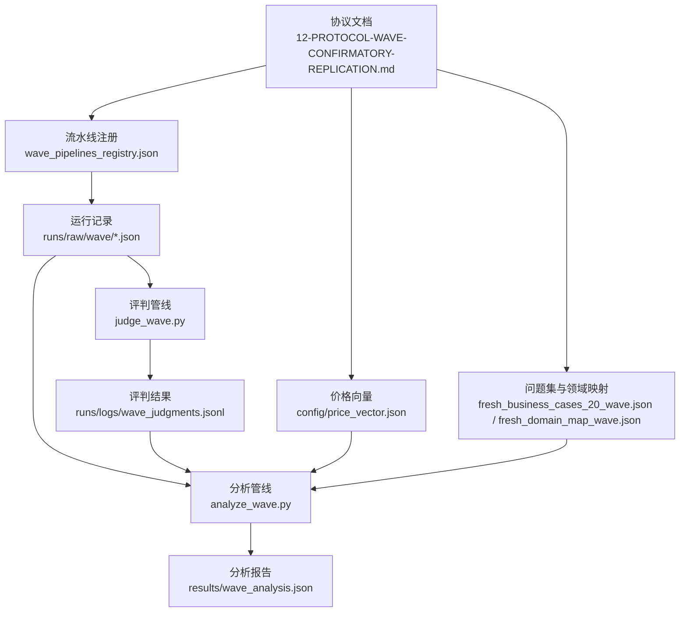
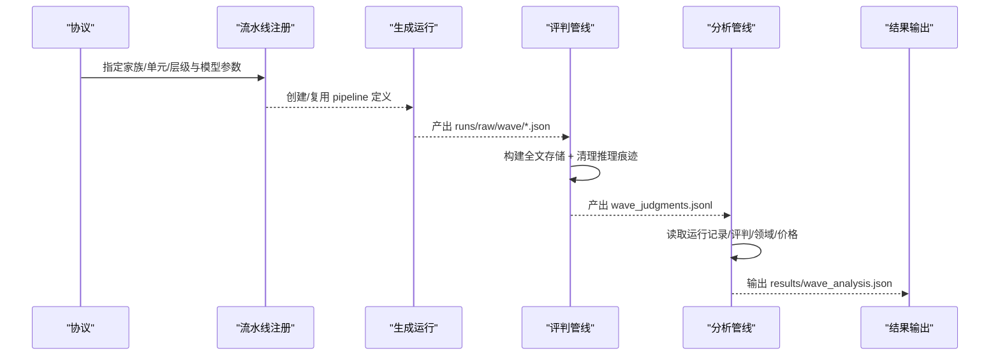
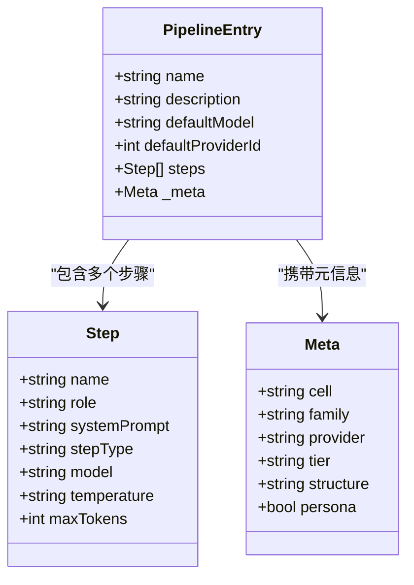
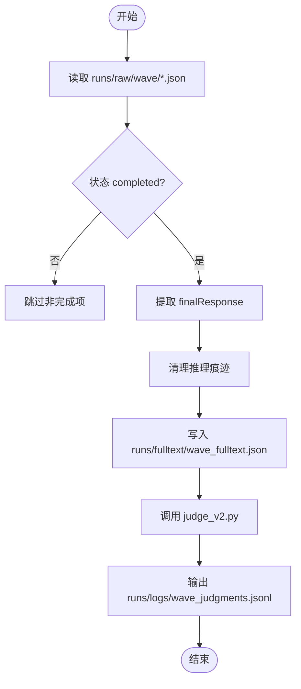
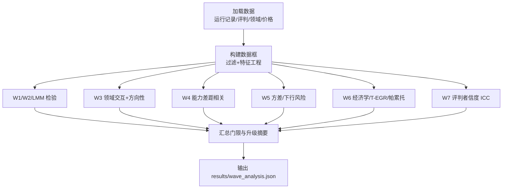
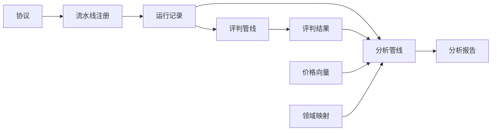

# Protocol 12: 确认性复制波次协议

<cite>
**本文引用的文件**
- [DeeWaanAI-Next/protocols/12-PROTOCOL-WAVE-CONFIRMATORY-REPLICATION.md](file://DeeWaanAI-Next/protocols/12-PROTOCOL-WAVE-CONFIRMATORY-REPLICATION.md)
- [research/orchestration-economics/code/analyze_wave.py](file://research/orchestration-economics/code/analyze_wave.py)
- [research/orchestration-economics/code/judge_wave.py](file://research/orchestration-economics/code/judge_wave.py)
- [research/orchestration-economics/pipelines/fixed/wave_pipelines_registry.json](file://research/orchestration-economics/pipelines/fixed/wave_pipelines_registry.json)
- [research/orchestration-economics/data/problems/fresh_domain_map_wave.json](file://research/orchestration-economics/data/problems/fresh_domain_map_wave.json)
- [research/orchestration-economics/data/problems/fresh_business_cases_20_wave.json](file://research/orchestration-economics/data/problems/fresh_business_cases_20_wave.json)
- [research/orchestration-economics/config/price_vector.json](file://research/orchestration-economics/config/price_vector.json)
- [research/orchestration-economics/config/model_registry.json](file://research/orchestration-economics/config/model_registry.json)
</cite>

## 更新摘要
**所做更改**
- 更新了 Mistral 模型标识符从 'mistral-medium-3-5-26-04' 到 'mistral-medium-2604' 的说明
- 添加了关于模型标识符修正的详细解释和背景信息
- 更新了相关章节以反映数据准确性和可复现性的改进

## 目录
1. [引言](#引言)
2. [项目结构](#项目结构)
3. [核心组件](#核心组件)
4. [架构总览](#架构总览)
5. [详细组件分析](#详细组件分析)
6. [依赖关系分析](#依赖关系分析)
7. [性能与执行特性](#性能与执行特性)
8. [故障排查指南](#故障排查指南)
9. [结论](#结论)
10. [附录](#附录)

## 引言
Protocol 12 是一个"确认性复制波次"研究方案，旨在对 Study-1 的探索性发现进行预注册、独立数据验证与升级判定。该波次使用 30 个全新商业案例（Fresh_Case_1–32，其中 1–10 已存在，11–32 补齐为 6×5 领域网格），覆盖 10 个模型家族（包含 5 个新家族），在三个实验单元（C-S-N、C-T-N、F-S-N）中重复生成与评估，并通过冻结的分析脚本与价格向量进行可复现的成本—质量—延迟评估。所有假设检验与门限规则均在数据生成前锁定，确保结论升级的严谨性。

## 项目结构
本波次的实现围绕"协议—配置—流水线—数据—评判—分析"的链路组织：
- 协议与注册：定义目标、设计、假设与执行纪律
- 流水线注册：按家族/单元/层级固定模型参数与步骤
- 问题集与领域映射：提供无接触的新案例与领域分层
- 价格向量：以 token 为单位计算成本，支持敏感性分析
- 评判管线：构建全文存储、清理推理痕迹、调用冻结评判器
- 分析管线：预注册 W1–W7 门限检验并输出结果

图表来源
- [DeeWaanAI-Next/protocols/12-PROTOCOL-WAVE-CONFIRMATORY-REPLICATION.md:10-169](file://DeeWaanAI-Next/protocols/12-PROTOCOL-WAVE-CONFIRMATORY-REPLICATION.md#L10-L169)
- [research/orchestration-economics/pipelines/fixed/wave_pipelines_registry.json:1-1086](file://research/orchestration-economics/pipelines/fixed/wave_pipelines_registry.json#L1-L1086)
- [research/orchestration-economics/data/problems/fresh_domain_map_wave.json:1-44](file://research/orchestration-economics/data/problems/fresh_domain_map_wave.json#L1-L44)
- [research/orchestration-economics/data/problems/fresh_business_cases_20_wave.json:1-163](file://research/orchestration-economics/data/problems/fresh_business_cases_20_wave.json#L1-L163)
- [research/orchestration-economics/config/price_vector.json:1-37](file://research/orchestration-economics/config/price_vector.json#L1-L37)
- [research/orchestration-economics/code/judge_wave.py:1-104](file://research/orchestration-economics/code/judge_wave.py#L1-L104)
- [research/orchestration-economics/code/analyze_wave.py:1-355](file://research/orchestration-economics/code/analyze_wave.py#L1-L355)

章节来源
- [DeeWaanAI-Next/protocols/12-PROTOCOL-WAVE-CONFIRMATORY-REPLICATION.md:10-169](file://DeeWaanAI-Next/protocols/12-PROTOCOL-WAVE-CONFIRMATORY-REPLICATION.md#L10-L169)

## 核心组件
- 协议与假设：明确波次目标、设计矩阵、假设与门限规则（W1–W7），以及升级规则与解释原则
- 流水线注册：为每个家族/单元/层级固定模型、温度、最大 token 数与步骤序列，标记来源（复用或新建）
- 问题与领域：30 个新鲜案例，6 领域×5 案例的平衡设计，领域映射冻结于生成之前
- 价格向量：以 token 计价的统一价格表，支持主分析与促销敏感性面板
- 评判管线：从原始运行记录构建全文存储，防御性清理推理痕迹，调用冻结评判器产出评判结果
- 分析管线：读取运行记录、评判结果、领域映射与价格向量，执行预注册统计检验并输出结果

章节来源
- [DeeWaanAI-Next/protocols/12-PROTOCOL-WAVE-CONFIRMATORY-REPLICATION.md:36-169](file://DeeWaanAI-Next/protocols/12-PROTOCOL-WAVE-CONFIRMATORY-REPLICATION.md#L36-L169)
- [research/orchestration-economics/pipelines/fixed/wave_pipelines_registry.json:1-1086](file://research/orchestration-economics/pipelines/fixed/wave_pipelines_registry.json#L1-L1086)
- [research/orchestration-economics/data/problems/fresh_domain_map_wave.json:1-44](file://research/orchestration-economics/data/problems/fresh_domain_map_wave.json#L1-L44)
- [research/orchestration-economics/data/problems/fresh_business_cases_20_wave.json:1-163](file://research/orchestration-economics/data/problems/fresh_business_cases_20_wave.json#L1-L163)
- [research/orchestration-economics/config/price_vector.json:1-37](file://research/orchestration-economics/config/price_vector.json#L1-L37)
- [research/orchestration-economics/code/judge_wave.py:1-104](file://research/orchestration-economics/code/judge_wave.py#L1-L104)
- [research/orchestration-economics/code/analyze_wave.py:1-355](file://research/orchestration-economics/code/analyze_wave.py#L1-L355)

## 架构总览
波次执行遵循"预注册—生成—评判—分析—报告"的闭环流程，关键约束包括：
- 模型与价格冻结：模型版本与价格向量在生成前锁定，保证可复现性
- 数据隔离：波次使用全新问题集，不与 Study-1 原始数据混合
- 评判一致性：沿用冻结评判器与提示变体，盲评且温度为零
- 分析锁：分析脚本在评判完成前冻结，任何后验调整需标注为敏感性分析

图表来源
- [research/orchestration-economics/pipelines/fixed/wave_pipelines_registry.json:1-1086](file://research/orchestration-economics/pipelines/fixed/wave_pipelines_registry.json#L1-L1086)
- [research/orchestration-economics/code/judge_wave.py:1-104](file://research/orchestration-economics/code/judge_wave.py#L1-L104)
- [research/orchestration-economics/code/analyze_wave.py:1-355](file://research/orchestration-economics/code/analyze_wave.py#L1-L355)

## 详细组件分析

### 组件A：协议与假设（W1–W7）
- 目标：对 Study-1 的探索性发现进行独立确认，决定是否升级为论文 headline claim
- 设计要点：30 个新问题、10 个模型家族、三单元（C-S-N/C-T-N/F-S-N）、每单元 cheap×3、frontier×2
- 假设与门限：
  - W1：团队效应复制（C-T-N vs C-S-N，方向为正）
  - W2：升级阈值复制（F-S-N vs C-T-N，方向为正）
  - W3：领域交互与方向模式（cell×domain 显著；至少 4/6 领域方向一致，最强正负域匹配）
  - W4：能力差距机制（Δ=FSN−CSN 与 τ=CTN−CSN 的负相关）
  - W5：方差/下行风险（营销领域团队方差优势方向性通过）
  - W6：经济学（T-EGR 与帕累托前沿位置）
  - W7：评判者信度（ICC(3,1)，仅审计）
- 升级规则：仅当对应门限通过时，探索性发现方可升级为 headline claim；未通过则保持探索性

**更新** 在协议第72行的 Mistral 模型标识符已从 'mistral-medium-3-5-26-04' 更正为 'mistral-medium-2604'，以确保数据准确性和可复现性。

章节来源
- [DeeWaanAI-Next/protocols/12-PROTOCOL-WAVE-CONFIRMATORY-REPLICATION.md:10-169](file://DeeWaanAI-Next/protocols/12-PROTOCOL-WAVE-CONFIRMATORY-REPLICATION.md#L10-L169)

### 组件B：流水线注册（家族/单元/层级）
- 内容：为每个家族（gpt、claude、gemini、kimi、qwen、thinkingmachines、gpt-oss、gemma、mistral、minimax）定义 C-S-N、C-T-N、F-S-N 三种单元，cheap/frontier 层级分别绑定具体模型与参数
- 元信息：包含 cell、family、provider、tier、structure、persona 等标签，便于后续聚合与筛选
- 来源标记：部分来自 Study-1 复用（study1-reuse），部分为新创建（created）

**更新** Mistral 家族的 frontier 模型标识符已修正为 'mistral-medium-2604'，并在描述中添加了详细的修正说明，记录了原无效标识符 'mistral-medium-3-5-26-04' 的问题及修正原因。

图表来源
- [research/orchestration-economics/pipelines/fixed/wave_pipelines_registry.json:1-1086](file://research/orchestration-economics/pipelines/fixed/wave_pipelines_registry.json#L1-L1086)

章节来源
- [research/orchestration-economics/pipelines/fixed/wave_pipelines_registry.json:1-1086](file://research/orchestration-economics/pipelines/fixed/wave_pipelines_registry.json#L1-L1086)

### 组件C：问题集与领域映射
- 问题集：fresh_business_cases_20_wave.json 提供 Fresh_Case_11–32（补齐 6×5 网格），与已有的 1–10 共同构成 30 个新问题
- 领域映射：fresh_domain_map_wave.json 将 30 个问题分配到 6 个领域（strategy_market_entry、marketing_communications、operations_supply_chain、hr_organization、finance_business_models、product_innovation），映射在生成前冻结
- 设计意义：确保跨领域的均衡覆盖，支撑 W3 的领域交互与方向性检验

章节来源
- [research/orchestration-economics/data/problems/fresh_business_cases_20_wave.json:1-163](file://research/orchestration-economics/data/problems/fresh_business_cases_20_wave.json#L1-L163)
- [research/orchestration-economics/data/problems/fresh_domain_map_wave.json:1-44](file://research/orchestration-economics/data/problems/fresh_domain_map_wave.json#L1-L44)

### 组件D：价格向量与成本计算
- 价格向量：config/price_vector.json 冻结了各模型的输入/输出单价（USD per 1M tokens），用于将 token 用量转换为美元成本
- 成本公式：cost = tokens × (φ·output + (1−φ)·input)，φ=0.5，与 Study-1 保持一致
- 敏感性：支持 minimax 促销价格向量作为敏感性分析

**更新** 价格向量中包含了修正后的 Mistral 模型定价信息，确保成本计算的准确性。

章节来源
- [research/orchestration-economics/config/price_vector.json:1-37](file://research/orchestration-economics/config/price_vector.json#L1-L37)
- [research/orchestration-economics/code/analyze_wave.py:42-110](file://research/orchestration-economics/code/analyze_wave.py#L42-L110)

### 组件E：评判管线（judge_wave.py）
- 职责：
  - 从 runs/raw/wave/*.json 构建 runs/fulltext/wave_fulltext.json，映射 finalResponse 到 fulltext
  - 防御性清理残留推理痕迹（如特定标记块），统计被清理文档数量
  - 调用冻结评判器 judge_v2.py，输出 runs/logs/wave_judgments.jsonl
- 约束：不修改 judge_v2.py，保持与 Study-1 一致的评判工具链

图表来源
- [research/orchestration-economics/code/judge_wave.py:1-104](file://research/orchestration-economics/code/judge_wave.py#L1-L104)

章节来源
- [research/orchestration-economics/code/judge_wave.py:1-104](file://research/orchestration-economics/code/judge_wave.py#L1-L104)

### 组件F：分析管线（analyze_wave.py）
- 输入：运行记录（wave_run_ledger.json）、评判结果（wave_judgments.jsonl）、领域映射、价格向量、模型注册表
- 处理：
  - 构建数据框，过滤已完成运行与有效单元，计算 composite 与各维度分数
  - 计算成本与 T-EGR（质量/美元·分钟），并进行帕累托前沿判断
  - 执行 LMM（随机截距：family、problem、family×problem）与 Holm 校正
  - 计算 W1–W7 指标与门限判定，输出升级门限摘要
- 输出：results/wave_analysis.json（含 gates、per-domain、pareto、ICC 等）

图表来源
- [research/orchestration-economics/code/analyze_wave.py:1-355](file://research/orchestration-economics/code/analyze_wave.py#L1-L355)

章节来源
- [research/orchestration-economics/code/analyze_wave.py:1-355](file://research/orchestration-economics/code/analyze_wave.py#L1-L355)

### 组件G：模型注册与标识符管理
- 模型注册表：model_registry.json 详细记录了所有模型的标识符、定价、端点信息和提供者配置
- Mistral 模型修正：在 D51 中记录了 Mistral 模型标识符的修正，从无效的 'mistral-medium-3-5-26-04' 更正为有效的 'mistral-medium-2604'
- 修正原因：原标识符在 api.mistral.ai 上无效，新的 dated snapshot 标识符确保了模型的可访问性和稳定性

**更新** 模型注册表中详细记录了 Mistral 模型标识符的修正过程，包括原无效标识符的问题说明和新标识符的优势。

章节来源
- [research/orchestration-economics/config/model_registry.json:190-208](file://research/orchestration-economics/config/model_registry.json#L190-L208)

## 依赖关系分析
- 协议驱动：所有配置与脚本行为受协议约束（模型冻结、价格冻结、分析锁）
- 流水线依赖：pipeline 注册决定生成阶段的模型与参数，影响运行记录的结构
- 评判依赖：judge_wave.py 依赖 judge_v2.py（冻结），并依赖 runs/raw/wave 的运行产物
- 分析依赖：analyze_wave.py 依赖运行记录、评判结果、领域映射与价格向量
- 外部依赖：模型提供商 API（OpenAI、Anthropic、Google、Moonshot、Together、Mistral、MiniMax 等）

**更新** 模型注册表的修正确保了所有依赖关系的正确性，特别是 Mistral 模型的依赖解析。

图表来源
- [DeeWaanAI-Next/protocols/12-PROTOCOL-WAVE-CONFIRMATORY-REPLICATION.md:10-169](file://DeeWaanAI-Next/protocols/12-PROTOCOL-WAVE-CONFIRMATORY-REPLICATION.md#L10-L169)
- [research/orchestration-economics/pipelines/fixed/wave_pipelines_registry.json:1-1086](file://research/orchestration-economics/pipelines/fixed/wave_pipelines_registry.json#L1-L1086)
- [research/orchestration-economics/code/judge_wave.py:1-104](file://research/orchestration-economics/code/judge_wave.py#L1-L104)
- [research/orchestration-economics/code/analyze_wave.py:1-355](file://research/orchestration-economics/code/analyze_wave.py#L1-L355)
- [research/orchestration-economics/config/price_vector.json:1-37](file://research/orchestration-economics/config/price_vector.json#L1-L37)
- [research/orchestration-economics/data/problems/fresh_domain_map_wave.json:1-44](file://research/orchestration-economics/data/problems/fresh_domain_map_wave.json#L1-L44)

章节来源
- [DeeWaanAI-Next/protocols/12-PROTOCOL-WAVE-CONFIRMATORY-REPLICATION.md:10-169](file://DeeWaanAI-Next/protocols/12-PROTOCOL-WAVE-CONFIRMATORY-REPLICATION.md#L10-L169)

## 性能与执行特性
- 并发与调度：生成阶段采用 D34 校准的并发水平，对新提供商进行 RPM 爬坡测试；评判完全并发
- 时间窗口：优先 UTC 14:00–00:00，避开 DeepSeek 高峰时段；Qwen 仅在低峰窗口
- 资源耗尽策略：若某家族额度耗尽，跳过该家族继续其他家族，并在 MANIFEST 披露
- 幂等与恢复：每个运行一个文件，原子写入，可通过目录扫描恢复
- 成本计算：基于 token 与冻结价格向量，避免直接存储美元数值，支持重新定价

**更新** 模型标识符的修正确保了成本计算的准确性，避免了因无效模型标识符导致的执行错误。

章节来源
- [DeeWaanAI-Next/protocols/12-PROTOCOL-WAVE-CONFIRMATORY-REPLICATION.md:121-147](file://DeeWaanAI-Next/protocols/12-PROTOCOL-WAVE-CONFIRMATORY-REPLICATION.md#L121-L147)
- [research/orchestration-economics/config/price_vector.json:1-37](file://research/orchestration-economics/config/price_vector.json#L1-L37)

## 故障排查指南
- 无完成运行：若 runs/raw/wave/ 下无 completed 运行，评判管线会中止并提示
- runId 缺失：若运行记录缺少 runId，评判管线会中止并列出缺失样本
- 价格向量缺失模型：若运行记录的模型不在价格向量中，分析管线会退出并报错
- 数据不足：若某领域样本不足（如营销领域），W5 门限将延后并披露原因
- 家族覆盖不足：若完整家族数少于阈值（W4 要求 ≥8），W4 延后并披露
- **新增** 模型标识符错误：若遇到无效的模型标识符（如原 mistral-medium-3-5-26-04），应使用修正后的标识符

**更新** 新增了针对模型标识符错误的故障排查指导，帮助识别和解决模型标识符相关问题。

章节来源
- [research/orchestration-economics/code/judge_wave.py:53-99](file://research/orchestration-economics/code/judge_wave.py#L53-L99)
- [research/orchestration-economics/code/analyze_wave.py:69-110](file://research/orchestration-economics/code/analyze_wave.py#L69-L110)
- [research/orchestration-economics/code/analyze_wave.py:226-248](file://research/orchestration-economics/code/analyze_wave.py#L226-L248)
- [research/orchestration-economics/code/analyze_wave.py:250-274](file://research/orchestration-economics/code/analyze_wave.py#L250-L274)

## 结论
Protocol 12 通过严格的预注册、冻结配置与独立数据，对 Study-1 的关键发现进行确认性复制。其设计强调：
- 数据隔离与模型/价格冻结，保障可复现性与公平比较
- 多假设门限与升级规则，避免事后贴标签
- 完整的执行与分析链路，覆盖生成、评判、成本与统计推断
- 透明披露与敏感性分析，增强结论稳健性
- **新增** 模型标识符的精确管理，确保技术实现的准确性和可复现性

**更新** 强调了模型标识符修正对整体研究可复现性的重要贡献，体现了研究过程中的严谨性和对细节的关注。

## 附录
- 关键路径参考：
  - 协议文本：[DeeWaanAI-Next/protocols/12-PROTOCOL-WAVE-CONFIRMATORY-REPLICATION.md](file://DeeWaanAI-Next/protocols/12-PROTOCOL-WAVE-CONFIRMATORY-REPLICATION.md)
  - 流水线注册：[research/orchestration-economics/pipelines/fixed/wave_pipelines_registry.json](file://research/orchestration-economics/pipelines/fixed/wave_pipelines_registry.json)
  - 问题与领域：[research/orchestration-economics/data/problems/fresh_business_cases_20_wave.json](file://research/orchestration-economics/data/problems/fresh_business_cases_20_wave.json)、[research/orchestration-economics/data/problems/fresh_domain_map_wave.json](file://research/orchestration-economics/data/problems/fresh_domain_map_wave.json)
  - 价格向量：[research/orchestration-economics/config/price_vector.json](file://research/orchestration-economics/config/price_vector.json)
  - 模型注册表：[research/orchestration-economics/config/model_registry.json](file://research/orchestration-economics/config/model_registry.json)
  - 评判管线：[research/orchestration-economics/code/judge_wave.py](file://research/orchestration-economics/code/judge_wave.py)
  - 分析管线：[research/orchestration-economics/code/analyze_wave.py](file://research/orchestration-economics/code/analyze_wave.py)

**更新** 新增了模型注册表的引用，以便读者了解模型标识符管理的详细信息。