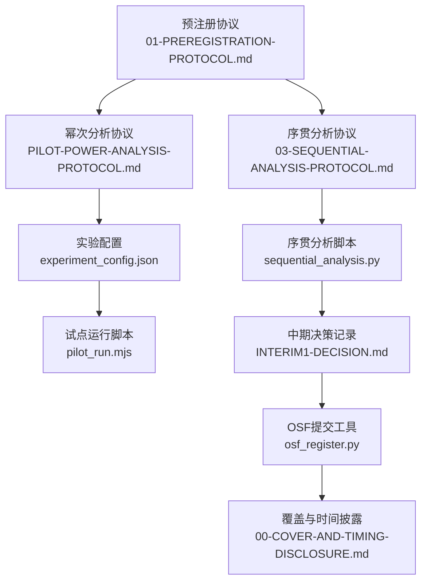
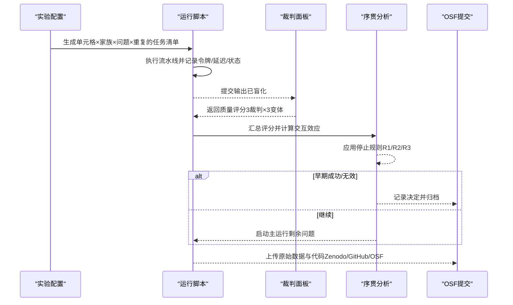
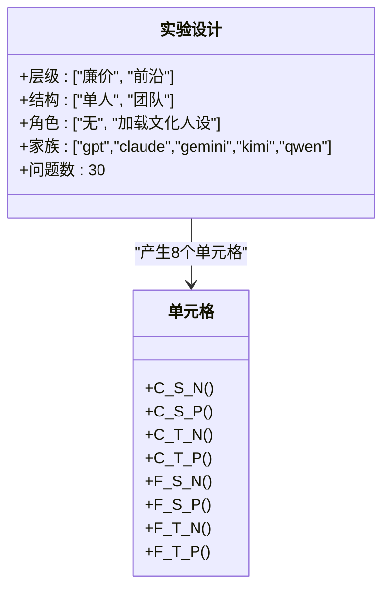
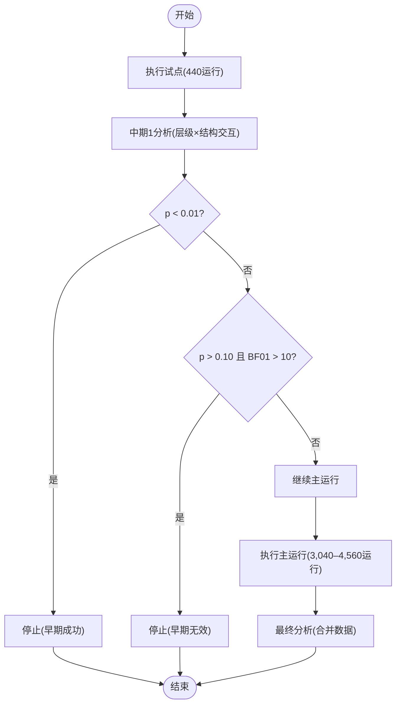
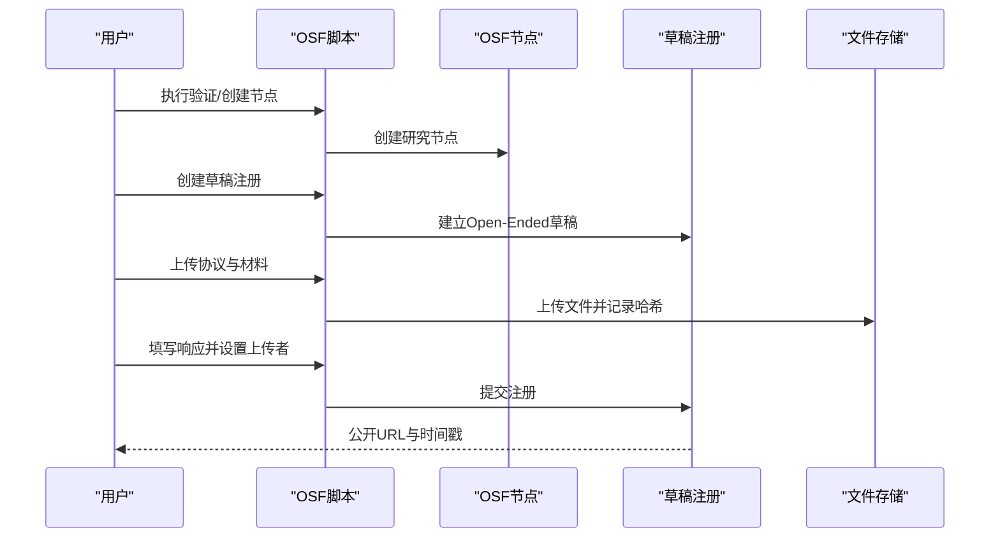
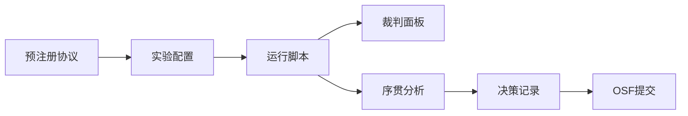

# 预注册协议

<cite>
**本文引用的文件**
- [01-PREREGISTRATION-PROTOCOL.md](file://DeeWaanAI-Next/protocols/01-PREREGISTRATION-PROTOCOL.md)
- [03-SEQUENTIAL-ANALYSIS-PROTOCOL.md](file://DeeWaanAI-Next/protocols/03-SEQUENTIAL-ANALYSIS-PROTOCOL.md)
- [PILOT-POWER-ANALYSIS-PROTOCOL.md](file://DeeWaanAI-Next/PILOT-POWER-ANALYSIS-PROTOCOL.md)
- [experiment_config.json](file://research/orchestration-economics/config/experiment_config.json)
- [sequential_analysis.py](file://research/orchestration-economics/code/sequential_analysis.py)
- [pilot_run.mjs](file://research/orchestration-economics/code/pilot_run.mjs)
- [INTERIM1-DECISION.md](file://research/orchestration-economics/results/INTERIM1-DECISION.md)
- [PILOT-V2-ANALYSIS.md](file://research/orchestration-economics/results/PILOT-V2-ANALYSIS.md)
- [amendment_A1_osf_delta.md](file://research/orchestration-economics/preregistration/amendment_A1_osf_delta.md)
- [osf_register.py](file://research/orchestration-economics/code/osf_register.py)
- [00-COVER-AND-TIMING-DISCLOSURE.md](file://research/orchestration-economics/preregistration/osf_submission/00-COVER-AND-TIMING-DISCLOSURE.md)
</cite>

## 目录
1. [引言](#引言)
2. [项目结构](#项目结构)
3. [核心组件](#核心组件)
4. [架构总览](#架构总览)
5. [详细组件分析](#详细组件分析)
6. [依赖关系分析](#依赖关系分析)
7. [性能与成本考量](#性能与成本考量)
8. [故障排查指南](#故障排查指南)
9. [结论](#结论)
10. [附录](#附录)

## 引言
本文件为DeeWaanAI“编排经济学”研究的预注册协议，聚焦于2×2×2被试内因子实验设计（层级×结构×角色），明确主要与次要假设、结果变量与测量方法、样本量与统计功效、序贯分析与停止规则、盲法设计与数据共享流程。该协议以OSF时间戳化存档，并在主运行前冻结关键要素；后续修正仅涉及测量基础设施与分析稳健性层，不改变假设、设计、单元格、模型族、问题集、样本计划或停止规则。

## 项目结构
研究相关协议与实现位于以下路径：
- 协议与修正案：DeeWaanAI-Next/protocols/*
- 实验配置与运行脚本：research/orchestration-economics/config/*.json, research/orchestration-economics/code/*
- 结果与决策记录：research/orchestration-economics/results/*
- OSF提交流程与状态：research/orchestration-economics/preregistration/*

图表来源
- [01-PREREGISTRATION-PROTOCOL.md:9-67](file://DeeWaanAI-Next/protocols/01-PREREGISTRATION-PROTOCOL.md#L9-L67)
- [03-SEQUENTIAL-ANALYSIS-PROTOCOL.md:8-44](file://DeeWaanAI-Next/protocols/03-SEQUENTIAL-ANALYSIS-PROTOCOL.md#L8-L44)
- [PILOT-POWER-ANALYSIS-PROTOCOL.md:11-25](file://DeeWaanAI-Next/PILOT-POWER-ANALYSIS-PROTOCOL.md#L11-L25)
- [experiment_config.json:5-24](file://research/orchestration-economics/config/experiment_config.json#L5-L24)
- [sequential_analysis.py:1-29](file://research/orchestration-economics/code/sequential_analysis.py#L1-L29)
- [pilot_run.mjs:1-15](file://research/orchestration-economics/code/pilot_run.mjs#L1-L15)
- [INTERIM1-DECISION.md:1-11](file://research/orchestration-economics/results/INTERIM1-DECISION.md#L1-L11)
- [osf_register.py:1-12](file://research/orchestration-economics/code/osf_register.py#L1-L12)
- [00-COVER-AND-TIMING-DISCLOSURE.md:1-10](file://research/orchestration-economics/preregistration/osf_submission/00-COVER-AND-TIMING-DISCLOSURE.md#L1-L10)

章节来源
- [01-PREREGISTRATION-PROTOCOL.md:9-67](file://DeeWaanAI-Next/protocols/01-PREREGISTRATION-PROTOCOL.md#L9-L67)
- [experiment_config.json:5-24](file://research/orchestration-economics/config/experiment_config.json#L5-L24)

## 核心组件
- 实验设计：2×2×2被试内因子（层级：廉价vs前沿；结构：单人vs团队；角色：无vs加载文化人设）。每个单元格包含5个模型家族（gpt、claude、gemini、kimi、qwen）作为被试内因素。
- 假设体系：
  - 主要假设H1：层级×结构的交互效应显著，即团队结构对廉价模型的增益大于前沿模型（支持“编排可替代层级”的论点）。
  - 次要假设：层级主效应、结构主效应、角色主效应、结构×角色交互等。
  - 探索性：模型家族调节层级效应。
- 结果变量：
  - 主要结果：质量评分（由冻结的D33裁判面板产出，3个非推理LLM裁判，与生成器家族不相交），聚合为每运行3名裁判分数的均值。
  - 次要结果：每次运行的成本（输入/输出令牌×提供商定价）、延迟（提交到最终响应的时间）、令牌效率（质量/成本或单位输出令牌的收益）。
- 样本量与功效：
  - 试点：11个问题×8单元格×5家族×1重复=440运行，目标功效约0.80（基于文献效应量估计）。
  - 主运行：19个问题×8单元格×5家族×2–3重复=3,040–4,560运行；总计约3,480–5,000运行。
- 统计分析：
  - 主要分析：重复测量ANOVA或线性混合模型（随机效应：问题、家族），检验层级×结构交互；效应量报告partial η²或标准化系数；事后比较使用Holm-Bonferroni校正。
  - 次要分析：成本-效果前沿、家族调节。
- 排除标准：失败运行、因额度耗尽暂停的运行（分析中排除但需报告计数）、异常值（>3SD标记但不轻易剔除）。
- 停止规则（序贯分析）：
  - 中期1（试点）：若交互p<0.01则提前成功停止；若p>0.10且BF01>10则无效停止；否则继续主运行。
  - 主运行：完成19个问题或达到目标功效后停止。
- 盲法：
  - 裁判不知条件（仅见输出）；生成器在标准流水线执行中不知情。
- 数据共享：
  - 原始数据（运行日志、裁判分数、令牌计数）共享至Zenodo；代码共享至GitHub；材料（问题、提示、裁判量表）共享至OSF。

章节来源
- [01-PREREGISTRATION-PROTOCOL.md:9-105](file://DeeWaanAI-Next/protocols/01-PREREGISTRATION-PROTOCOL.md#L9-L105)
- [experiment_config.json:139-165](file://research/orchestration-economics/config/experiment_config.json#L139-L165)
- [experiment_config.json:245-256](file://research/orchestration-economics/config/experiment_config.json#L245-L256)

## 架构总览
下图展示从实验设计到数据分析与OSF提交的端到端流程，包括试点与主运行的序贯控制、裁判盲法与数据归档。

图表来源
- [experiment_config.json:5-24](file://research/orchestration-economics/config/experiment_config.json#L5-L24)
- [pilot_run.mjs:1-15](file://research/orchestration-economics/code/pilot_run.mjs#L1-L15)
- [sequential_analysis.py:1-29](file://research/orchestration-economics/code/sequential_analysis.py#L1-L29)
- [03-SEQUENTIAL-ANALYSIS-PROTOCOL.md:8-44](file://DeeWaanAI-Next/protocols/03-SEQUENTIAL-ANALYSIS-PROTOCOL.md#L8-L44)
- [01-PREREGISTRATION-PROTOCOL.md:100-105](file://DeeWaanAI-Next/protocols/01-PREREGISTRATION-PROTOCOL.md#L100-L105)

## 详细组件分析

### 实验设计与因子组合
- 因子与水平：
  - 层级：廉价（C）vs 前沿（F）
  - 结构：单人（S）vs 团队（T）
  - 角色：无（N）vs 加载文化人设（P）
- 单元格：8种组合（C-S-N、C-S-P、C-T-N、C-T-P、F-S-N、F-S-P、F-T-N、F-T-P）
- 模型家族：5个（gpt、claude、gemini、kimi、qwen），作为被试内因素
- 问题集：30个（6领域×5题），试点用11个随机子集，主运行用剩余19个

图表来源
- [01-PREREGISTRATION-PROTOCOL.md:9-18](file://DeeWaanAI-Next/protocols/01-PREREGISTRATION-PROTOCOL.md#L9-L18)
- [experiment_config.json:5-24](file://research/orchestration-economics/config/experiment_config.json#L5-L24)

章节来源
- [01-PREREGISTRATION-PROTOCOL.md:9-18](file://DeeWaanAI-Next/protocols/01-PREREGISTRATION-PROTOCOL.md#L9-L18)
- [experiment_config.json:5-24](file://research/orchestration-economics/config/experiment_config.json#L5-L24)

### 假设体系与设计原理
- 主要假设H1：层级×结构交互显著，团队结构对廉价的增益大于前沿（支持“编排经济学”论点：结构可替代层级）。
- 次要假设：
  - H2：层级主效应（前沿整体优于廉价）
  - H3：结构主效应（团队整体优于单人）
  - H4：角色主效应（加载人设整体优于无人设）
  - H5：结构×角色交互（人设在团队中放大结构性严谨）
- 探索性E1：模型家族调节层级效应（如gpt/claude差距大于kimi/qwen）

章节来源
- [01-PREREGISTRATION-PROTOCOL.md:20-48](file://DeeWaanAI-Next/protocols/01-PREREGISTRATION-PROTOCOL.md#L20-L48)

### 结果变量与测量
- 主要结果：质量评分（冻结D33裁判面板，3个非推理LLM裁判，与生成器家族不相交），聚合为每运行3名裁判分数的均值；量表为Likert或0–100（依量表而定）。
- 次要结果：
  - 成本：每次运行的令牌成本（输入/输出令牌×提供商定价）
  - 延迟：提交到最终响应的墙钟时间
  - 令牌效率：质量/成本或单位输出令牌的质量提升
- 裁判盲法：方案剥离臂标识，随机顺序呈现；裁判仅见输出，不知条件。

章节来源
- [01-PREREGISTRATION-PROTOCOL.md:49-61](file://DeeWaanAI-Next/protocols/01-PREREGISTRATION-PROTOCOL.md#L49-L61)
- [experiment_config.json:139-165](file://research/orchestration-economics/config/experiment_config.json#L139-L165)
- [experiment_config.json:177-194](file://research/orchestration-economics/config/experiment_config.json#L177-L194)

### 样本量与统计功效
- 试点：11个问题×8单元格×5家族×1重复=440运行；目标功效约0.80（基于文献效应量估计）
- 主运行：19个问题×8单元格×5家族×2–3重复=3,040–4,560运行；总计约3,480–5,000运行
- 依据：基于可比LLM评估研究的效应量提取与敏感性分析，采用重复测量ANOVA参数设定（α=0.05，power=0.80，8组×5测量，保守相关r=0.5）

章节来源
- [01-PREREGISTRATION-PROTOCOL.md:62-67](file://DeeWaanAI-Next/protocols/01-PREREGISTRATION-PROTOCOL.md#L62-L67)
- [PILOT-POWER-ANALYSIS-PROTOCOL.md:61-90](file://DeeWaanAI-Next/PILOT-POWER-ANALYSIS-PROTOCOL.md#L61-L90)

### 序贯分析与停止规则
- 中期1（试点）：
  - R1（早期成功）：交互p<0.01 → 停止并报告效应量与置信区间
  - R2（早期无效）：p>0.10且BF01>10 → 停止并报告无效效应
  - R3（继续）：其他情况 → 继续主运行
- 中期2（主运行）：合并试点+主运行数据，进行最终分析（α=0.05）
- 实际执行偏差披露：试点将F-T单元格延后至Phase B（仅claude+kimi），因此中期1使用A+B组合数据进行交互估计；平衡子集交叉检查用于稳健性判断

图表来源
- [03-SEQUENTIAL-ANALYSIS-PROTOCOL.md:8-44](file://DeeWaanAI-Next/protocols/03-SEQUENTIAL-ANALYSIS-PROTOCOL.md#L8-L44)
- [sequential_analysis.py:16-27](file://research/orchestration-economics/code/sequential_analysis.py#L16-L27)
- [INTERIM1-DECISION.md:13-59](file://research/orchestration-economics/results/INTERIM1-DECISION.md#L13-L59)

章节来源
- [03-SEQUENTIAL-ANALYSIS-PROTOCOL.md:8-44](file://DeeWaanAI-Next/protocols/03-SEQUENTIAL-ANALYSIS-PROTOCOL.md#L8-L44)
- [sequential_analysis.py:16-27](file://research/orchestration-economics/code/sequential_analysis.py#L16-L27)
- [INTERIM1-DECISION.md:13-59](file://research/orchestration-economics/results/INTERIM1-DECISION.md#L13-L59)

### 盲法设计与裁判机制
- 裁判盲法：方案剥离臂标识，随机顺序呈现；裁判仅见输出，不知条件
- 裁判面板：3个非推理LLM裁判（deepseek、zhipu/GLM、meta/Llama），与生成器家族不相交（D33）
- 裁判温度与变体：温度0，3个固定提示变体，每方案9个评分（3裁判×3变体）

章节来源
- [experiment_config.json:139-165](file://research/orchestration-economics/config/experiment_config.json#L139-L165)
- [experiment_config.json:177-194](file://research/orchestration-economics/config/experiment_config.json#L177-L194)

### 数据共享与OSF提交流程
- 数据共享：
  - 原始数据（运行日志、裁判分数、令牌计数）共享至Zenodo
  - 代码共享至GitHub
  - 材料（问题、提示、裁判量表）共享至OSF
- OSF提交流程：
  - 通过脚本创建节点、草稿注册、上传文件、填写响应并提交
  - 覆盖与时间披露说明注册时间晚于主运行开始，但所有协议与修正案均在相应阶段前冻结并获批
  - 修正案A1仅涉及测量基础设施修正（完整文本裁判、裁判输出完整性、审计字段），不改变假设、设计、单元格、样本计划或停止规则

图表来源
- [osf_register.py:35-153](file://research/orchestration-economics/code/osf_register.py#L35-L153)
- [00-COVER-AND-TIMING-DISCLOSURE.md:11-44](file://research/orchestration-economics/preregistration/osf_submission/00-COVER-AND-TIMING-DISCLOSURE.md#L11-L44)
- [amendment_A1_osf_delta.md:13-58](file://research/orchestration-economics/preregistration/amendment_A1_osf_delta.md#L13-L58)

章节来源
- [01-PREREGISTRATION-PROTOCOL.md:100-105](file://DeeWaanAI-Next/protocols/01-PREREGISTRATION-PROTOCOL.md#L100-L105)
- [osf_register.py:35-153](file://research/orchestration-economics/code/osf_register.py#L35-L153)
- [00-COVER-AND-TIMING-DISCLOSURE.md:11-44](file://research/orchestration-economics/preregistration/osf_submission/00-COVER-AND-TIMING-DISCLOSURE.md#L11-L44)
- [amendment_A1_osf_delta.md:13-58](file://research/orchestration-economics/preregistration/amendment_A1_osf_delta.md#L13-L58)

## 依赖关系分析
- 协议与实现的耦合：
  - 预注册协议定义假设、设计、样本量、停止规则
  - 实验配置提供具体模型族、单元格重复数、裁判设置
  - 运行脚本负责执行与归档，序贯分析脚本读取运行与裁判数据并应用停止规则
  - 结果记录与决策文档反映中期分析结果与继续/停止决定
- 外部依赖：
  - LLM提供商（openai、anthropic、google、moonshot、alibaba）
  - 裁判模型（deepseek、zhipu、meta）
  - OSF API用于注册与版本管理

图表来源
- [01-PREREGISTRATION-PROTOCOL.md:9-67](file://DeeWaanAI-Next/protocols/01-PREREGISTRATION-PROTOCOL.md#L9-L67)
- [experiment_config.json:5-24](file://research/orchestration-economics/config/experiment_config.json#L5-L24)
- [sequential_analysis.py:1-29](file://research/orchestration-economics/code/sequential_analysis.py#L1-L29)
- [INTERIM1-DECISION.md:1-11](file://research/orchestration-economics/results/INTERIM1-DECISION.md#L1-L11)
- [osf_register.py:35-153](file://research/orchestration-economics/code/osf_register.py#L35-L153)

章节来源
- [experiment_config.json:5-24](file://research/orchestration-economics/config/experiment_config.json#L5-L24)
- [sequential_analysis.py:1-29](file://research/orchestration-economics/code/sequential_analysis.py#L1-L29)

## 性能与成本考量
- 成本核算：
  - 成本按令牌×定价计算，价格向量冻结于预注册时点
  - 执行窗口UTC 14:00–00:00，避免高峰时段
  - 令牌效率稳健性：单位输出令牌的质量提升，tokenizer限制需声明
- 性能优化：
  - 并发运行上限与批次间暂停，提高吞吐同时避免过载
  - 重试与退避策略，处理瞬态网络错误
  - 裁判输出完整性门控，缺失维度自动重试，持久失败记录审计

章节来源
- [experiment_config.json:247-256](file://research/orchestration-economics/config/experiment_config.json#L247-L256)
- [experiment_config.json:208-231](file://research/orchestration-economics/config/experiment_config.json#L208-L231)
- [pilot_run.mjs:30-67](file://research/orchestration-economics/code/pilot_run.mjs#L30-L67)

## 故障排查指南
- 常见失败类型：
  - API错误、超时、网络中断（ETIMEDOUT、ECONNRESET等）
  - 逻辑错误（解析失败、工具错误）不应重试
- 恢复策略：
  - 指数退避重试（5s、15s、30s、60s）
  - 断点续传：记录已完成任务，重启跳过
  - 流式错误捕获：从服务端拉取step_error或pipeline_error
- 裁判完整性：
  - 缺失维度评分自动重试最多两次
  - 持续失败记录incomplete标志，不静默丢弃

章节来源
- [pilot_run.mjs:30-67](file://research/orchestration-economics/code/pilot_run.mjs#L30-L67)
- [experiment_config.json:208-231](file://research/orchestration-economics/config/experiment_config.json#L208-L231)
- [amendment_A1_osf_delta.md:30-36](file://research/orchestration-economics/preregistration/amendment_A1_osf_delta.md#L30-L36)

## 结论
本预注册协议明确了2×2×2被试内因子实验设计的核心要素：层级×结构×角色的组合方式、主要与次要假设、质量评分作为主要结果变量的选择依据、成本/延迟/令牌效率等次要结果的测量方法、样本量与功效分析、序贯分析的停止规则与盲法设计，以及数据共享与OSF提交流程。试点阶段的偏差与中期决策表明，主运行需在完全平衡的8单元格×5家族下估计交互效应，以确保结论的稳健性与方向正确性。

## 附录
- 修正案A1：测量基础设施修正（完整文本裁判、裁判输出完整性、审计字段、长度敏感性分析）
- 中期决策记录：试点阶段交互效应的方向与稳健性分析，决定继续主运行
- 试点v2重判：纠正截断导致的裁判偏差，确认主运行必要性

章节来源
- [amendment_A1_osf_delta.md:13-58](file://research/orchestration-economics/preregistration/amendment_A1_osf_delta.md#L13-L58)
- [INTERIM1-DECISION.md:13-59](file://research/orchestration-economics/results/INTERIM1-DECISION.md#L13-L59)
- [PILOT-V2-ANALYSIS.md:13-67](file://research/orchestration-economics/results/PILOT-V2-ANALYSIS.md#L13-L67)