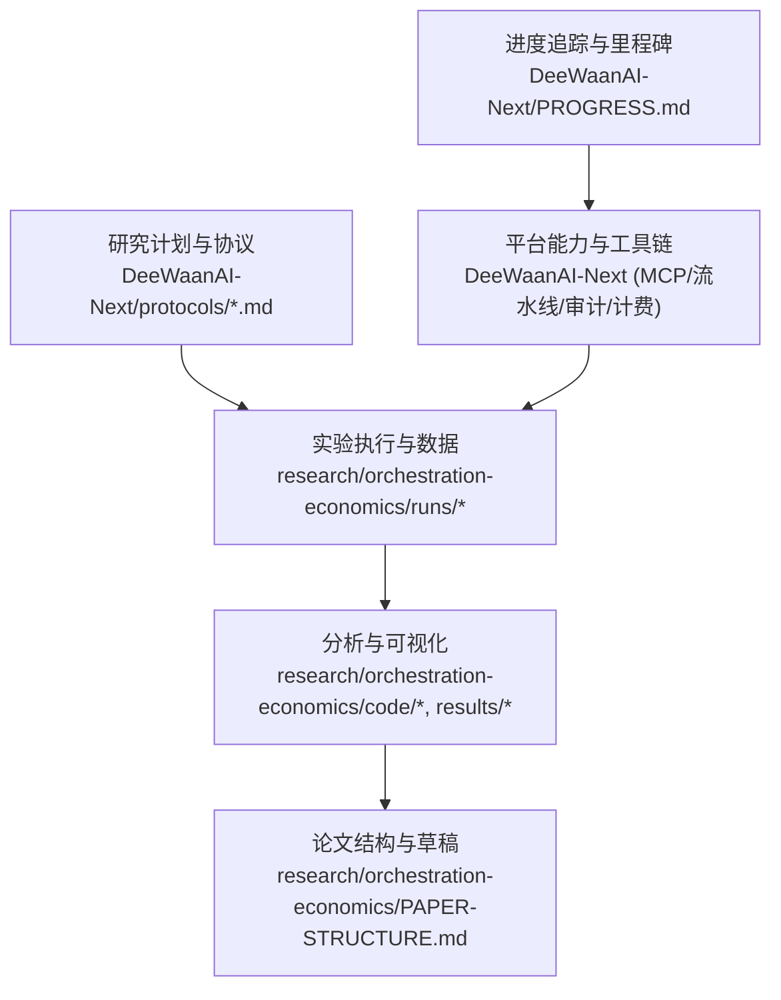
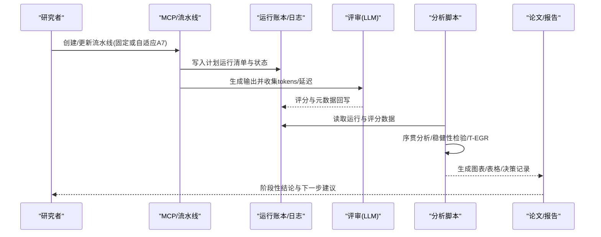
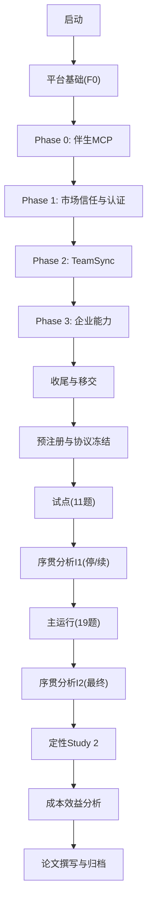
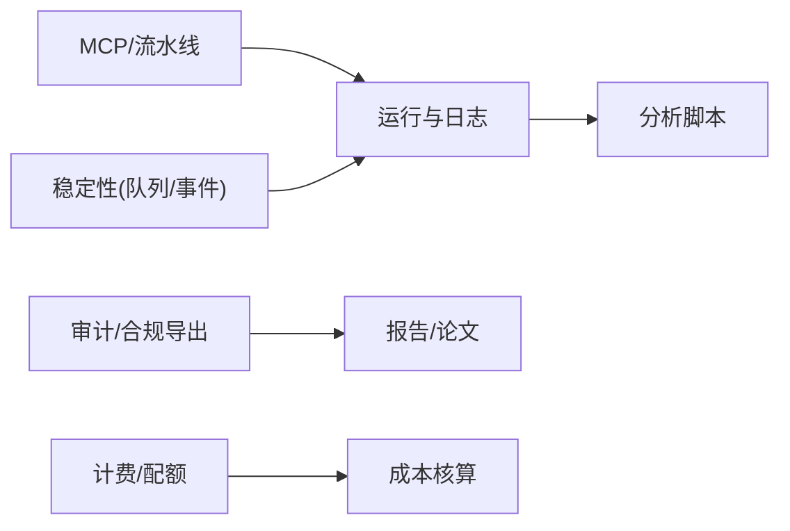

# 研究进度

<cite>
**本文引用的文件**
- [DeeWaanAI-Next/PROGRESS.md](file://DeeWaanAI-Next/PROGRESS.md)
- [DeeWaanAI-Next/RESEARCH-PAPER-PLAN.md](file://DeeWaanAI-Next/RESEARCH-PAPER-PLAN.md)
- [DeeWaanAI-Next/PILOT-POWER-ANALYSIS-PROTOCOL.md](file://DeeWaanAI-Next/PILOT-POWER-ANALYSIS-PROTOCOL.md)
- [DeeWaanAI-Next/protocols/01-PREREGISTRATION-PROTOCOL.md](file://DeeWaanAI-Next/protocols/01-PREREGISTRATION-PROTOCOL.md)
- [DeeWaanAI-Next/protocols/02-QUALITATIVE-ANALYSIS-PROTOCOL.md](file://DeeWaanAI-Next/protocols/02-QUALITATIVE-ANALYSIS-PROTOCOL.md)
- [DeeWaanAI-Next/protocols/03-SEQUENTIAL-ANALYSIS-PROTOCOL.md](file://DeeWaanAI-Next/protocols/03-SEQUENTIAL-ANALYSIS-PROTOCOL.md)
- [DeeWaanAI-Next/protocols/04-COST-EFFECTIVENESS-PROTOCOL.md](file://DeeWaanAI-Next/protocols/04-COST-EFFECTIVENESS-PROTOCOL.md)
- [research/orchestration-economics/PAPER-STRUCTURE.md](file://research/orchestration-economics/PAPER-STRUCTURE.md)
- [research/orchestration-economics/results/INTERIM1-DECISION.md](file://research/orchestration-economics/results/INTERIM1-DECISION.md)
- [research/orchestration-economics/results/INTERIM2-DECISION.md](file://research/orchestration-economics/results/INTERIM2-DECISION.md)
- [research/orchestration-economics/results/COST-EFFECTIVENESS.md](file://research/orchestration-economics/results/COST-EFFECTIVENESS.md)
- [research/orchestration-economics/results/QUALITATIVE-STUDY2.md](file://research/orchestration-economics/results/QUALITATIVE-STUDY2.md)
</cite>

## 目录
1. [引言](#引言)
2. [项目结构](#项目结构)
3. [核心组件](#核心组件)
4. [架构总览](#架构总览)
5. [详细组件分析](#详细组件分析)
6. [依赖关系分析](#依赖关系分析)
7. [性能与成本考量](#性能与成本考量)
8. [故障排查指南](#故障排查指南)
9. [结论](#结论)
10. [附录](#附录)

## 引言
本文件为DeeWaanAI“编排经济学”研究的进度文档，聚焦以下目标：
- 记录整体时间线与里程碑计划（含平台工程与研究执行的并行推进）
- 明确各阶段的研究目标与交付成果
- 解释试点研究的功率分析与样本量计算
- 记录研究论文的计划与章节安排
- 说明阶段性成果的评估标准与验收流程
- 提供研究进度的跟踪方法与报告模板
- 包含风险识别与应对策略
- 记录团队分工与协作机制

## 项目结构
围绕研究的主仓库由两部分构成：
- 应用与平台工程：DeeWaanAI-Next（MCP、流水线、市场信任、企业能力等），以及持续集成与部署脚本
- 研究数据与分析：research/orchestration-economics（实验配置、运行日志、结果、协议与论文结构）

图表来源
- [DeeWaanAI-Next/PROGRESS.md:1-203](file://DeeWaanAI-Next/PROGRESS.md#L1-L203)
- [research/orchestration-economics/PAPER-STRUCTURE.md:1-338](file://research/orchestration-economics/PAPER-STRUCTURE.md#L1-L338)

章节来源
- [DeeWaanAI-Next/PROGRESS.md:1-203](file://DeeWaanAI-Next/PROGRESS.md#L1-L203)
- [research/orchestration-economics/PAPER-STRUCTURE.md:1-338](file://research/orchestration-economics/PAPER-STRUCTURE.md#L1-L338)

## 核心组件
- 预注册与协议套件：定义假设、设计、停止规则、质量与成本度量、定性编码方案
- 幂等执行与可恢复性：基于平台流水线的运行账本与重试策略，确保中断后可继续
- 统计与经济学分析：混合效应模型、序贯分析边界、T-EGR与Pareto前沿
- 论文产出：结构化章节、图表清单、参考文献登记与可复现数据归档

章节来源
- [DeeWaanAI-Next/protocols/01-PREREGISTRATION-PROTOCOL.md:1-131](file://DeeWaanAI-Next/protocols/01-PREREGISTRATION-PROTOCOL.md#L1-L131)
- [DeeWaanAI-Next/protocols/03-SEQUENTIAL-ANALYSIS-PROTOCOL.md:1-142](file://DeeWaanAI-Next/protocols/03-SEQUENTIAL-ANALYSIS-PROTOCOL.md#L1-L142)
- [DeeWaanAI-Next/protocols/04-COST-EFFECTIVENESS-PROTOCOL.md:1-164](file://DeeWaanAI-Next/protocols/04-COST-EFFECTIVENESS-PROTOCOL.md#L1-L164)
- [research/orchestration-economics/PAPER-STRUCTURE.md:1-338](file://research/orchestration-economics/PAPER-STRUCTURE.md#L1-L338)

## 架构总览
研究执行通过DeeWaanAI的MCP与流水线能力驱动，形成“计划—执行—评估—分析—论文”的闭环。

图表来源
- [DeeWaanAI-Next/RESEARCH-PAPER-PLAN.md:352-388](file://DeeWaanAI-Next/RESEARCH-PAPER-PLAN.md#L352-L388)
- [research/orchestration-economics/results/INTERIM1-DECISION.md:1-67](file://research/orchestration-economics/results/INTERIM1-DECISION.md#L1-L67)
- [research/orchestration-economics/results/INTERIM2-DECISION.md:1-117](file://research/orchestration-economics/results/INTERIM2-DECISION.md#L1-L117)

## 详细组件分析

### 时间线与里程碑
- 平台基础与能力（F0至Phase 3、Final Sprint、Batch A/B、Trust Phase 0）：构建MCP、流水线、认证、团队同步、企业SSO/中继、审计导出、读副本与限流等能力，支撑研究执行的可重复性与可扩展性
- 研究主进程：预注册→试点→序贯分析→主运行→定性Study 2→成本效益分析→论文撰写

图表来源
- [DeeWaanAI-Next/PROGRESS.md:9-115](file://DeeWaanAI-Next/PROGRESS.md#L9-L115)
- [DeeWaanAI-Next/PROGRESS.md:117-164](file://DeeWaanAI-Next/PROGRESS.md#L117-L164)
- [DeeWaanAI-Next/PROGRESS.md:166-203](file://DeeWaanAI-Next/PROGRESS.md#L166-L203)
- [research/orchestration-economics/results/INTERIM1-DECISION.md:1-67](file://research/orchestration-economics/results/INTERIM1-DECISION.md#L1-L67)
- [research/orchestration-economics/results/INTERIM2-DECISION.md:1-117](file://research/orchestration-economics/results/INTERIM2-DECISION.md#L1-L117)

章节来源
- [DeeWaanAI-Next/PROGRESS.md:1-203](file://DeeWaanAI-Next/PROGRESS.md#L1-L203)

### 研究目标与交付物
- 研究问题：在成本匹配条件下，小模型+文化人设的序列团队是否优于单一大模型？
- 主要交付：
  - 预注册与协议（假设、设计、停止规则、分析计划）
  - 运行账本与原始数据（令牌、延迟、评分）
  - 序贯分析决策记录（I1/I2）
  - 成本效益前沿与T-EGR
  - 定性机制证据（Study 2）
  - 论文结构与图表清单

章节来源
- [DeeWaanAI-Next/RESEARCH-PAPER-PLAN.md:12-28](file://DeeWaanAI-Next/RESEARCH-PAPER-PLAN.md#L12-L28)
- [research/orchestration-economics/PAPER-STRUCTURE.md:22-94](file://research/orchestration-economics/PAPER-STRUCTURE.md#L22-L94)

### 试点功率分析与样本量计算
- 设计：2×2×2组内因子设计，5个模型家族，30题（6域×5题），试点为随机子集
- 任务：从文献提取效应量，进行重复测量ANOVA功率分析，给出所需问题数N及敏感性曲线
- 输出：推荐N、工具与参数、可引用段落、保存路径

章节来源
- [DeeWaanAI-Next/PILOT-POWER-ANALYSIS-PROTOCOL.md:1-174](file://DeeWaanAI-Next/PILOT-POWER-ANALYSIS-PROTOCOL.md#L1-L174)

### 研究论文计划与章节安排
- 工作标题与贡献点：首次成本匹配的预注册因子实验；T-EGR指标；机制解释；实践决策规则
- 章节：引言、文献综述、方法、结果、讨论、局限、未来方向、结论
- 图表与附表：设计图、森林图、成本-质量散点与Pareto前沿、代码频率热图、关键发现汇总表等

章节来源
- [research/orchestration-economics/PAPER-STRUCTURE.md:16-94](file://research/orchestration-economics/PAPER-STRUCTURE.md#L16-L94)
- [research/orchestration-economics/PAPER-STRUCTURE.md:280-338](file://research/orchestration-economics/PAPER-STRUCTURE.md#L280-L338)

### 阶段性成果评估标准与验收流程
- 序贯分析停止规则：
  - 早期成功：p < 0.01 → 停止并报告
  - 早期无效：p > 0.10且BF₀₁ > 10 → 停止并报告零效应
  - 否则继续到主运行
- 主运行最终分析：按Rule 4不再收集新数据，报告效应量、CI与p值
- 成本效益验收：Pareto前沿稳定于多φ；ICER排序；T-EGR用于比较

章节来源
- [DeeWaanAI-Next/protocols/03-SEQUENTIAL-ANALYSIS-PROTOCOL.md:20-64](file://DeeWaanAI-Next/protocols/03-SEQUENTIAL-ANALYSIS-PROTOCOL.md#L20-L64)
- [research/orchestration-economics/results/INTERIM1-DECISION.md:37-59](file://research/orchestration-economics/results/INTERIM1-DECISION.md#L37-L59)
- [research/orchestration-economics/results/INTERIM2-DECISION.md:27-89](file://research/orchestration-economics/results/INTERIM2-DECISION.md#L27-L89)
- [DeeWaanAI-Next/protocols/04-COST-EFFECTIVENESS-PROTOCOL.md:50-78](file://DeeWaanAI-Next/protocols/04-COST-EFFECTIVENESS-PROTOCOL.md#L50-L78)

### 研究进度跟踪方法与报告模板
- 进度追踪：以里程碑清单形式记录平台与研究双轨进展，标注完成日期与验证方式
- 报告模板：
  - 序贯分析决策记录（含数据指纹、偏离说明、统计结果、停止规则判定）
  - 成本效益分析报告（单元格汇总、Pareto前沿、ICER、稳健性）
  - 定性分析报告（编码可靠性、主题流行度、机制解释）

章节来源
- [DeeWaanAI-Next/PROGRESS.md:1-203](file://DeeWaanAI-Next/PROGRESS.md#L1-L203)
- [research/orchestration-economics/results/INTERIM1-DECISION.md:1-67](file://research/orchestration-economics/results/INTERIM1-DECISION.md#L1-L67)
- [research/orchestration-economics/results/COST-EFFECTIVENESS.md:1-73](file://research/orchestration-economics/results/COST-EFFECTIVENESS.md#L1-L73)
- [research/orchestration-economics/results/QUALITATIVE-STUDY2.md:1-97](file://research/orchestration-economics/results/QUALITATIVE-STUDY2.md#L1-L97)

### 风险识别与应对策略
- 模型停用/价格波动：锁定版本与价格向量，使用token不变的成本核算
- 评测不可靠：采用多judge面板与冻结提示词，报告κ/ICC
- 污染质疑：引入后截断案例集做稳健性检查
- 成本超支：限制maxTokens，最后运行昂贵的前线模型
- 平台偏见质疑：公开全部流水线导出与原始日志，平台仅作为仪器

章节来源
- [DeeWaanAI-Next/RESEARCH-PAPER-PLAN.md:391-401](file://DeeWaanAI-Next/RESEARCH-PAPER-PLAN.md#L391-L401)
- [research/orchestration-economics/PAPER-STRUCTURE.md:263-276](file://research/orchestration-economics/PAPER-STRUCTURE.md#L263-L276)

### 团队分工与协作机制
- 角色分工：
  - 研究者：提出假设、冻结协议、审阅结果与论文
  - 工程师：搭建MCP/流水线、保障幂等与可恢复、维护审计与合规导出
  - 分析师：实现序贯分析、稳健性检验、成本效益与可视化
  - 评审员：LLM盲评与人类抽样复核
- 协作机制：
  - 预注册与变更留痕（OSF/Git标签）
  - 运行账本与IDempotent重跑
  - 标准化报告模板与门禁（tsc/i18n/test/build/smoke）

章节来源
- [DeeWaanAI-Next/RESEARCH-PAPER-PLAN.md:352-388](file://DeeWaanAI-Next/RESEARCH-PAPER-PLAN.md#L352-L388)
- [DeeWaanAI-Next/PROGRESS.md:83-115](file://DeeWaanAI-Next/PROGRESS.md#L83-L115)

## 依赖关系分析
研究执行对平台能力的依赖包括：
- MCP工具：创建/更新流水线、运行与状态查询、审批步骤、项目上下文、导出
- 审计与合规：签名导出、访问控制、速率限制
- 计费与配额：按provider定价与token用量核算成本
- 稳定性：队列、发布订阅、事件总线、worker生命周期管理

图表来源
- [DeeWaanAI-Next/RESEARCH-PAPER-PLAN.md:352-388](file://DeeWaanAI-Next/RESEARCH-PAPER-PLAN.md#L352-L388)
- [DeeWaanAI-Next/PROGRESS.md:9-68](file://DeeWaanAI-Next/PROGRESS.md#L9-L68)

章节来源
- [DeeWaanAI-Next/PROGRESS.md:9-68](file://DeeWaanAI-Next/PROGRESS.md#L9-L68)
- [DeeWaanAI-Next/RESEARCH-PAPER-PLAN.md:352-388](file://DeeWaanAI-Next/RESEARCH-PAPER-PLAN.md#L352-L388)

## 性能与成本考量
- 成本核算：基于冻结价格向量的token不变成本，主φ=0.5，敏感性φ∈{0.25,0.75}
- 经济性指标：T-EGR（团队级效率增益比）、ICER（增量成本效果比）
- Pareto前沿：跨φ稳定的最优组合；persona单元普遍被其无persona孪生支配
- 优化建议：优先选择C-S-N/C-T-N/F-S-N；谨慎使用F-T系列；必要时用低成本精炼步骤提升性价比

章节来源
- [research/orchestration-economics/results/COST-EFFECTIVENESS.md:1-73](file://research/orchestration-economics/results/COST-EFFECTIVENESS.md#L1-L73)
- [DeeWaanAI-Next/protocols/04-COST-EFFECTIVENESS-PROTOCOL.md:9-78](file://DeeWaanAI-Next/protocols/04-COST-EFFECTIVENESS-PROTOCOL.md#L9-L78)

## 故障排查指南
- 序贯分析不一致：当不同预设分析选项冲突时，遵循“继续到主运行”的规则，避免过早停止
- 数据完整性：锁定数据集并记录SHA指纹；排除系统性缺失单元格但保留部分评分
- 成本偏差披露：团队中间输出未计入导致团队成本略低估，方向有利于廉价团队，已在协议中披露
- 平台侧异常：利用队列去重、事件总线、worker恢复与审计日志定位问题

章节来源
- [research/orchestration-economics/results/INTERIM1-DECISION.md:13-59](file://research/orchestration-economics/results/INTERIM1-DECISION.md#L13-L59)
- [research/orchestration-economics/results/INTERIM2-DECISION.md:10-25](file://research/orchestration-economics/results/INTERIM2-DECISION.md#L10-L25)
- [DeeWaanAI-Next/protocols/04-COST-EFFECTIVENESS-PROTOCOL.md:131-164](file://DeeWaanAI-Next/protocols/04-COST-EFFECTIVENESS-PROTOCOL.md#L131-L164)

## 结论
- 序贯分析支持H1：在成本匹配下，团队结构对廉价模型的增益大于前线模型
- 成本效益显示：廉价单人/团队（无人设）位于Pareto前沿；人设单元普遍被支配
- 机制证据：精炼步骤通过增加结构与长度提升分数，但无法复制前线的密度优势
- 下一步：完成论文撰写与数据归档，保持开放科学与可复现

## 附录
- 协议与修订：预注册、定性分析、序贯分析、成本效益及多项修订（A1–A4）
- 论文结构：章节、图表、参考登记与映射
- 运行与结果：主运行、序贯决策、成本效益、定性Study 2

章节来源
- [DeeWaanAI-Next/protocols/01-PREREGISTRATION-PROTOCOL.md:1-131](file://DeeWaanAI-Next/protocols/01-PREREGISTRATION-PROTOCOL.md#L1-L131)
- [DeeWaanAI-Next/protocols/02-QUALITATIVE-ANALYSIS-PROTOCOL.md:1-133](file://DeeWaanAI-Next/protocols/02-QUALITATIVE-ANALYSIS-PROTOCOL.md#L1-L133)
- [research/orchestration-economics/PAPER-STRUCTURE.md:1-338](file://research/orchestration-economics/PAPER-STRUCTURE.md#L1-L338)
- [research/orchestration-economics/results/QUALITATIVE-STUDY2.md:1-97](file://research/orchestration-economics/results/QUALITATIVE-STUDY2.md#L1-L97)