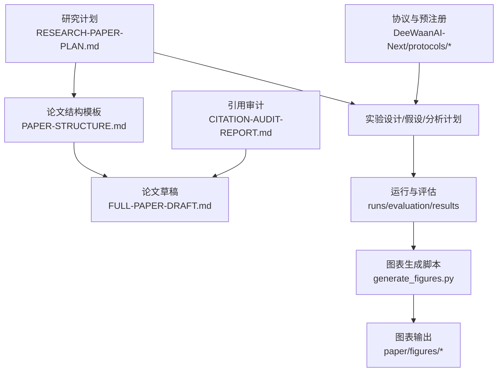
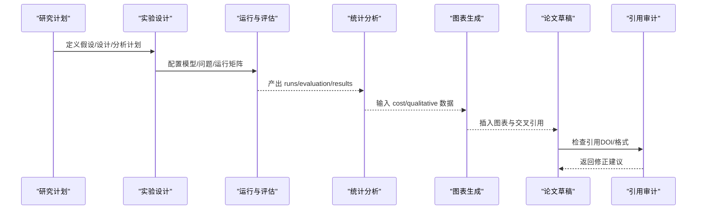
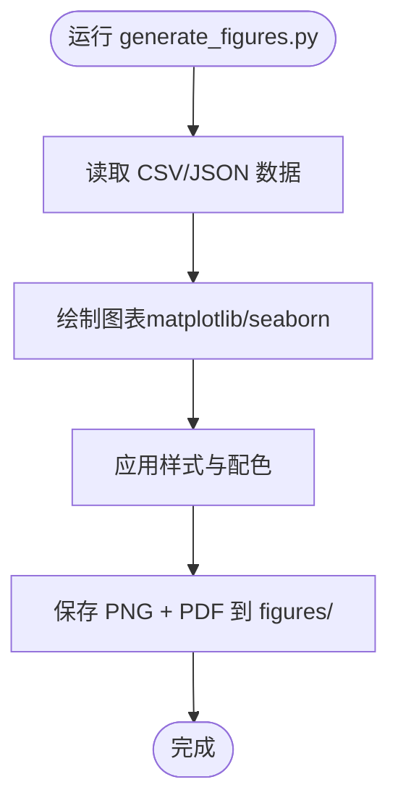
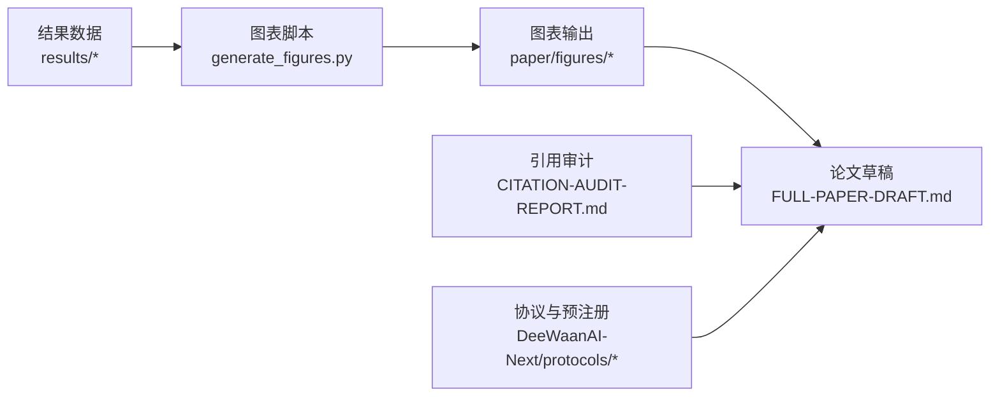

# 论文撰写

<cite>
**本文引用的文件**
- [research/orchestration-economics/README.md](file://research/orchestration-economics/README.md)
- [research/orchestration-economics/PAPER-STRUCTURE.md](file://research/orchestration-economics/PAPER-STRUCTURE.md)
- [research/orchestration-economics/RESEARCH-PAPER-PLAN.md](file://research/orchestration-economics/RESEARCH-PAPER-PLAN.md)
- [research/orchestration-economics/paper/generate_figures.py](file://research/orchestration-economics/paper/generate_figures.py)
- [research/orchestration-economics/paper/FIGURE-SELECTION-GUIDE.md](file://research/orchestration-economics/paper/FIGURE-SELECTION-GUIDE.md)
- [research/orchestration-economics/paper/CITATION-AUDIT-REPORT.md](file://research/orchestration-economics/paper/CITATION-AUDIT-REPORT.md)
- [DeeWaanAI-Next/protocols/01-PREREGISTRATION-PROTOCOL.md](file://DeeWaanAI-Next/protocols/01-PREREGISTRATION-PROTOCOL.md)
- [research/orchestration-economics/paper/FULL-PAPER-DRAFT.md](file://research/orchestration-economics/paper/FULL-PAPER-DRAFT.md)
</cite>

## 目录
1. [引言](#引言)
2. [项目结构](#项目结构)
3. [核心组件](#核心组件)
4. [架构总览](#架构总览)
5. [详细组件分析](#详细组件分析)
6. [依赖关系分析](#依赖关系分析)
7. [性能与可重复性](#性能与可重复性)
8. [故障排查指南](#故障排查指南)
9. [结论](#结论)
10. [附录](#附录)

## 引言
本文件面向“DeeWaanAI 的论文”撰写工作，目标是提供一份从整体结构、图表脚本使用、引用管理、版本控制与协作流程，到学术写作规范、数据可视化最佳实践、同行评审准备与回复策略、以及发布传播渠道的系统化指南。文档严格基于仓库内现有材料整理，确保每一步操作都可追溯、可复现。

## 项目结构
围绕论文写作的核心资源集中在 research/orchestration-economics 目录：
- 研究计划与设计：RESEARCH-PAPER-PLAN.md、PAPER-STRUCTURE.md、README.md
- 论文草稿与图表：paper/ 下的 FULL-PAPER-DRAFT.md 与 generate_* 系列脚本
- 协议与预注册：DeeWaanAI-Next/protocols/ 下的多份协议与修正案
- 结果与数据：results/ 下的成本、质量、定性编码等数据（由脚本读取）

**图示来源**
- [research/orchestration-economics/RESEARCH-PAPER-PLAN.md:1-120](file://research/orchestration-economics/RESEARCH-PAPER-PLAN.md#L1-L120)
- [research/orchestration-economics/PAPER-STRUCTURE.md:1-120](file://research/orchestration-economics/PAPER-STRUCTURE.md#L1-L120)
- [research/orchestration-economics/paper/generate_figures.py:1-60](file://research/orchestration-economics/paper/generate_figures.py#L1-L60)

**章节来源**
- [research/orchestration-economics/README.md:18-41](file://research/orchestration-economics/README.md#L18-L41)
- [research/orchestration-economics/RESEARCH-PAPER-PLAN.md:434-473](file://research/orchestration-economics/RESEARCH-PAPER-PLAN.md#L434-L473)

## 核心组件
- 论文结构与章节安排：PAPER-STRUCTURE.md 定义了编号章节（引言、文献综述、方法、结果、讨论、局限、未来方向、结论），并给出每节要点、关键结论句与图表清单。
- 研究计划：RESEARCH-PAPER-PLAN.md 明确研究问题、假设、实验设计、执行计划、预算与风险、数据与代码可获取性。
- 图表生成：generate_figures.py 统一生成论文所需的核心图表（设计图、森林图、差距恢复、热力图、T-EGR 柱状图等）。
- 引用管理：CITATION-AUDIT-REPORT.md 提供 DOI 校验、错误修复建议与提交前必改项。
- 协议与预注册：DeeWaanAI-Next/protocols/ 包含预注册协议、分析与修正协议，保障研究透明性与可重复性。

**章节来源**
- [research/orchestration-economics/PAPER-STRUCTURE.md:1-120](file://research/orchestration-economics/PAPER-STRUCTURE.md#L1-L120)
- [research/orchestration-economics/RESEARCH-PAPER-PLAN.md:12-108](file://research/orchestration-economics/RESEARCH-PAPER-PLAN.md#L12-L108)
- [research/orchestration-economics/paper/generate_figures.py:1-60](file://research/orchestration-economics/paper/generate_figures.py#L1-L60)
- [research/orchestration-economics/paper/CITATION-AUDIT-REPORT.md:9-36](file://research/orchestration-economics/paper/CITATION-AUDIT-REPORT.md#L9-L36)
- [DeeWaanAI-Next/protocols/01-PREREGISTRATION-PROTOCOL.md:1-131](file://DeeWaanAI-Next/protocols/01-PREREGISTRATION-PROTOCOL.md#L1-L131)

## 架构总览
论文生产流水线包括“设计—执行—评估—分析—图表—成稿—引用审计—发布”的闭环。下图展示主要组件与数据流。

**图示来源**
- [research/orchestration-economics/RESEARCH-PAPER-PLAN.md:382-418](file://research/orchestration-economics/RESEARCH-PAPER-PLAN.md#L382-L418)
- [research/orchestration-economics/paper/generate_figures.py:144-183](file://research/orchestration-economics/paper/generate_figures.py#L144-L183)
- [research/orchestration-economics/paper/CITATION-AUDIT-REPORT.md:91-97](file://research/orchestration-economics/paper/CITATION-AUDIT-REPORT.md#L91-L97)

## 详细组件分析

### 论文结构与章节安排
- 章节顺序：1 引言 → 2 文献综述 → 3 方法 → 4 结果 → 5 讨论 → 6 局限 → 7 未来方向 → 8 结论。
- 每节要点：
  - 引言：漏斗式引入、编号贡献、路线图段落。
  - 文献综述：主题分流的四个流派 + 整合段。
  - 方法：设计/设备/测量/统计/效度/可获取性。
  - 结果：各小节以“关键结论”收尾；含 Study 1/2、经济分析、稳健性。
  - 讨论：理论解释、实践规则、方法论教训。
  - 局限与未来方向：明确边界与后续研究。
  - 结论：四句裁决 + 实践句。
- 图表规划：共列 9 张主图与补充材料清单，对应 §4.x 的具体位置。

**章节来源**
- [research/orchestration-economics/PAPER-STRUCTURE.md:22-124](file://research/orchestration-economics/PAPER-STRUCTURE.md#L22-L124)
- [research/orchestration-economics/PAPER-STRUCTURE.md:127-190](file://research/orchestration-economics/PAPER-STRUCTURE.md#L127-L190)
- [research/orchestration-economics/PAPER-STRUCTURE.md:193-248](file://research/orchestration-economics/PAPER-STRUCTURE.md#L193-L248)
- [research/orchestration-economics/PAPER-STRUCTURE.md:251-296](file://research/orchestration-economics/PAPER-STRUCTURE.md#L251-L296)

### 图表生成脚本使用方法与定制选项
- 入口脚本：generate_figures.py
- 输出目录：research/orchestration-economics/paper/figures/
- 生成的核心图表：
  - 图1：2×2×2 设计与装置示意图
  - 图2：按单元的质量森林图（含 95% CI）
  - 图4：Study 2 差距恢复与维度效应
  - 图5：代码流行度热力图（原始/精炼/前沿）
  - 图6：T-EGR 柱状图
- 数据源：
  - cell_summary.csv（φ=0.5 为主分析）
  - refine_study2_pooled.json（Study 2 精炼结果）
  - qual2_analysis.json（定性编码）
  - cost_effectiveness.json（经济性指标）
- 样式与配色：
  - 字体大小、标题字号、图例字号、DPI 等通过 matplotlib rcParams 设置
  - 单元颜色映射 CELL_COLORS 与标签 CELL_LABELS 集中管理
- 扩展方式：
  - 新增图表可在脚本末尾追加函数块，复用 savefig(name) 保存 PNG+PDF
  - 如需更多变体，参考 FIGURE-SELECTION-GUIDE.md 中的“可能变体”列表

**图示来源**
- [research/orchestration-economics/paper/generate_figures.py:16-57](file://research/orchestration-economics/paper/generate_figures.py#L16-L57)
- [research/orchestration-economics/paper/generate_figures.py:144-183](file://research/orchestration-economics/paper/generate_figures.py#L144-L183)
- [research/orchestration-economics/paper/generate_figures.py:186-255](file://research/orchestration-economics/paper/generate_figures.py#L186-L255)
- [research/orchestration-economics/paper/generate_figures.py:258-328](file://research/orchestration-economics/paper/generate_figures.py#L258-L328)
- [research/orchestration-economics/paper/generate_figures.py:331-363](file://research/orchestration-economics/paper/generate_figures.py#L331-L363)

**章节来源**
- [research/orchestration-economics/paper/generate_figures.py:1-60](file://research/orchestration-economics/paper/generate_figures.py#L1-L60)
- [research/orchestration-economics/paper/FIGURE-SELECTION-GUIDE.md:624-647](file://research/orchestration-economics/paper/FIGURE-SELECTION-GUIDE.md#L624-L647)

### 引用管理与参考文献格式规范
- 审计范围：覆盖 PAPER-STRUCTURE.md 中“Reference register”所列条目
- 关键发现：
  - 存在两条“致命错误”需提交前修复（DOI 错误、会议年份/会场错误）
  - 若干次要修正（作者名、副标题、期刊 DOI 可用）
  - 自引条目为 Zenodo 预印本/数据集，需确认目标期刊是否允许
- 建议流程：
  - 在提交前重新通过 Crossref/journal 数据库核验所有 DOI
  - 将自引移至“相关研究”或“数据可用性”部分（视期刊要求）
  - 对已验证正确的条目保留原引用，避免不必要的改动

**章节来源**
- [research/orchestration-economics/paper/CITATION-AUDIT-REPORT.md:9-36](file://research/orchestration-economics/paper/CITATION-AUDIT-REPORT.md#L9-L36)
- [research/orchestration-economics/paper/CITATION-AUDIT-REPORT.md:39-58](file://research/orchestration-economics/paper/CITATION-AUDIT-REPORT.md#L39-L58)
- [research/orchestration-economics/paper/CITATION-AUDIT-REPORT.md:61-87](file://research/orchestration-economics/paper/CITATION-AUDIT-REPORT.md#L61-L87)
- [research/orchestration-economics/paper/CITATION-AUDIT-REPORT.md:91-97](file://research/orchestration-economics/paper/CITATION-AUDIT-REPORT.md#L91-L97)

### 论文草稿的版本控制与协作流程
- 版本标识：FULL-PAPER-DRAFT.md 顶部标注版本号与日期（如 v2, 2026-08-08）
- 变更追踪：
  - 建议在 Git 中以语义化版本标记（v1/v2…）与变更日志记录修改点
  - 图表与数据变更应同步更新 generate_figures.py 与 FIGURE-SELECTION-GUIDE.md 的交叉引用
- 协作建议：
  - 分工：一人负责文本与结构，一人负责图表与数据，一人负责引用审计
  - 评审：内部两轮审阅（内容正确性 + 格式一致性），再进入外部同行评审
  - 冻结：提交前锁定数据与脚本版本，确保可复现

**章节来源**
- [research/orchestration-economics/paper/FULL-PAPER-DRAFT.md:1-8](file://research/orchestration-economics/paper/FULL-PAPER-DRAFT.md#L1-L8)
- [research/orchestration-economics/README.md:12-17](file://research/orchestration-economics/README.md#L12-L17)

### 学术写作规范与语言润色指南
- 结构规范：遵循 PAPER-STRUCTURE.md 的章节顺序与“关键结论”收尾模式
- 术语与缩写：在摘要后列出缩写表，保持全文一致
- 证据导向：每个图表必须承载一个明确的论断，避免装饰性图表
- 语言风格：简洁、精确、避免过度修饰；优先使用量化表述与置信区间
- 自检清单：
  - 所有章节是否对齐模板？
  - 图表是否均有数据来源与交叉引用？
  - 假设与结果是否一一对应？
  - 局限性是否充分披露？

**章节来源**
- [research/orchestration-economics/PAPER-STRUCTURE.md:22-124](file://research/orchestration-economics/PAPER-STRUCTURE.md#L22-L124)
- [research/orchestration-economics/paper/FIGURE-SELECTION-GUIDE.md:9-13](file://research/orchestration-economics/paper/FIGURE-SELECTION-GUIDE.md#L9-L13)

### 图表制作与数据可视化最佳实践
- 选择依据：每张图对应一个论断（见 FIGURE-SELECTION-GUIDE.md 的优先级表）
- 可读性：统一配色、清晰标注、合理尺寸与纵横比
- 可访问性：提供黑白打印版与色盲友好配色（见指南中的调色板）
- 可复现：所有图表由脚本生成，数据源固定，避免手工绘图
- 变体管理：根据期刊限制与审稿人需求选择主图/补充图

**章节来源**
- [research/orchestration-economics/paper/FIGURE-SELECTION-GUIDE.md:17-55](file://research/orchestration-economics/paper/FIGURE-SELECTION-GUIDE.md#L17-L55)
- [research/orchestration-economics/paper/FIGURE-SELECTION-GUIDE.md:606-621](file://research/orchestration-economics/paper/FIGURE-SELECTION-GUIDE.md#L606-L621)

### 同行评审的准备与回复策略
- 准备要点：
  - 预注册与协议公开（OSF/GitHub），保证透明度
  - 完整的数据与代码可获取性声明
  - 稳健性检验与敏感性分析（LOO、φ 面板、长度相关性等）
- 回复策略：
  - 针对“方法学严谨性”：强调预注册、冻结配置、盲评、独立 judge 家族
  - 针对“经济度量”：说明 T-EGR 与价格假设稳健性（φ 面板）
  - 针对“机制解释”：结合定性编码（κ=0.824）与维度分解
- 常见质疑应对：
  - “样本量不足？”：报告功效与置信区间，展示稳健性
  - “LLM 作为评委可靠性？”：报告 κ/ICC、留一法、家族不相干性
  - “成本核算偏差？”：token 不变成本、冻结价格向量、实际日志计费

**章节来源**
- [research/orchestration-economics/RESEARCH-PAPER-PLAN.md:303-316](file://research/orchestration-economics/RESEARCH-PAPER-PLAN.md#L303-L316)
- [research/orchestration-economics/PAPER-STRUCTURE.md:164-189](file://research/orchestration-economics/PAPER-STRUCTURE.md#L164-L189)
- [research/orchestration-economics/README.md:81-90](file://research/orchestration-economics/README.md#L81-L90)

### 论文的发布与传播渠道
- 预注册与数据：OSF（Open Science Framework）与 Zenodo 归档
- 代码与文档：GitHub 仓库，附带 README 与复现实验步骤
- 论文投稿：目标期刊（决策支持、商业研究、电子市场、信息管理类）
- 传播：机构博客、技术社区、学术会议海报与演示

**章节来源**
- [research/orchestration-economics/RESEARCH-PAPER-PLAN.md:378-379](file://research/orchestration-economics/RESEARCH-PAPER-PLAN.md#L378-L379)
- [research/orchestration-economics/README.md:12-17](file://research/orchestration-economics/README.md#L12-L17)

## 依赖关系分析
- 图表脚本依赖数据：
  - results/cost/cell_summary.csv（质量与成本汇总）
  - results/refine_study2_pooled.json（Study 2 精炼结果）
  - results/qual2_analysis.json（定性编码）
  - results/cost/cost_effectiveness.json（经济性指标）
- 论文草稿依赖：
  - 图表文件（PNG/PDF）
  - 引用审计结果（DOI 修正）
- 协议与预注册：
  - 指导实验设计与分析计划，确保方法与结果一致

**图示来源**
- [research/orchestration-economics/paper/generate_figures.py:144-183](file://research/orchestration-economics/paper/generate_figures.py#L144-L183)
- [research/orchestration-economics/paper/CITATION-AUDIT-REPORT.md:91-97](file://research/orchestration-economics/paper/CITATION-AUDIT-REPORT.md#L91-L97)
- [DeeWaanAI-Next/protocols/01-PREREGISTRATION-PROTOCOL.md:1-131](file://DeeWaanAI-Next/protocols/01-PREREGISTRATION-PROTOCOL.md#L1-L131)

**章节来源**
- [research/orchestration-economics/paper/generate_figures.py:144-183](file://research/orchestration-economics/paper/generate_figures.py#L144-L183)
- [research/orchestration-economics/paper/CITATION-AUDIT-REPORT.md:91-97](file://research/orchestration-economics/paper/CITATION-AUDIT-REPORT.md#L91-L97)

## 性能与可重复性
- 可重复性原则：
  - 所有产物（管道定义、响应、令牌/延迟日志、评判提示与分数、分析输出）均导出至文件并提交
  - 运行清单与种子固定，幂等执行，支持中断恢复
- 性能考量：
  - 前端团队成本较高，但质量提升有限；廉价团队在性价比上更优
  - 图表生成脚本运行时短（约 30–45 秒），适合频繁迭代
- 复现步骤：
  - 导入管道 JSON 到 DeeWaanAI（或兼容编排器）
  - 使用实验配置进行运行与评判
  - 执行分析脚本生成表格与图表

**章节来源**
- [research/orchestration-economics/README.md:12-17](file://research/orchestration-economics/README.md#L12-L17)
- [research/orchestration-economics/README.md:81-90](file://research/orchestration-economics/README.md#L81-L90)
- [research/orchestration-economics/paper/FIGURE-SELECTION-GUIDE.md:624-647](file://research/orchestration-economics/paper/FIGURE-SELECTION-GUIDE.md#L624-L647)

## 故障排查指南
- 图表生成失败：
  - 检查数据路径与文件名是否正确（cell_summary.csv、*.json）
  - 确认 matplotlib/seaborn 环境安装与字体支持
- 引用错误：
  - 依据 CITATION-AUDIT-REPORT.md 修复 DOI 与会议年份
  - 重新核验 Crossref/journal 数据库
- 运行中断：
  - 使用幂等执行与指数退避重试策略
  - 检查令牌日志与实际成本，避免静默失败

**章节来源**
- [research/orchestration-economics/paper/CITATION-AUDIT-REPORT.md:91-97](file://research/orchestration-economics/paper/CITATION-AUDIT-REPORT.md#L91-L97)
- [research/orchestration-economics/RESEARCH-PAPER-PLAN.md:342-364](file://research/orchestration-economics/RESEARCH-PAPER-PLAN.md#L342-L364)

## 结论
本指南系统化梳理了 DeewaanAI 论文的撰写流程：从结构设计、图表生成、引用管理，到版本控制、协作与评审策略，以及发布传播渠道。通过严格的预注册、可复现的数据与脚本、以及清晰的图表与引用审计，确保论文具备高学术标准与实践价值。

## 附录
- 快速命令（再生成图表）：
  - python research/orchestration-economics/paper/generate_figures.py
  - python research/orchestration-economics/paper/generate_supplementary_figures.py
  - python research/orchestration-economics/paper/generate_new_figures.py
- 图表编号对照：见 FIGURE-SELECTION-GUIDE.md 的“Figure Numbering Crosswalk”

**章节来源**
- [research/orchestration-economics/paper/FIGURE-SELECTION-GUIDE.md:624-647](file://research/orchestration-economics/paper/FIGURE-SELECTION-GUIDE.md#L624-L647)
- [research/orchestration-economics/paper/FIGURE-SELECTION-GUIDE.md:651-672](file://research/orchestration-economics/paper/FIGURE-SELECTION-GUIDE.md#L651-L672)