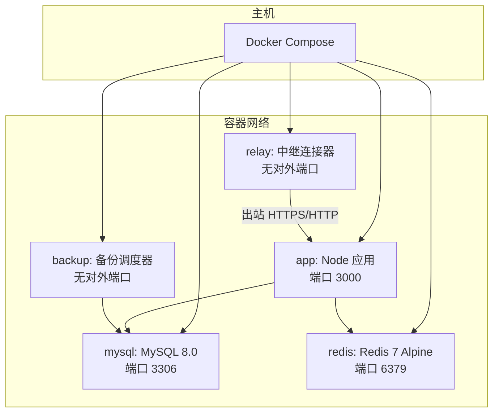
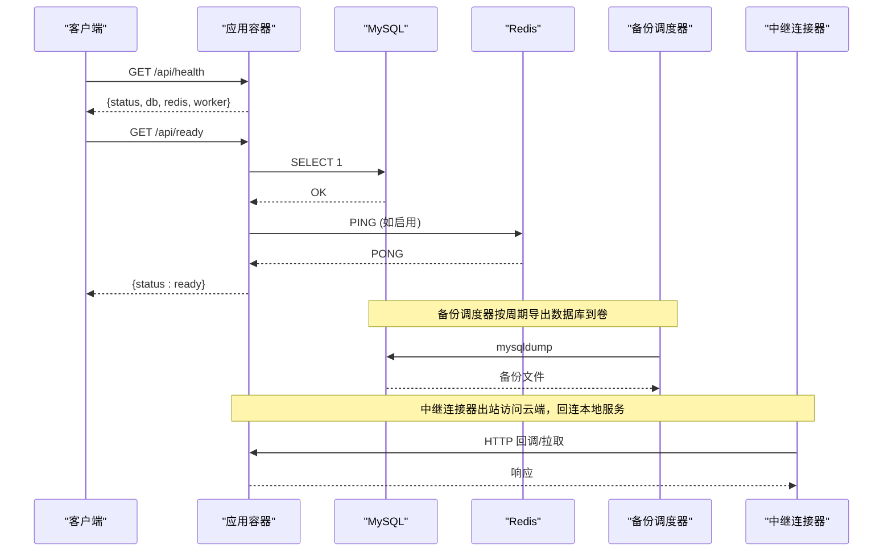
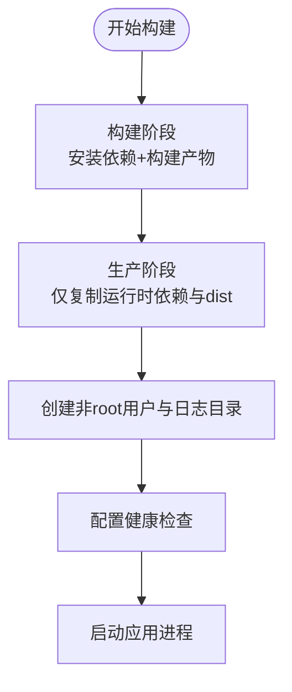
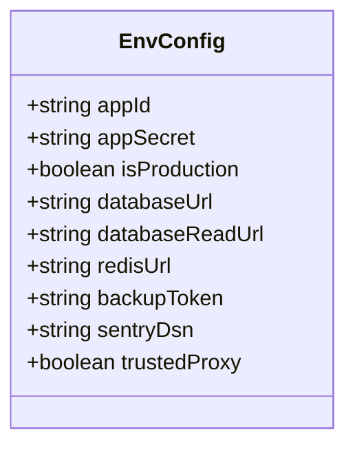
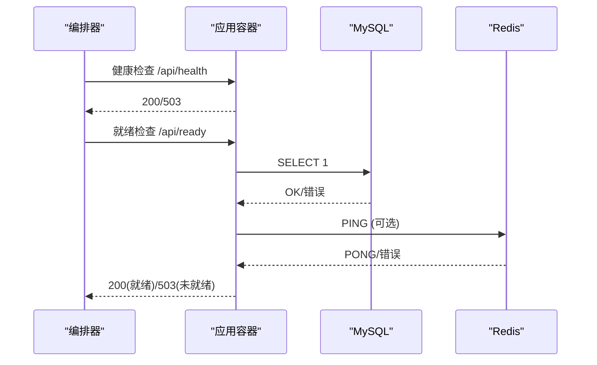
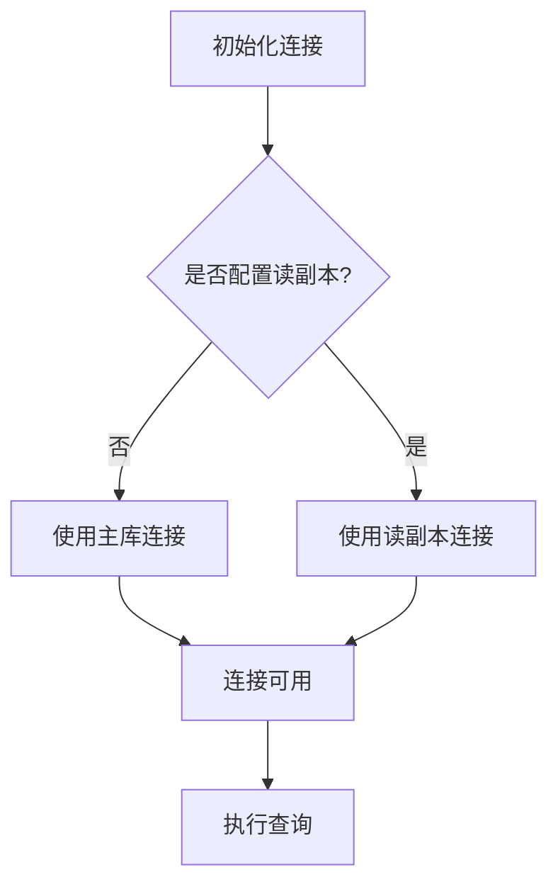
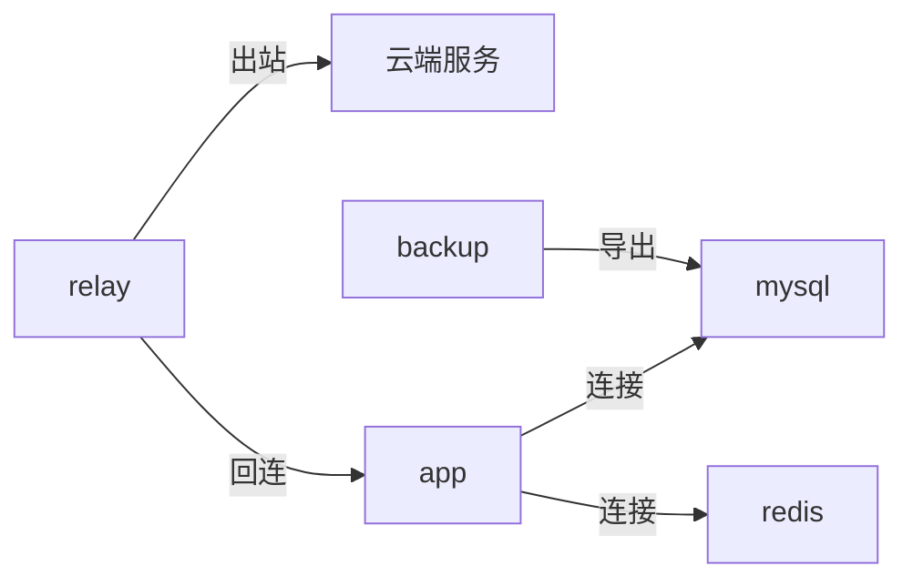
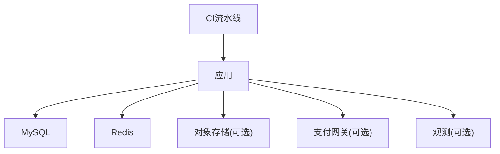

# Docker容器化部署

<cite>
**本文引用的文件**
- [Dockerfile](file://Dockerfile)
- [.dockerignore](file://.dockerignore)
- [docker-compose.yml](file://docker-compose.yml)
- [docker-compose.backup.yml](file://docker-compose.backup.yml)
- [docker-compose.relay.yml](file://docker-compose.relay.yml)
- [DEPLOY.md](file://DEPLOY.md)
- [package.json](file://package.json)
- [api/lib/env.ts](file://api/lib/env.ts)
- [api/boot.ts](file://api/boot.ts)
- [api/infra/redis.ts](file://api/infra/redis.ts)
- [api/queries/connection.ts](file://api/queries/connection.ts)
- [drizzle.config.ts](file://drizzle.config.ts)
- [.github/workflows/ci.yml](file://.github/workflows/ci.yml)
</cite>

## 目录
1. [简介](#简介)
2. [项目结构](#项目结构)
3. [核心组件](#核心组件)
4. [架构总览](#架构总览)
5. [详细组件分析](#详细组件分析)
6. [依赖关系分析](#依赖关系分析)
7. [性能与镜像优化](#性能与镜像优化)
8. [故障排查指南](#故障排查指南)
9. [结论](#结论)
10. [附录](#附录)

## 简介
本文件为DeeWaanAI提供完整的Docker容器化部署指南，覆盖多阶段构建、生产镜像优化、环境变量配置、docker-compose编排（主应用、MySQL、Redis）、健康检查、日志与卷挂载最佳实践，以及自定义镜像构建、推送与生命周期管理。文档基于仓库中的Dockerfile、compose文件与环境配置实现，确保与实际代码一致。

## 项目结构
- 应用服务：Node.js后端，使用Vite构建前端产物并通过esbuild打包后端入口，运行dist下的产物。
- 数据层：MySQL持久化存储；Redis用于缓存、限流与队列等。
- 辅助服务：备份调度器（独立容器）与对端中继连接器（outbound-only）。
- CI/CD：GitHub Actions执行类型检查、测试与构建，并启动真实MySQL/Redis进行集成测试。

图表来源
- [docker-compose.yml:1-52](file://docker-compose.yml#L1-L52)
- [docker-compose.backup.yml:32-47](file://docker-compose.backup.yml#L32-L47)
- [docker-compose.relay.yml:21-38](file://docker-compose.relay.yml#L21-L38)

章节来源
- [docker-compose.yml:1-52](file://docker-compose.yml#L1-L52)
- [docker-compose.backup.yml:1-47](file://docker-compose.backup.yml#L1-L47)
- [docker-compose.relay.yml:1-38](file://docker-compose.relay.yml#L1-L38)

## 核心组件
- 多阶段构建镜像：构建阶段安装依赖并编译产物；生产阶段仅拷贝必要文件，最小化攻击面与体积。
- 健康检查：容器内通过HTTP探针检测应用就绪；数据库与缓存服务各自提供健康检查。
- 环境变量：应用启动读取必需的环境变量，并在生产环境校验敏感项。
- 数据持久化：MySQL与Redis数据通过命名卷持久化。
- 辅助服务：备份调度器定期导出数据库；中继连接器仅出站通信，满足严格外发网络策略。

章节来源
- [Dockerfile:1-39](file://Dockerfile#L1-L39)
- [api/lib/env.ts:1-105](file://api/lib/env.ts#L1-L105)
- [api/boot.ts:85-125](file://api/boot.ts#L85-L125)
- [docker-compose.yml:1-52](file://docker-compose.yml#L1-L52)

## 架构总览
下图展示容器间交互与关键流程：应用启动后连接MySQL与可选的Redis，暴露健康与就绪接口；备份服务定时调用数据库导出；中继连接器向云端发起出站请求并访问本地服务。

图表来源
- [api/boot.ts:85-125](file://api/boot.ts#L85-L125)
- [api/infra/redis.ts:40-87](file://api/infra/redis.ts#L40-L87)
- [docker-compose.backup.yml:32-47](file://docker-compose.backup.yml#L32-L47)
- [docker-compose.relay.yml:21-38](file://docker-compose.relay.yml#L21-L38)

## 详细组件分析

### 多阶段构建与生产镜像
- 构建阶段：基于node:20-alpine，安装依赖并执行构建脚本生成dist产物。
- 生产阶段：再次使用node:20-alpine，仅复制运行时依赖与dist，创建非root用户，安装mysqldump工具，设置环境变量与健康检查，启动应用。
- .dockerignore排除开发文件与构建产物，减少上下文大小。

图表来源
- [Dockerfile:1-39](file://Dockerfile#L1-L39)
- [.dockerignore:1-17](file://.dockerignore#L1-L17)

章节来源
- [Dockerfile:1-39](file://Dockerfile#L1-L39)
- [.dockerignore:1-17](file://.dockerignore#L1-L17)

### 环境变量与安全
- 必需变量：APP_SECRET、DATABASE_URL、AI_SWARM_MASTER_KEY、MARKETPLACE_MASTER_KEY、APP_ID等在生产环境缺失将阻止启动。
- 可选基础设施：REDIS_URL、S3_*、SENTRY_DSN、BACKUP_TOKEN等未配置时应用降级或跳过相关功能。
- 安全校验：生产环境拒绝已知不安全默认值。

图表来源
- [api/lib/env.ts:1-105](file://api/lib/env.ts#L1-L105)

章节来源
- [api/lib/env.ts:1-105](file://api/lib/env.ts#L1-L105)
- [DEPLOY.md:46-63](file://DEPLOY.md#L46-L63)

### 健康检查与就绪探针
- 容器级健康检查：通过wget探测/api/health，返回状态码判断存活。
- 应用就绪探针：/api/ready在MySQL可达且Redis（若启用）连通时返回200，否则503，供负载均衡器路由控制。

图表来源
- [Dockerfile:30-38](file://Dockerfile#L30-L38)
- [api/boot.ts:85-125](file://api/boot.ts#L85-L125)

章节来源
- [Dockerfile:30-38](file://Dockerfile#L30-L38)
- [api/boot.ts:85-125](file://api/boot.ts#L85-L125)

### 数据库与缓存连接
- 数据库连接：通过Drizzle ORM初始化连接实例，支持主库与读副本（当配置DATABASE_READ_URL时）。
- Redis连接：具备重试与退避机制，失败时记录警告并以内存降级模式继续运行。

图表来源
- [api/queries/connection.ts:1-42](file://api/queries/connection.ts#L1-L42)
- [api/infra/redis.ts:40-87](file://api/infra/redis.ts#L40-L87)

章节来源
- [api/queries/connection.ts:1-42](file://api/queries/connection.ts#L1-L42)
- [api/infra/redis.ts:40-87](file://api/infra/redis.ts#L40-L87)

### docker-compose编排
- 主应用：可取消注释以本地开发运行，依赖MySQL健康后启动，映射端口与环境变量。
- MySQL：设置根密码、数据库名与用户，持久化数据卷，提供健康检查。
- Redis：Alpine基础镜像，持久化数据卷，健康检查。
- 备份调度器：独立compose文件，挂载脚本只读，写入备份到宿主目录，无需对外端口。
- 中继连接器：仅出站通信，挂载连接器脚本只读，通过extra_hosts解析host.docker.internal。

图表来源
- [docker-compose.yml:1-52](file://docker-compose.yml#L1-L52)
- [docker-compose.backup.yml:32-47](file://docker-compose.backup.yml#L32-L47)
- [docker-compose.relay.yml:21-38](file://docker-compose.relay.yml#L21-L38)

章节来源
- [docker-compose.yml:1-52](file://docker-compose.yml#L1-L52)
- [docker-compose.backup.yml:1-47](file://docker-compose.backup.yml#L1-L47)
- [docker-compose.relay.yml:1-38](file://docker-compose.relay.yml#L1-L38)

### 日志管理与卷挂载最佳实践
- 日志目录：镜像内创建logs目录并赋予非root用户权限，便于应用输出日志。
- 数据卷：MySQL与Redis数据通过命名卷持久化，避免容器重建丢失数据。
- 备份卷：备份调度器将数据库导出写入宿主./backups目录，建议配合外部存储或定期归档。

章节来源
- [Dockerfile:25-28](file://Dockerfile#L25-L28)
- [docker-compose.yml:12-18](file://docker-compose.yml#L12-L18)
- [docker-compose.backup.yml:36-45](file://docker-compose.backup.yml#L36-L45)

### 构建自定义镜像与推送
- 构建命令：在项目根目录执行标准Docker构建，利用多阶段构建产出生产镜像。
- 推送镜像：将构建好的镜像推送到私有或公有镜像仓库，以便在不同环境部署。
- 版本管理：结合标签与CI流水线，确保镜像与代码版本一致。

章节来源
- [Dockerfile:1-39](file://Dockerfile#L1-L39)
- [package.json:7-21](file://package.json#L7-L21)

### 容器生命周期管理
- 启动：通过docker compose up启动全部服务，或使用docker run单独启动应用。
- 停止：docker compose down清理容器与网络，保留数据卷。
- 重启：服务异常时可通过restart策略自动恢复。
- 监控：通过健康检查与就绪探针观察服务状态。

章节来源
- [docker-compose.yml:1-52](file://docker-compose.yml#L1-L52)
- [docker-compose.backup.yml:44-47](file://docker-compose.backup.yml#L44-L47)
- [docker-compose.relay.yml:35-38](file://docker-compose.relay.yml#L35-L38)

## 依赖关系分析
- 应用依赖：MySQL与Redis为关键依赖，应用启动时校验并建立连接。
- 构建依赖：CI中安装依赖、类型检查、单元测试与构建产物，确保质量门禁。
- 外部依赖：可选S3兼容存储、Stripe支付、Sentry观测等，未配置时应用降级。

图表来源
- [api/lib/env.ts:1-105](file://api/lib/env.ts#L1-L105)
- [.github/workflows/ci.yml:1-96](file://.github/workflows/ci.yml#L1-L96)

章节来源
- [api/lib/env.ts:1-105](file://api/lib/env.ts#L1-L105)
- [.github/workflows/ci.yml:1-96](file://.github/workflows/ci.yml#L1-L96)

## 性能与镜像优化
- 基础镜像：使用node:20-alpine减小体积，降低攻击面。
- 分层缓存：先COPY包清单再安装依赖，充分利用Docker缓存加速重复构建。
- 仅生产依赖：生产阶段使用--omit=dev安装依赖，移除开发工具链。
- 清理缓存：构建完成后清理npm缓存，进一步缩小镜像。
- 非root运行：以普通用户运行应用，提升安全性。
- 健康检查：容器级与应用级健康检查结合，提高编排稳定性。

章节来源
- [Dockerfile:1-39](file://Dockerfile#L1-L39)
- [package.json:7-21](file://package.json#L7-L21)

## 故障排查指南
- 健康检查失败：检查/api/health返回状态，确认MySQL与Redis连接情况。
- 就绪检查失败：查看/api/ready，若503则说明依赖不可用，需检查数据库与缓存配置。
- 环境变量缺失：生产环境缺少必需变量将导致启动失败，核对APP_SECRET、DATABASE_URL等。
- Redis连接失败：应用会重试并降级，查看日志确认连接状态。
- 备份失败：检查备份调度器环境变量与数据库公网/私网可达性。

章节来源
- [api/boot.ts:85-125](file://api/boot.ts#L85-L125)
- [api/lib/env.ts:1-105](file://api/lib/env.ts#L1-L105)
- [api/infra/redis.ts:40-87](file://api/infra/redis.ts#L40-L87)
- [docker-compose.backup.yml:32-47](file://docker-compose.backup.yml#L32-L47)

## 结论
本项目采用多阶段构建与Alpine基础镜像，实现了轻量、安全的容器化方案。通过docker-compose编排MySQL与Redis，并提供备份与中继连接器等辅助服务。健康检查与就绪探针保障编排稳定性，环境变量集中管理确保安全与灵活性。遵循本文档的最佳实践，可实现高效、可靠的部署与运维。

## 附录
- 环境变量参考：详见应用环境模块，包含必需与可选变量说明。
- 数据库迁移：使用Drizzle CLI进行迁移与推送，确保Schema一致性。
- CI流水线：类型检查、测试与构建门禁，集成真实MySQL/Redis验证。

章节来源
- [api/lib/env.ts:1-105](file://api/lib/env.ts#L1-L105)
- [drizzle.config.ts:1-16](file://drizzle.config.ts#L1-L16)
- [.github/workflows/ci.yml:1-96](file://.github/workflows/ci.yml#L1-L96)