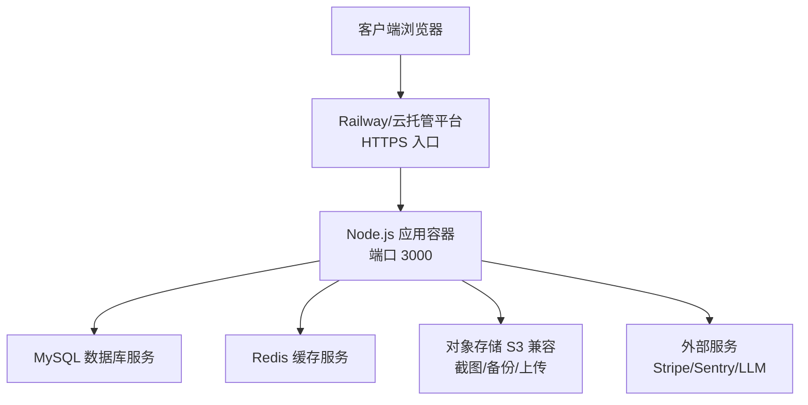
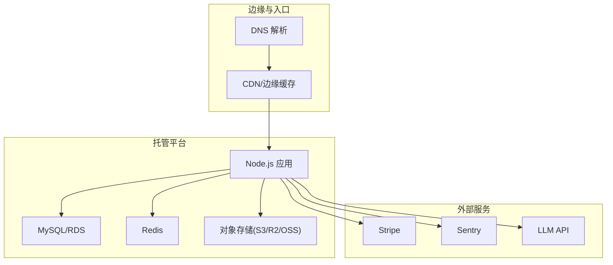
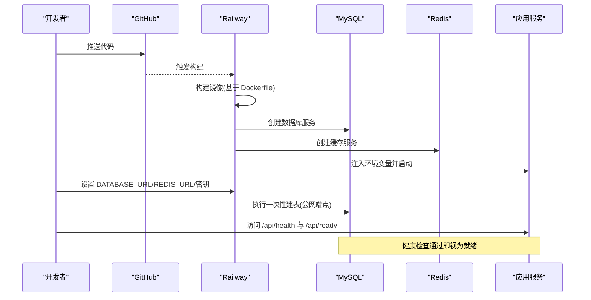
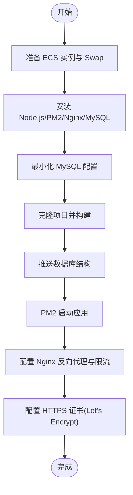
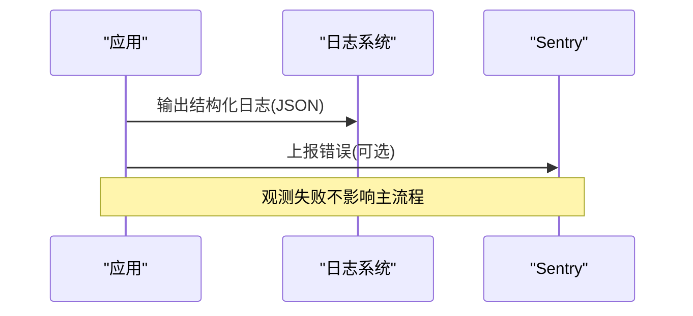
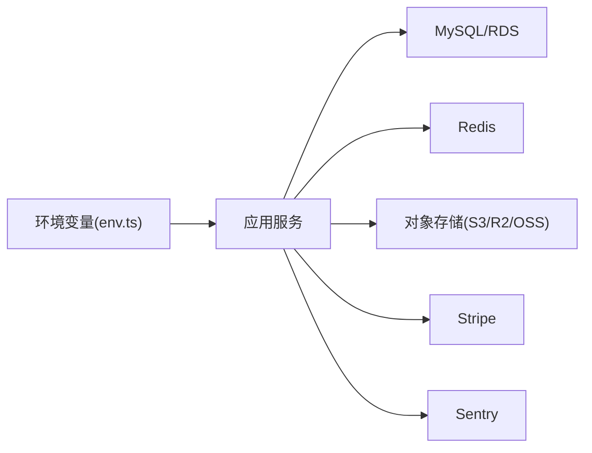

# 云平台部署

<cite>
**本文引用的文件**
- [DEPLOY.md](file://DEPLOY.md)
- [Dockerfile](file://Dockerfile)
- [docker-compose.yml](file://docker-compose.yml)
- [deploy/aliyun-optimized.md](file://deploy/aliyun-optimized.md)
- [deploy/aliyun-setup.sh](file://deploy/aliyun-setup.sh)
- [api/lib/env.ts](file://api/lib/env.ts)
- [api/lib/logger.ts](file://api/lib/logger.ts)
- [api/lib/observability.ts](file://api/lib/observability.ts)
- [DeeWaanAI-Next/PHASE3-SPEC.md](file://DeeWaanAI-Next/PHASE3-SPEC.md)
</cite>

## 目录
1. [简介](#简介)
2. [项目结构](#项目结构)
3. [核心组件](#核心组件)
4. [架构总览](#架构总览)
5. [详细组件分析](#详细组件分析)
6. [依赖关系分析](#依赖关系分析)
7. [性能与成本优化](#性能与成本优化)
8. [故障排查指南](#故障排查指南)
9. [结论](#结论)
10. [附录](#附录)

## 简介
本指南面向在主流云平台部署 DeeWaanAI 的工程与运维团队，提供从 Railway 零代码部署到阿里云 ECS + RDS + OSS 的完整方案，并补充 AWS、Google Cloud 等平台的部署要点。文档覆盖环境配置、域名与 HTTPS、CDN 缓存、监控告警、日志收集、性能优化与弹性伸缩、以及成本优化策略。所有步骤均基于仓库内现有配置与脚本进行说明，确保可落地与可复现。

## 项目结构
- 应用镜像与运行入口：通过 Dockerfile 构建 Node.js 生产镜像，暴露 3000 端口，内置健康检查端点 /api/health。
- 本地开发编排：docker-compose.yml 提供 MySQL 与 Redis 服务，便于本地联调与集成测试。
- 云平台部署指引：
  - Railway 一键部署清单（含数据库、缓存、环境变量、域名与健康检查）。
  - 阿里云 ECS 最小化部署脚本与内存优化建议。
- 运行时环境与能力开关：集中式环境变量管理，支持可选基础设施（Redis、S3 兼容存储、Stripe、Sentry）与功能特性开关。

图表来源
- [Dockerfile:1-39](file://Dockerfile#L1-L39)
- [docker-compose.yml:1-52](file://docker-compose.yml#L1-L52)
- [DEPLOY.md:28-80](file://DEPLOY.md#L28-L80)

章节来源
- [Dockerfile:1-39](file://Dockerfile#L1-L39)
- [docker-compose.yml:1-52](file://docker-compose.yml#L1-L52)
- [DEPLOY.md:28-80](file://DEPLOY.md#L28-L80)

## 核心组件
- 环境变量与密钥管理：集中定义必需与可选变量，生产环境对缺失或默认值进行校验与拒绝启动。
- 健康检查与就绪探针：容器级健康检查调用 /api/health；就绪性可通过 /api/ready 判断依赖可达。
- 可选基础设施：
  - 缓存：Redis（限流、速率控制、会话等）。
  - 对象存储：S3 兼容（截图、备份、静态资源）。
  - 支付：Stripe（测试/生产模式）。
  - 观测：Sentry（错误上报）。
- 安全与代理：可信代理头处理（x-forwarded-for），用于限速与 IP 识别。

章节来源
- [api/lib/env.ts:1-105](file://api/lib/env.ts#L1-L105)
- [DEPLOY.md:46-80](file://DEPLOY.md#L46-L80)
- [Dockerfile:30-38](file://Dockerfile#L30-L38)

## 架构总览
下图展示典型云端部署拓扑：前端通过平台边缘（如 Railway 自定义域名）进入应用容器，应用连接数据库与缓存，使用对象存储持久化数据，并通过外部服务完成支付与错误上报。

图表来源
- [DEPLOY.md:103-112](file://DEPLOY.md#L103-L112)
- [api/lib/env.ts:47-70](file://api/lib/env.ts#L47-L70)
- [DeeWaanAI-Next/PHASE3-SPEC.md:73-81](file://DeeWaanAI-Next/PHASE3-SPEC.md#L73-L81)

## 详细组件分析

### Railway 零代码部署流程
- 前置准备：创建 GitHub 私库并推送代码；生成三个密钥（APP_SECRET、AI_SWARM_MASTER_KEY、MARKETPLACE_MASTER_KEY）。
- 创建项目：在 Railway 选择“从 GitHub 仓库部署”，自动检测 Dockerfile 并构建。
- 添加数据库与缓存：添加 MySQL 与 Redis 服务，获取内部连接 URL。
- 设置环境变量：配置 DATABASE_URL、REDIS_URL、APP_ID、VITE_APP_ID、NODE_ENV 及审计导出密钥等。
- 初始化数据库表：启用 MySQL 公网 TCP 端点，执行一次数据库迁移/推送到远端数据库。
- 开启功能标志：通过数据库 feature_flags 表启用必要功能。
- 获取域名与验证：生成 Railway 域名，访问 /api/health 与 /api/ready 验证服务状态。
- 可选：拆分工作进程：将长任务 worker 独立为单独服务，避免阻塞 HTTP 请求。

图表来源
- [DEPLOY.md:28-112](file://DEPLOY.md#L28-L112)
- [Dockerfile:30-38](file://Dockerfile#L30-L38)

章节来源
- [DEPLOY.md:28-112](file://DEPLOY.md#L28-L112)
- [Dockerfile:30-38](file://Dockerfile#L30-L38)

### 阿里云部署方案（ECS + RDS + OSS）
- ECS 实例与内存预算：推荐 2vCPU 0.5GB 起步，限制单进程与堆大小，配合 Swap 防止 OOM。
- MySQL 最小化配置：降低 InnoDB 缓冲池、关闭性能 schema、限制连接数与超时时间。
- Node.js 进程管理：使用 PM2 以 fork 模式运行，设置最大内存重启阈值。
- Nginx 反向代理与限流：配置请求速率限制、SSE 流式传输超时与缓冲策略。
- 自动化安装脚本：一键安装系统依赖、Node.js、PM2、MySQL、构建应用、推送数据库结构、启动服务与配置防火墙。
- 证书与域名：可使用 Let's Encrypt 自动签发与续期 HTTPS 证书。

图表来源
- [deploy/aliyun-setup.sh:1-198](file://deploy/aliyun-setup.sh#L1-L198)
- [deploy/aliyun-optimized.md:15-123](file://deploy/aliyun-optimized.md#L15-L123)

章节来源
- [deploy/aliyun-optimized.md:1-151](file://deploy/aliyun-optimized.md#L1-L151)
- [deploy/aliyun-setup.sh:1-198](file://deploy/aliyun-setup.sh#L1-L198)

### AWS 部署要点（参考实践）
- 计算与服务：使用 ECS/Fargate 或 EC2 运行 Node.js 容器；通过 ALB/NLB 暴露入口。
- 数据库：使用 RDS for MySQL，配置只读副本提升读性能。
- 缓存：使用 ElastiCache for Redis。
- 对象存储：使用 S3 作为截图与备份存储，配置 IAM 最小权限。
- 域名与证书：使用 ACM 证书与 CloudFront/ALB 组合实现 HTTPS 与缓存。
- 监控与日志：使用 CloudWatch 收集日志与指标，结合 X-Ray 做链路追踪。
- 弹性伸缩：基于 CPU/队列长度/自定义指标配置 Auto Scaling。

章节来源
- [api/lib/env.ts:47-70](file://api/lib/env.ts#L47-L70)
- [DEPLOY.md:125-133](file://DEPLOY.md#L125-L133)

### Google Cloud 部署要点（参考实践）
- 计算与服务：使用 Cloud Run 或 GKE 运行容器；通过 Cloud Load Balancing 暴露入口。
- 数据库：使用 Cloud SQL for MySQL，必要时启用只读副本。
- 缓存：使用 Memorystore for Redis。
- 对象存储：使用 Cloud Storage 作为截图与备份存储。
- 域名与证书：使用 Managed Certificates 与 Global LB 实现 HTTPS。
- 监控与日志：使用 Cloud Monitoring 与 Logging，结合 Error Reporting。
- 弹性伸缩：基于请求量与延迟目标自动扩缩容。

章节来源
- [api/lib/env.ts:47-70](file://api/lib/env.ts#L47-L70)
- [DEPLOY.md:125-133](file://DEPLOY.md#L125-L133)

### 域名配置、HTTPS 与 CDN 加速
- 自定义域名：在 Railway 中绑定自定义域名；或在云厂商 LB/网关处配置域名与证书。
- HTTPS：使用平台托管证书（如 Railway/ACM/Managed Certificates）或 Let’s Encrypt。
- CDN 缓存：对公开响应设置 Cache-Control（例如认证徽章与报告 JSON），提高命中率与降低源站压力。
- 代理与安全：确保可信代理头正确传递，避免绕过限速。

章节来源
- [DEPLOY.md:103-112](file://DEPLOY.md#L103-L112)
- [DeeWaanAI-Next/PHASE3-SPEC.md:73-81](file://DeeWaanAI-Next/PHASE3-SPEC.md#L73-L81)
- [api/lib/env.ts:57-63](file://api/lib/env.ts#L57-L63)

### 监控告警与日志收集
- 健康检查：容器健康检查调用 /api/health；就绪检查 /api/ready 用于依赖可达性判定。
- 结构化日志：应用输出 JSON 格式日志，便于聚合与分析。
- 错误上报：可选接入 Sentry，生产环境根据 DSN 动态初始化。
- 平台日志：利用各云平台日志服务（CloudWatch/Stackdriver/Log Service）统一收集。

图表来源
- [api/lib/logger.ts:1-32](file://api/lib/logger.ts#L1-L32)
- [api/lib/observability.ts:1-34](file://api/lib/observability.ts#L1-L34)
- [Dockerfile:30-38](file://Dockerfile#L30-L38)

章节来源
- [api/lib/logger.ts:1-32](file://api/lib/logger.ts#L1-L32)
- [api/lib/observability.ts:1-34](file://api/lib/observability.ts#L1-L34)
- [Dockerfile:30-38](file://Dockerfile#L30-L38)

### 性能优化与弹性伸缩
- 读扩展：配置数据库只读副本，将读密集型查询路由至副本。
- 缓存策略：合理设置 Cache-Control，减少重复计算与后端压力。
- 限流与降级：基于 Redis 的速率控制与提供者节流，保障稳定性。
- 弹性伸缩：根据 CPU、内存、队列长度或自定义指标自动扩缩容。
- Worker 分离：将长任务从 Web 进程中分离，避免阻塞请求。

章节来源
- [DeeWaanAI-Next/PHASE3-SPEC.md:73-81](file://DeeWaanAI-Next/PHASE3-SPEC.md#L73-L81)
- [api/lib/providerThrottle.ts:116-153](file://api/lib/providerThrottle.ts#L116-L153)
- [DEPLOY.md:135-143](file://DEPLOY.md#L135-L143)

## 依赖关系分析
- 应用与环境变量：
  - 必需：APP_SECRET、DATABASE_URL、AI_SWARM_MASTER_KEY、MARKETPLACE_MASTER_KEY、APP_ID。
  - 可选：REDIS_URL、S3_*、STRIPE_*、SENTRY_DSN、AUDIT_EXPORT_KEY、PUBLIC_APP_URL 等。
- 运行时依赖：
  - 数据库：MySQL（RDS/自建）。
  - 缓存：Redis（ElastiCache/Managed Redis/自建）。
  - 对象存储：S3 兼容（AWS S3/Cloudflare R2/MinIO/阿里云 OSS）。
  - 外部服务：Stripe（支付）、Sentry（错误上报）、LLM API（可选）。

图表来源
- [api/lib/env.ts:21-95](file://api/lib/env.ts#L21-L95)

章节来源
- [api/lib/env.ts:21-95](file://api/lib/env.ts#L21-L95)

## 性能与成本优化
- 容器与进程：
  - 使用多阶段构建减小镜像体积。
  - 限制 Node.js 堆大小与进程数，避免内存溢出。
- 数据库：
  - 最小化 InnoDB 缓冲与连接数，按需启用只读副本。
- 缓存与 CDN：
  - 合理使用 Redis 与 CDN 缓存，降低后端压力。
- 对象存储：
  - 将截图与备份转存至 S3 兼容存储，避免临时文件系统丢失。
- 弹性伸缩：
  - 基于指标自动扩缩容，峰值时扩容、低谷时缩容。
- 成本监控：
  - 定期查看平台用量页面，关注数据库与对象存储费用。

章节来源
- [Dockerfile:1-39](file://Dockerfile#L1-L39)
- [deploy/aliyun-optimized.md:1-151](file://deploy/aliyun-optimized.md#L1-L151)
- [DEPLOY.md:125-133](file://DEPLOY.md#L125-L133)

## 故障排查指南
- 健康检查失败：
  - 检查 /api/health 与 /api/ready 返回状态，确认数据库与缓存可达。
- 崩溃与日志：
  - 查看平台部署日志；应用输出结构化日志便于定位问题。
- 数据库连接：
  - 确认 DATABASE_URL 指向正确的私有或公网端点；首次建表需临时开放公网端点。
- 对象存储：
  - 若截图无法保存，检查 S3_* 环境变量与权限；使用提供的 smoke 脚本验证。
- 备份：
  - 配置 BACKUP_TOKEN 与 S3_*，启用定时备份；或使用本地备份脚本。

章节来源
- [DEPLOY.md:69-112](file://DEPLOY.md#L69-L112)
- [DEPLOY.md:125-133](file://DEPLOY.md#L125-L133)
- [api/lib/logger.ts:1-32](file://api/lib/logger.ts#L1-L32)

## 结论
本指南基于仓库内的 Dockerfile、docker-compose、环境变量与部署脚本，提供了 Railway 零代码部署与阿里云 ECS + RDS + OSS 的完整方案，并补充了 AWS 与 Google Cloud 的部署要点。通过合理的域名与 HTTPS、CDN 缓存、监控与日志、性能优化与弹性伸缩，可实现稳定、可扩展且成本可控的生产部署。建议在上线前完成支付、SSO、中继与只读副本等验收项，确保业务连续性。

## 附录
- 关键环境变量清单（节选）：
  - 必需：APP_SECRET、DATABASE_URL、AI_SWARM_MASTER_KEY、MARKETPLACE_MASTER_KEY、APP_ID。
  - 可选：REDIS_URL、S3_ENDPOINT、S3_REGION、S3_BUCKET、S3_ACCESS_KEY_ID、S3_SECRET_ACCESS_KEY、STRIPE_SECRET_KEY、STRIPE_WEBHOOK_SECRET、SENTRY_DSN、AUDIT_EXPORT_KEY、PUBLIC_APP_URL、BACKUP_TOKEN。
- 健康检查端点：
  - /api/health：服务健康状态。
  - /api/ready：依赖就绪状态（数据库与缓存可达）。

章节来源
- [api/lib/env.ts:21-95](file://api/lib/env.ts#L21-L95)
- [DEPLOY.md:103-112](file://DEPLOY.md#L103-L112)