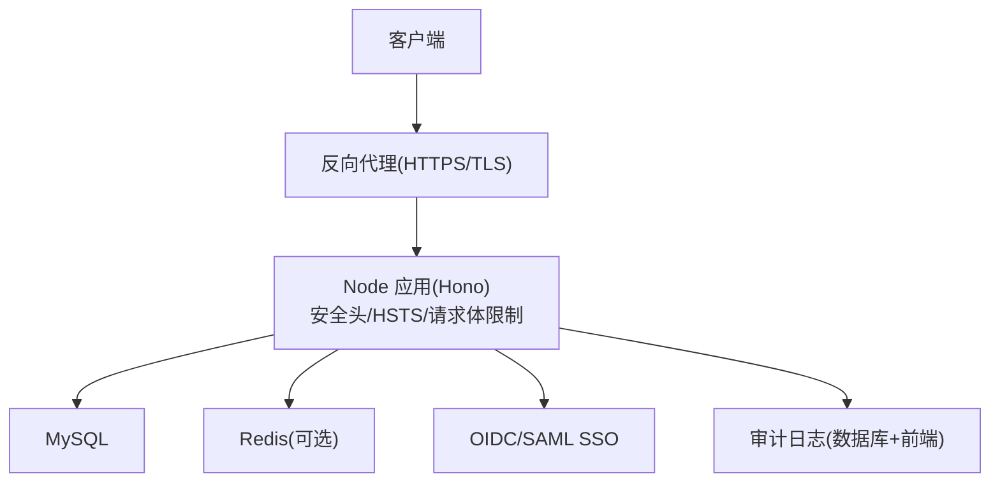
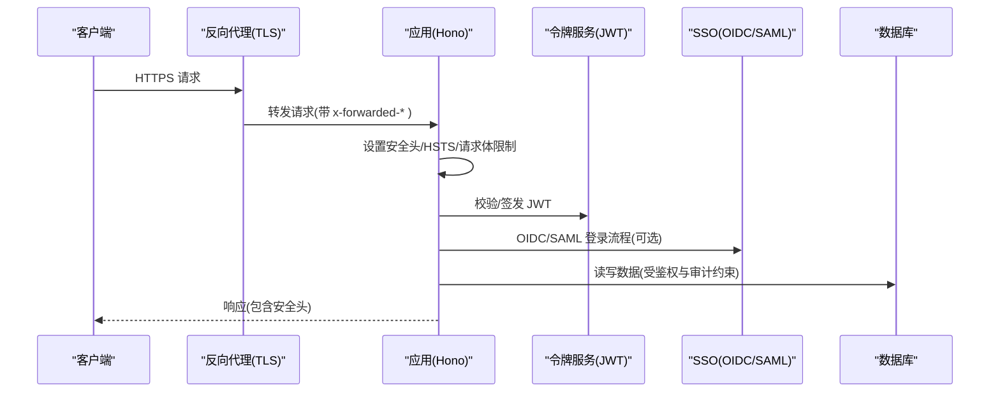
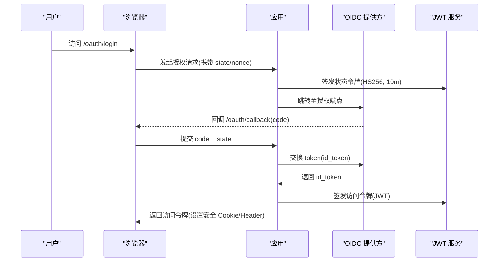
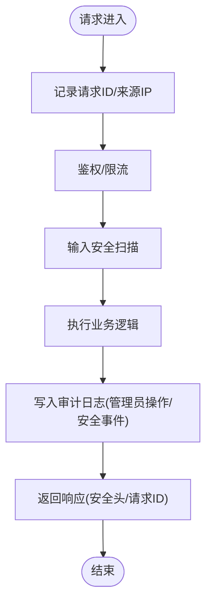
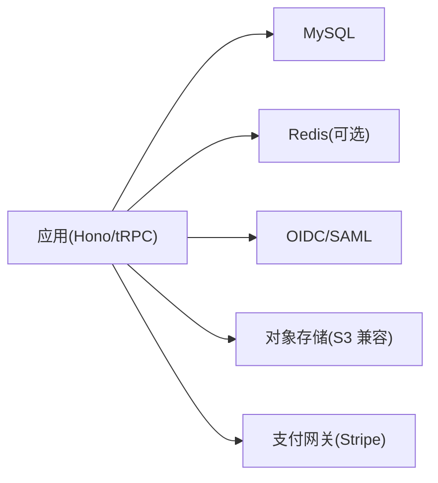

# 安全加固

<cite>
**本文引用的文件**
- [api/boot.ts](file://api/boot.ts)
- [api/lib/env.ts](file://api/lib/env.ts)
- [api/middleware.ts](file://api/middleware.ts)
- [api/sso-route.ts](file://api/sso-route.ts)
- [api/services/sso.ts](file://api/services/sso.ts)
- [api/services/tokenService.ts](file://api/services/tokenService.ts)
- [api/mcp/context.ts](file://api/mcp/context.ts)
- [api/mcp/register.ts](file://api/mcp/register.ts)
- [api/lib/clientIp.ts](file://api/lib/clientIp.ts)
- [api/services/promptSecurityScan.ts](file://api/services/promptSecurityScan.ts)
- [api/mcp/tools/addProvider.ts](file://api/mcp/tools/addProvider.ts)
- [db/migrations/015_admin_audit.sql](file://db/migrations/015_admin_audit.sql)
- [src/pages/Audit.tsx](file://src/pages/Audit.tsx)
- [src/locales/en/audit.json](file://src/locales/en/audit.json)
- [src/locales/zh/audit.json](file://src/locales/zh/audit.json)
- [Dockerfile](file://Dockerfile)
- [docker-compose.yml](file://docker-compose.yml)
</cite>

## 目录
1. [简介](#简介)
2. [项目结构](#项目结构)
3. [核心组件](#核心组件)
4. [架构总览](#架构总览)
5. [详细组件分析](#详细组件分析)
6. [依赖关系分析](#依赖关系分析)
7. [性能与安全权衡](#性能与安全权衡)
8. [故障排查指南](#故障排查指南)
9. [结论](#结论)
10. [附录](#附录)

## 简介
本文件面向生产环境，为 DeeWaanAI 提供系统化的安全加固指南。内容覆盖 HTTPS 与反向代理、SSL 证书管理（含 Let’s Encrypt 自动续期）、防火墙与端口访问控制、敏感信息保护（环境变量加密、密钥管理与 API 密钥轮换）、输入验证与输出编码（防 SQL 注入、XSS、命令注入等）、会话与令牌安全（JWT、CSRF 防护）、安全审计与日志记录、以及安全扫描与渗透测试的实施建议。文档中的实现细节均基于仓库现有代码与配置，确保可落地执行。

## 项目结构
- 应用入口与全局中间件：在启动时设置请求 ID、安全响应头、HSTS、请求体大小限制，并注册健康检查与就绪探针。
- 环境与密钥：集中读取并校验关键环境变量，拒绝已知不安全默认值。
- 认证与会话：通过 JWT 签发与校验、OIDC/SAML SSO 流程、状态令牌（HS256）与 CSRF 相关机制。
- 输入安全：对提示词与用户输入进行注入、泄露、滥用模式检测。
- 审计与合规：持久化管理员操作审计表，前端提供审计查看与合规导出能力。
- 部署与网络：容器镜像暴露内部端口，配合反向代理对外提供 HTTPS；数据库与缓存以独立服务运行。

**图示来源**
- [api/boot.ts:37-59](file://api/boot.ts#L37-L59)
- [api/lib/env.ts:21-35](file://api/lib/env.ts#L21-L35)
- [docker-compose.yml:2-11](file://docker-compose.yml#L2-L11)

**章节来源**
- [api/boot.ts:37-59](file://api/boot.ts#L37-L59)
- [api/lib/env.ts:21-35](file://api/lib/env.ts#L21-L35)
- [docker-compose.yml:2-11](file://docker-compose.yml#L2-L11)

## 核心组件
- 安全响应头与 HSTS：在生产环境启用 Strict-Transport-Security，强制浏览器使用 HTTPS。
- 请求体限制：限制最大请求体大小，降低大体积攻击面。
- 环境变量与密钥：要求 APP_SECRET、DATABASE_URL、主密钥等，并在生产环境拒绝开发默认值。
- 可信代理与 IP 解析：支持 TRUSTED_PROXY 开关，避免伪造 XFF 绕过限流。
- 令牌与会话：HS256 JWT 访问令牌、OIDC/SAML 登录流程、状态令牌签名与校验。
- 输入安全扫描：检测注入、数据外泄、滥用指令等风险。
- 审计与合规：管理员操作审计表、审计页面与合规导出。

**章节来源**
- [api/boot.ts:47-59](file://api/boot.ts#L47-L59)
- [api/lib/env.ts:21-35](file://api/lib/env.ts#L21-L35)
- [api/lib/clientIp.ts:1-36](file://api/lib/clientIp.ts#L1-L36)
- [api/services/tokenService.ts:28-70](file://api/services/tokenService.ts#L28-L70)
- [api/services/sso.ts:146-226](file://api/services/sso.ts#L146-L226)
- [api/services/promptSecurityScan.ts:65-131](file://api/services/promptSecurityScan.ts#L65-L131)
- [db/migrations/015_admin_audit.sql:1-14](file://db/migrations/015_admin_audit.sql#L1-L14)

## 架构总览
下图展示从客户端到后端的安全路径：反向代理终止 TLS，应用层设置安全头与限流，认证通过 JWT/SSO，输入经安全扫描，操作写入审计日志。

**图示来源**
- [api/boot.ts:37-59](file://api/boot.ts#L37-L59)
- [api/services/tokenService.ts:28-70](file://api/services/tokenService.ts#L28-L70)
- [api/sso-route.ts:55-89](file://api/sso-route.ts#L55-L89)
- [api/services/sso.ts:146-226](file://api/services/sso.ts#L146-L226)

## 详细组件分析

### HTTPS 与 SSL 证书管理（含 Let’s Encrypt 自动续期）
- 应用层已启用 HSTS（生产环境），强制 HTTPS。
- 建议在反向代理（如 Nginx/Caddy/Cloudflare）终止 TLS，并配置自动续期：
  - 使用 ACME 协议（Let’s Encrypt）自动申请与续期证书。
  - 将证书挂载至反向代理，仅对内网暴露应用端口（例如 3000）。
- 若需自托管证书，请确保私钥最小权限访问与定期轮换。

**章节来源**
- [api/boot.ts:47-59](file://api/boot.ts#L47-L59)
- [Dockerfile:30-36](file://Dockerfile#L30-L36)

### 反向代理配置要点
- 仅开放 80/443，禁止直接暴露应用端口。
- 正确传递 x-forwarded-proto/x-forwarded-host，以便应用生成回调 URL。
- 开启请求体大小限制与超时策略，减轻后端压力。
- 结合 WAF/CDN 进行基础防护（CC、SQLi、XSS 等）。

**章节来源**
- [api/sso-route.ts:55-66](file://api/sso-route.ts#L55-L66)
- [api/boot.ts:47-59](file://api/boot.ts#L47-L59)

### 防火墙规则、端口访问控制与网络安全组
- 容器镜像暴露 3000 端口，应仅允许反向代理所在主机或内网访问。
- 数据库与 Redis 不直接暴露公网端口，仅在容器网络内互通。
- 云厂商安全组/防火墙：
  - 入站：仅放行 80/443 到反向代理。
  - 出站：按需放行外部依赖（如对象存储、支付网关、邮件等）。
- 最小权限原则：仅授予必要端口与协议。

**章节来源**
- [Dockerfile:30-36](file://Dockerfile#L30-L36)
- [docker-compose.yml:2-11](file://docker-compose.yml#L2-L11)
- [docker-compose.yml:36-47](file://docker-compose.yml#L36-L47)

### 敏感信息保护（环境变量、密钥管理、API 密钥轮换）
- 环境变量：
  - 必需项：APP_SECRET、DATABASE_URL、AI_SWARM_MASTER_KEY、MARKETPLACE_MASTER_KEY 等。
  - 生产环境拒绝已知不安全默认值，缺失则阻止启动。
- 密钥管理：
  - 建议使用外部密钥管理服务（KMS/Secrets Manager）注入环境变量。
  - 分离审计导出密钥（AUDIT_EXPORT_KEY）与 APP_SECRET，便于轮换。
- API 密钥轮换：
  - 提供商密钥加密存储（salt/iv/authTag/ciphertext），避免明文落库。
  - 建立轮换流程：生成新密钥 → 更新配置 → 旧密钥宽限期 → 清理。

**章节来源**
- [api/lib/env.ts:21-46](file://api/lib/env.ts#L21-L46)
- [api/mcp/tools/addProvider.ts:22-25](file://api/mcp/tools/addProvider.ts#L22-L25)
- [db/migrations/020_api_key_ref_text.sql:1-7](file://db/migrations/020_api_key_ref_text.sql#L1-L7)

### 输入验证与输出编码（防 SQL 注入、XSS、命令注入）
- 输入验证：
  - 提示词与用户输入经安全扫描，检测注入指令、数据外泄、滥用模式。
  - 限制请求体大小，减少资源耗尽风险。
- 输出编码：
  - 通过安全响应头（X-Content-Type-Options、Referrer-Policy）降低 MIME 嗅探与跨源泄露风险。
  - 前端渲染遵循框架默认 XSS 防护，避免直接插入不受信 HTML。
- 命令注入防护：
  - 避免直接使用用户输入拼接系统命令；如需调用外部工具，使用白名单参数与沙箱隔离。

**章节来源**
- [api/services/promptSecurityScan.ts:65-131](file://api/services/promptSecurityScan.ts#L65-L131)
- [api/boot.ts:47-59](file://api/boot.ts#L47-L59)
- [api/boot.ts:59-59](file://api/boot.ts#L59-L59)

### 会话与令牌安全（JWT、会话超时、CSRF 防护）
- JWT 访问令牌：
  - HS256 签名，包含 userId、scopes、clientId，设置过期时间。
  - 校验失败返回空结果，避免异常泄露。
- SSO 流程：
  - OIDC：校验 id_token、issuer、audience，提取 email/name/nonce。
  - SAML：生成元数据、处理 ACS，构造本地 JWT。
  - 状态令牌：HS256 签名，短生命周期（10 分钟），用于防重放与 CSRF。
- CSRF 防护：
  - 使用 state/nonce 绑定请求上下文，防止跨站请求伪造。
  - next 参数仅允许同域 /oauth/ 路径，防止开放重定向。

**图示来源**
- [api/services/sso.ts:146-226](file://api/services/sso.ts#L146-L226)
- [api/services/tokenService.ts:28-70](file://api/services/tokenService.ts#L28-L70)
- [api/sso-route.ts:55-89](file://api/sso-route.ts#L55-L89)

**章节来源**
- [api/services/tokenService.ts:28-70](file://api/services/tokenService.ts#L28-L70)
- [api/services/sso.ts:146-226](file://api/services/sso.ts#L146-L226)
- [api/sso-route.ts:55-89](file://api/sso-route.ts#L55-L89)

### 安全审计与日志记录（访问日志、错误日志、安全事件监控）
- 审计表：管理员角色/等级/标志/SSO 变更等持久化记录。
- 审计页面：提供执行历史、响应链、质量指标与合规导出。
- 日志：
  - 全局错误捕获（未捕获异常、未处理 Promise 拒绝）。
  - 健康检查与就绪探针，便于编排器探测。
  - 请求 ID 贯穿链路，便于追踪。

**图示来源**
- [api/boot.ts:37-59](file://api/boot.ts#L37-L59)
- [db/migrations/015_admin_audit.sql:1-14](file://db/migrations/015_admin_audit.sql#L1-L14)
- [src/pages/Audit.tsx:425-459](file://src/pages/Audit.tsx#L425-L459)

**章节来源**
- [db/migrations/015_admin_audit.sql:1-14](file://db/migrations/015_admin_audit.sql#L1-L14)
- [src/pages/Audit.tsx:425-459](file://src/pages/Audit.tsx#L425-L459)
- [src/locales/en/audit.json:1-46](file://src/locales/en/audit.json#L1-L46)
- [src/locales/zh/audit.json:1-46](file://src/locales/zh/audit.json#L1-L46)
- [api/boot.ts:37-59](file://api/boot.ts#L37-L59)

### 安全扫描、漏洞检测与渗透测试实施指南
- 代码级扫描：
  - 静态分析（SAST）：识别硬编码密钥、危险函数调用、弱加密算法。
  - 依赖漏洞扫描（SCA）：定期更新依赖，修复高危漏洞。
- 运行时防护：
  - 启用 WAF/CDN 防护，拦截常见攻击载荷。
  - 限流与反暴力破解：基于 IP 的速率限制，结合可信代理开关。
- 渗透测试：
  - 定期开展黑盒/灰盒测试，覆盖认证、授权、输入校验、文件上传、SSO 回调等。
  - 关注开放重定向、CSRF、JWT 篡改、越权访问等高风险项。
- 持续改进：
  - 将扫描与测试结果纳入 CI/CD，阻断高危问题合并。
  - 建立漏洞响应流程与修复 SLA。

[本节为通用指导，无需特定源码引用]

## 依赖关系分析
- 应用依赖：
  - Hono 作为 HTTP 框架，承载路由、中间件与健康检查。
  - tRPC 用于类型安全的接口定义与调用。
  - Redis（可选）用于限流、队列与缓存。
  - MySQL 用于持久化数据与审计日志。
- 外部集成：
  - OIDC/SAML 提供方用于企业单点登录。
  - 对象存储（S3 兼容）用于备份与上传。
  - 支付网关（Stripe）用于计费与订阅。

**图示来源**
- [api/boot.ts:137-195](file://api/boot.ts#L137-L195)
- [api/lib/env.ts:36-54](file://api/lib/env.ts#L36-L54)

**章节来源**
- [api/boot.ts:137-195](file://api/boot.ts#L137-L195)
- [api/lib/env.ts:36-54](file://api/lib/env.ts#L36-L54)

## 性能与安全权衡
- 请求体限制：平衡可用性与抗 DDoS 能力。
- 限流策略：基于 IP 的速率限制，兼顾用户体验与防暴力破解。
- 审计与日志：保留必要字段，避免记录敏感数据，控制日志量与留存周期。
- 令牌过期：短期访问令牌降低泄露影响范围，刷新令牌需安全存储与轮换。

[本节为通用指导，无需特定源码引用]

## 故障排查指南
- 启动失败：
  - 检查必需环境变量是否齐全且非开发默认值。
  - 确认数据库与 Redis 可达。
- 认证失败：
  - 核对 JWT 签发与校验配置（issuer、密钥、过期时间）。
  - 检查 OIDC/SAML 回调地址与域名一致性。
- 限流误伤：
  - 确认 TRUSTED_PROXY 设置与反向代理是否正确传递 x-forwarded-for。
- 审计缺失：
  - 检查管理员操作是否触发审计写入，确认数据库连接与权限。

**章节来源**
- [api/lib/env.ts:21-35](file://api/lib/env.ts#L21-L35)
- [api/lib/clientIp.ts:1-36](file://api/lib/clientIp.ts#L1-L36)
- [api/services/tokenService.ts:28-70](file://api/services/tokenService.ts#L28-L70)
- [api/sso-route.ts:55-89](file://api/sso-route.ts#L55-L89)

## 结论
本指南基于现有代码与配置，提供了生产环境安全加固的系统化方案。通过 HTTPS/HSTS、反向代理、防火墙与端口控制、敏感信息保护、输入验证与输出编码、JWT/SSO 与会话安全、审计与日志、以及持续的安全扫描与渗透测试，构建纵深防御体系。建议将上述措施纳入 CI/CD 与运维流程，持续评估与改进。

[本节为总结性内容，无需特定源码引用]

## 附录
- 环境变量清单（部分）：
  - APP_SECRET、DATABASE_URL、AI_SWARM_MASTER_KEY、MARKETPLACE_MASTER_KEY
  - REDIS_URL、STRIPE_SECRET_KEY、STRIPE_WEBHOOK_SECRET
  - AUDIT_EXPORT_KEY、S3_*、BACKUP_TOKEN、TRUSTED_PROXY、PUBLIC_APP_URL
- 端口与暴露：
  - 应用内部端口：3000（容器内）
  - 数据库：3306（容器内）
  - 缓存：6379（容器内）
- 健康检查：
  - /api/health：进程存活与数据库连通性
  - /api/ready：具备服务能力（数据库与 Redis 连通）

**章节来源**
- [api/lib/env.ts:21-95](file://api/lib/env.ts#L21-L95)
- [Dockerfile:30-36](file://Dockerfile#L30-L36)
- [docker-compose.yml:2-11](file://docker-compose.yml#L2-L11)
- [docker-compose.yml:36-47](file://docker-compose.yml#L36-L47)
- [api/boot.ts:73-135](file://api/boot.ts#L73-L135)