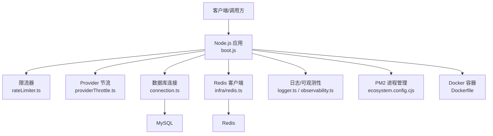
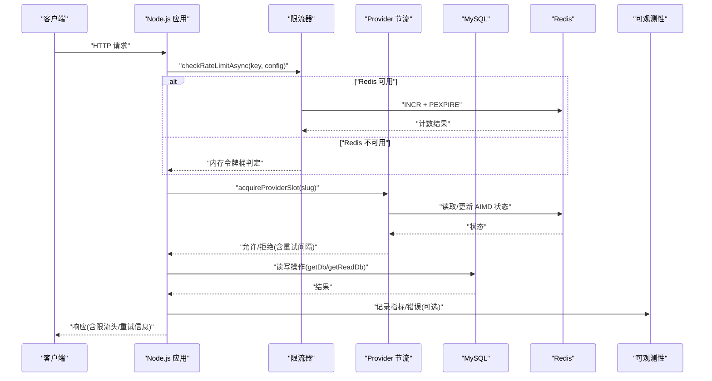
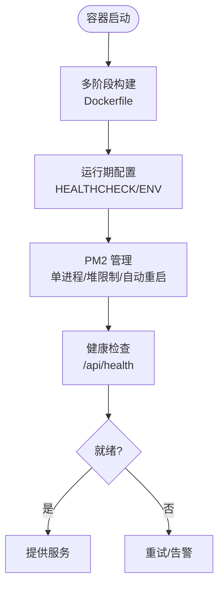
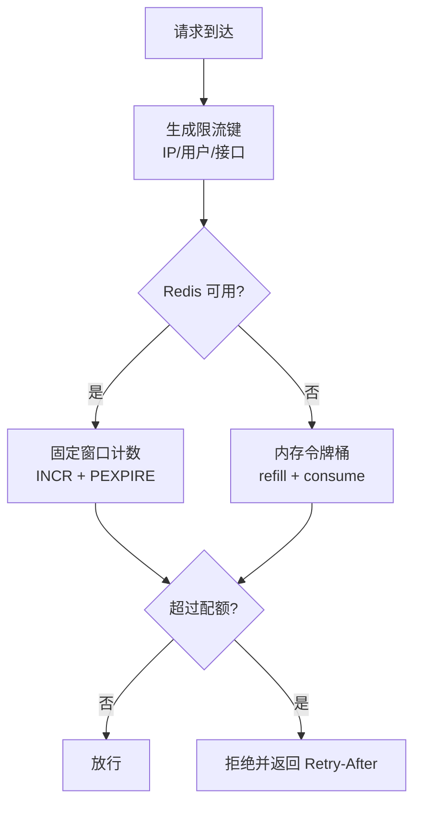
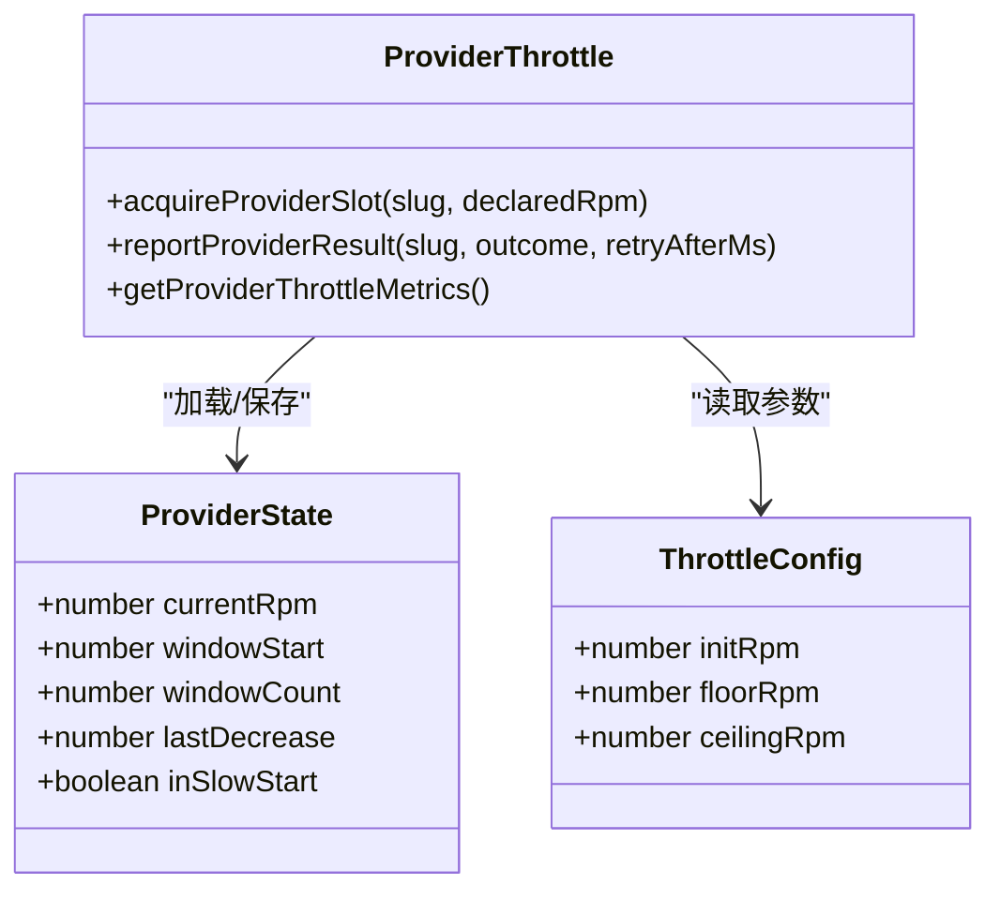
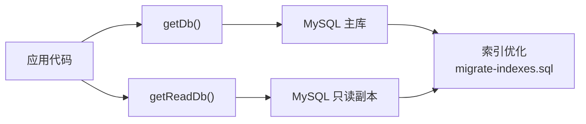
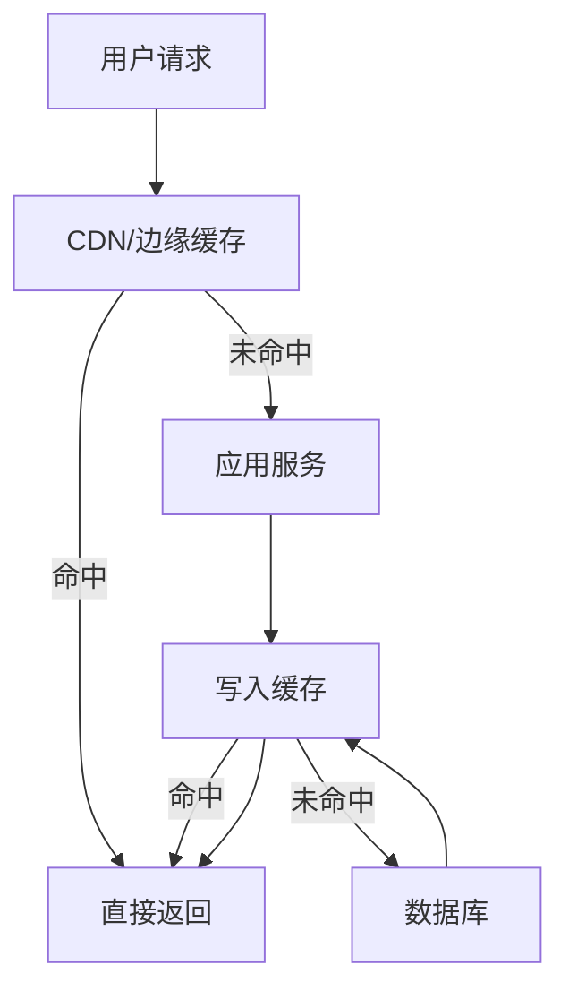
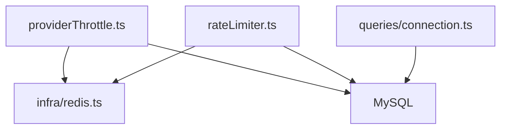

# 性能优化

<cite>
**本文引用的文件**
- [Dockerfile](file://Dockerfile)
- [docker-compose.yml](file://docker-compose.yml)
- [ecosystem.config.cjs](file://ecosystem.config.cjs)
- [api/lib/env.ts](file://api/lib/env.ts)
- [api/infra/redis.ts](file://api/infra/redis.ts)
- [api/lib/rateLimiter.ts](file://api/lib/rateLimiter.ts)
- [api/lib/providerThrottle.ts](file://api/lib/providerThrottle.ts)
- [api/queries/connection.ts](file://api/queries/connection.ts)
- [db/migrate-indexes.sql](file://db/migrate-indexes.sql)
- [deploy/aliyun-optimized.md](file://deploy/aliyun-optimized.md)
- [api/lib/observability.ts](file://api/lib/observability.ts)
- [api/lib/logger.ts](file://api/lib/logger.ts)
- [DeeWaanAI-Next/PHASE3-SPEC.md](file://DeeWaanAI-Next/PHASE3-SPEC.md)
- [scripts/beta-simulation.mjs](file://scripts/beta-simulation.mjs)
</cite>

## 目录
1. [简介](#简介)
2. [项目结构](#项目结构)
3. [核心组件](#核心组件)
4. [架构总览](#架构总览)
5. [详细组件分析](#详细组件分析)
6. [依赖关系分析](#依赖关系分析)
7. [性能考量](#性能考量)
8. [故障排查指南](#故障排查指南)
9. [结论](#结论)
10. [附录](#附录)

## 简介
本文件面向生产环境，系统性梳理 DeeWaanAI 的性能优化策略与落地实践，覆盖容器资源限制、Node.js 运行时优化、API 限流与速率控制（含 Redis 与令牌桶/固定窗口）、数据库查询与索引优化、缓存策略（Redis、浏览器、CDN）、监控指标与可观测性、以及负载/压力测试与容量规划。所有建议均基于仓库中现有实现与配置进行提炼与扩展说明，便于在真实生产环境中安全落地。

## 项目结构
- 应用入口与运行：通过 Docker 镜像构建并启动 Node.js 服务，暴露健康检查端点，使用 PM2 管理进程与日志轮转。
- 基础设施：MySQL 与 Redis 通过 docker-compose 编排；Redis 作为限流、队列、状态共享的可选依赖，具备优雅降级能力。
- 数据层：Drizzle ORM 连接 MySQL，支持主库与只读副本路由；提供迁移脚本与索引优化。
- 限流与节流：内置内存令牌桶与 Redis 固定窗口限流；对外部 Provider 调用采用 AIMD 自适应限速。
- 可观测性：Sentry 可选集成；结构化 JSON 日志输出；健康检查与健康探针。

**图示来源**
- [Dockerfile:1-39](file://Dockerfile#L1-L39)
- [ecosystem.config.cjs:1-32](file://ecosystem.config.cjs#L1-L32)
- [api/lib/rateLimiter.ts:1-216](file://api/lib/rateLimiter.ts#L1-L216)
- [api/lib/providerThrottle.ts:1-275](file://api/lib/providerThrottle.ts#L1-L275)
- [api/queries/connection.ts:1-42](file://api/queries/connection.ts#L1-L42)
- [api/infra/redis.ts:1-88](file://api/infra/redis.ts#L1-L88)
- [api/lib/logger.ts:1-32](file://api/lib/logger.ts#L1-L32)
- [api/lib/observability.ts:1-33](file://api/lib/observability.ts#L1-L33)

**章节来源**
- [Dockerfile:1-39](file://Dockerfile#L1-L39)
- [docker-compose.yml:1-52](file://docker-compose.yml#L1-L52)
- [ecosystem.config.cjs:1-32](file://ecosystem.config.cjs#L1-L32)

## 核心组件
- 容器与进程管理：单进程模式、堆大小限制、自动重启与日志轮转，保障低内存环境稳定运行。
- 限流与速率控制：多策略组合（令牌桶、固定窗口），支持 Redis 分布式计数与内存降级。
- Provider 自适应节流：AIMD 算法动态调整 RPM，避免雪崩与过度请求。
- 数据库访问：读写分离（可选）、索引优化、连接复用。
- 可观测性：Sentry 可选启用、结构化日志、健康检查。

**章节来源**
- [api/lib/rateLimiter.ts:1-216](file://api/lib/rateLimiter.ts#L1-L216)
- [api/lib/providerThrottle.ts:1-275](file://api/lib/providerThrottle.ts#L1-L275)
- [api/queries/connection.ts:1-42](file://api/queries/connection.ts#L1-L42)
- [api/lib/observability.ts:1-33](file://api/lib/observability.ts#L1-L33)
- [api/lib/logger.ts:1-32](file://api/lib/logger.ts#L1-L32)
- [ecosystem.config.cjs:1-32](file://ecosystem.config.cjs#L1-L32)
- [Dockerfile:1-39](file://Dockerfile#L1-L39)

## 架构总览
下图展示请求从进入应用到外部依赖的关键路径，包括限流、Provider 节流、数据库访问与 Redis 依赖的降级策略。

**图示来源**
- [api/lib/rateLimiter.ts:31-93](file://api/lib/rateLimiter.ts#L31-L93)
- [api/lib/providerThrottle.ts:168-235](file://api/lib/providerThrottle.ts#L168-L235)
- [api/queries/connection.ts:10-42](file://api/queries/connection.ts#L10-L42)
- [api/infra/redis.ts:65-82](file://api/infra/redis.ts#L65-L82)
- [api/lib/observability.ts:17-33](file://api/lib/observability.ts#L17-L33)

## 详细组件分析

### 容器资源限制与网络带宽控制
- 容器镜像：多阶段构建，最小化产物体积；设置健康检查端点用于编排平台探测。
- 进程管理：PM2 单进程模式，限制 Node.js 堆大小，设置最大内存重启阈值，防止 OOM。
- 环境变量：NODE_ENV、PORT 等；健康检查通过 HTTP 探测。
- 网络带宽：当前仓库未显式配置容器级带宽限制；建议在编排层（如 Kubernetes LimitRange/NetworkPolicy）或云厂商层面按实例规格限制 egress/ingress 带宽，避免突发流量打满链路。

**图示来源**
- [Dockerfile:11-38](file://Dockerfile#L11-L38)
- [ecosystem.config.cjs:1-32](file://ecosystem.config.cjs#L1-L32)

**章节来源**
- [Dockerfile:1-39](file://Dockerfile#L1-L39)
- [ecosystem.config.cjs:1-32](file://ecosystem.config.cjs#L1-L32)
- [deploy/aliyun-optimized.md:1-55](file://deploy/aliyun-optimized.md#L1-L55)

### Node.js 应用性能优化
- 事件循环优化：保持单进程减少上下文切换；合理拆分长任务至队列/工作线程；避免阻塞同步操作。
- 内存泄漏预防：限制堆大小（--max-old-space-size），结合 PM2 的 max_memory_restart 自动恢复；定期采样堆快照定位增长源。
- 垃圾回收调优：根据内存预算调整堆上限；在高并发场景下关注 GC 停顿对延迟的影响。
- 日志与可观测性：结构化 JSON 日志；Sentry 可选集成，失败不阻断服务。

**章节来源**
- [ecosystem.config.cjs:1-32](file://ecosystem.config.cjs#L1-L32)
- [api/lib/logger.ts:1-32](file://api/lib/logger.ts#L1-L32)
- [api/lib/observability.ts:1-33](file://api/lib/observability.ts#L1-L33)

### API 限流与速率限制
- 令牌桶（内存）：默认每键维护令牌桶，支持清理过期桶，适合单机快速限流。
- 固定窗口（Redis）：以时间窗为粒度 INCR+PEXPIRE，跨节点共享配额；失败回退到内存路径，保证可用性。
- 客户分级限流：solo/team/admin 三档配额，统一接口返回剩余量与重试时间，便于前端友好提示。
- 预置策略：认证、执行、批量、读取、截图上传/服务等不同场景的默认限制。

**图示来源**
- [api/lib/rateLimiter.ts:31-93](file://api/lib/rateLimiter.ts#L31-L93)
- [api/lib/rateLimiter.ts:198-215](file://api/lib/rateLimiter.ts#L198-L215)

**章节来源**
- [api/lib/rateLimiter.ts:1-216](file://api/lib/rateLimiter.ts#L1-L216)

### Provider 自适应节流（AIMD）
- 算法要点：慢启动翻倍、拥塞避免加法增长、收到 429 时乘法减半；支持冷却窗口与暂停重试。
- 持久化：优先 Redis Hash 存储状态，失败回退内存；支持按 Provider 维度独立调节。
- 指标：提供当前 RPM、窗口计数、是否处于慢启动等指标，便于监控与调参。

**图示来源**
- [api/lib/providerThrottle.ts:17-35](file://api/lib/providerThrottle.ts#L17-L35)
- [api/lib/providerThrottle.ts:88-133](file://api/lib/providerThrottle.ts#L88-L133)
- [api/lib/providerThrottle.ts:168-235](file://api/lib/providerThrottle.ts#L168-L235)
- [api/lib/providerThrottle.ts:240-275](file://api/lib/providerThrottle.ts#L240-L275)

**章节来源**
- [api/lib/providerThrottle.ts:1-275](file://api/lib/providerThrottle.ts#L1-L275)

### 数据库查询优化、索引策略与连接池
- 连接与路由：Drizzle ORM 单例连接；支持只读副本路由（getReadDb），将浏览/搜索等读多写少请求分流。
- 索引优化：针对高频查询字段建立二级索引（项目、用户、状态、关联表外键等），显著降低全表扫描。
- 连接池：通过 ORM 驱动与数据库配置控制连接数与超时；在低内存环境下限制最大连接数，避免内存耗尽。

**图示来源**
- [api/queries/connection.ts:10-42](file://api/queries/connection.ts#L10-L42)
- [db/migrate-indexes.sql:1-111](file://db/migrate-indexes.sql#L1-L111)

**章节来源**
- [api/queries/connection.ts:1-42](file://api/queries/connection.ts#L1-L42)
- [db/migrate-indexes.sql:1-111](file://db/migrate-indexes.sql#L1-L111)
- [deploy/aliyun-optimized.md:15-45](file://deploy/aliyun-optimized.md#L15-L45)

### 缓存策略设计（Redis、浏览器、CDN）
- Redis 缓存：限流、Provider 状态、队列等关键路径使用 Redis；具备连接失败时的内存降级，确保高可用。
- 浏览器缓存：静态资源与公共接口可使用 Cache-Control/ETag；鉴权相关响应不缓存。
- CDN 缓存：对公开报告与徽章等静态内容设置合理的 s-maxage/max-age，提升边缘命中率。

**图示来源**
- [api/infra/redis.ts:1-88](file://api/infra/redis.ts#L1-L88)
- [DeeWaanAI-Next/PHASE3-SPEC.md:73-81](file://DeeWaanAI-Next/PHASE3-SPEC.md#L73-L81)

**章节来源**
- [api/infra/redis.ts:1-88](file://api/infra/redis.ts#L1-L88)
- [DeeWaanAI-Next/PHASE3-SPEC.md:73-81](file://DeeWaanAI-Next/PHASE3-SPEC.md#L73-L81)

### 监控指标收集、性能分析与瓶颈识别
- 可观测性：Sentry 可选初始化，失败不影响服务；结构化日志便于集中采集与分析。
- 健康检查：容器内健康检查端点，配合编排平台进行存活与就绪探测。
- 性能分析：结合日志中的耗时与错误率，定位热点接口与慢查询；利用 Provider 节流指标评估外部依赖稳定性。

**章节来源**
- [api/lib/observability.ts:1-33](file://api/lib/observability.ts#L1-L33)
- [api/lib/logger.ts:1-32](file://api/lib/logger.ts#L1-L32)
- [Dockerfile:35-38](file://Dockerfile#L35-L38)

### 负载测试、压力测试与容量规划
- 压测工具与脚本：提供 beta-simulation 模拟多角色协作流程，验证端到端吞吐与稳定性；cramp_test 用于基准对比与回归检测。
- 容量规划：依据内存预算（如 0.5GB 实例）限制进程数与堆大小，预留 OS 与中间件开销；数据库连接数与缓冲池需匹配实例规格。
- 弹性策略：在云原生环境中结合水平扩缩容与资源配额，应对峰值流量。

**章节来源**
- [scripts/beta-simulation.mjs:1-294](file://scripts/beta-simulation.mjs#L1-L294)
- [deploy/aliyun-optimized.md:1-55](file://deploy/aliyun-optimized.md#L1-L55)

## 依赖关系分析
- 限流模块依赖 Redis 客户端；当 Redis 不可用时自动降级到内存实现，保证系统韧性。
- Provider 节流同样依赖 Redis 持久化状态，失败回退内存，避免外部依赖影响核心流程。
- 数据库访问通过 ORM 抽象，读写分离使读多写少场景获得更好吞吐。

**图示来源**
- [api/lib/rateLimiter.ts:1-216](file://api/lib/rateLimiter.ts#L1-L216)
- [api/lib/providerThrottle.ts:1-275](file://api/lib/providerThrottle.ts#L1-L275)
- [api/infra/redis.ts:1-88](file://api/infra/redis.ts#L1-L88)
- [api/queries/connection.ts:1-42](file://api/queries/connection.ts#L1-L42)

**章节来源**
- [api/lib/rateLimiter.ts:1-216](file://api/lib/rateLimiter.ts#L1-L216)
- [api/lib/providerThrottle.ts:1-275](file://api/lib/providerThrottle.ts#L1-L275)
- [api/infra/redis.ts:1-88](file://api/infra/redis.ts#L1-L88)
- [api/queries/connection.ts:1-42](file://api/queries/connection.ts#L1-L42)

## 性能考量
- 容器与进程：单进程 + 堆限制 + 自动重启，适合低内存环境；健康检查保障编排可靠性。
- 限流与节流：Redis 分布式计数 + 内存降级；AIMD 自适应外部依赖速率，避免雪崩。
- 数据库：读写分离与索引优化，降低延迟与 CPU 占用；连接数与缓冲池按实例规格调优。
- 缓存：Redis 作为热点数据与状态共享层；浏览器与 CDN 缓存静态与公开内容。
- 可观测性：结构化日志与 Sentry 可选集成，便于问题定位与性能分析。
- 压测与容量：基于脚本进行端到端压测与回归；按内存与连接数制定容量基线。

[本节为通用指导，无需特定文件引用]

## 故障排查指南
- Redis 不可用：限流与节流自动降级到内存；查看日志中“Redis unavailable”警告，确认 REDIS_URL 与网络连通性。
- Provider 429 频繁：观察 providerThrottle 指标，确认是否触发乘法减半与冷却窗口；必要时调整 init/floor/ceiling 参数。
- 数据库慢查询：检查索引是否生效，必要时补充复合索引；限制连接数与超时，避免连接风暴。
- 内存异常：关注 PM2 的 max_memory_restart 触发情况；结合堆快照定位泄漏点。
- 健康检查失败：确认 /api/health 可达性与依赖服务状态。

**章节来源**
- [api/infra/redis.ts:40-82](file://api/infra/redis.ts#L40-L82)
- [api/lib/providerThrottle.ts:207-235](file://api/lib/providerThrottle.ts#L207-L235)
- [db/migrate-indexes.sql:1-111](file://db/migrate-indexes.sql#L1-L111)
- [ecosystem.config.cjs:1-32](file://ecosystem.config.cjs#L1-L32)
- [Dockerfile:35-38](file://Dockerfile#L35-L38)

## 结论
本项目在生产环境已具备完善的性能优化基础：容器与进程管理稳健、限流与节流策略完备、数据库访问与索引优化到位、缓存分层清晰、可观测性健全。建议在编排层补充带宽限制与弹性伸缩策略，持续通过压测与监控迭代调优，确保在高负载下的稳定性与效率。

[本节为总结，无需特定文件引用]

## 附录
- 环境变量参考：APP_ID、DATABASE_URL、REDIS_URL、SENTRY_DSN、PROVIDER_THROTTLE 等，详见环境配置模块。
- 部署与优化文档：阿里云低内存实例优化建议与 MySQL 超小配置参考。

**章节来源**
- [api/lib/env.ts:24-95](file://api/lib/env.ts#L24-L95)
- [deploy/aliyun-optimized.md:1-55](file://deploy/aliyun-optimized.md#L1-L55)