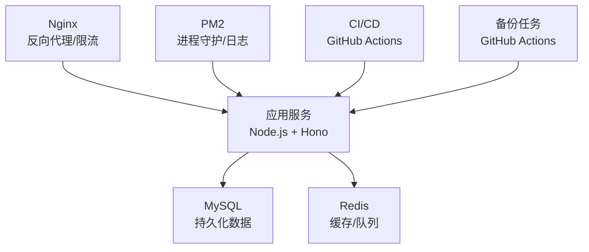
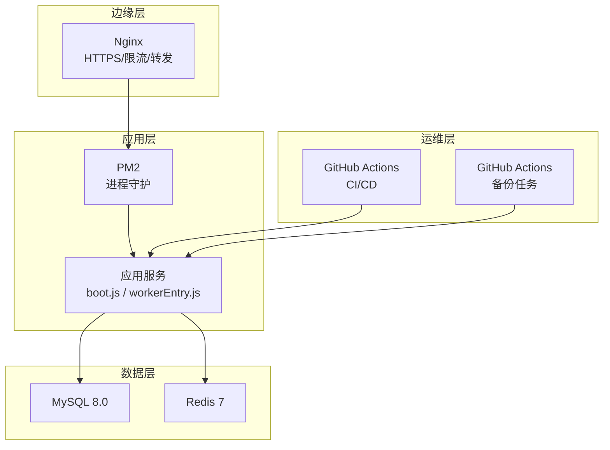
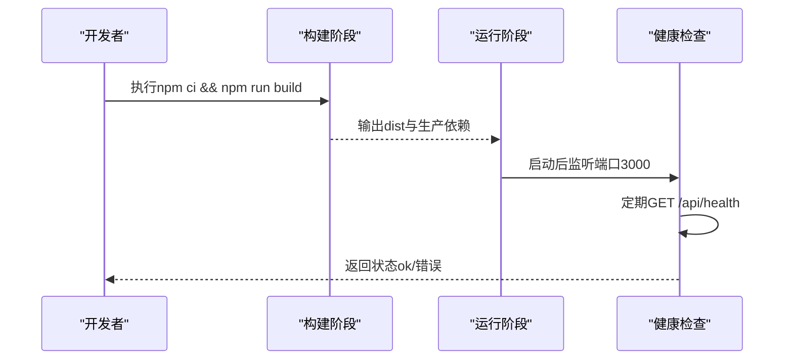
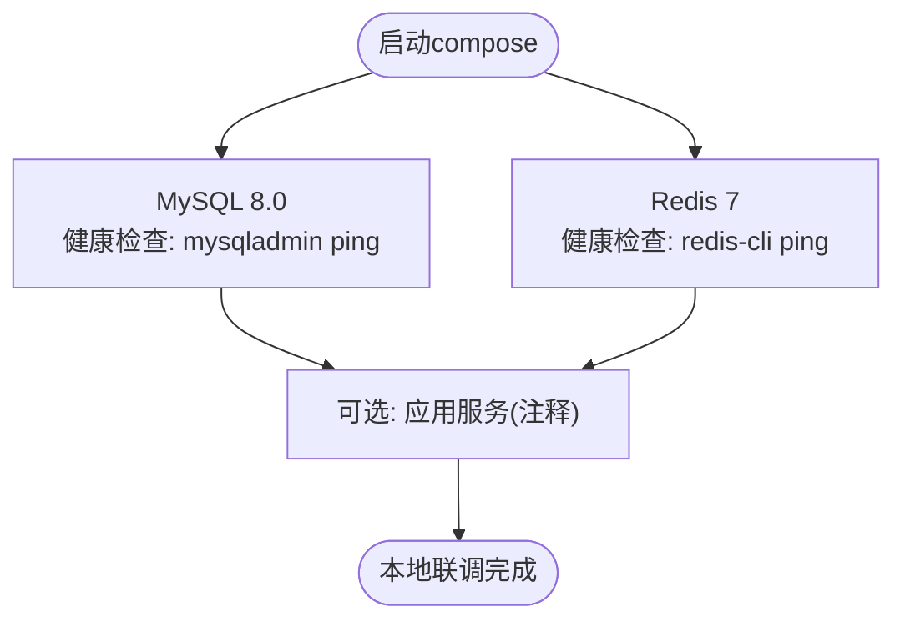
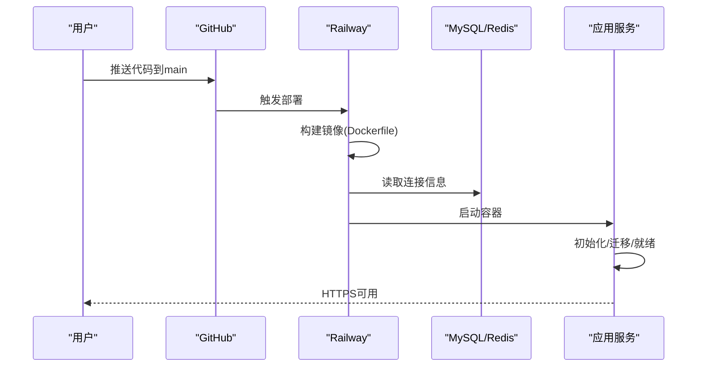
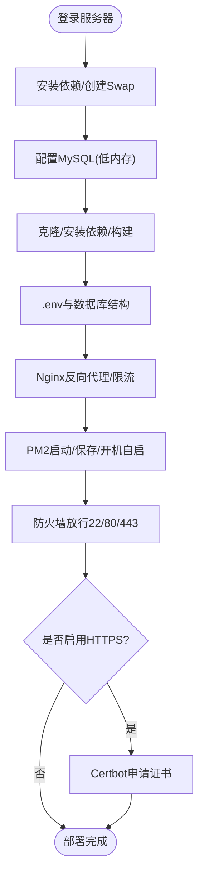
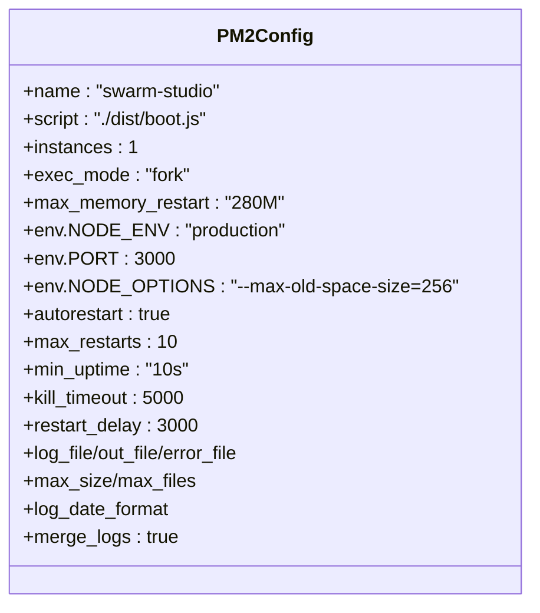
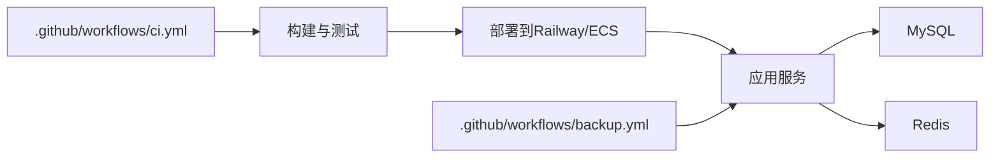

# 生产环境部署

<cite>
**本文引用的文件**
- [Dockerfile](file://Dockerfile)
- [docker-compose.yml](file://docker-compose.yml)
- [DEPLOY.md](file://DEPLOY.md)
- [ecosystem.config.cjs](file://ecosystem.config.cjs)
- [deploy/aliyun-setup.sh](file://deploy/aliyun-setup.sh)
- [deploy/aliyun-optimized.md](file://deploy/aliyun-optimized.md)
- [deploy/install.sh](file://deploy/install.sh)
- [package.json](file://package.json)
- [.github/workflows/ci.yml](file://.github/workflows/ci.yml)
- [.github/workflows/backup.yml](file://.github/workflows/backup.yml)
- [api/lib/env.ts](file://api/lib/env.ts)
</cite>

## 目录
1. [简介](#简介)
2. [项目结构](#项目结构)
3. [核心组件](#核心组件)
4. [架构总览](#架构总览)
5. [详细组件分析](#详细组件分析)
6. [依赖关系分析](#依赖关系分析)
7. [性能考虑](#性能考虑)
8. [故障排查指南](#故障排查指南)
9. [结论](#结论)
10. [附录](#附录)

## 简介
本文件面向生产环境，提供DeeWaanAI的容器化与云平台部署完整指南。内容涵盖：
- Docker镜像构建、容器编排与服务配置
- Railway零代码部署流程与阿里云ECS手动部署步骤
- PM2进程管理器的配置、监控、日志与自动重启策略
- 性能优化建议（内存/CPU限制、资源调优）
- 安全最佳实践（HTTPS、防火墙、密钥与环境校验）

## 项目结构
仓库包含应用服务、站点、数据库迁移、CI/CD流水线以及多套部署脚本与文档。关键部署相关位置如下：
- 容器镜像定义：根目录Dockerfile
- 本地开发编排：docker-compose.yml（MySQL、Redis）
- 云平台部署说明：DEPLOY.md（Railway）
- 阿里云部署脚本与优化指南：deploy/aliyun-setup.sh、deploy/install.sh、deploy/aliyun-optimized.md
- 进程管理：ecosystem.config.cjs（PM2）
- CI/CD与备份：.github/workflows/ci.yml、.github/workflows/backup.yml
- 环境变量与安全校验：api/lib/env.ts
- 构建与启动脚本：package.json

图表来源
- [Dockerfile:1-39](file://Dockerfile#L1-L39)
- [docker-compose.yml:1-52](file://docker-compose.yml#L1-L52)
- [ecosystem.config.cjs:1-32](file://ecosystem.config.cjs#L1-L32)
- [.github/workflows/ci.yml:1-96](file://.github/workflows/ci.yml#L1-L96)
- [.github/workflows/backup.yml:1-46](file://.github/workflows/backup.yml#L1-L46)

章节来源
- [Dockerfile:1-39](file://Dockerfile#L1-L39)
- [docker-compose.yml:1-52](file://docker-compose.yml#L1-L52)
- [package.json:7-21](file://package.json#L7-L21)

## 核心组件
- 应用服务：基于Node.js与Hono的服务端入口，构建产物位于dist目录，通过boot.js启动；支持独立worker进程用于后台任务。
- 数据存储：MySQL 8.0作为主存储，Redis 7作为缓存与队列后端。
- 反向代理：Nginx负责HTTPS终止、请求转发、SSE流式响应与速率限制。
- 进程管理：PM2负责单实例运行、内存限制、崩溃重启与日志轮转。
- CI/CD：GitHub Actions执行类型检查、测试、构建与集成测试；定时触发备份任务。
- 环境变量与安全：运行时强制要求必要的环境变量，并拒绝已知不安全默认值。

章节来源
- [package.json:7-21](file://package.json#L7-L21)
- [api/lib/env.ts:1-22](file://api/lib/env.ts#L1-L22)

## 架构总览
下图展示生产环境典型部署拓扑：Nginx作为边缘入口，将HTTP/HTTPS流量转发至Node应用；应用连接MySQL与Redis；PM2守护应用进程；CI/CD在推送时执行质量门禁；备份任务定时调用应用备份接口。

图表来源
- [Dockerfile:1-39](file://Dockerfile#L1-L39)
- [docker-compose.yml:1-52](file://docker-compose.yml#L1-L52)
- [ecosystem.config.cjs:1-32](file://ecosystem.config.cjs#L1-L32)
- [.github/workflows/ci.yml:1-96](file://.github/workflows/ci.yml#L1-L96)
- [.github/workflows/backup.yml:1-46](file://.github/workflows/backup.yml#L1-L46)

## 详细组件分析

### Docker容器化部署
- 构建阶段：使用node:20-alpine基础镜像安装依赖并执行构建命令，产出dist目录。
- 运行阶段：仅复制生产依赖与构建产物，创建非root用户appuser，暴露端口3000，设置健康检查探针访问/api/health。
- 健康检查：每30秒探测一次，超时5秒，重试3次，确保服务就绪。

图表来源
- [Dockerfile:1-39](file://Dockerfile#L1-L39)

章节来源
- [Dockerfile:1-39](file://Dockerfile#L1-L39)

### 容器编排（docker-compose）
- 提供MySQL 8.0与Redis 7服务，挂载数据卷，配置健康检查。
- 应用服务已注释，可按需启用以进行本地联调。

图表来源
- [docker-compose.yml:1-52](file://docker-compose.yml#L1-L52)

章节来源
- [docker-compose.yml:1-52](file://docker-compose.yml#L1-L52)

### Railway平台零代码部署
- 从GitHub仓库一键部署，Railway自动识别Dockerfile并构建。
- 添加MySQL与Redis服务，配置环境变量（DATABASE_URL、REDIS_URL、APP_SECRET等）。
- 首次通过数据库迁移或drizzle push创建表结构。
- 生成域名获得HTTPS访问；提供健康检查端点验证连通性。
- 可选拆分Web与Worker服务，避免长任务阻塞HTTP。

图表来源
- [DEPLOY.md:1-145](file://DEPLOY.md#L1-L145)

章节来源
- [DEPLOY.md:1-145](file://DEPLOY.md#L1-L145)

### 阿里云ECS部署（手动）
- 脚本自动化安装Node.js 20、MySQL 8.0、Nginx、PM2，并生成随机密钥。
- 为低内存实例配置MySQL最小化参数，开启Swap防止OOM。
- 构建应用、推送数据库结构、配置Nginx反向代理与限流。
- 使用PM2启动应用并设置开机自启；开放防火墙端口22/80/443。
- 可选使用Certbot申请Let's Encrypt证书实现HTTPS。

图表来源
- [deploy/aliyun-setup.sh:1-198](file://deploy/aliyun-setup.sh#L1-L198)
- [deploy/install.sh:1-222](file://deploy/install.sh#L1-L222)
- [deploy/aliyun-optimized.md:1-151](file://deploy/aliyun-optimized.md#L1-L151)

章节来源
- [deploy/aliyun-setup.sh:1-198](file://deploy/aliyun-setup.sh#L1-L198)
- [deploy/install.sh:1-222](file://deploy/install.sh#L1-L222)
- [deploy/aliyun-optimized.md:1-151](file://deploy/aliyun-optimized.md#L1-L151)

### PM2进程管理器配置与使用
- 单实例fork模式，限制Node堆大小，设置最大内存重启阈值。
- 自动重启、重启次数上限、最小运行时间、优雅关闭超时与重启延迟。
- 日志轮转：合并日志、按大小与数量切割，记录日期格式。
- 适用于低内存环境，避免多进程导致的内存压力。

图表来源
- [ecosystem.config.cjs:1-32](file://ecosystem.config.cjs#L1-L32)

章节来源
- [ecosystem.config.cjs:1-32](file://ecosystem.config.cjs#L1-L32)

### 环境变量与安全校验
- 生产环境强制要求必要环境变量，缺失则抛出错误阻止启动。
- 拒绝已知不安全的默认密钥，防止误用开发配置上线。
- 建议在云平台中通过服务变量注入敏感信息，避免写入代码库。

章节来源
- [api/lib/env.ts:1-22](file://api/lib/env.ts#L1-L22)

### 工作进程分离（可选）
- 默认情况下，Pipeline Worker与Web进程共享资源；高负载时可拆分为独立服务。
- 在Railway上可新增一个GitHub Repo服务，指定自定义启动命令指向workerEntry.js，并在Web服务中禁用内置Worker。

章节来源
- [DEPLOY.md:135-145](file://DEPLOY.md#L135-L145)
- [package.json:12-13](file://package.json#L12-L13)

## 依赖关系分析
- 应用服务依赖MySQL与Redis，通过环境变量配置连接字符串。
- Nginx对API与SSE流路径分别设置不同的限流与超时策略。
- CI/CD在每次推送时执行类型检查、测试与构建，保障发布质量。
- 备份任务定时调用应用备份接口，将数据库导出并上传至对象存储。

图表来源
- [.github/workflows/ci.yml:1-96](file://.github/workflows/ci.yml#L1-L96)
- [.github/workflows/backup.yml:1-46](file://.github/workflows/backup.yml#L1-L46)

章节来源
- [.github/workflows/ci.yml:1-96](file://.github/workflows/ci.yml#L1-L96)
- [.github/workflows/backup.yml:1-46](file://.github/workflows/backup.yml#L1-L46)

## 性能考虑
- 内存限制
  - Node堆限制：通过NODE_OPTIONS限制最大旧空间大小，避免内存泄漏导致系统不稳定。
  - PM2内存重启：当进程超过设定阈值时自动重启，保护整体稳定性。
- CPU与并发
  - 低内存实例建议使用单实例fork模式，避免多进程带来的额外开销。
  - Nginx限流：对API与SSE流分别设置不同速率限制，防止滥用与过载。
- 数据库与缓存
  - MySQL低内存配置：减少缓冲池、临时表大小与线程缓存，限制最大连接数。
  - Redis作为缓存与队列后端，降低数据库压力。
- 资源预留
  - 操作系统与Nginx占用少量内存，保留一定缓冲应对突发流量。

章节来源
- [ecosystem.config.cjs:1-32](file://ecosystem.config.cjs#L1-L32)
- [deploy/aliyun-optimized.md:1-151](file://deploy/aliyun-optimized.md#L1-L151)
- [deploy/install.sh:131-172](file://deploy/install.sh#L131-L172)

## 故障排查指南
- 健康检查失败
  - 检查/api/health与/api/ready端点，确认MySQL与Redis可达。
  - 查看容器日志与PM2日志定位问题。
- 数据库连接异常
  - 核对DATABASE_URL与权限，确保迁移已完成。
  - 在Railway中启用公共TCP端点仅用于一次性迁移，完成后关闭。
- 内存不足/OOM
  - 观察free -h与htop，必要时增加Swap或升级实例规格。
  - 调整MySQL与Node内存参数，降低并发。
- 备份未生效
  - 确认BACKUP_TOKEN与S3_*环境变量已配置。
  - 检查GitHub Actions中的备份任务是否被跳过或失败。

章节来源
- [DEPLOY.md:108-133](file://DEPLOY.md#L108-L133)
- [.github/workflows/backup.yml:1-46](file://.github/workflows/backup.yml#L1-L46)

## 结论
本部署方案提供了从容器化到云平台的完整路径，兼顾了低资源环境的稳定性与可扩展性。通过PM2进程管理、Nginx反向代理与限流、CI/CD质量门禁与定时备份，确保生产环境的安全与可靠。建议在生产前完成安全加固（HTTPS、防火墙、密钥管理），并根据实际负载逐步拆分Web与Worker服务以提升吞吐能力。

## 附录

### 环境变量清单（示例）
- DATABASE_URL：MySQL连接串
- REDIS_URL：Redis连接串
- APP_SECRET：应用密钥
- AI_SWARM_MASTER_KEY：主密钥
- MARKETPLACE_MASTER_KEY：市场主密钥
- NODE_ENV：运行环境
- PORT：服务端口
- STRIPE_*：支付相关（可选）
- AUDIT_EXPORT_KEY：审计导出密钥（可选）
- BACKUP_TOKEN：备份令牌（可选）
- S3_*：对象存储配置（可选）

章节来源
- [DEPLOY.md:46-65](file://DEPLOY.md#L46-L65)
- [deploy/aliyun-setup.sh:100-113](file://deploy/aliyun-setup.sh#L100-L113)
- [deploy/install.sh:112-123](file://deploy/install.sh#L112-L123)

### 安全配置最佳实践
- HTTPS
  - 使用Nginx终止TLS，结合Certbot自动续期证书。
  - 在Railway上通过“Generate Domain”获取HTTPS域名。
- 防火墙
  - 仅开放必要端口（SSH、HTTP、HTTPS），其他端口默认拒绝。
- 密钥与环境
  - 通过云平台服务变量注入敏感信息，禁止硬编码。
  - 应用启动时校验必要环境变量，拒绝不安全默认值。
- 限流与超时
  - Nginx对API与SSE流实施速率限制与合理超时，防止滥用与资源耗尽。

章节来源
- [deploy/install.sh:181-221](file://deploy/install.sh#L181-L221)
- [deploy/aliyun-setup.sh:126-172](file://deploy/aliyun-setup.sh#L126-L172)
- [api/lib/env.ts:1-22](file://api/lib/env.ts#L1-L22)