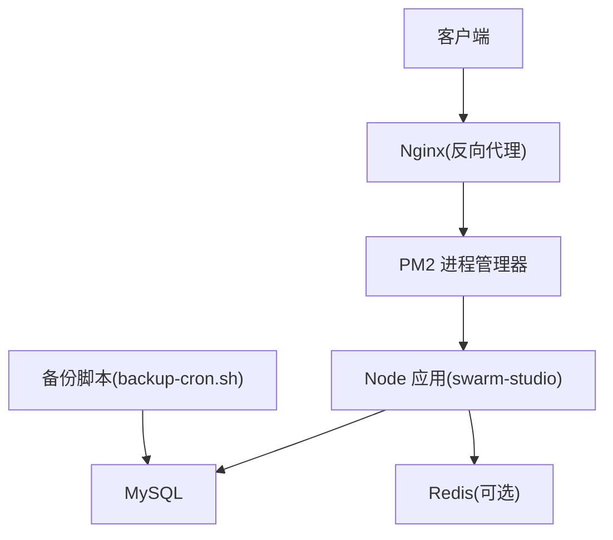
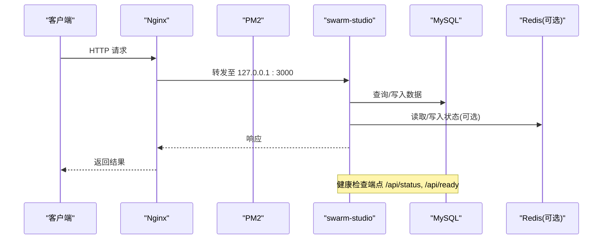
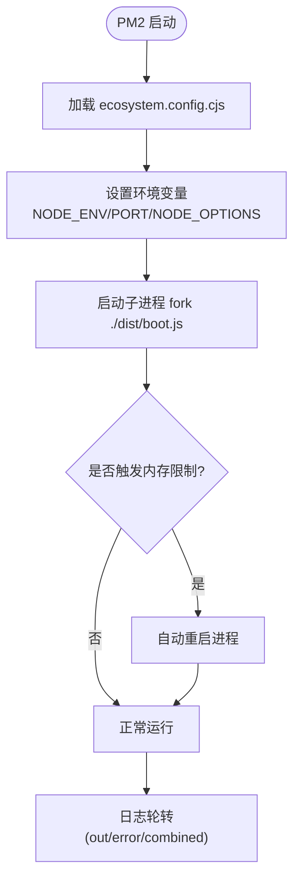
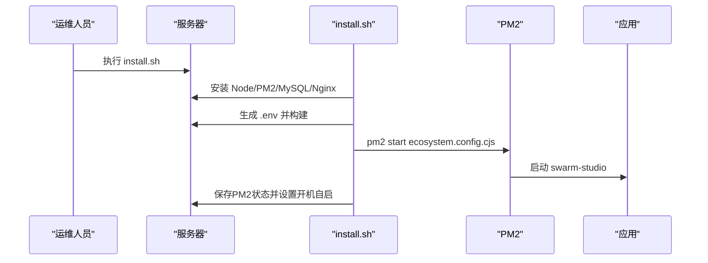
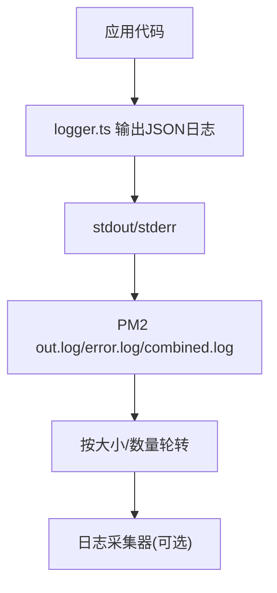
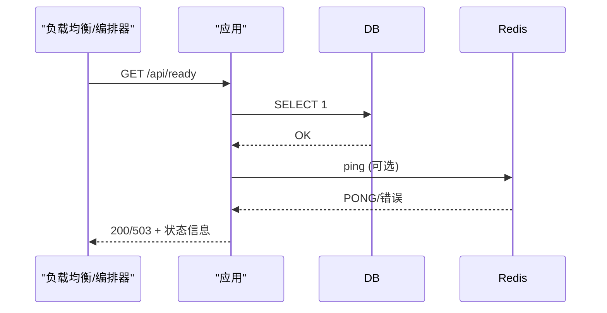
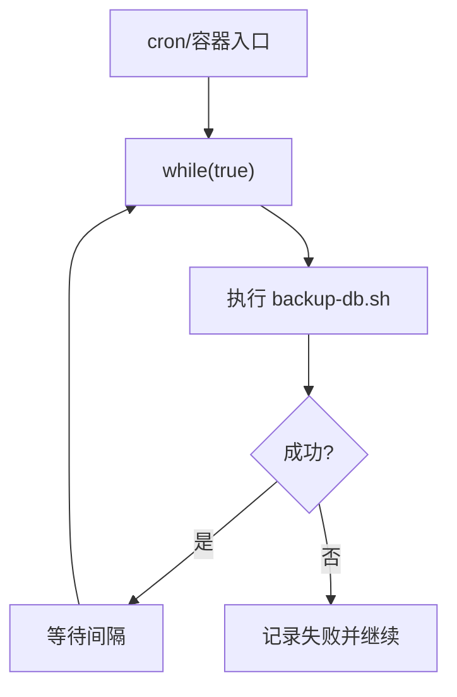
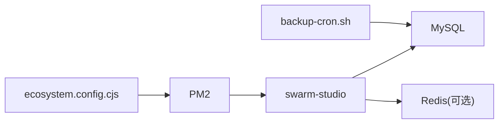

# 进程管理

<cite>
**本文引用的文件**
- [ecosystem.config.cjs](file://ecosystem.config.cjs)
- [deploy/install.sh](file://deploy/install.sh)
- [deploy/aliyun-setup.sh](file://deploy/aliyun-setup.sh)
- [api/lib/logger.ts](file://api/lib/logger.ts)
- [api/boot.ts](file://api/boot.ts)
- [scripts/backup-cron.sh](file://scripts/backup-cron.sh)
- [api/infra/redis.ts](file://api/infra/redis.ts)
</cite>

## 目录
1. [简介](#简介)
2. [项目结构](#项目结构)
3. [核心组件](#核心组件)
4. [架构总览](#架构总览)
5. [详细组件分析](#详细组件分析)
6. [依赖关系分析](#依赖关系分析)
7. [性能考虑](#性能考虑)
8. [故障排查指南](#故障排查指南)
9. [结论](#结论)
10. [附录](#附录)

## 简介
本文件面向DeeWaanAI项目的生产运维与开发部署，聚焦PM2进程管理器的配置与使用。内容涵盖：
- ecosystem.config.cjs 配置详解（进程名、脚本入口、实例数、执行模式、内存限制、自动重启、日志轮转等）
- 进程启动、停止、重启、监控的常用命令
- 日志管理策略（轮转、级别、收集方案）
- 自动重启机制、内存限制与CPU使用率监控
- 定时任务（数据库备份、数据清理等后台任务调度）
- 进程间通信、集群模式与负载均衡的配置方法
- 故障排查技巧与性能调优建议

## 项目结构
本项目采用单应用+外部依赖的部署形态：
- 应用主进程由PM2托管，入口为构建产物 boot.js
- Nginx作为反向代理，将HTTP流量转发到Node服务
- MySQL提供持久化存储，Redis可选用于队列/限流/状态共享
- 备份任务通过独立脚本循环执行，配合容器或系统计划任务运行

图表来源
- [deploy/install.sh:131-179](file://deploy/install.sh#L131-L179)
- [ecosystem.config.cjs:1-31](file://ecosystem.config.cjs#L1-L31)
- [scripts/backup-cron.sh:1-57](file://scripts/backup-cron.sh#L1-L57)

章节来源
- [deploy/install.sh:131-179](file://deploy/install.sh#L131-L179)
- [ecosystem.config.cjs:1-31](file://ecosystem.config.cjs#L1-L31)

## 核心组件
- PM2 配置文件：定义进程名称、脚本路径、实例数、执行模式、环境变量、内存限制、自动重启、日志轮转等关键参数
- 安装与启动脚本：在服务器上安装Node、PM2、MySQL、Nginx，并生成.env、构建应用、启动PM2进程
- 日志模块：输出结构化JSON日志，支持按环境控制日志级别
- 健康检查接口：/api/status 与 /api/ready 暴露运行时状态与就绪性
- 备份任务：定时调用mysqldump进行数据库备份，具备失败重试与保留策略

章节来源
- [ecosystem.config.cjs:1-31](file://ecosystem.config.cjs#L1-L31)
- [deploy/install.sh:174-179](file://deploy/install.sh#L174-L179)
- [api/lib/logger.ts:1-32](file://api/lib/logger.ts#L1-L32)
- [api/boot.ts:85-125](file://api/boot.ts#L85-L125)
- [scripts/backup-cron.sh:1-57](file://scripts/backup-cron.sh#L1-L57)

## 架构总览
下图展示了从请求进入、到PM2管理的应用进程、再到后端依赖的完整链路，以及备份任务的独立运行方式。

图表来源
- [deploy/install.sh:131-179](file://deploy/install.sh#L131-L179)
- [api/boot.ts:85-125](file://api/boot.ts#L85-L125)

## 详细组件分析

### PM2 进程管理配置（ecosystem.config.cjs）
- 进程名：swarm-studio
- 脚本入口：./dist/boot.js
- 实例数：1（低内存环境推荐单进程）
- 执行模式：fork（非cluster）
- 内存限制：max_memory_restart=280M；NODE_OPTIONS设置堆大小上限
- 自动重启：autorestart=true；最大重启次数、最小运行时间、杀进程超时、重启延迟
- 日志轮转：combined/out/error日志文件，按大小与数量轮转，统一时间格式，合并日志

图表来源
- [ecosystem.config.cjs:1-31](file://ecosystem.config.cjs#L1-L31)

章节来源
- [ecosystem.config.cjs:1-31](file://ecosystem.config.cjs#L1-L31)

### 安装与启动流程（deploy/install.sh）
- 安装Node 20、PM2、MySQL、Nginx
- 生成密钥与.env，构建应用，推送数据库schema
- 配置Nginx反向代理与限流规则
- 删除旧进程、以PM2启动应用、保存并设置开机自启
- 开放防火墙端口（22/80/443）

图表来源
- [deploy/install.sh:38-179](file://deploy/install.sh#L38-L179)

章节来源
- [deploy/install.sh:38-179](file://deploy/install.sh#L38-L179)

### 日志管理策略
- 应用日志：api/lib/logger.ts 输出结构化JSON，包含时间戳、级别、消息与附加数据；日志级别由LOG_LEVEL控制
- PM2日志：out.log、error.log、combined.log，按大小与数量轮转，统一日期格式，便于集中采集
- 收集方案：可将PM2日志与stdout/stderr统一输出到文件系统，结合日志采集器（如Fluent Bit/Filebeat）推送到集中式日志平台

图表来源
- [api/lib/logger.ts:1-32](file://api/lib/logger.ts#L1-L32)
- [ecosystem.config.cjs:22-29](file://ecosystem.config.cjs#L22-L29)

章节来源
- [api/lib/logger.ts:1-32](file://api/lib/logger.ts#L1-L32)
- [ecosystem.config.cjs:22-29](file://ecosystem.config.cjs#L22-L29)

### 健康检查与就绪性
- /api/status：返回运行时长、内存占用、数据库连接状态、Redis状态、队列后端、worker状态
- /api/ready：当数据库可达且Redis（若启用）连通时返回200，否则503，适合负载均衡与健康探针

图表来源
- [api/boot.ts:85-125](file://api/boot.ts#L85-L125)

章节来源
- [api/boot.ts:85-125](file://api/boot.ts#L85-L125)

### 定时任务（数据库备份）
- backup-cron.sh：循环调用backup-db.sh，支持间隔配置、失败不中断、输出日志
- 适用于容器或系统计划任务，确保定期备份与保留策略

图表来源
- [scripts/backup-cron.sh:1-57](file://scripts/backup-cron.sh#L1-L57)

章节来源
- [scripts/backup-cron.sh:1-57](file://scripts/backup-cron.sh#L1-L57)

### 进程间通信与集群模式
- 当前配置为单进程fork模式，适合低内存环境
- 如需多进程并行处理，可考虑：
  - 使用Redis作为共享状态与队列后端，实现进程间通信与任务分发
  - 通过pm2 cluster模式增加实例数，但需评估内存与负载能力
- 注意：低内存环境下不建议开启cluster模式，避免OOM风险

章节来源
- [ecosystem.config.cjs:5-7](file://ecosystem.config.cjs#L5-L7)
- [api/infra/redis.ts:1-38](file://api/infra/redis.ts#L1-L38)

## 依赖关系分析
- PM2依赖ecosystem.config.cjs进行进程管理
- 应用依赖MySQL与可选Redis
- Nginx作为反向代理，将流量转发到应用
- 备份脚本独立于应用，直接访问MySQL

图表来源
- [ecosystem.config.cjs:1-31](file://ecosystem.config.cjs#L1-L31)
- [deploy/install.sh:131-179](file://deploy/install.sh#L131-L179)
- [scripts/backup-cron.sh:1-57](file://scripts/backup-cron.sh#L1-L57)

章节来源
- [ecosystem.config.cjs:1-31](file://ecosystem.config.cjs#L1-L31)
- [deploy/install.sh:131-179](file://deploy/install.sh#L131-L179)
- [scripts/backup-cron.sh:1-57](file://scripts/backup-cron.sh#L1-L57)

## 性能考虑
- 内存限制：通过NODE_OPTIONS限制堆大小，PM2 max_memory_restart防止内存泄漏导致崩溃
- 单进程模式：低内存环境优先选择fork单实例，避免多进程带来的额外开销
- 日志轮转：合理设置max_size与max_files，防止磁盘占满
- 数据库与缓存：MySQL与Redis按需启用，减少不必要的资源消耗
- 监控：结合系统工具（free、htop）与PM2监控命令观察CPU与内存使用情况

章节来源
- [ecosystem.config.cjs:8-15](file://ecosystem.config.cjs#L8-L15)
- [deploy/install.sh:174-179](file://deploy/install.sh#L174-L179)

## 故障排查指南
- 查看进程状态：pm2 status
- 查看实时日志：pm2 logs
- 重启进程：pm2 restart swarm-studio
- 检查内存：free -h
- 健康检查：curl http://localhost:3000/api/status 与 /api/ready
- 常见问题：
  - 进程频繁重启：检查内存限制与日志轮转配置
  - 数据库连接失败：确认DATABASE_URL与MySQL服务状态
  - Redis不可用：应用会降级到内存状态，关注相关告警

章节来源
- [deploy/install.sh:174-179](file://deploy/install.sh#L174-L179)
- [api/boot.ts:85-125](file://api/boot.ts#L85-L125)
- [api/infra/redis.ts:1-38](file://api/infra/redis.ts#L1-L38)

## 结论
本项目基于PM2对单进程Node应用进行生命周期管理，结合Nginx反向代理与MySQL/Redis依赖，形成稳定、易维护的生产部署方案。通过合理的内存限制、日志轮转与健康检查，保障应用在低资源环境下的可用性与可观测性。定时备份脚本确保数据安全。未来可根据业务增长逐步引入集群模式与更完善的监控体系。

## 附录

### PM2常用命令参考
- 启动：pm2 start ecosystem.config.cjs
- 停止：pm2 stop swarm-studio
- 重启：pm2 restart swarm-studio
- 查看状态：pm2 status
- 查看日志：pm2 logs
- 保存配置：pm2 save
- 开机自启：pm2 startup systemd

章节来源
- [deploy/install.sh:174-179](file://deploy/install.sh#L174-L179)