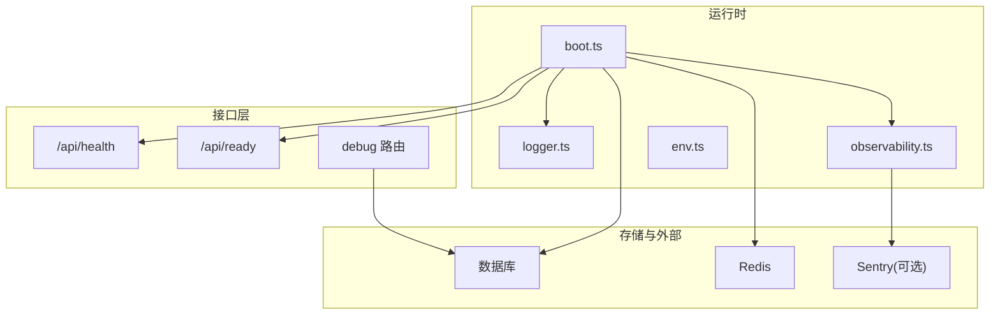
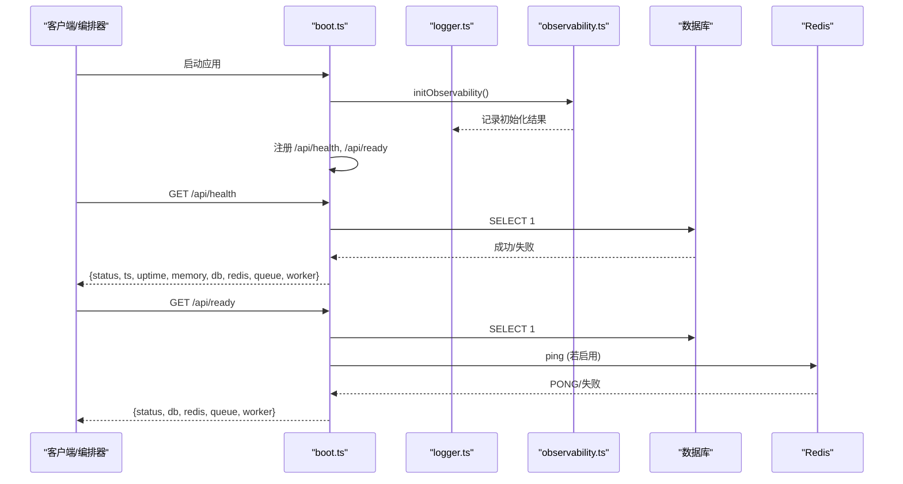
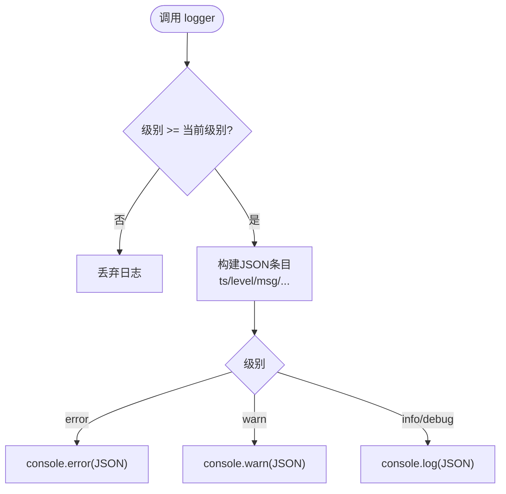
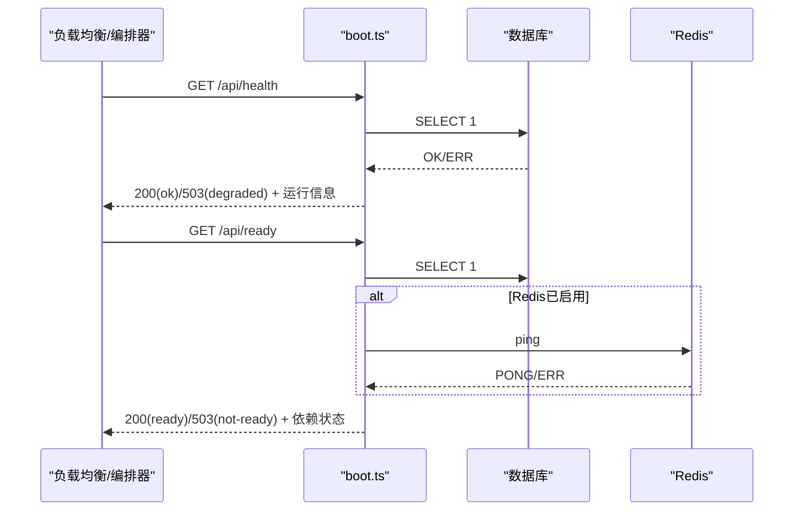
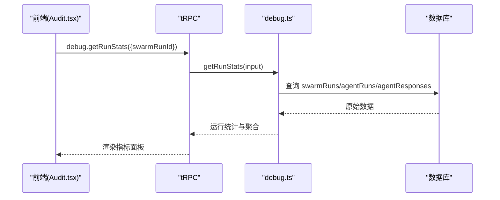
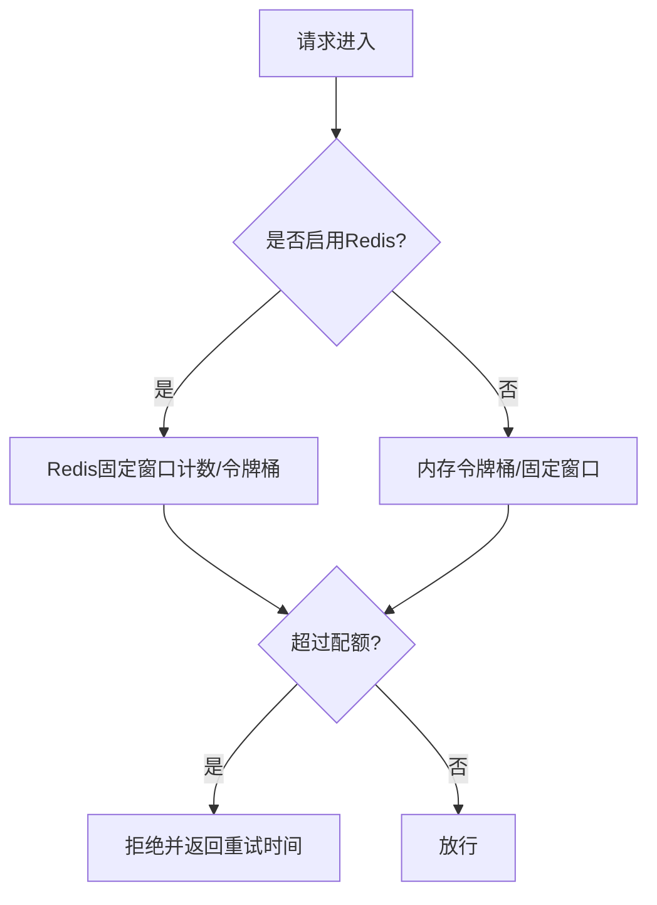
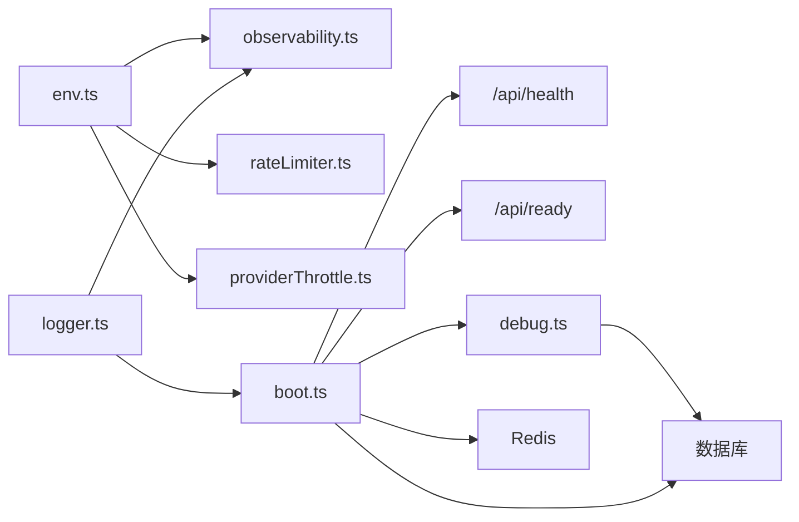

# 监控和日志管理

<cite>
**本文引用的文件**
- [api/lib/logger.ts](file://api/lib/logger.ts)
- [api/lib/observability.ts](file://api/lib/observability.ts)
- [api/boot.ts](file://api/boot.ts)
- [api/lib/env.ts](file://api/lib/env.ts)
- [api/routers/debug.ts](file://api/routers/debug.ts)
- [api/lib/rateLimiter.ts](file://api/lib/rateLimiter.ts)
- [api/lib/providerThrottle.ts](file://api/lib/providerThrottle.ts)
- [src/pages/Audit.tsx](file://src/pages/Audit.tsx)
</cite>

## 目录
1. [简介](#简介)
2. [项目结构](#项目结构)
3. [核心组件](#核心组件)
4. [架构总览](#架构总览)
5. [详细组件分析](#详细组件分析)
6. [依赖关系分析](#依赖关系分析)
7. [性能考量](#性能考量)
8. [故障诊断指南](#故障诊断指南)
9. [结论](#结论)
10. [附录](#附录)

## 简介
本文件面向运维与研发人员，系统化说明 DeeWaanAI 的监控与日志管理能力：内置结构化日志、可选的错误上报（Sentry）、健康检查端点（/api/health、/api/ready）、关键性能指标收集与展示、以及告警与通知建议。文档同时提供故障定位方法与最佳实践，帮助快速发现并处理异常。

## 项目结构
与监控和日志相关的核心位置如下：
- 日志与可观测性：api/lib/logger.ts、api/lib/observability.ts
- 启动与健康检查：api/boot.ts
- 环境变量与开关：api/lib/env.ts
- 调试与指标查询：api/routers/debug.ts、src/pages/Audit.tsx
- 限流与提供者节流（间接影响性能）：api/lib/rateLimiter.ts、api/lib/providerThrottle.ts

图表来源
- [api/boot.ts:73-135](file://api/boot.ts#L73-L135)
- [api/lib/logger.ts:1-31](file://api/lib/logger.ts#L1-L31)
- [api/lib/observability.ts:1-33](file://api/lib/observability.ts#L1-L33)
- [api/lib/env.ts:24-95](file://api/lib/env.ts#L24-L95)
- [api/routers/debug.ts:1-174](file://api/routers/debug.ts#L1-L174)

章节来源
- [api/boot.ts:73-135](file://api/boot.ts#L73-L135)
- [api/lib/logger.ts:1-31](file://api/lib/logger.ts#L1-L31)
- [api/lib/observability.ts:1-33](file://api/lib/observability.ts#L1-L33)
- [api/lib/env.ts:24-95](file://api/lib/env.ts#L24-L95)
- [api/routers/debug.ts:1-174](file://api/routers/debug.ts#L1-L174)

## 核心组件
- 结构化日志器：基于 LOG_LEVEL 过滤级别，输出 JSON 行，便于集中采集与分析。支持 debug/info/warn/error 四级。
- 错误上报（Sentry）：通过 SENTRY_DSN 启用，动态导入 SDK，失败不阻塞启动；生产环境自动设置 environment。
- 健康检查：
  - /api/health：进程存活且数据库可达即 200；数据库不可达返回 503，状态为 degraded。
  - /api/ready：要求数据库可达，并在配置了 Redis 时要求 Redis 连通；否则返回 503，用于负载均衡/编排就绪探针。
- 运行期指标：健康端点返回 uptime、内存（RSS/Heap）、DB/Redis/队列/Worker 状态等。
- 调试与指标查询：通过 tRPC debug 路由获取运行统计、步骤级延迟与 Token 用量、按角色聚合等。

章节来源
- [api/lib/logger.ts:1-31](file://api/lib/logger.ts#L1-L31)
- [api/lib/observability.ts:1-33](file://api/lib/observability.ts#L1-L33)
- [api/boot.ts:73-135](file://api/boot.ts#L73-L135)
- [api/routers/debug.ts:44-174](file://api/routers/debug.ts#L44-L174)

## 架构总览
应用启动时初始化可观测性与工作进程，注册健康与就绪端点，全局捕获未处理异常，并提供优雅停机流程。

图表来源
- [api/boot.ts:61-135](file://api/boot.ts#L61-L135)
- [api/lib/observability.ts:16-33](file://api/lib/observability.ts#L16-L33)
- [api/lib/logger.ts:12-31](file://api/lib/logger.ts#L12-L31)

## 详细组件分析

### 日志系统
- 日志级别与格式
  - 级别：debug、info、warn、error，默认 info。
  - 格式：JSON 单行，包含时间戳、级别、消息及扩展字段，便于日志平台解析。
  - 级别过滤：由 LOG_LEVEL 控制，低于当前级别的日志将被丢弃。
- 请求追踪
  - 中间件生成或透传 x-request-id，写入响应头，便于跨服务链路追踪。
- 全局异常
  - 捕获 uncaughtException 与 unhandledRejection，统一以 error 级别记录。
- 轮转策略
  - 代码未实现本地日志轮转；建议将标准输出接入容器日志系统（如 Docker/云厂商日志），由外部日志系统进行轮转与保留。

图表来源
- [api/lib/logger.ts:12-31](file://api/lib/logger.ts#L12-L31)
- [api/boot.ts:37-45](file://api/boot.ts#L37-L45)
- [api/boot.ts:375-381](file://api/boot.ts#L375-L381)

章节来源
- [api/lib/logger.ts:1-31](file://api/lib/logger.ts#L1-L31)
- [api/boot.ts:37-45](file://api/boot.ts#L37-L45)
- [api/boot.ts:375-381](file://api/boot.ts#L375-L381)

### 可观测性（Sentry）
- 启用条件：SENTRY_DSN 非空时动态加载 @sentry/node 并初始化。
- 环境标识：根据 isProduction 设置 environment。
- 健壮性：初始化失败仅记录警告，不影响主进程启动。

章节来源
- [api/lib/observability.ts:1-33](file://api/lib/observability.ts#L1-L33)
- [api/lib/env.ts:63-64](file://api/lib/env.ts#L63-L64)

### 健康检查与就绪检查
- /api/health（存活探针）
  - 行为：尝试执行数据库查询；成功返回 200，状态 ok；失败返回 503，状态 degraded。
  - 返回内容：status、时间戳、uptime、内存（RSS/Heap）、db/redis/queue/worker 状态。
- /api/ready（就绪探针）
  - 行为：要求数据库可达；若启用 Redis，则还需 Redis 连通；满足条件返回 200，否则 503。
  - 用途：负载均衡/编排器据此决定是否向实例转发流量。

图表来源
- [api/boot.ts:73-135](file://api/boot.ts#L73-L135)

章节来源
- [api/boot.ts:73-135](file://api/boot.ts#L73-L135)

### 性能监控指标与展示
- 进程级指标（健康端点）
  - uptime：进程运行时长。
  - memory.rss/heapUsed：内存使用量（MB）。
  - 依赖状态：db、redis、queue、worker。
- 任务与模型调用指标（调试端点）
  - 单次运行统计：总 Token 消耗、总延迟、各步骤明细（角色、模型、延迟、Token）。
  - 项目级聚合：运行次数、响应数、累计 Token、累计延迟、按角色聚合的平均值、标记数量。
- 前端展示
  - 审计页面通过 tRPC 调用 debug.getRunStats 渲染步骤级指标与汇总。

图表来源
- [api/routers/debug.ts:44-174](file://api/routers/debug.ts#L44-L174)
- [src/pages/Audit.tsx:231-252](file://src/pages/Audit.tsx#L231-L252)

章节来源
- [api/routers/debug.ts:44-174](file://api/routers/debug.ts#L44-L174)
- [src/pages/Audit.tsx:231-252](file://src/pages/Audit.tsx#L231-L252)

### 限流与提供者节流（对性能的影响）
- 通用限流：令牌桶算法，支持内存模式与 Redis 固定窗口模式（多节点共享），失败降级到内存模式。
- 客户分级限流：按 solo/team/admin 不同配额进行每分钟固定窗口计数。
- 提供者节流：AIMD 自适应调整每个提供者的 RPM，状态优先存 Redis，回退到内存。

图表来源
- [api/lib/rateLimiter.ts:31-93](file://api/lib/rateLimiter.ts#L31-L93)
- [api/lib/rateLimiter.ts:198-216](file://api/lib/rateLimiter.ts#L198-L216)
- [api/lib/providerThrottle.ts:1-274](file://api/lib/providerThrottle.ts#L1-L274)

章节来源
- [api/lib/rateLimiter.ts:31-93](file://api/lib/rateLimiter.ts#L31-L93)
- [api/lib/rateLimiter.ts:198-216](file://api/lib/rateLimiter.ts#L198-L216)
- [api/lib/providerThrottle.ts:1-274](file://api/lib/providerThrottle.ts#L1-L274)

## 依赖关系分析
- boot.ts 依赖 logger、observability、数据库连接、Redis、队列与工作进程。
- observability 依赖 env 与 logger，按需引入 Sentry。
- debug 路由依赖数据库 schema 与 ORM 查询，暴露指标查询能力。
- rateLimiter/providerThrottle 依赖 Redis，具备健壮的降级路径。

图表来源
- [api/lib/env.ts:24-95](file://api/lib/env.ts#L24-L95)
- [api/lib/observability.ts:1-33](file://api/lib/observability.ts#L1-L33)
- [api/lib/rateLimiter.ts:1-216](file://api/lib/rateLimiter.ts#L1-L216)
- [api/lib/providerThrottle.ts:1-274](file://api/lib/providerThrottle.ts#L1-L274)
- [api/boot.ts:61-135](file://api/boot.ts#L61-L135)
- [api/routers/debug.ts:1-174](file://api/routers/debug.ts#L1-L174)

章节来源
- [api/lib/env.ts:24-95](file://api/lib/env.ts#L24-L95)
- [api/lib/observability.ts:1-33](file://api/lib/observability.ts#L1-L33)
- [api/lib/rateLimiter.ts:1-216](file://api/lib/rateLimiter.ts#L1-L216)
- [api/lib/providerThrottle.ts:1-274](file://api/lib/providerThrottle.ts#L1-L274)
- [api/boot.ts:61-135](file://api/boot.ts#L61-L135)
- [api/routers/debug.ts:1-174](file://api/routers/debug.ts#L1-L174)

## 性能考量
- 健康检查开销：每次请求执行一次数据库查询；在高频探测场景下需合理设置间隔，避免放大数据库压力。
- 内存与堆：健康端点直接读取进程内存，注意在高负载下的采样频率。
- 限流与节流：
  - 限流失败会降级到内存模式，可能降低跨节点一致性；建议在多实例部署中确保 Redis 可用。
  - 提供者节流使用 AIMD 自适应调节，有助于缓解上游限制与抖动。
- 指标查询：debug 路由涉及多次聚合查询，建议在审计页面分页与限制查询范围，避免大表全量扫描。

[本节为通用指导，无需特定文件引用]

## 故障诊断指南
- 快速定位
  - 查看 /api/health 与 /api/ready 判断进程与依赖状态。
  - 通过日志平台检索 ERROR/WARN 级别日志，结合 x-request-id 追踪请求链路。
  - 使用 debug.getRunStats 查看具体运行的延迟与 Token 消耗，定位慢步骤。
- 常见问题
  - 数据库不可用：/api/health 返回 degraded，/api/ready 返回 not-ready；检查连接串与网络。
  - Redis 不可用：/api/ready 返回 not-ready；限流与节流降级到内存模式，可能出现瞬时不一致。
  - 未处理异常：全局捕获后以 error 级别记录；若启用 Sentry，可在错误平台查看堆栈与环境。
- 优雅停机
  - SIGTERM/SIGINT 触发停止工作进程与关闭队列，超时强制退出；观察停机期间的任务状态，下次启动会自动修复“悬挂”任务。

章节来源
- [api/boot.ts:73-135](file://api/boot.ts#L73-L135)
- [api/boot.ts:375-414](file://api/boot.ts#L375-L414)
- [api/routers/debug.ts:44-174](file://api/routers/debug.ts#L44-L174)
- [api/lib/observability.ts:16-33](file://api/lib/observability.ts#L16-L33)

## 结论
DeeWaanAI 提供了轻量而稳健的监控与日志体系：结构化日志、可选的错误上报、明确的健康与就绪探针、以及面向运行时的指标查询。配合合理的日志轮转与告警策略，可实现从“可见—可测—可告—可排障”的完整闭环。建议在生产环境中：
- 开启 Sentry 并配置告警规则。
- 将标准输出接入集中式日志系统，并配置轮转与保留策略。
- 为 /api/health 与 /api/ready 配置健康检查与就绪探针。
- 对关键指标（延迟、错误率、资源使用）建立仪表盘与阈值告警。

[本节为总结性内容，无需特定文件引用]

## 附录

### 环境变量参考（与监控相关）
- LOG_LEVEL：日志级别（debug/info/warn/error），默认 info。
- SENTRY_DSN：错误上报 DSN，为空则禁用 Sentry。
- NODE_ENV：决定 Sentry environment 与部分安全校验。
- DATABASE_URL/DATABASE_READ_URL：数据库连接。
- REDIS_URL：缓存/队列依赖，影响就绪检查与限流/节流。
- PORT：服务端口。

章节来源
- [api/lib/env.ts:24-95](file://api/lib/env.ts#L24-L95)