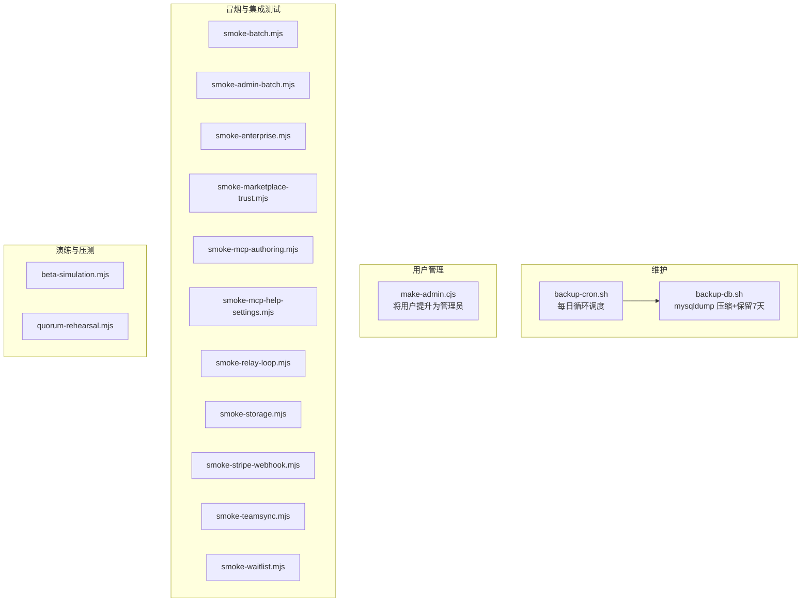
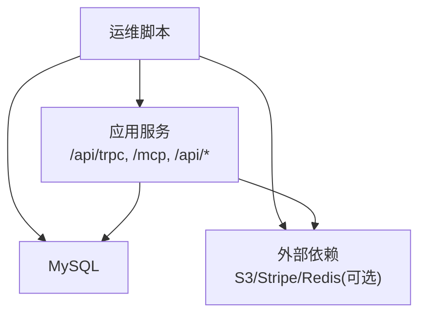
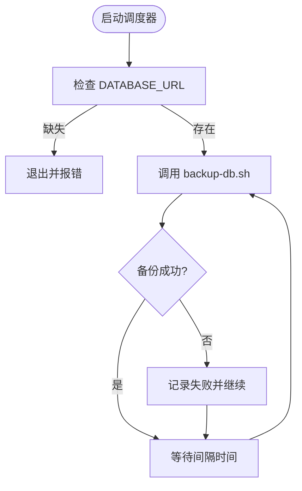
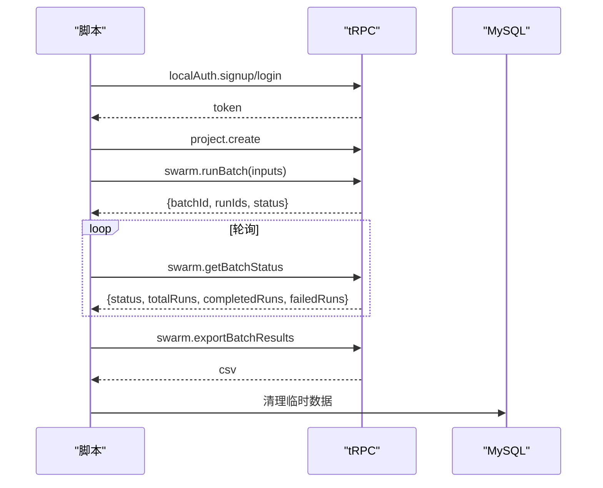
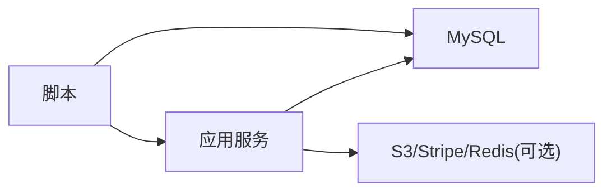

# 运维脚本使用

<cite>
**本文引用的文件**
- [scripts/backup-cron.sh](file://scripts/backup-cron.sh)
- [scripts/backup-db.sh](file://scripts/backup-db.sh)
- [scripts/make-admin.cjs](file://scripts/make-admin.cjs)
- [scripts/smoke-batch.mjs](file://scripts/smoke-batch.mjs)
- [scripts/smoke-admin-batch.mjs](file://scripts/smoke-admin-batch.mjs)
- [scripts/smoke-enterprise.mjs](file://scripts/smoke-enterprise.mjs)
- [scripts/smoke-marketplace-trust.mjs](file://scripts/smoke-marketplace-trust.mjs)
- [scripts/smoke-mcp-authoring.mjs](file://scripts/smoke-mcp-authoring.mjs)
- [scripts/smoke-mcp-help-settings.mjs](file://scripts/smoke-mcp-help-settings.mjs)
- [scripts/smoke-relay-loop.mjs](file://scripts/smoke-relay-loop.mjs)
- [scripts/smoke-storage.mjs](file://scripts/smoke-storage.mjs)
- [scripts/smoke-stripe-webhook.mjs](file://scripts/smoke-stripe-webhook.mjs)
- [scripts/smoke-teamsync.mjs](file://scripts/smoke-teamsync.mjs)
- [scripts/smoke-waitlist.mjs](file://scripts/smoke-waitlist.mjs)
- [scripts/beta-simulation.mjs](file://scripts/beta-simulation.mjs)
- [scripts/quorum-rehearsal.mjs](file://scripts/quorum-rehearsal.mjs)
</cite>

## 目录
1. [简介](#简介)
2. [项目结构](#项目结构)
3. [核心组件](#核心组件)
4. [架构总览](#架构总览)
5. [详细组件分析](#详细组件分析)
6. [依赖关系分析](#依赖关系分析)
7. [性能与稳定性考虑](#性能与稳定性考虑)
8. [故障排查指南](#故障排查指南)
9. [结论](#结论)
10. [附录：自定义脚本开发指南](#附录自定义脚本开发指南)

## 简介
本文件为 DeeWaanAI 的运维脚本使用手册，覆盖数据库备份、用户管理、系统冒烟测试、集成测试、功能验证、批量操作与演练脚本等。文档提供每个脚本的功能说明、运行方式、参数与环境变量要求、执行流程与最佳实践，并给出可视化流程图与时序图，帮助运维与研发快速定位问题与高效执行任务。

## 项目结构
运维脚本集中在 scripts 目录，按用途分为三类：
- 数据与系统维护：数据库备份（含定时调度）
- 用户与权限管理：管理员提升等
- 测试与演练：冒烟测试、集成测试、功能验证、企业特性开关、MCP 工具链、存储、支付回调、团队同步、等待列表、多创建者模拟与评审演练

**章节来源**
- [scripts/backup-cron.sh:1-57](file://scripts/backup-cron.sh#L1-L57)
- [scripts/backup-db.sh:1-56](file://scripts/backup-db.sh#L1-L56)
- [scripts/make-admin.cjs:1-49](file://scripts/make-admin.cjs#L1-L49)
- [scripts/smoke-batch.mjs:1-134](file://scripts/smoke-batch.mjs#L1-L134)
- [scripts/smoke-admin-batch.mjs:1-132](file://scripts/smoke-admin-batch.mjs#L1-L132)
- [scripts/smoke-enterprise.mjs:1-167](file://scripts/smoke-enterprise.mjs#L1-L167)
- [scripts/smoke-marketplace-trust.mjs:1-311](file://scripts/smoke-marketplace-trust.mjs#L1-L311)
- [scripts/smoke-mcp-authoring.mjs:1-248](file://scripts/smoke-mcp-authoring.mjs#L1-L248)
- [scripts/smoke-mcp-help-settings.mjs:1-281](file://scripts/smoke-mcp-help-settings.mjs#L1-L281)
- [scripts/smoke-relay-loop.mjs:1-223](file://scripts/smoke-relay-loop.mjs#L1-L223)
- [scripts/smoke-storage.mjs:1-143](file://scripts/smoke-storage.mjs#L1-L143)
- [scripts/smoke-stripe-webhook.mjs:1-257](file://scripts/smoke-stripe-webhook.mjs#L1-L257)
- [scripts/smoke-teamsync.mjs:1-265](file://scripts/smoke-teamsync.mjs#L1-L265)
- [scripts/smoke-waitlist.mjs:1-96](file://scripts/smoke-waitlist.mjs#L1-L96)
- [scripts/beta-simulation.mjs:1-294](file://scripts/beta-simulation.mjs#L1-L294)
- [scripts/quorum-rehearsal.mjs:1-310](file://scripts/quorum-rehearsal.mjs#L1-L310)

## 核心组件
- 数据库备份
  - 每日循环调度器：启动后立即执行一次备份，随后按间隔重复；失败不中断循环，仅记录日志。
  - 单次备份：基于 mysqldump 生成带时间戳的 .sql.gz，自动清理超过7天的旧备份。
- 用户管理
  - 管理员提升：通过用户名将用户角色更新为 admin。
- 冒烟与集成测试
  - 批量流水线冒烟：注册账号、创建项目、提交批处理、轮询状态、导出结果、列出批次。
  - 管理后台冒烟：审计日志、防自降级、用户搜索、认证队列重入。
  - 企业特性冒烟：SSO 查找与授权、中继往返、签名审计账本、MCP 限流。
  - 市场信任冒烟：安全扫描拦截、可见性限制、盲池隐私、评审配额判定。
  - MCP 工具冒烟：作者工具、帮助与设置、提供者配置、采样探针。
  - 中继闭环冒烟：注册中继、子进程连接器、请求入队与完成。
  - 存储冒烟：S3 上传、对象校验、鉴权下载、伪造签名拒绝。
  - Stripe 回调冒烟：离线构造事件、幂等处理、退款撤销权益。
  - 团队同步冒烟：开关控制、工具暴露、端到端协作流程。
  - 等待列表冒烟：加入、重复处理、校验、计数与 CORS。
- 演练与压测
  - Beta 多创建者模拟：受控上限、清单式清理、预算保护、真实 API 调用。
  - 评审配额演练：保护真实 listing、发布占位 listing、五评审×三次评分、恢复状态。

**章节来源**
- [scripts/backup-cron.sh:1-57](file://scripts/backup-cron.sh#L1-L57)
- [scripts/backup-db.sh:1-56](file://scripts/backup-db.sh#L1-L56)
- [scripts/make-admin.cjs:1-49](file://scripts/make-admin.cjs#L1-L49)
- [scripts/smoke-batch.mjs:1-134](file://scripts/smoke-batch.mjs#L1-L134)
- [scripts/smoke-admin-batch.mjs:1-132](file://scripts/smoke-admin-batch.mjs#L1-L132)
- [scripts/smoke-enterprise.mjs:1-167](file://scripts/smoke-enterprise.mjs#L1-L167)
- [scripts/smoke-marketplace-trust.mjs:1-311](file://scripts/smoke-marketplace-trust.mjs#L1-L311)
- [scripts/smoke-mcp-authoring.mjs:1-248](file://scripts/smoke-mcp-authoring.mjs#L1-L248)
- [scripts/smoke-mcp-help-settings.mjs:1-281](file://scripts/smoke-mcp-help-settings.mjs#L1-L281)
- [scripts/smoke-relay-loop.mjs:1-223](file://scripts/smoke-relay-loop.mjs#L1-L223)
- [scripts/smoke-storage.mjs:1-143](file://scripts/smoke-storage.mjs#L1-L143)
- [scripts/smoke-stripe-webhook.mjs:1-257](file://scripts/smoke-stripe-webhook.mjs#L1-L257)
- [scripts/smoke-teamsync.mjs:1-265](file://scripts/smoke-teamsync.mjs#L1-L265)
- [scripts/smoke-waitlist.mjs:1-96](file://scripts/smoke-waitlist.mjs#L1-L96)
- [scripts/beta-simulation.mjs:1-294](file://scripts/beta-simulation.mjs#L1-L294)
- [scripts/quorum-rehearsal.mjs:1-310](file://scripts/quorum-rehearsal.mjs#L1-L310)

## 架构总览
运维脚本围绕“应用服务 + 数据库 + 外部依赖”展开：
- 应用服务：tRPC/MCP/HTTP 接口，作为被测目标
- 数据库：MySQL，用于持久化与断言
- 外部依赖：S3、Stripe、Redis 等（按需启用）

**图示来源**
- [scripts/smoke-batch.mjs:1-134](file://scripts/smoke-batch.mjs#L1-L134)
- [scripts/smoke-enterprise.mjs:1-167](file://scripts/smoke-enterprise.mjs#L1-L167)
- [scripts/smoke-storage.mjs:1-143](file://scripts/smoke-storage.mjs#L1-L143)
- [scripts/smoke-stripe-webhook.mjs:1-257](file://scripts/smoke-stripe-webhook.mjs#L1-L257)

## 详细组件分析

### 数据库备份（backup-cron.sh + backup-db.sh）
- 功能
  - 循环调度：立即执行一次备份后按间隔重复；失败不中断。
  - 单次备份：mysqldump 单事务快照，输出 gz 文件，保留最近7天。
- 运行方式
  - 环境变量：DATABASE_URL（必填）、BACKUP_DIR（可选）、BACKUP_INTERVAL_SECONDS（可选）。
  - 典型用法：在容器或常驻进程中以 bash 运行调度器；或通过 crontab 直接调用单次备份。
- 恢复方法
  - 解压后通过 mysql 导入。

**图示来源**
- [scripts/backup-cron.sh:1-57](file://scripts/backup-cron.sh#L1-L57)
- [scripts/backup-db.sh:1-56](file://scripts/backup-db.sh#L1-L56)

**章节来源**
- [scripts/backup-cron.sh:1-57](file://scripts/backup-cron.sh#L1-L57)
- [scripts/backup-db.sh:1-56](file://scripts/backup-db.sh#L1-L56)

### 用户管理（make-admin.cjs）
- 功能：根据用户名将用户角色设置为 admin。
- 运行方式：node scripts/make-admin.cjs <username>，需配置 DATABASE_URL。
- 注意事项：仅在确认目标用户正确时使用；失败时返回非零退出码。

**章节来源**
- [scripts/make-admin.cjs:1-49](file://scripts/make-admin.cjs#L1-L49)

### 批量流水线冒烟（smoke-batch.mjs）
- 功能：验证 runBatch、getBatchStatus、exportBatchResults、listBatches 等关键路径。
- 运行方式：确保应用服务已启动；脚本读取 .env 中的 DATABASE_URL，默认端口 3000。
- 关键断言：批次创建返回 batchId、runIds 数量、状态流转、CSV 导出行数、列表包含目标批次。
- 清理：结束后删除临时用户、项目、批处理与相关步骤。

**图示来源**
- [scripts/smoke-batch.mjs:1-134](file://scripts/smoke-batch.mjs#L1-L134)

**章节来源**
- [scripts/smoke-batch.mjs:1-134](file://scripts/smoke-batch.mjs#L1-L134)

### 管理后台冒烟（smoke-admin-batch.mjs）
- 功能：验证审计日志、防自降级、用户搜索（用户名/邮箱）、认证队列与重入守卫。
- 运行方式：需要应用服务运行；脚本会创建临时用户并注入特征标志进行断言。
- 清理：删除审计日志、临时用户与标志行。

**章节来源**
- [scripts/smoke-admin-batch.mjs:1-132](file://scripts/smoke-admin-batch.mjs#L1-L132)

### 企业特性冒烟（smoke-enterprise.mjs）
- 功能：开关 enterprise_sso/enterprise_relay；验证 SSO 查找与授权、中继注册/入队/拉取/完成、审计账本签名、MCP 限流。
- 运行方式：支持 phases flags/off/on/disable；需要 APP_SECRET 与 DATABASE_URL。
- 注意：关闭时对应端点应返回 404；开启后进行端到端断言。

**章节来源**
- [scripts/smoke-enterprise.mjs:1-167](file://scripts/smoke-enterprise.mjs#L1-L167)

### 市场信任冒烟（smoke-marketplace-trust.mjs）
- 功能：安全扫描拦截提交、认证中不可购买、盲池隐私、评审配额（≥阈值发布、低于阈值拒绝）。
- 运行方式：需要迁移 014；可传入 baseUrl 与 --keep；必须设置 APP_SECRET 与 DATABASE_URL。
- 清理：删除评审任务、测试提示、模板、用户与标志位。

**章节来源**
- [scripts/smoke-marketplace-trust.mjs:1-311](file://scripts/smoke-marketplace-trust.mjs#L1-L311)

### MCP 作者工具冒烟（smoke-mcp-authoring.mjs）
- 功能：验证 create/get/update/design_pipeline 工具及层级门控（标准版受限、pro_designer 可用）。
- 运行方式：通过 MCP 流式 HTTP 传输；需要 DATABASE_URL 与 APP_SECRET。
- 清理：删除项目、步骤与临时用户。

**章节来源**
- [scripts/smoke-mcp-authoring.mjs:1-248](file://scripts/smoke-mcp-authoring.mjs#L1-L248)

### MCP 帮助与设置冒烟（smoke-mcp-help-settings.mjs）
- 功能：验证 deewaanai_help、get_settings、set_default_model、suggest_llm_providers、add_provider 与采样探针。
- 运行方式：通过 MCP 会话；支持 capabilities 指示客户端是否支持采样。
- 清理：删除新增提供者、临时用户与标志位。

**章节来源**
- [scripts/smoke-mcp-help-settings.mjs:1-281](file://scripts/smoke-mcp-help-settings.mjs#L1-L281)

### 中继闭环冒烟（smoke-relay-loop.mjs）
- 功能：启用 enterprise_relay，注册中继，拉起 connector 子进程，入队 http_proxy 请求，断言完成并写库。
- 运行方式：需要 BASE URL、APP_SECRET、DATABASE_URL；支持 --keep 保留中间数据。
- 清理：恢复标志位、删除中继与请求记录。

**章节来源**
- [scripts/smoke-relay-loop.mjs:1-223](file://scripts/smoke-relay-loop.mjs#L1-L223)

### 存储冒烟（smoke-storage.mjs）
- 功能：验证 S3 兼容后端上传、对象大小一致、不在本地磁盘落盘、鉴权下载、伪造签名拒绝。
- 运行方式：需要 S3_ENDPOINT/REGION/BUCKET/ACCESS_KEY/SECRET_KEY 与 DATABASE_URL；可指定 baseUrl。
- 清理：删除对象与临时用户。

**章节来源**
- [scripts/smoke-storage.mjs:1-143](file://scripts/smoke-storage.mjs#L1-L143)

### Stripe 回调冒烟（smoke-stripe-webhook.mjs）
- 功能：离线构造 checkout.session.completed 与 charge.refunded，验证购买授予权益、销售计数、退款撤销权益与幂等。
- 运行方式：需要 STRIPE_WEBHOOK_SECRET 与 DATABASE_URL；可传入 baseUrl。
- 清理：删除购买、权益、模板、idempotency_keys。

**章节来源**
- [scripts/smoke-stripe-webhook.mjs:1-257](file://scripts/smoke-stripe-webhook.mjs#L1-L257)

### 团队同步冒烟（smoke-teamsync.mjs）
- 功能：开关 teamsync 特性；验证 team_* 工具暴露与执行；端到端协作流程（上下文、交接、记忆）。
- 运行方式：支持 phases flag/off/on/disable/flow；需要 APP_SECRET 与 DATABASE_URL。
- 清理：删除团队、成员、项目、运行与通知。

**章节来源**
- [scripts/smoke-teamsync.mjs:1-265](file://scripts/smoke-teamsync.mjs#L1-L265)

### 等待列表冒烟（smoke-waitlist.mjs）
- 功能：验证 join 契约、重复加入、校验、计数与 CORS。
- 运行方式：需要应用服务运行；默认端口 3000。
- 清理：删除临时条目。

**章节来源**
- [scripts/smoke-waitlist.mjs:1-96](file://scripts/smoke-waitlist.mjs#L1-L96)

### Beta 多创建者模拟（beta-simulation.mjs）
- 功能：模拟多创建者发布到市场、评审员工作盲池；具备硬上限、清单式清理、预算保护、真实 API 调用。
- 运行方式：REHEARSAL_DB_URL 必填；阶段 setup/wait/review/verify/cleanup；支持 --dry-run。
- 清理：仅删除清单中记录的实体，恢复真实 listing 状态。

**章节来源**
- [scripts/beta-simulation.mjs:1-294](file://scripts/beta-simulation.mjs#L1-L294)

### 评审配额演练（quorum-rehearsal.mjs）
- 功能：保护真实 listing，发布占位 listing，通过 MCP 发布并提交评审；5 评审各评 3 次，断言最终状态。
- 运行方式：REHEARSAL_DB_URL 必填；阶段 setup/wait/review/verify/cleanup/all；支持 --dry-run。
- 清理：删除占位 listing 及其关联数据，恢复真实 listing。

**章节来源**
- [scripts/quorum-rehearsal.mjs:1-310](file://scripts/quorum-rehearsal.mjs#L1-L310)

## 依赖关系分析
- 脚本与应用服务
  - 多数冒烟脚本通过 tRPC/MCP/HTTP 与本地应用交互，依赖 PORT 与 .env 配置。
- 脚本与数据库
  - 所有脚本通过 DATABASE_URL 直连 MySQL，用于断言与清理。
- 外部依赖
  - 存储冒烟依赖 S3 兼容服务；Stripe 冒烟依赖 webhook secret；企业冒烟可能涉及 Redis（由应用侧缓存标志位）。

**图示来源**
- [scripts/smoke-batch.mjs:1-134](file://scripts/smoke-batch.mjs#L1-L134)
- [scripts/smoke-enterprise.mjs:1-167](file://scripts/smoke-enterprise.mjs#L1-L167)
- [scripts/smoke-storage.mjs:1-143](file://scripts/smoke-storage.mjs#L1-L143)
- [scripts/smoke-stripe-webhook.mjs:1-257](file://scripts/smoke-stripe-webhook.mjs#L1-L257)

**章节来源**
- [scripts/smoke-batch.mjs:1-134](file://scripts/smoke-batch.mjs#L1-L134)
- [scripts/smoke-enterprise.mjs:1-167](file://scripts/smoke-enterprise.mjs#L1-L167)
- [scripts/smoke-storage.mjs:1-143](file://scripts/smoke-storage.mjs#L1-L143)
- [scripts/smoke-stripe-webhook.mjs:1-257](file://scripts/smoke-stripe-webhook.mjs#L1-L257)

## 性能与稳定性考虑
- 备份
  - 使用单事务快照避免锁表；gzip 压缩减少空间占用；7 天保留策略控制增长。
- 冒烟测试
  - 合理轮询间隔与最大次数，避免长时间阻塞；对速率限制（如注册、MCP 限流）进行退避。
- 演练与压测
  - 硬上限与预算保护防止失控；清单式清理确保可重复执行；只修改必要的最小范围数据。

[本节为通用指导，无需具体文件引用]

## 故障排查指南
- 常见错误
  - 缺少环境变量：DATABASE_URL、APP_SECRET、STRIPE_WEBHOOK_SECRET、S3_* 等。
  - 应用未启动或端口不一致：调整 PORT 或 baseUrl。
  - 数据库迁移未应用：先执行相应迁移（如 marketplace trust 的 014）。
  - 外部依赖不可用：S3 桶不存在、Stripe webhook secret 不匹配。
- 定位建议
  - 查看脚本输出的 PASS/FAIL 行与错误详情。
  - 检查数据库临时数据是否被清理；必要时使用 --keep 保留以便诊断。
  - 对于企业特性，确认 feature_flags 开关与 TTL 刷新。

**章节来源**
- [scripts/smoke-marketplace-trust.mjs:1-311](file://scripts/smoke-marketplace-trust.mjs#L1-L311)
- [scripts/smoke-stripe-webhook.mjs:1-257](file://scripts/smoke-stripe-webhook.mjs#L1-L257)
- [scripts/smoke-enterprise.mjs:1-167](file://scripts/smoke-enterprise.mjs#L1-L167)
- [scripts/smoke-storage.mjs:1-143](file://scripts/smoke-storage.mjs#L1-L143)

## 结论
本套运维脚本覆盖了从数据备份、用户管理到全链路冒烟与演练的关键场景。通过统一的环境变量约定、严格的断言与完善的清理机制，可在本地或 CI 环境中稳定执行。建议结合 CI 流水线定期运行冒烟与演练脚本，保障版本变更后的系统可靠性。

[本节为总结，无需具体文件引用]

## 附录：自定义脚本开发指南
- 编写规范
  - 明确输入：命令行参数与环境变量；优先从环境变量读取敏感信息。
  - 最小权限：仅访问必要的数据库表与接口；避免全局查询影响生产数据。
  - 幂等与可重复：支持多次运行且不影响已有数据；提供 --dry-run 与 --keep。
  - 清理机制：在 finally 块中确保资源释放与临时数据清理。
- 错误处理
  - 对外部依赖失败进行捕获与重试（必要时加退避）。
  - 对业务错误进行断言并输出可读信息；使用非零退出码表示失败。
- 日志记录
  - 结构化输出：PASS/FAIL 标记、关键指标、错误堆栈摘要。
  - 控制输出粒度：调试时可增加详细日志，生产环境保持简洁。
- 执行环境准备
  - 提前检查依赖：数据库连接、外部服务可达性、必要迁移已应用。
  - 权限控制：使用最小权限账户；避免在生产库直接执行破坏性操作。
  - 参数验证：对必填参数进行前置校验，失败即早退出。

[本节为通用指导，无需具体文件引用]