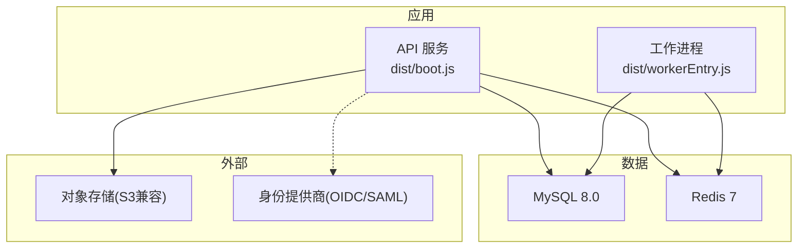
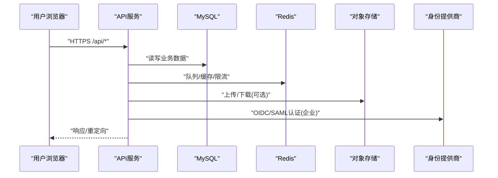
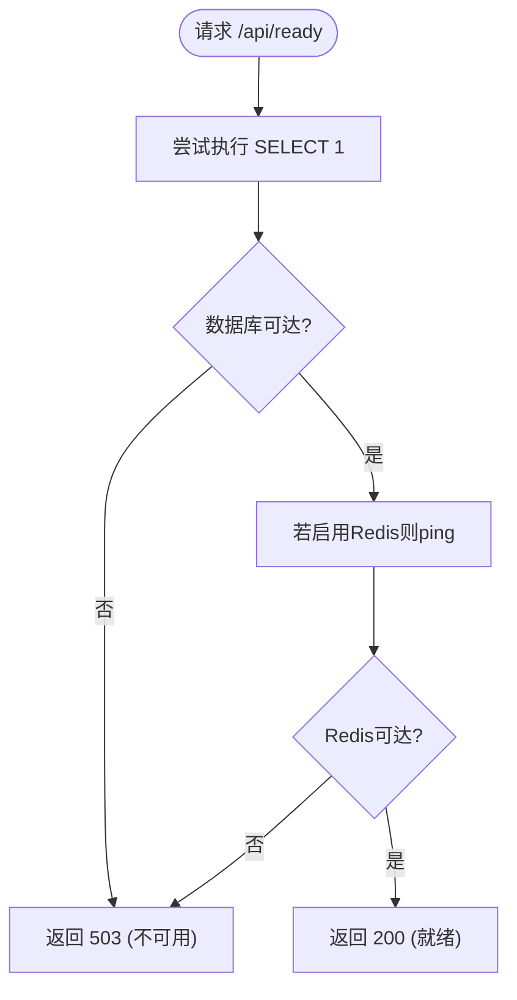
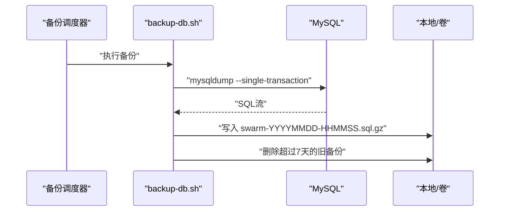
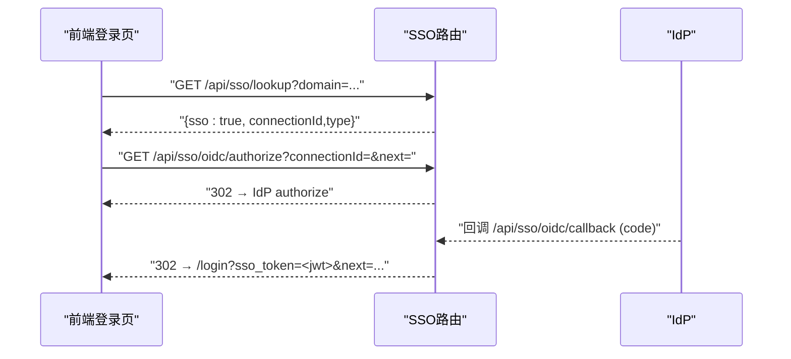
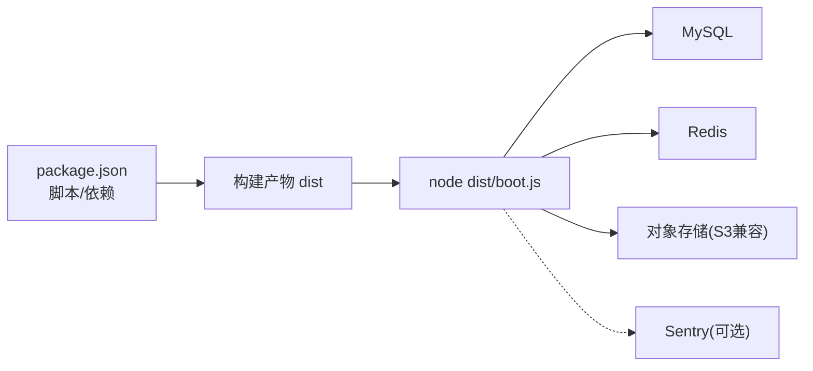

# 部署和运维文档

<cite>
**本文引用的文件**
- [DEPLOY.md](file://DEPLOY.md)
- [Dockerfile](file://Dockerfile)
- [docker-compose.yml](file://docker-compose.yml)
- [docker-compose.backup.yml](file://docker-compose.backup.yml)
- [docker-compose.relay.yml](file://docker-compose.relay.yml)
- [ecosystem.config.cjs](file://ecosystem.config.cjs)
- [package.json](file://package.json)
- [deploy/aliyun-setup.sh](file://deploy/aliyun-setup.sh)
- [scripts/backup-db.sh](file://scripts/backup-db.sh)
- [scripts/backup-cron.sh](file://scripts/backup-cron.sh)
- [api/lib/env.ts](file://api/lib/env.ts)
- [api/boot.ts](file://api/boot.ts)
- [api/lib/logger.ts](file://api/lib/logger.ts)
- [api/lib/observability.ts](file://api/lib/observability.ts)
- [api/sso-route.ts](file://api/sso-route.ts)
- [src/pages/Dashboard.tsx](file://src/pages/Dashboard.tsx)
</cite>

## 目录
1. [简介](#简介)
2. [项目结构](#项目结构)
3. [核心组件](#核心组件)
4. [架构总览](#架构总览)
5. [详细组件分析](#详细组件分析)
6. [依赖关系分析](#依赖关系分析)
7. [性能考虑](#性能考虑)
8. [故障排查指南](#故障排查指南)
9. [结论](#结论)
10. [附录](#附录)

## 简介
本文件面向DeeWaanAI的部署与运维，覆盖开发环境本地搭建、环境变量配置与调试技巧；生产环境的Docker化部署、云平台（Railway、阿里云）部署方案；PM2进程管理、备份恢复、监控告警与企业级能力（出站中继、SSO）。同时提供性能优化建议与最佳实践，帮助你在不同规模与合规要求下稳定运行。

## 项目结构
- 应用服务：Node.js + Hono 后端，构建产物位于 dist，启动入口为 boot.js；可选 worker 进程处理长任务。
- 数据层：MySQL 8.0 作为主数据库，Redis 用于队列、缓存与分布式状态。
- 容器编排：提供 docker-compose 用于本地 MySQL/Redis；独立 compose 文件用于备份调度与出站中继。
- 运维脚本：备份脚本、PM2 配置、阿里云一键安装脚本等。
- 企业功能：SSO（OIDC/SAML）、出站中继（仅出站访问云端），通过特性开关控制。

图表来源
- [Dockerfile:1-39](file://Dockerfile#L1-L39)
- [docker-compose.yml:1-52](file://docker-compose.yml#L1-L52)
- [package.json:7-21](file://package.json#L7-L21)

章节来源
- [Dockerfile:1-39](file://Dockerfile#L1-L39)
- [docker-compose.yml:1-52](file://docker-compose.yml#L1-L52)
- [package.json:7-21](file://package.json#L7-L21)

## 核心组件
- 环境变量与运行时校验：集中定义并校验必需变量，拒绝不安全默认值，支持可选基础设施降级。
- 健康检查与就绪探针：/api/health 返回运行态与依赖状态；/api/ready 在数据库与Redis可达时返回200。
- 日志与可观测性：结构化JSON日志，Sentry按需初始化且失败不阻塞服务。
- 备份与恢复：mysqldump 压缩转储，保留策略与定时循环；支持服务端触发备份到对象存储。
- 企业能力：SSO登录流程（OIDC/SAML）与出站中继连接器（仅出站）。

章节来源
- [api/lib/env.ts:1-105](file://api/lib/env.ts#L1-L105)
- [api/boot.ts:85-125](file://api/boot.ts#L85-L125)
- [api/lib/logger.ts:1-32](file://api/lib/logger.ts#L1-L32)
- [api/lib/observability.ts:1-34](file://api/lib/observability.ts#L1-L34)
- [scripts/backup-db.sh:1-56](file://scripts/backup-db.sh#L1-L56)
- [scripts/backup-cron.sh:1-57](file://scripts/backup-cron.sh#L1-L57)
- [api/sso-route.ts:1-290](file://api/sso-route.ts#L1-L290)

## 架构总览
下图展示典型部署拓扑：前端浏览器访问Web服务，Web服务连接MySQL与Redis，必要时调用对象存储；企业场景启用SSO与出站中继。

图表来源
- [api/boot.ts:85-125](file://api/boot.ts#L85-L125)
- [api/lib/env.ts:1-105](file://api/lib/env.ts#L1-L105)
- [api/sso-route.ts:1-290](file://api/sso-route.ts#L1-L290)

## 详细组件分析

### 环境变量与运行时安全
- 必需变量：APP_SECRET、DATABASE_URL、AI_SWARM_MASTER_KEY、MARKETPLACE_MASTER_KEY、APP_ID、VITE_APP_ID、NODE_ENV、PORT。
- 可选基础设施：REDIS_URL、STRIPE_*、SENTRY_DSN、S3_*、AUDIT_EXPORT_KEY、BACKUP_TOKEN、TRUSTED_PROXY、PUBLIC_APP_URL 等。
- 安全策略：生产环境禁止使用已知弱密钥；未配置的功能优雅降级（如Stripe、S3、Redis）。

章节来源
- [api/lib/env.ts:1-105](file://api/lib/env.ts#L1-L105)
- [package.json:7-21](file://package.json#L7-L21)

### 健康检查与就绪探针
- /api/health：返回 status、uptime、memory、db、redis、queue、worker 等状态。
- /api/ready：当数据库可达且Redis（若启用）连通时返回200，否则503，适合负载均衡器或编排系统探测。

图表来源
- [api/boot.ts:85-125](file://api/boot.ts#L85-L125)

章节来源
- [api/boot.ts:85-125](file://api/boot.ts#L85-L125)

### 日志与可观测性
- 日志：统一JSON格式，按级别输出，可通过 LOG_LEVEL 控制。
- 错误上报：Sentry仅在配置SENTRY_DSN时加载，初始化失败不影响服务。

章节来源
- [api/lib/logger.ts:1-32](file://api/lib/logger.ts#L1-L32)
- [api/lib/observability.ts:1-34](file://api/lib/observability.ts#L1-L34)

### 备份与恢复
- 本地/容器备份：scripts/backup-db.sh 基于 mysqldump 生成 .sql.gz，保留7天；scripts/backup-cron.sh 提供每日循环调度。
- 服务端备份：/api/admin/backup 需要 BACKUP_TOKEN，将转储流式上传至对象存储（S3兼容），并清理过期备份。
- 恢复方式：gunzip 后导入目标库。

图表来源
- [scripts/backup-db.sh:1-56](file://scripts/backup-db.sh#L1-L56)
- [scripts/backup-cron.sh:1-57](file://scripts/backup-cron.sh#L1-L57)
- [docker-compose.backup.yml:1-47](file://docker-compose.backup.yml#L1-L47)

章节来源
- [scripts/backup-db.sh:1-56](file://scripts/backup-db.sh#L1-L56)
- [scripts/backup-cron.sh:1-57](file://scripts/backup-cron.sh#L1-L57)
- [docker-compose.backup.yml:1-47](file://docker-compose.backup.yml#L1-L47)

### 进程管理与日志轮转（PM2）
- PM2配置：单实例、fork模式、崩溃自动重启、内存上限触发重启、日志轮转（大小与数量限制）。
- 启动命令：npm start 启动API；npm run start:worker 启动工作进程。

章节来源
- [ecosystem.config.cjs:1-32](file://ecosystem.config.cjs#L1-L32)
- [package.json:7-21](file://package.json#L7-L21)

### 云平台部署

#### Railway 部署要点
- 依赖：MySQL、Redis、HTTPS域名。
- 环境变量：DATABASE_URL、REDIS_URL、APP_SECRET、AI_SWARM_MASTER_KEY、MARKETPLACE_MASTER_KEY、APP_ID、VITE_APP_ID、NODE_ENV、AUDIT_EXPORT_KEY（可选）、BACKUP_TOKEN（可选）。
- 数据库初始化：首次通过公网TCP端点执行 drizzle push。
- 特性开关：通过数据库 feature_flags 表开启电路保护、本地文件夹、市场交易、企业SSO/Relay等。
- 健康检查：/api/health 与 /api/ready。
- 截图与备份：可配置S3兼容存储；GitHub Actions或独立容器每日备份到对象存储。
- 计费：Stripe测试模式接入步骤与回调地址。

章节来源
- [DEPLOY.md:1-145](file://DEPLOY.md#L1-L145)

#### 阿里云 ECS 部署（低内存优化）
- 自动化脚本：创建swap、安装Node/PM2/MySQL/Nginx、生成密钥、构建应用、推送数据库结构、启动PM2、配置反向代理与防火墙、可选Let's Encrypt证书。
- 适用规格：2vCPU 0.5GB RAM 的最小实例。

章节来源
- [deploy/aliyun-setup.sh:1-198](file://deploy/aliyun-setup.sh#L1-L198)

### 企业级部署选项

#### 出站中继（On-Prem Relay）
- 仅出站：连接器向云端发起HTTPS请求，并向本地服务发起HTTP请求，不暴露任何入站端口，满足严格出站策略与数据驻留要求。
- 运行方式：docker-compose.relay.yml 挂载 connector.mjs，设置 CLOUD_URL、RELAY_TOKEN、LOCAL_URL、POLL_WAIT。

章节来源
- [docker-compose.relay.yml:1-38](file://docker-compose.relay.yml#L1-L38)

#### 单点登录（SSO：OIDC/SAML）
- 路由：/api/sso/* 受 enterprise_sso 特性开关控制；支持域名查找、OIDC授权/回调、SAML元数据/ACS。
- 前端集成：登录页根据邮箱域名判断是否显示“继续通过SSO”，完成跳转与令牌回写。
- 安全：state JWT签名、nonce、最小权限、失败重定向而非500。

图表来源
- [api/sso-route.ts:1-290](file://api/sso-route.ts#L1-L290)
- [src/pages/Dashboard.tsx:93-133](file://src/pages/Dashboard.tsx#L93-L133)

章节来源
- [api/sso-route.ts:1-290](file://api/sso-route.ts#L1-L290)
- [src/pages/Dashboard.tsx:93-133](file://src/pages/Dashboard.tsx#L93-L133)

## 依赖关系分析
- 运行时依赖：MySQL、Redis（可选）、对象存储（可选）、Sentry（可选）、Stripe（可选）。
- 构建与运行：Node 20，esbuild 打包，vite 构建前端，drizzle-kit 管理数据库迁移。
- 容器镜像：多阶段构建，生产镜像仅包含运行所需依赖与二进制。

图表来源
- [package.json:7-21](file://package.json#L7-L21)
- [Dockerfile:1-39](file://Dockerfile#L1-L39)

章节来源
- [package.json:7-21](file://package.json#L7-L21)
- [Dockerfile:1-39](file://Dockerfile#L1-L39)

## 性能考虑
- 资源限制：PM2 设置 max_memory_restart 与 NODE_OPTIONS 堆大小，避免内存泄漏导致OOM。
- 数据库：低内存MySQL配置（innodb_buffer_pool_size、thread_cache_size等），减少查询开销。
- 队列与并发：Redis可用时启用队列与分布式状态；工作进程分离以减轻HTTP线程压力。
- 网络与代理：在可信边缘代理（如Railway）下信任X-Forwarded-For进行限速；直连互联网时关闭该信任。
- 对象存储：大文件或图片走S3兼容存储，降低本地磁盘压力与提升可用性。
- 可观测性：启用Sentry收集异常，结合结构化日志快速定位问题。

[本节为通用指导，无需特定文件引用]

## 故障排查指南
- 健康检查：
  - /api/health：查看 status、db、redis、worker 等状态。
  - /api/ready：若返回503，检查数据库与Redis连通性。
- 日志：
  - 查看PM2日志：pm2 logs swarm-studio。
  - 查看容器日志：docker compose logs -f。
  - 日志级别：调整 LOG_LEVEL 获取更详细信息。
- 备份：
  - 本地/容器：scripts/backup-cron.sh 输出到 ./backups；确认 retention 策略生效。
  - 服务端：确保 BACKUP_TOKEN 与 S3_* 配置正确，验证 /api/admin/backup 可调用。
- 常见错误：
  - 缺少必需环境变量：启动时报错提示缺失项，补齐后重启。
  - Redis不可用：队列/限流降级为内存实现，不影响基本功能。
  - 数据库不可达：/api/ready 返回503，检查网络与凭据。

章节来源
- [api/boot.ts:85-125](file://api/boot.ts#L85-L125)
- [api/lib/logger.ts:1-32](file://api/lib/logger.ts#L1-L32)
- [scripts/backup-cron.sh:1-57](file://scripts/backup-cron.sh#L1-L57)
- [api/lib/env.ts:1-105](file://api/lib/env.ts#L1-L105)

## 结论
本运维文档提供了从开发到生产的完整路径：本地容器化、云平台部署、进程管理、备份恢复、监控告警与企业级能力（出站中继、SSO）。遵循环境变量与安全策略、合理配置资源与监控，可在不同规模与合规环境下稳定运行DeeWaanAI。

## 附录

### 环境变量清单（节选）
- 必需：APP_SECRET、DATABASE_URL、AI_SWARM_MASTER_KEY、MARKETPLACE_MASTER_KEY、APP_ID、VITE_APP_ID、NODE_ENV、PORT。
- 可选：REDIS_URL、STRIPE_SECRET_KEY、STRIPE_WEBHOOK_SECRET、STRIPE_PRICE_SOLO、STRIPE_PRICE_TEAM_SEAT、SENTRY_DSN、S3_ENDPOINT、S3_REGION、S3_BUCKET、S3_ACCESS_KEY_ID、S3_SECRET_ACCESS_KEY、AUDIT_EXPORT_KEY、BACKUP_TOKEN、TRUSTED_PROXY、PUBLIC_APP_URL、SWARM_WORKER_CONCURRENCY、PROVIDER_THROTTLE、WAITLIST_CORS_ORIGINS。

章节来源
- [api/lib/env.ts:1-105](file://api/lib/env.ts#L1-L105)

### 常用运维命令
- 启动API：npm start
- 启动Worker：npm run start:worker
- 构建：npm run build
- 数据库迁移：npx drizzle-kit migrate / npx drizzle-kit push
- PM2管理：pm2 start npm --name "swarm-studio" -- start；pm2 logs；pm2 restart
- 备份：scripts/backup-db.sh；scripts/backup-cron.sh

章节来源
- [package.json:7-21](file://package.json#L7-L21)
- [ecosystem.config.cjs:1-32](file://ecosystem.config.cjs#L1-L32)
- [scripts/backup-db.sh:1-56](file://scripts/backup-db.sh#L1-L56)
- [scripts/backup-cron.sh:1-57](file://scripts/backup-cron.sh#L1-L57)