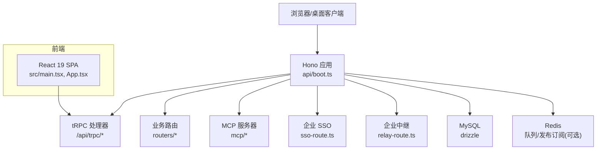
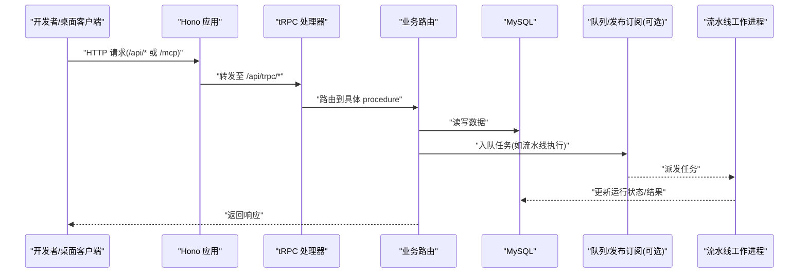
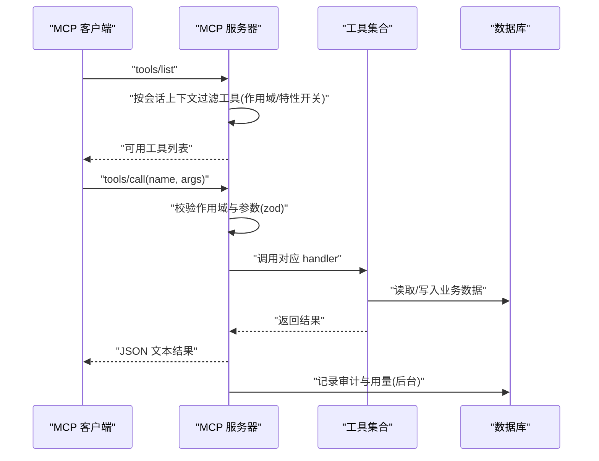
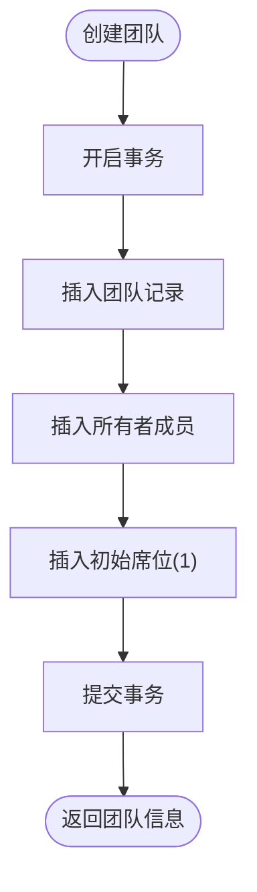
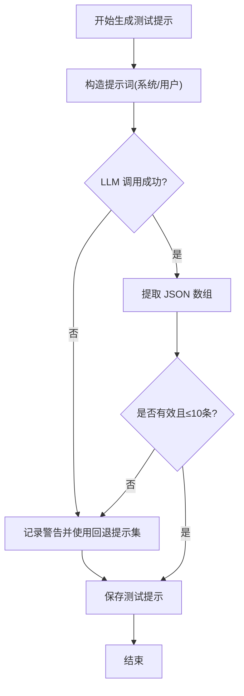
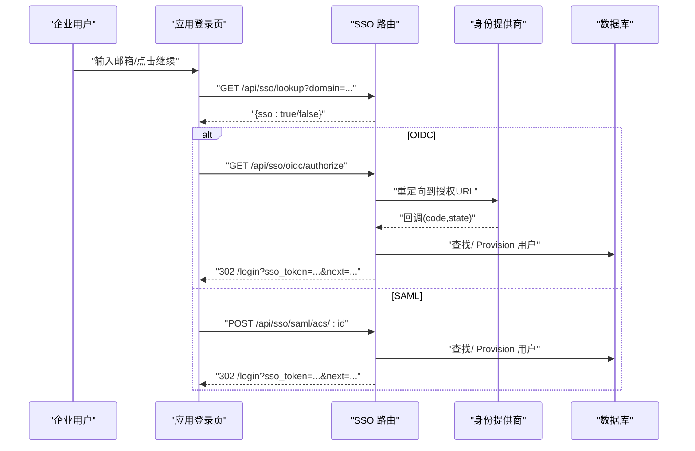
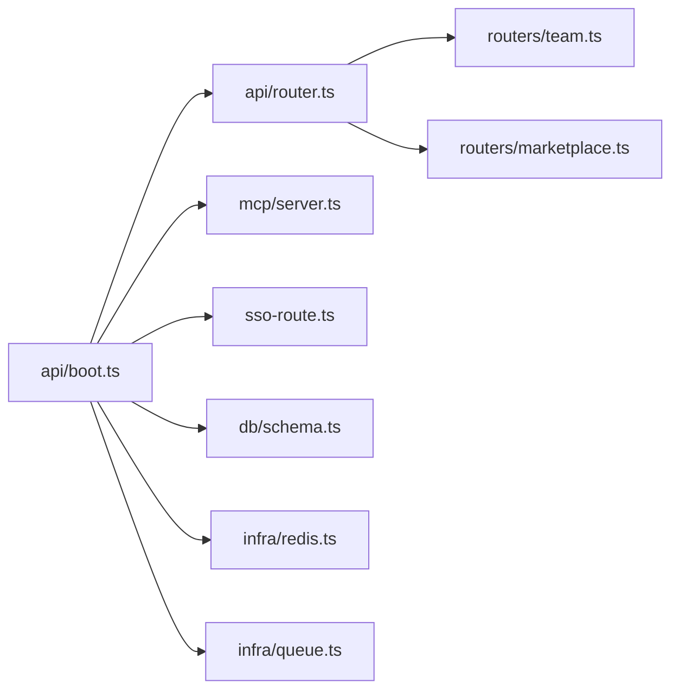

# 项目概述

<cite>
**本文引用的文件**
- [README.md](file://README.md)
- [package.json](file://package.json)
- [api/boot.ts](file://api/boot.ts)
- [api/router.ts](file://api/router.ts)
- [src/main.tsx](file://src/main.tsx)
- [src/App.tsx](file://src/App.tsx)
- [db/schema.ts](file://db/schema.ts)
- [docker-compose.yml](file://docker-compose.yml)
- [COMMERCIAL.md](file://COMMERCIAL.md)
- [ENGINEERING.md](file://ENGINEERING.md)
- [api/mcp/server.ts](file://api/mcp/server.ts)
- [api/mcp/tools/index.ts](file://api/mcp/tools/index.ts)
- [api/routers/team.ts](file://api/routers/team.ts)
- [api/routers/marketplace.ts](file://api/routers/marketplace.ts)
- [api/sso-route.ts](file://api/sso-route.ts)
- [db/migrations/013_enterprise.sql](file://db/migrations/013_enterprise.sql)
</cite>

## 目录
1. [简介](#简介)
2. [项目结构](#项目结构)
3. [核心组件](#核心组件)
4. [架构总览](#架构总览)
5. [详细组件分析](#详细组件分析)
6. [依赖关系分析](#依赖关系分析)
7. [性能考量](#性能考量)
8. [故障排查指南](#故障排查指南)
9. [结论](#结论)
10. [附录](#附录)

## 简介
DeeWaanAI 是一个多产品平台，从“流水线构建工作室”演进为面向桌面端 AI 应用的统一平台。它提供：
- 伴侣（MCP 服务器）：通过流式 HTTP + OAuth 2.1 让 Claude Desktop、ChatGPT、Qwen Code、Kimi 等桌面 LLM 应用连接并运行用户流水线；MCP 工具是版本化的公开 API 契约，只增不改。
- DeeWaanAI 市场：跨应用认证市场，包含公开认证报告、五评审打分、Stripe 购买与“一次购买，在你的应用中运行”的授权能力。
- TeamSync：混合应用团队共享内存、运行记录、交接与反馈（受 teamsync 功能开关控制）。
- 企业功能：SSO（OIDC + SAML）、仅出站的企业内网中继、签名合规导出、按客户维度的 MCP 速率限制（受 enterprise_sso / enterprise_relay 功能开关控制）。

技术栈：
- 后端：Hono + tRPC + MySQL/drizzle；可选 Redis（队列/发布订阅，无 Redis 时回退到内存实现）；Stripe 计费。
- 前端：React 19 + Vite + i18next；SPA 与 API 由同一 Node 进程在开发/生产环境提供服务。

快速开始（本地）：
- 环境要求：Node 20+，Docker（用于 MySQL 8 与 Redis 7）。
- 步骤：
  - docker compose up -d
  - cp .env.example .env 并编辑必要变量
  - npm ci
  - npm run db:push
  - npm run dev（Vite 开发服务器，API + SPA 在 http://localhost:3000）
- 生产方式：
  - npm run build 生成 dist/public 与 dist/boot.js
  - NODE_ENV=production node dist/boot.js（默认端口 3000）
- 健康检查：GET /api/health（MySQL 可达返回 200，降级返回 503）

许可证：
- 双许可：AGPL-3.0（开源自托管）与商业许可（闭源/白标/再分发等场景需购买商业许可）。

章节来源
- [README.md:1-127](file://README.md#L1-L127)
- [package.json:1-100](file://package.json#L1-L100)
- [COMMERCIAL.md:1-44](file://COMMERCIAL.md#L1-L44)

## 项目结构
整体采用前后端同进程部署：
- 后端入口 api/boot.ts 启动 Hono 应用，注册中间件、路由、tRPC、MCP、SSO、中继、健康检查、工作进程与优雅关闭。
- tRPC 路由聚合于 api/router.ts，将各业务子路由（项目、代理、流水线、市场、团队、计费、认证等）组合为 appRouter。
- 前端 src/main.tsx 初始化 React 19 根节点，挂载路由与 tRPC Provider；src/App.tsx 定义页面路由与懒加载。
- 数据层使用 drizzle schema.ts 定义表结构，配合迁移脚本管理数据库变更。
- 基础设施：Redis 可选（队列/发布订阅），BullMQ 作为队列后端；无 Redis 时使用内存回退。
- 文档与工程规范：ENGINEERING.md 提供模块地图、请求流程与扩展指南。

图表来源
- [api/boot.ts:1-200](file://api/boot.ts#L1-L200)
- [api/router.ts:1-73](file://api/router.ts#L1-L73)
- [src/main.tsx:1-21](file://src/main.tsx#L1-L21)
- [src/App.tsx:1-70](file://src/App.tsx#L1-L70)

章节来源
- [ENGINEERING.md:9-103](file://ENGINEERING.md#L9-L103)
- [api/boot.ts:1-200](file://api/boot.ts#L1-L200)
- [api/router.ts:1-73](file://api/router.ts#L1-L73)
- [src/main.tsx:1-21](file://src/main.tsx#L1-L21)
- [src/App.tsx:1-70](file://src/App.tsx#L1-L70)

## 核心组件
- Hono 应用与健康/就绪探针：
  - 设置请求 ID、安全头、请求体大小限制。
  - /api/health 探测 MySQL 连通性；/api/ready 同时探测 Redis（若启用）。
  - 启动流水线工作进程（可独立 worker 进程模式）。
- tRPC 路由聚合：
  - 将 auth、project、agent、pipeline、marketplace、team、billing、certification 等子路由组合为 appRouter。
- MCP 服务器：
  - 每个会话创建独立 McpServer，按权限与作用域注册工具，支持特性开关隐藏工具。
  - 工具清单集中注册于 tools/index.ts，涵盖流水线、市场、团队、批处理、可移植性等。
- 团队功能：
  - 团队创建、邀请加入、成员列表、席位与计费同步（Phase 2）。
- 市场功能：
  - 商品浏览、测试提示生成、安全扫描、AI 辅助评审、Stripe 购买与授权发放。
- 企业功能：
  - SSO（OIDC/SAML）路由注册，受 enterprise_sso 开关控制；企业中继路由受 enterprise_relay 开关控制。
- 数据模型：
  - users、llm_providers、projects、agents、swarm_runs 等核心表定义于 db/schema.ts。

章节来源
- [api/boot.ts:35-195](file://api/boot.ts#L35-L195)
- [api/router.ts:1-73](file://api/router.ts#L1-L73)
- [api/mcp/server.ts:1-209](file://api/mcp/server.ts#L1-L209)
- [api/mcp/tools/index.ts:1-95](file://api/mcp/tools/index.ts#L1-L95)
- [api/routers/team.ts:1-200](file://api/routers/team.ts#L1-L200)
- [api/routers/marketplace.ts:1-200](file://api/routers/marketplace.ts#L1-L200)
- [api/sso-route.ts:21-290](file://api/sso-route.ts#L21-L290)
- [db/schema.ts:1-200](file://db/schema.ts#L1-L200)

## 架构总览
系统以单 Node 进程承载 API、MCP 表面与静态 SPA 服务，结合 MySQL 持久化与可选 Redis 异步能力。前端通过 tRPC 调用后端能力，MCP 客户端通过流式 HTTP/OAuth 接入。

图表来源
- [api/boot.ts:361-373](file://api/boot.ts#L361-L373)
- [api/router.ts:1-73](file://api/router.ts#L1-L73)
- [db/schema.ts:1-200](file://db/schema.ts#L1-L200)

章节来源
- [api/boot.ts:1-200](file://api/boot.ts#L1-L200)
- [api/router.ts:1-73](file://api/router.ts#L1-L73)

## 详细组件分析

### MCP 服务器（伴侣）
- 设计要点：
  - 每个会话构建独立 McpServer，按作用域与特性开关注册工具。
  - 工具输入通过 zod 校验，错误以标准 JSON-RPC 错误返回。
  - 每次调用记录审计日志与月度用量计数（fire-and-forget，不影响主流程）。
- 工具注册：
  - 所有工具集中在 tools/index.ts 中声明，便于统一管理与扩展。
- 典型调用序列：
  - 客户端发起 tools/list → 服务端根据当前会话上下文返回可用工具。
  - 客户端调用 tools/call → 服务端校验作用域→执行 handler→返回结果并记录审计。

图表来源
- [api/mcp/server.ts:1-209](file://api/mcp/server.ts#L1-L209)
- [api/mcp/tools/index.ts:1-95](file://api/mcp/tools/index.ts#L1-L95)

章节来源
- [api/mcp/server.ts:1-209](file://api/mcp/server.ts#L1-L209)
- [api/mcp/tools/index.ts:1-95](file://api/mcp/tools/index.ts#L1-L95)

### 团队功能（TeamSync）
- 能力概览：
  - 创建团队、邀请加入、列出成员、获取团队详情。
  - 席位数量与 Stripe 计费同步（Phase 2）。
- 关键流程：
  - 创建团队：原子事务插入团队、所有者成员、初始席位。
  - 加入团队：校验邀请码、避免重复加入、触发席位计费同步。

图表来源
- [api/routers/team.ts:25-67](file://api/routers/team.ts#L25-L67)

章节来源
- [api/routers/team.ts:1-200](file://api/routers/team.ts#L1-L200)

### 市场功能（Marketplace）
- 能力概览：
  - 商品浏览（公共缓存友好）、测试提示自动生成（LLM 驱动，带超时与重试）、安全扫描、AI 辅助评审、Stripe 购买与授权发放。
- 关键流程：
  - 生成测试提示：构造系统/用户提示，调用适配器 chat，解析 JSON 输出，失败回退到通用提示集。
  - 重试策略：对非配额类错误指数退避重试；配额/余额不足立即报错不重试。

图表来源
- [api/routers/marketplace.ts:55-122](file://api/routers/marketplace.ts#L55-L122)
- [api/routers/marketplace.ts:162-199](file://api/routers/marketplace.ts#L162-L199)

章节来源
- [api/routers/marketplace.ts:1-200](file://api/routers/marketplace.ts#L1-L200)

### 企业功能（SSO 与中继）
- SSO：
  - 支持 OIDC 与 SAML，路由注册受 enterprise_sso 开关控制（关闭时返回 404）。
  - 查找连接、构建授权 URL、交换代码、验证 SAML 响应、签发本地令牌并重定向登录。
- 中继：
  - 仅出站连接器桥接，受 enterprise_relay 开关控制。
- 数据库：
  - sso_connections、relay_registrations、relay_requests 等表用于存储连接与会话。

图表来源
- [api/sso-route.ts:21-290](file://api/sso-route.ts#L21-L290)
- [db/migrations/013_enterprise.sql:1-23](file://db/migrations/013_enterprise.sql#L1-L23)

章节来源
- [api/sso-route.ts:21-290](file://api/sso-route.ts#L21-L290)
- [db/migrations/013_enterprise.sql:1-23](file://db/migrations/013_enterprise.sql#L1-L23)

## 依赖关系分析
- 运行时依赖：
  - Hono、@trpc/server、drizzle-orm、mysql2、ioredis、bullmq、stripe、react、vite、i18next 等。
- 模块耦合：
  - boot.ts 聚合所有路由与基础设施；router.ts 聚合 tRPC 子路由；mcp/server.ts 消费工具集合；services 层解耦领域逻辑。
- 外部集成点：
  - Stripe（计费）、Redis（队列/发布订阅）、MySQL（持久化）、Sentry（可选观测）、第三方 LLM 提供商（通过适配器）。

图表来源
- [api/boot.ts:1-200](file://api/boot.ts#L1-L200)
- [api/router.ts:1-73](file://api/router.ts#L1-L73)
- [api/mcp/server.ts:1-209](file://api/mcp/server.ts#L1-L209)
- [api/sso-route.ts:21-290](file://api/sso-route.ts#L21-L290)
- [db/schema.ts:1-200](file://db/schema.ts#L1-L200)

章节来源
- [package.json:23-73](file://package.json#L23-L73)
- [api/boot.ts:1-200](file://api/boot.ts#L1-L200)

## 性能考量
- 健康/就绪探针：
  - /api/health 检测 MySQL；/api/ready 额外检测 Redis（若启用），供负载均衡器/编排器使用。
- 队列与工作进程：
  - 长耗时流水线执行通过队列与 worker 进程异步处理，避免阻塞 HTTP 请求。
  - 支持 START_WORKER=false 分离 Web 与 Worker 进程。
- 缓存与限流：
  - 市场浏览使用短 TTL 缓存；全局 rate limiter 支持令牌桶与固定窗口。
- 资源限制：
  - 请求体大小限制（50MB）；PM2 配置堆上限与自动重启；Docker 健康检查。
- 可观测性：
  - Sentry 上报（可选）；结构化日志；MCP 调用审计与用量统计。

章节来源
- [api/boot.ts:61-135](file://api/boot.ts#L61-L135)
- [api/boot.ts:197-359](file://api/boot.ts#L197-L359)
- [README.md:89-104](file://README.md#L89-L104)

## 故障排查指南
- 启动失败：
  - 检查环境变量（APP_ID、APP_SECRET、DATABASE_URL、REDIS_URL、STRIPE_* 等）。
  - 确认 MySQL/Redis 容器已启动并可访问。
- 健康检查异常：
  - GET /api/health 返回 503：MySQL 不可达或降级；检查数据库连接与网络。
  - GET /api/ready 返回 503：Redis 未连接（若启用）；检查 REDIS_URL 与网络。
- 工作进程问题：
  - 检查 START_WORKER 环境变量；查看队列后端与 worker 状态。
  - 启动时会修复“卡住”的运行记录（running/pending）并重新入队。
- 企业功能不可用：
  - 确认 enterprise_sso / enterprise_relay 功能开关已启用；SSO 路由在未启用时返回 404。
- 市场购买失败：
  - 检查 STRIPE_SECRET_KEY 与 STRIPE_WEBHOOK_SECRET；确认价格 ID 配置正确。

章节来源
- [README.md:41-69](file://README.md#L41-L69)
- [api/boot.ts:73-135](file://api/boot.ts#L73-L135)
- [api/boot.ts:197-359](file://api/boot.ts#L197-L359)
- [api/sso-route.ts:21-290](file://api/sso-route.ts#L21-L290)

## 结论
DeeWaanAI 以 Hono + tRPC 为核心，结合 React 19 SPA、MySQL/drizzle 与可选 Redis，提供统一的 MCP 伴侣、市场生态、团队协作与企业级能力。其模块化设计与健壮的基础设施（健康检查、队列、审计、限流、缓存）使其既能满足个人开发者快速上手，也能支撑企业规模化部署。双许可策略兼顾开源社区与商业需求。

## 附录
- 快速开始与环境变量：参考 README 中的 Quickstart 与环境变量表格。
- 部署：Railway、Docker、PM2、阿里云优化方案与仅出站中继。
- 工程文档：ENGINEERING.md 提供模块地图、请求流程与扩展指南（添加语言/MCP 工具/计费计划/LLM 提供商/功能开关/迁移）。

章节来源
- [README.md:20-104](file://README.md#L20-L104)
- [ENGINEERING.md:9-103](file://ENGINEERING.md#L9-L103)